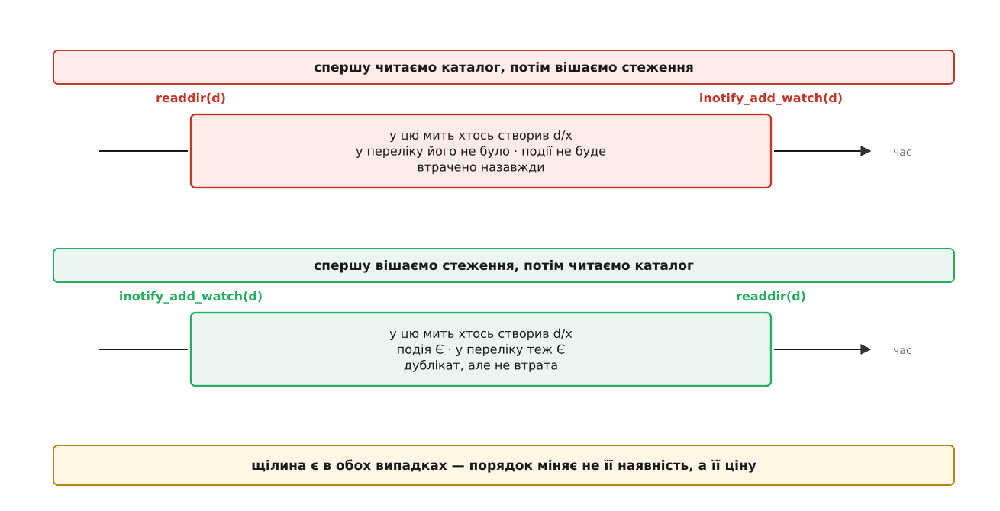
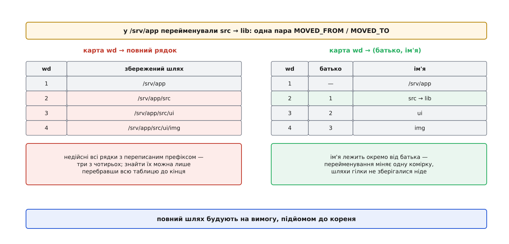

# ⚙️ Спостерігач за деревом каталогів

Робоча програма мовою C, яка отримує шлях і друкує потік змін усередині цілого піддерева — з правильними повними шляхами й без мовчазних пропусків. Уся суть задачі — у системних викликах і в розкладці структур, які вони віддають, тож і працюємо на тому рівні, де ці структури видно.

Інтерфейс inotify виглядає як три виклики, тож перша реалізація зазвичай має тридцять рядків і працює на демонстрації. Ламається вона не від навантаження, а від звичайних дій: `mv` каталогу в середині дерева, `npm install`, `git checkout` між гілками. Причина в тому, що працездатний спостерігач — це не обгортка над `read()`, а чотири окремі механізми: обхід із правильним порядком двох викликів, карта `wd` → шлях, що переживає перейменування, склеювання половинок переїзду за `cookie` і повне відновлення після втрати картини. Кожен існує через власну вузьку причину, і жоден не виводиться з інтерфейсу — його треба вивести із задачі.

## Що саме має вміти програма

Без записаного контракту неможливо сказати, коли реалізація правильна, а коли просто не спіймана на брехні. Програма друкує рядки:

```
RESYNC              — усе, що ви знали, недійсне; далі йде повний перелік
= <шлях>            — існує (побачено обходом)
+ <шлях>            — з'явилося
- <шлях>            — зникло
w <шлях>            — закрито після запису
> <старий> <новий>  — перейменовано
READY <n>           — обхід закінчено, далі самі події
```

Дві вимоги до цього потоку. Перша: **жодна зміна не зникає мовчки** — якщо спостерігач утратив картину, він каже про це `RESYNC`, а не вдає, що все гаразд. Друга: **дублікати дозволені**. Друга вимога виглядає як поступка якості, а насправді вона й тримає першу: повнота й неповторність у цій задачі несумісні, і вибирати доводиться повноту.

## Порядок обходу: щілину не прибрати, її можна лише переоцінити

Стеження прив'язане до одного inode, тож на дерево з тисячі каталогів треба тисячу окремих стежень, і розставляє їх обхід. Обхід кожного каталогу складається з двох дій: поставити стеження й прочитати вміст. Між ними минає час, і за цей час хтось інший може створити файл. Порядок цих двох дій вирішує все.

Якщо спершу прочитати вміст, а потім поставити стеження, то файл, створений у проміжку, не потрапив у перелік (його ще не було) і не дасть події (стеження ще не стояло). Він для програми не існує — і не існуватиме, доки хтось не зробить повний обхід наново. Це втрата без сліду.

Якщо спершу поставити стеження, а потім прочитати вміст, той самий файл дасть подію (стеження вже стоїть), а ще може потрапити в перелік (якщо `readdir` дійде до нього пізніше). Тобто про нього стане відомо один раз або двічі — але **не нуль разів**.



*Порядок не прибирає щілини — він міняє її наслідок з утрати на дублікат.*

Ось звідки друга вимога контракту. Дублікати — не недогляд реалізації, а **ціна повноти**: щілина між двома незалежними системними викликами не закривається жодним порядком, і єдиний вибір — чим за неї платити. Практичний наслідок для того, хто споживає потік: кожен обробник має бути ідемпотентним. Складальник, який перезбирає файл за шляхом, ідемпотентний природно; лічильник змін — ні, і його на цьому потоці будувати не можна.

Той самий порядок діє й пізніше, не лише на старті. Прийшла подія `IN_CREATE` з бітом `IN_ISDIR` — усередині нового каталогу вже могли щось створити, доки подія лежала в черзі. Тому щойно доглянутий каталог **перечитують завжди**, навіть якщо він щойно народився порожнім.

Ціле піддерево, утім, двічі не обходиться, і розпізнавач для цього дає саме ядро: якщо той самий inode уже під наглядом, `inotify_add_watch()` не заводить нового стеження, а повертає **той самий `wd`**, що й перше. Тобто перевірка «чи є вже такий `wd` у моїй карті» надійно ловить повторний захід у ту саму гілку — і повторне перечитування, і другий запис у карті відпадають самі.

## Від `wd` до шляху

У події немає шляху. Є `wd` того каталогу, у якому щось сталося, і `name` — ім'я запису всередині нього. Щоб надрукувати `/srv/app/src/ui/main.c`, програма мусить сама тримати відображення `wd` → каталог.

Ключ — маленьке додатне число, але не щільне: ядро роздає `wd` через `idr` і **перевикористовує звільнені номери**. Масив за індексом `wd` тому не годиться (дірки й повторне заселення), а лінійний пошук по тисячах записів на кожну подію з'їв би весь виграш від сповіщень. Природний вибір — [хеш-таблиця](root:sf-algorithms/hash-table) з ланцюжками: сталий час на пошук, ключ — саме число `wd`.

Лишається питання, **що** класти в комірку. Очевидний варіант — повний рядок шляху. Він і ламається першим.

`mv src lib` у корені проєкту — це одна пара подій. Але каталог `src` міг мати сотні нащадків, і кожен з них зберігає рядок, що починається з `/srv/app/src/…`. Усі ці рядки миттєво стали брехнею. Полагодити їх можна лише перебравши **всю** таблицю в пошуках префікса, з хірургією над кожним знайденим рядком. Одна дешева операція користувача коштує обходу всіх стежень — а на дереві з `node_modules` це десятки тисяч.

Правильна комірка зберігає не шлях, а **ланку**: `wd` батька плюс власне ім'я в цьому батькові. Тоді повний шлях узагалі ніде не лежить — його будують на вимогу, підіймаючись до кореня й склеюючи імена у зворотному порядку.



*Перейменування каталогу в середині дерева міняє один запис — шляхи цілої гілки стають правильними самі, бо їх ніде не зберігали.*

Заплатили за це підйомом до кореня на кожну подію — це рівно глибина дерева, тобто одиниці чи десятки кроків, кожен зі сталим часом. За можливість не переписувати десятки тисяч рядків на кожен `mv` — угода очевидна.

Ланка на батька дає й другу зручність задарма. Якщо в комірці тримати ще й список дітей, то за парою «`wd` батька + ім'я» знаходиться вузол самого підкаталогу (перебором дітей одного каталогу, а не всієї таблиці), а обхід цього списку вглиб дає все піддерево — саме те, що треба, коли гілку виносять за межі дерева й з неї треба знімати стеження.

## Склеювання пари за `cookie`

`rename()` у ядрі перетворюється на дві події: `IN_MOVED_FROM` у старому каталозі й `IN_MOVED_TO` у новому. Обидві несуть однакове ненульове число в полі `cookie` — це єдине, що їх пов'язує.

Половинка без пари — не помилка, а звичайна річ: об'єкт міг переїхати з-під нагляду назовні (буде тільки `MOVED_FROM`) або ззовні під нагляд (буде тільки `MOVED_TO`). Тому чекати пару вічно не можна: непарний `MOVED_FROM` треба через якийсь час визнати видаленням, а непарний `MOVED_TO` — появою.

Скільки чекати? Обидві половинки народжуються всередині одного `rename()`, тож нормально вони лежать у черзі поруч і склеюються в одному батчі. Затримка потрібна лише на випадок, коли читання розсікло чергу між ними. Сотні мілісекунд вистачає з великим запасом; це і є затримка, з якою програма повідомляє про переїзд за межі дерева. Відлічувати її треба [монотонним годинником](root:sf-apps/monotonic-vs-wall-time) — настінний час стрибає від NTP, і на стрибку назад половинки зависли б назавжди.

## Один цикл на всі джерела

Дескриптор групи inotify читається звичайним `read()`, тому його кладуть в [epoll](root:sys-unix/select-poll-epoll) поряд із рештою: сокетом керування, `signalfd`, `timerfd`. Ніякого окремого потоку для стеження не потрібно.

Дві дрібниці, на яких спотикаються. Перша: буфер для `read()` мусить умістити щонайменше один запис максимальної довжини — інакше з ядра 2.6.21 виклик повертає `EINVAL`, а не короткий запис. Мінімум — `sizeof(struct inotify_event) + NAME_MAX + 1`; на практиці беруть десятки кілобайтів, щоб забирати події пачками. Друга: буфер має бути вирівняний під `struct inotify_event`, бо по ньому йдуть арифметикою вказівника — записи змінної довжини лежать упритул. І, звісно, `read()` [переривається сигналом](root:sys-unix/eintr-and-restart), тож `EINTR` треба перезапускати.

Тайм-аут `epoll_wait()` рахують від найближчого дедлайну незакритої половинки переїзду: поки нема чого чекати — блокуємось без обмеження, є половинка — прокидаємось рівно тоді, коли її час вийшов.

## Код

Далі — програма цілком, розбита на частини в порядку складання. Збірка: `cc -O2 -Wall -Wextra -o watchtree watchtree.c`.

**Каркас, маска подій і вузол карти.**

:::tabs
:::code proj-watch-tree/c/kod.c
:::code proj-watch-tree/cpp/kod.cpp
:::

**Карта `wd` → вузол і побудова шляху.** Хешування — множення на просте число з подальшим узяттям старших бітів: молодші біти `wd` майже послідовні, і брати їх напряму означало б заселяти кошики підряд.

:::tabs
:::code proj-watch-tree/c/kod-2.c
:::code proj-watch-tree/cpp/kod-2.cpp
:::

**Обхід.** Стеження — першою дією, читання вмісту — другою; звіт про кожен знайдений запис іде маркером `=`, бо це стан, а не подія.

:::tabs
:::code proj-watch-tree/c/kod-3.c
:::code proj-watch-tree/cpp/kod-3.cpp
:::

**Знімання гілки й забування.** Різниця між двома операціями принципова: коли ядро само зняло стеження (`IN_IGNORED`), кликати `inotify_rm_watch()` уже нема на що, а коли гілку винесли за межі дерева — стеження живі й ядро їх не зніме, поки ми не попросимо.

:::tabs
:::code proj-watch-tree/c/kod-4.c
:::code proj-watch-tree/cpp/kod-4.cpp
:::

**Відкладені обходи.** Нові стеження ставлять **тільки** після того, як черга спорожніла. Причина вузька, але справжня: `inotify_rm_watch()` одразу звільняє номер, а породжений ним `IN_IGNORED` ще лежить у черзі — постав нове стеження просто зараз, і воно може отримати той самий `wd`, після чого чужий `IN_IGNORED` знищить свіжий запис. Дренаж черги до кінця прибирає цю гонитву цілком.

:::tabs
:::code proj-watch-tree/c/kod-5.c
:::code proj-watch-tree/cpp/kod-5.cpp
:::

**Половинки переїзду.**

:::tabs
:::code proj-watch-tree/c/kod-6.c
:::code proj-watch-tree/cpp/kod-6.cpp
:::

**Розбір подій і дренаж черги.**

:::tabs
:::code proj-watch-tree/c/kod-7.c
:::code proj-watch-tree/cpp/kod-7.cpp
:::

**Старт групи, перебудова й головний цикл.**

:::tabs
:::code proj-watch-tree/c/kod-8.c
:::code proj-watch-tree/cpp/kod-8.cpp
:::

## Переповнення: єдина правильна реакція — забути все

Черга групи скінченна (типово 16384 події). Коли вона повна, ядро кладе туди `IN_Q_OVERFLOW` із `wd = -1` і відкидає решту. Спокуса опрацювати цю подію «якось м'якше» велика й хибна: після переповнення невідомо, **що саме** загубилося, а отже недійсна вся картина, а не якась її частина. Локального ремонту не існує.

Тому в коді `IN_Q_OVERFLOW` робить рівно одне — вмикає `c->rebuild`, і головний цикл викликає `start_group()`: закрити дескриптор (з ним гинуть усі стеження), очистити карту, відкрити нову групу, обійти дерево наново. Споживач бачить новий `RESYNC` і знає, що його попередню картину треба викинути.

Той самий шлях умикається ще у двох випадках: переїхав сам корінь (`IN_MOVE_SELF` на кореневому вузлі — усі побудовані шляхи стали брехнею) і переповнилися внутрішні черги програми. Один механізм відновлення на всі втрати картини — це не лінощі, а те, що робить програму придатною для великих дерев: інакше кожен новий різновид втрати вимагав би власного, майже ніколи не випробуваного коду.

## `IN_IGNORED` і `ENOSPC`: два повідомлення, які не можна проковтнути

`IN_IGNORED` означає, що стеження більше нема — ядро зняло його само, бо об'єкт видалили, розмонтували або файлову систему від'єднали. Це остання подія цього `wd`, і після неї номер вільний для перевикористання. Запис із карти прибирають саме тут, і ніде більше; спроба прибирати його «завчасно» на `IN_DELETE_SELF` дає порожні комірки й загублені події.

`ENOSPC` від `inotify_add_watch()` — це вичерпаний `max_user_watches`, а не місце на диску. Найгірше, що з ним можна зробити, — проігнорувати повернене `-1` і поїхати далі: програма тоді працює, але покриває обрізане дерево й мовчить про зміни в решті. Тому в коді це смертельна помилка з повідомленням, у якому є все потрібне: скільки стежень уже поставлено, яка чинна межа, де вона лежить і чим її піднімають. Межа — [звичайний параметр ядра](root:sys-unix/sysctl-tunables), її [видно у /proc](root:sys-unix/proc-reading-process-and-kernel-state) і крутять `sysctl`.

## Скільки це коштує: дерево з `node_modules`

Тепер порахуймо ціну покриття — і в стеженнях, і в пам'яті ядра.

Кожне стеження — це структура `inotify_inode_mark` у [slab-кеші ядра](root:sys-unix/kernel-memory-slab), спільний на inode `fsnotify_mark_connector`, запис у `idr` і — найдорожче — **утриманий у пам'яті inode**: доки стеження живе, ядро не має права викинути inode з кешу. На ext4 inode загорнутий у більшу структуру `ext4_inode_info`, і саме її розмір визначає ціну.

Ядро рахує ліміт за власною формулою, і її видно в `fs/notify/inotify/inotify_user.c`:

```
INOTIFY_WATCH_COST = sizeof(struct inotify_inode_mark) + 2 · sizeof(struct inode)

на x86-64 з типовою конфігурацією:
  sizeof(struct inotify_inode_mark)  ≈   80 Б   (fsnotify_mark ≈ 72 Б + int wd)
  sizeof(struct inode)               ≈  632 Б
  INOTIFY_WATCH_COST                 ≈ 1344 Б ≈ 1.3 КіБ
```

Подвоєний розмір inode тут — не те, що inotify виділяє, а груба оцінка того, що стеження **не дає звільнити**. Звідси й межа: ядро дозволяє одному користувачеві зайняти під стеження не більше 1 % адресованої пам'яті, затиснувши результат у діапазон [8192, 1048576].

**Умова: проєкт із `node_modules`, 12 000 каталогів; машина з 16 ГіБ пам'яті, корінь на ext4.**

```
каталогів у дереві     = 12000        (find . -type d | wc -l)
стежень                = 12000        (одне на каталог, рекурсії ядро не вміє)

пам'ять на одне стеження:
  inotify_inode_mark            ≈   80 Б
  fsnotify_mark_connector       ≈   32 Б
  запис у idr (амортизовано)    ≈    9 Б
  утриманий inode ext4          ≈ 1100 Б
  ─────────────────────────────────────
  разом                         ≈ 1.2 КіБ

пам'ять ядра на дерево = 12000 · 1.2 КіБ ≈ 14 МіБ   (не витісняється у своп)
списано з ліміту       = 12000 · 1.3 КіБ ≈ 15 МіБ
чинна межа             = (16 ГіБ / 100) / 1344 Б   ≈ 127 800 стежень
межа до ядра 5.11      = 8192 → ENOSPC на 8193-му каталозі
```

Два висновки, і обидва практичні. Перший: на сучасній машині дерево з `node_modules` покривається з десятикратним запасом, а знаменита притча про `ENOSPC` у редакторах — спадок сталої стелі у 8192, яку в ядрі 5.11 (лютий 2021) замінили на частку від пам'яті. Стеля, утім, не зникла: формула бере пам'ять **машини** й рахує її раз, під час завантаження, тож на віртуалці чи вбудованому пристрої з 1 ГіБ вона дає підлогу 8192 — і 2005 рік повертається цілком. Обмеження пам'яті контейнера на це число не впливає взагалі: ядро й межа в нього спільні з хостом.

Другий висновок неприємніший: 14 МіБ — це **пам'ять ядра**, яку не можна ні витіснити у своп, ні відібрати під тиском. Вона змагається за місце зі сторінковим кешем. Десяток інструментів, кожен зі своїм деревом, — і десятки таких мегабайтів осідають назавжди.

Поміряти замість вірити на слово — чотири команди:

:::code proj-watch-tree/sh/main.sh

## Складність і пастки

**Складність.** Пам'ять і кількість стежень — лінійні від числа каталогів, `O(D)`. Обробка однієї події — сталий пошук у хеш-таблиці плюс побудова шляху за глибиною дерева, `O(глибина)`. Перейменування каталогу — `O(1)` незалежно від розміру гілки. Повний обхід — `O(D)` викликів `inotify_add_watch` і `readdir`; на дереві з 12 000 каталогів це частки секунди на теплому кеші й помітно довше на холодному.

**Пастки, кожна з яких колись коштувала комусь вечора.**

- **Один inode — один `wd`, скільки б імен на нього не вело.** Каталог, [примонтований через bind у двох місцях](root:sys-unix/mount-model) усередині дерева, дасть той самий `wd`, і в карті лишиться лише один зі шляхів. Події для другого шляху приходитимуть із першим — тихо й неправильно. Ознака в коді — `map_get(wd)` знайшов запис із іншим батьком; чесна реакція — попередити.
- **Межу дерева тримають два прапорці, а не один.** [Символьне посилання](root:sys-unix/hard-and-symbolic-links) на каталог поза деревом ловиться лише парою: `AT_SYMLINK_NOFOLLOW` не дає обхідникові в нього спуститися, `IN_DONT_FOLLOW` не дає `inotify_add_watch()` розкрити посилання, якщо шлях усе ж дійшов до нього. Без них спостерігач тихо виходить за свої межі, а на циклі посилань — зациклюється.
- **`d_type` буває `DT_UNKNOWN`.** Не всі файлові системи заповнюють це поле в `readdir()`. Код, який вірить лише `d_type == DT_DIR`, на такій ФС не спуститься нікуди й покриє один каталог. Запасний шлях — `fstatat()` [від дескриптора каталогу](root:sys-unix/at-family-syscalls), а не `stat()` за склеєним шляхом: другий варіант ще й гониться з перейменуваннями.
- **`ENOENT` під час обходу — норма, а не помилка.** Каталог могли видалити, доки ми до нього йшли; це звичайна робота файлової системи. Друкувати тут попередження означає засипати журнал шумом на кожному `git checkout`.
- **Кількість подій ≠ кількість операцій.** Однакові поспіль події (той самий `wd`, маска, `cookie`, ім'я) ядро зливає в одну, якщо читач не встиг забрати попередню. Будувати на потоці лічильники не можна — лише стан.
- **`IN_MODIFY` — не «файл готовий».** Один запис у кілька системних викликів дасть кілька подій, і читання після кожної половину разів дає недописаний вміст. Межа записаного, яку ядро вміє назвати, — `IN_CLOSE_WRITE`, і саме вона стоїть у масці.
- **`read()` у малий буфер повертає `EINVAL`.** Не короткий запис, не нуль — помилку, і то з ядра 2.6.21. Мінімум — `sizeof(struct inotify_event) + NAME_MAX + 1`.
- **Вирівнювання буфера обов'язкове.** Записи лежать упритул, і по них ходять арифметикою вказівника; невирівняний масив `char` — невизначена поведінка, яка на x86 «працює», а на інших архітектурах ні.
- **Стеження за файлом, а не за каталогом, гине від першого ж збереження.** Обережні редактори пишуть у тимчасовий файл і роблять `rename()` поверх — ім'я веде на новий inode, стеження лишається на старому. Тому в цій програмі стеження ставлять **лише** на каталоги, а про файли дізнаються з подій їхнього каталогу.
