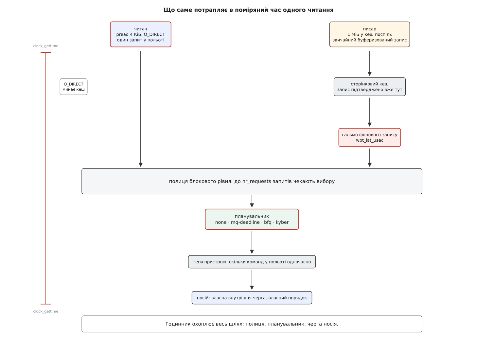

# ⚙️ Стенд: поміряти планувальник власним годинником

Це готова програма на C, яка під фоновою заливкою запису міряє час кожного дрібного читання з носія й видає p50, p99 і p99.9 — саме ті числа, на яких видно, що перемикання планувальника дає на твоєму пристрої, а чого не дає.

## Чому середнє нічого не покаже

Спокуса поміряти «швидкість» одним числом велика й хибна. Планувальник не робить окреме звертання швидшим: він вирішує, чиє звертання піде першим. Тому половина читань, які й так не чекали, лишиться на місці, а зрушиться те, що стояло в кінці, — верхні кілька відсотків розподілу. Середнє змішує обидві частини в одну кашу й показує невелику різницю там, де в хвості вона кратна.

Тому міряємо не середнє, а **перцентилі**: значення, нижче за яке лежить задана частка вимірів. p99.9 — це поріг, який перевищує одне читання з тисячі. Саме воно й псує враження від системи, бо секунда затримки раз на тисячу звертань помітна, а десять зайвих мікросекунд у середньому — ні. Що ця величина означає формально й чому хвіст розподілу не відновлюється з середнього й розкиду, розібрано в [перцентилях і хвостах](root:math-probability/percentiles-quantiles) — для замірів досить того, що це просто відсортований масив і взятий із нього елемент за номером.

Стенд складається з двох ролей. **Писар** заливає носій — пише великими шматками поспіль, як робить копіювання файлу. **Читач** — жертва: дрібні читання по випадкових зміщеннях, по одному за раз, і час кожного під годинником.

Одна деталь у ролі читача не декоративна: **один запит у польоті**. Якщо читач подасть тридцять два одразу, поміряне число перетвориться на пропускну здатність черги й перестане відповідати на питання «скільки чекає одне маленьке читання». А відповідає на нього саме планувальник.



*Читач іде повз кеш, писар — крізь кеш і крізь гальмо фонового запису; поміряний час містить усе, що нижче.*

Звідси два рішення, і вони навмисно різні. Читач відкриває файл із `O_DIRECT` — інакше сторінковий кеш віддасть дані з пам'яті й ми поміряємо швидкість пам'яті, а не носія; за це доводиться платити вирівнюванням буфера й зміщень, і саме тому в коді є `posix_memalign` (див. [буферизований і прямий ввід-вивід](root:sys-unix/buffered-and-direct-io)). Писар, навпаки, пише **звичайним буферизованим записом**: механізм, який тут перевіряють, керує фоновим скиданням кешу на носій, а прямий запис проходить повз нього — і сценарій «копіюю файл, система затинається» зникає разом із ним.

Годинник — `CLOCK_MONOTONIC`: він не стрибає від переведення системного часу й читається без входу в ядро, тож коштує кількадесят наносекунд проти сотень мікросекунд виміру ([час у ядрі](root:sys-unix/kernel-timekeeping)).

## Програма

:::tabs
:::code proj-measure-schedulers/c/iolat.c
:::code proj-measure-schedulers/cpp/iolat.cpp
:::

Три місця тут неочевидні. Вирівнювання не вгадують, а питають: `statx` із прапорцем `STATX_DIOALIGN` (Linux 6.1 і новіші) повертає окремо вимогу до адреси буфера й окремо до зміщення у файлі — на носіях із секторами 4096 байтів звичне припущення про 512 просто не спрацює, і `pread` поверне `EINVAL`. Перцентиль беруть за **найближчим рангом**: масив відсортовано, індекс — стеля від частки, жодної інтерполяції; для мільйона вимірів різниця між способами менша за шум, а помилитися ніде. І перші дві секунди відкидають: поки писар не розігнався, читач міряє порожній носій.

## Перемикач і прогін

Ручка стоїть на **цілому пристрої**, а не на розділі, і працює на ходу.

:::code proj-measure-schedulers/sh/main.sh

Скрипт вимагає прав адміністратора (запис у `/sys` і в `/proc/sys`) і місця під файли — вісім гігабайтів на читання плюс чотири на заливку. Окремого `modprobe` не треба: запис назви в `scheduler` сам підвантажує потрібний модуль, а якщо його в системі нема — повертає помилку, і рядок пропускається.

Останній стовпчик — те, скільки мебібайтів за секунду носій **справді** проковтнув: сьоме поле `/sys/block/<пристрій>/stat` рахує записані сектори по 512 байтів завжди, незалежно від розміру сектора носія. Передостанній рахує інше — байти, прийняті в пам'ять, а не доїхані до заліза ([кеш сторінок і довговічність запису](root:sys-unix/page-cache-durability)). На довгому прогоні числа зближуються, бо ядро притримує писаря, коли брудних сторінок стає забагато; на короткому вони розходяться в рази, і саме передостанній стовпчик спокушає повірити, що носій узяв удвічі більше, ніж насправді.

## Як читається таблиця

Числа нижче — приклад форми відповіді, а не норматив; на твоєму залізі будуть свої.

```
планувальник      p50      p99    p99.9      max  читань/с  прийн.  носій
none              112      340     9800    41000      6900     468    455
mq-deadline       119      395     2100     8700      6300     461    448
bfq               148      520     1400     5200      4100     342    331
kyber             121      360     1750     6900      6700     466    452
```

Читають її **стовпчиками, а не рядками**. p50 між `none`, `mq-deadline` і `kyber` майже не рухається — і не мусить: планувальник не прискорює окреме звертання; помітний приріст лише в `bfq`, і це плата за навмисне чекання без діла. Уся дія в p99.9: різниця між першим і другим рядком у кілька разів — це і є ціна відсутності стелі на очікування. Останні два стовпчики кажуть, чим за це заплачено: рядок із найкращим хвостом має найгіршу пропускну здатність, і якщо вона впала на чверть, то «відгукливіше» коштувало чверті смуги.

Найважливіший результат — коли всі чотири рядки однакові. Це не «планувальники не працюють», а «замір нічого не міряє», і далі йде перелік причин.

> 🔧 **Навіщо це.** Пораду «постав bfq, буде відгукливіше» перевіряє рівно один прогін цього стенда, і після нього розмова йде не про віру, а про два числа: наскільки впав p99.9 і наскільки за це впала пропускна здатність. На одному носії обмін вигідний, на сусідньому — ні, і жодна загальна порада цього не знає.

Сам стенд у поміряне майже не втручається. `clock_gettime(CLOCK_MONOTONIC)` виконується без входу в ядро й коштує кількадесят наносекунд — тисячна частка виміру в сотню мікросекунд. Масив вимірів займає вісім байтів на читання; чотири мільйони — тридцять два мегабайти, і сортування мільйона чисел наприкінці триває частки секунди, уже після зупинки годинника. Витрата, яку варто тримати в голові, — інша: кожен буферизований `pwrite` копіює мегабайт із буфера програми в сторінки кешу, і на цьому писар безперервно з'їдає помітну частку ядра процесора, а на швидкому носії — ціле ядро. На машині з одним ядром читач змагатиметься з ним не за носій, а за процесор — і таблиця вийде про що завгодно, крім планувальників.

## Пастки, кожна з яких перетворює замір на прикрасу

**Кеш замість носія.** Загубився `O_DIRECT` — і читання йдуть із пам'яті. Ознака однозначна: p50 в одиниці мікросекунд. Навіть найшвидший носій дає десятки, а одиниці — це вже швидкість копіювання в пам'яті, а не звертання до пристрою.

**Розріджений файл.** `fallocate` створює незаписані ділянки, і читання з такої ділянки файлова система віддає нулями, взагалі не звертаючись до носія. Тому в скрипті `dd` із `/dev/urandom`, а не `fallocate` чи `truncate`.

**Гальмо фонового запису ховає різницю.** Ще перед планувальником стоїть окремий шар, який обмежує глибину фонового запису за виміряною затримкою читань, — і саме він, а не планувальник, тримає хвіст під `none`. Його ціль лежить у `wbt_lat_usec` тієї ж черги (запис `0` вимикає механізм). Хочеш побачити внесок планувальника окремо — запиши нуль, поміряй, поверни попереднє число; хочеш побачити систему такою, якою вона працює, — не чіпай, але не приписуй планувальникові чужу заслугу. Як цей шар підбирає глибину, описано в [гальмуванні фонового запису](root:sys-unix/writeback-throttling).

**Глибина полиці змінює відповідь.** `nr_requests` задає, скільки запитів узагалі може чекати вибору. Мала полиця — переставляти нема з чого, і всі чотири рядки зійдуться; велика — хвіст росте в усіх. Порівнювати планувальники можна лише за однакового `nr_requests`, і це число варто друкувати поруч із таблицею.

**Розділ системного диска.** Ручка є лише в цілого пристрою, а не в розділу: `/sys/block/nvme0n1/queue/scheduler` існує, `/sys/block/nvme0n1p2/...` — ні. Гірше інше: на системному диску паралельно працюють журнал, індексатор і оновлення пакунків, і їхній ввід-вивід потрапляє в твій хвіст. Замір на окремому носії коштує пів години пошуків і рятує від тижня хибних висновків.

**Коротка пробіжка.** У носія є власна внутрішня черга, кеш і збирання сміття; перші секунди він працює на свіжому стані й показує те, чого не покаже через хвилину, — уже тому прогін тримають хвилинним. Друга причина рахується не в секундах, а у вимірах: p99.9 — це одна тисячна відсортованого масиву, і з десяти тисяч вимірів її визначають десять значень, тобто чистий шум; тридцять тисяч дають тридцять, і лише тоді число починає щось означати. Скільки це секунд, залежить від носія: на NVMe з таблиці вище тридцять тисяч набігають менш ніж за десять секунд (дві з них ще й відкинуто на розігрів), а на обертовому диску під заливкою — за кілька хвилин, і хвилинного прогону там замало.

**Шаруватий пристрій.** Пристрій, зібраний із шарів через [device mapper](root:sys-unix/device-mapper) чи програмний масив, власної черги з планувальником не має — він приймає запит і передає нижче. Ставити планувальник треба тому пристрою, що лежить в основі; знайти його — `lsblk -o NAME,TYPE,ROTA`, дно дерева і є ціллю.

Останнє коштує нічого й рятує від найгіршого: перш ніж робити висновок, прожени один і той самий планувальник двічі поспіль. Якщо два прогони `none` різняться між собою більше, ніж `none` від `bfq`, ти міряєш не планувальник, а погоду.
