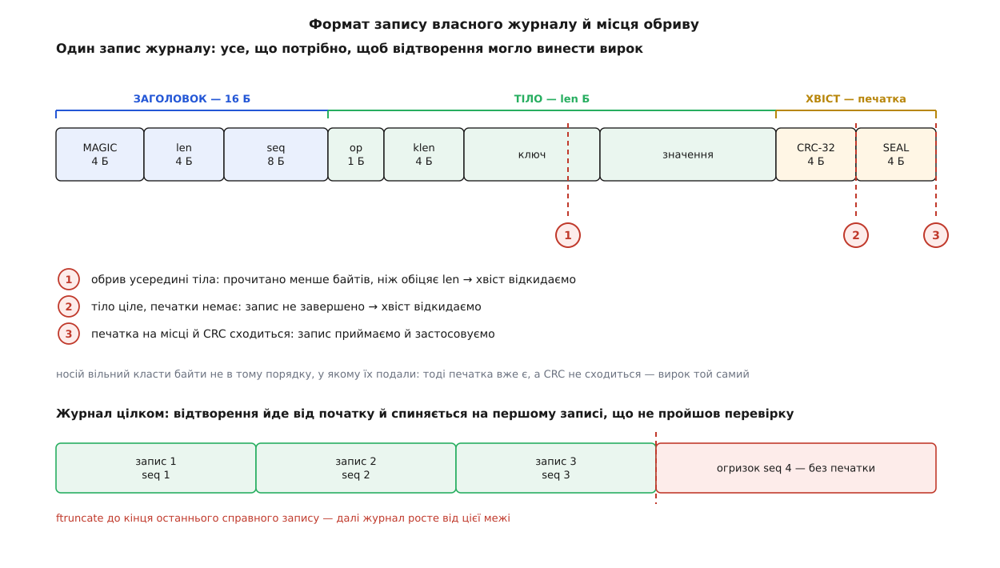

# ⚙️ Сховище «ключ→значення» з власним журналом

Двісті рядків на C, що роблять те саме, що робить журнал файлової системи: дописують запис із печаткою, підтверджують його аж після `fsync`, а при наступному відкритті відтворюють журнал і відрізають незапечатаний хвіст. Писати це варто рівно з однієї причини: поки конструкція не пройшла крізь ваші власні руки, «fsync у правильному місці» лишається заклинанням. А тут буде видно, як та сама програма з `fsync` і без нього поводиться на `kill -9` **однаково добре** — і як вона розходиться на справжньому обриві живлення.

Мова тут одна й вибору немає: домен — це системні виклики POSIX, `write`, `fsync`, `ftruncate`, і будь-яка обгортка над ними ховає рівно те, заради чого все затіяно.

## Задача

Програма зберігає пари «ключ → значення» у файлі. Вимога одна, зате сувора:

> Якщо `put()` повернув успіх, то після **будь-якого** обриву в **будь-який** момент — наступне відкриття сховища бачить цей запис. Якщо `put()` не встиг повернутися, запис або є цілим, або його немає зовсім; напівзаписаних значень читач не бачить ніколи.

Інструментів у нас теж рівно два, і обидва слабкі. Перший: `write()` дописує байти в кінець файлу — але без жодної обіцянки, що вони кудись дійшли, і навіть без обіцянки, що дійшли всі. Другий: `fsync()` (або `fdatasync()`) чекає, доки записане справді ляже на носій. Атомарності немає ніде.

## Ідея: печатку не можна дописати частково — а от перевірку можна зробити вирішальною

Спокуслива й хибна відповідь: «пишемо запис, а на диску він або є, або нема». Ні. Дописування довільної довжини не атомарне ні на якому рівні: `write()` має право повернути менше байтів, ніж просили; ядро розкладає їх по сторінках і виштовхує кожну окремо; носій приймає їх у кеш і кладе на пластини чи в комірки в порядку, який обирає сам. Обрив ловить довільну підмножину байтів.

Правильна відповідь інша: ми не робимо запис атомарним — ми робимо **вирок про нього** односкладовим. Нехай кожен запис має два зайві поля:

- **CRC-32** усього запису — коротке число, що не збіжиться, якщо байти дійшли не всі або дійшли зіпсутими;
- **печатку** — чотирибайтову константу в самому кінці.

Правило відтворення: запис вважається справжнім тоді й лише тоді, коли після нього стоїть печатка **і** контрольна сума сходиться. Одна умова, одна відповідь «так/ні». Усе, що не пройшло, — обривок, і його разом з усім, що за ним, викидають.

Чому печатка стоїть у кінці, а не на початку? Бо в кінці вона з'явиться найпізніше — і те, що ми її бачимо, є свідченням про решту. А чому самої печатки замало й потрібна ще контрольна сума? Бо свідчення це слабке: порядок доходження байтів до носія нам ніхто не обіцяв, і чотири байти хвоста цілком могли лягти раніше за середину. Печатка каже «намір дійшов до кінця», сума каже «і все, що він накриває, ціле». Разом вони дають вирок, у якому можна не сумніватися — з точністю до 2⁻³² на випадкове збігання суми.

> 🔧 **Навіщо це.** Це не спрощення заради навчального прикладу — це рівно те, що робить ext4, коли ввімкнено контрольні суми журналу: блок фіксації дозволено писати разом з описовими блоками, не чекаючи окремого скидання кешу, бо арифметична перевірка цілості замінює гарантію порядку. Написавши це самі, ви потім читаєте опції монтування як текст, а не як заклинання.

Отже, [контрольна сума](root:com-modulation/crc) тут не «на всяк випадок від псування» — вона несе логічне навантаження, і без неї конструкція розсипається.

Далі — де стоїть `fsync`. Він стоїть в одному-єдиному місці: **між записом і поверненням успіху з `put()`**. Це й є визначення слова «підтверджено». Усе, що ми обіцяли читачеві, стосується лише записів, для яких `put()` устиг повернутися; усе, що в польоті, ми маємо право втратити — але не маємо права показати напівживим.



*Печатка з'являється останньою, тож її наявність свідчить про решту запису; контрольна сума перетворює це свідчення на перевірку, яка не залежить від порядку доходження байтів.*

## Формат запису

```
запис = ЗАГОЛОВОК (16 Б) + ТІЛО (len Б) + ХВІСТ (8 Б)

ЗАГОЛОВОК
   0  4  MAGIC = 0x314C564B      байти 'K','V','L','1'
   4  4  len                     довжина ТІЛА
   8  8  seq                     номер запису, зростає на одиницю

ТІЛО (len байтів)
   0  1  op                      1 — покласти, 2 — видалити
   1  4  klen                    довжина ключа
   5  klen                       ключ
        len − 5 − klen           значення

ХВІСТ
   0  4  crc                     CRC-32 над ЗАГОЛОВКОМ і ТІЛОМ
   4  4  SEAL = 0x214C4145       печатка, байти 'E','A','L','!'
```

Числа кладемо в файл побайтово, від молодшого. Це не педантизм: файл — формат обміну, а не зліпок пам'яті, і зчитувати його доведеться на машині з іншим порядком байтів і з іншим вирівнюванням структур.

## Код

### Цеглини

:::code proj-journal-replay/c/kvlog.c

Два виклики, які майже завжди пишуть неправильно, — `write` і `read`. Обидва мають право зробити менше, ніж просили, і обидва мають право перерватися сигналом. Тому в коді їх немає жодного разу без обгортки:

:::code proj-journal-replay/c/tsehlyny.c

### Стан у пам'яті

Сховище тримає поточний стан у пам'яті, а на диску лежить лише журнал. Індекс тут навмисно найдурніший — масив із лінійним пошуком: у цій вправі цікаве дописування й відтворення, а не структура даних, і чесніше сказати це прямо, ніж плутати читача хеш-таблицею.

:::code proj-journal-replay/c/stan-u-pamiati.c

Зверніть увагу: `apply` не знає нічого про диск. Це та сама функція, яку викликає й дописування, і відтворення, — і саме тому «стан після відтворення» за побудовою дорівнює «станові, що був до обриву».

### Дописування з підтвердженням

:::code proj-journal-replay/c/dopysuvannia-z.c

Тут `fdatasync`, а не `fsync`, і це не заощадження на дрібницях. `fdatasync` не скидає ті метадані, без яких дані однаково можна прочитати, — насамперед час зміни. Але **нову довжину файлу він скидає**, бо без неї дописані байти не прочитаєш. Тобто рівно те, що нам треба, і на один запис метаданих менше. Так і сказано в описі виклику: `fdatasync` не скидає змінених метаданих, «якщо тільки ці метадані не потрібні, щоб подальше читання даних відпрацювало правильно».

### Відтворення при відкритті

:::code proj-journal-replay/c/vidtvorennia-pry-vidkrytti.c

Одна дрібниця в `replay` варта окремого речення: обрізання хвоста **не потребує власного `fsync`**. Якщо машина згасне посеред відновлення, наступне відкриття просто пройде журнал знову й обріже те саме місце. Відтворення ідемпотентне — його можна повторювати скільки завгодно разів із тим самим результатом, і саме тому воно само по собі не потребує захисту. Це та сама властивість, заради якої ext4 кладе в журнал готові образи блоків, а не опис дії: переписати образ удруге — те саме, що переписати вперше.

### Обгортка

:::code proj-journal-replay/c/obhortka.c

Той `fflush` — не охайність, а частина досліду. Коли вивід перенаправлено у файл, бібліотека мови робить його поблоковим і тримає рядки у **своєму** буфері, всередині процесу. Без `fflush` `kill -9` забере ці рядки з собою, і ми не знатимемо, які саме записи вважалися підтвердженими. Дописані ж у сховище байти той самий `kill -9` не забере — вони вже в ядрі. Ця асиметрія і є перший урок, тож зробимо її дослідом.

## Дослід перший: kill -9

```sh
$ cc -O2 -Wall -Wextra -o kvlog kvlog.c
$ rm -f store.log
$ ./kvlog fill 100000 > confirmed.txt & pid=$!
$ sleep 1; kill -9 $pid
$ tail -1 confirmed.txt
4137
$ ./kvlog list
записів: 4137, журнал: 255387 Б, наступний номер: 4138
```

Числа у вас будуть інші — важлива рівність. Скільки записів устигло підтвердитися, стільки й пережило вбивство процесу.

Тепер те саме без `fsync`:

```sh
$ rm -f store.log confirmed.txt
$ KVLOG_NOSYNC=1 ./kvlog fill 100000 > confirmed.txt & pid=$!
$ sleep 1; kill -9 $pid
$ tail -1 confirmed.txt
61208
$ KVLOG_NOSYNC=1 ./kvlog list
записів: 61208, журнал: 3844998 Б, наступний номер: 61209
```

Рівність **та сама**, хоч `fsync` не викликали жодного разу. Різниця лише в тому, що встигли зробити вп'ятнадцятеро більше роботи.

Це не парадокс — це визначення. `kill -9` шле [сигнал](root:sys-unix/signal-model) `SIGKILL`, який не можна ні перехопити, ні відкласти: ядро просто знімає процес. Гине те, що належало процесові, — його пам'ять, його дескриптори, його буфери в просторі користувача. Байти, віддані в `write()`, процесові вже **не належать**: вони лежать у кеші сторінок ядра, ядро живе, і воно виштовхне їх на носій, коли дійде черга. Тому `kill -9` не перевіряє довговічності взагалі.

Що ж він перевіряє? Три цілком реальні речі, і жодну з них не варто зневажати:

- що програма не тримає підтверджених даних у власних буферах (класична пастка — писати через `FILE *` і забути про [буферизацію stdio](root:sys-unix/stdio-buffering));
- що обрамлення запису витримує смерть посеред `write_full` — а вона цілком можлива, бо великий запис ядро віддає частинами;
- що відтворення не залежить від жодного стану, який був лише в пам'яті програми.

Перевірити другу річ можна прицільно: покласти значення на кілька мегабайтів і вбити процес під час дописування. Хвіст буде без печатки — відтворення його відітне, а всі попередні записи лишаться цілі.

## Дослід другий: справжня втрата живлення

Щоб зникло те, що ядро ще не виштовхнуло, має зникнути **саме ядро** разом із пам'яттю. Три способи це влаштувати, від найдоступнішого до найчеснішого.

**Віртуальна машина, вимкнена силою.** Гість втрачає всю оперативну пам'ять миттєво — саме те, що треба:

```sh
$ virsh destroy scratch-vm      # не shutdown, а обрив
```

З одним обов'язковим застереженням: образ диска має бути під'єднаний так, щоб **хазяїн не рятував гостя своїм кешем** — `cache=none` або `cache=directsync`. Інакше ви перевірите гостьовий кеш, а хазяйський тихо доправить решту, і дослід збреше на вашу користь.

**Негайне перезавантаження без синхронізації** — на машині, якої не шкода:

```sh
# sysctl -w kernel.sysrq=1
# echo b > /proc/sysrq-trigger     # перезавантаження МИТТЄВО, без sync і розмонтування
```

`echo s` перед цим зробив би синхронізацію — саме тому його тут і немає.

**Запис і відтворення на рівні пристрою.** Найточніший інструмент — це `dm-log-writes`: ціль device-mapper, яка веде журнал усіх записів у тому порядку, у якому вони **насправді лягали б на пристрій**, а не в тому, у якому їх подавали. Вона накопичує звичайні записи до наступного скидання кешу й лише тоді фіксує їх гуртом; запити з прапорцем FUA, що йдуть повз кеш, потрапляють у журнал одразу. Далі окремою утилітою журнал відтворюють до будь-якої позначки — і дивляться, у якому стані опинилася б файлова система, якби живлення зникло саме там. Так тестують самі файлові системи; так само можна перевірити й ваше сховище, не спаливши жодного блока живлення.

Результат передбачуваний і повчальний:

```sh
# з fsync: підтверджено 4137, після обриву живлення
$ ./kvlog list
записів: 4137, журнал: 255387 Б, наступний номер: 4138

# без fsync: підтверджено 61208, після обриву живлення
$ KVLOG_NOSYNC=1 ./kvlog list
записів: 3915, журнал: 241623 Б, наступний номер: 3916
```

Ось і вся ціна питання. Без `fsync` сховище відповідало «готово» п'ятдесяти семи тисячам записів, яких на носії не було й не мало звідки взятися. Структура при цьому бездоганна: журнал цілий, хвіст відрізано, повторне відкриття дає той самий стан. Просто цей стан — не той, який ми пообіцяли.

Варто чітко розрізняти, що саме перевіряє кожен дослід:

| дослід | що гине | що перевіряє | чого не перевіряє |
|---|---|---|---|
| `kill -9` | лише процес | обрамлення запису, буфери програми, чистоту відтворення | довговічність — кеш ядра живий |
| `sysrq-b`, вимкнена ВМ | процес і кеш ядра | що `fsync` стоїть у правильних точках | чи не бреше кеш носія |
| обрив живлення, `dm-log-writes` | усе | усю конструкцію, включно з поведінкою пристрою | — |

## Дослід третій: обірваний хвіст і повторне відтворення

Обірваний запис можна зробити руками, не чекаючи катастрофи:

:::code proj-journal-replay/sh/main.sh

Сорок байтів сміття зникли: відтворення не знайшло ні печатки, ні сходимої суми — і відрізало хвіст. Ті самі два записи на місці.

Ідемпотентність перевіряється так само просто: відкрити сховище ще раз і ще раз. Розмір файлу, кількість записів і наступний номер після другого й третього відкриття однакові — бо відтворення не додає нічого від себе, воно лише повторює те, що вже застосовували.

Тонкий випадок, на якому легко втратити дані назавжди: сміття, що **випадково скидається на початок запису**. Якби ми не відрізали хвіст, а просто пропускали його, — залишок міг би згодом опинитися між нашими записами й зупинити наступне відтворення на півдорозі. Обрізання прибирає цю можливість цілком: за межею останнього справного запису у файлі не лишається нічого. Номер послідовності — другий, незалежний замок на тих самих дверях: навіть якщо десь виживе давній запис із правильною сумою, дірка в нумерації спинить відтворення саме там, де треба.

## Ціна

Дописування коштує одного `write` і, у тривкому режимі, одного скидання кешу. Відтворення коштує одного повного проходу журналу — тобто часу, пропорційного розмірові журналу, а не кількості ключів. Пам'ять — пропорційна кількості живих ключів.

Уся вартість тривкості сидить в одному числі:

```
одне підтвердження = одне скидання кешу носія

NVMe SSD        ≈ 50…200 мкс   →   5000…20000 підтверджень/с
SATA SSD        ≈ 0.5…2 мс     →   500…2000 підтверджень/с
обертовий диск  ≈ 8…15 мс      →   60…120 підтверджень/с
                  (8.3 мс — один оберт пластини на 7200 об/хв)

без fsync: запис лише в пам'ять ядра ≈ одиниці мікросекунд
                                     →   сотні тисяч/с
```

Звідси єдиний спосіб зробити тривке сховище швидким — не робити менше `fsync` на запис, а **зробити менше записів на один `fsync`**: зібрати пачку операцій, дописати їх усі й скинути кеш один раз, після чого підтвердити всю пачку разом. Це називають груповою фіксацією, і це буквально те, що робить ext4 своїм інтервалом фіксації: тисяча дрібних операцій за півсекунди — це одне скидання на всю тисячу. Ціна теж та сама: те, що не встигло потрапити в пачку, губиться, а вікно втрати дорівнює інтервалу.

## Пастки

**Часткове дописування — не обов'язково префікс.** Спокуслива модель «обрив залишає перші K байтів» хибна двічі. `write()` має право віддати менше, ніж просили; а носій має право покласти дописані байти в порядку, зручному йому. Тому єдина надійна перевірка — контрольна сума над усім записом, а не «чи схоже це на початок запису». Гарантії, що бодай один запис не порветься навпіл, стандарт POSIX не дає взагалі: атомарність сектора — властивість конкретного пристрою, а не мови. У сучасному Linux її нарешті можна спитати й затребувати явно: `statx` повідомляє поля `stx_atomic_write_unit_min` і `stx_atomic_write_unit_max`, а `pwritev2` із прапорцем `RWF_ATOMIC` обіцяє, що після збою «збережуться або всі дані запису, або жодні, але ніколи не суміш старих і нових». Довжина при цьому мусить бути степенем двійки в дозволеному діапазоні й вирівняною у файлі.

**`O_APPEND` не рятує від рваного запису.** Він робить неподільним лише зсув: «зсунутися в кінець і почати писати» відбувається як один крок, тому два процеси не затруть один одного початковими позиціями. Самі байти від цього атомарними не стають. І взагалі: одночасні письменники в один журнал — окрема задача, яку розв'язують [замками на файл](root:sys-unix/file-locking), а не сподіванням.

**`fsync` файлу не робить тривким його ім'я.** Наше сховище викликає `fsync` на каталозі одразу після створення файлу — і це не перестраховка. В описі виклику сказано прямо: `fsync()` «не обов'язково гарантує, що запис у каталозі, який містить файл, теж дійшов до диска; для цього потрібен окремий `fsync()` на дескрипторі каталогу». Без нього після обриву можна дістати цілий журнал, на який ніщо не вказує. Той самий порядок — дані, `fsync`, `rename`, `fsync` каталогу — потрібен і в [атомарній заміні файлу](root:sf-data/atomic-file-replace).

**Носій може брехати про доходження.** `fsync` доводить дані до пристрою; чи пішли вони далі, у пластини або комірки, залежить від того, чи має пристрій летючий кеш запису й чи чесно він виконує команду скидання. Дешеві флешки, картки й окремі побутові SSD цим славляться. Побачити стан кешу можна в `/sys/block/*/queue/write_cache`; на старих ядрах і рідковживаних файлових системах реалізації `fsync` узагалі «не вміють скидати кеші дисків», і тоді описи виклику радять вимикати кеш пристрою через `hdparm` чи `sdparm`. Практичний висновок простий: заяву «у нас усе тривке» перевіряють обривом живлення, а не читанням коду.

**Помилку `fsync` не можна проковтнути.** Це не теорія: у 2018 році спільнота PostgreSQL з'ясувала, що на Linux помилка зворотного запису повідомлялася **один раз**, після чого сторінки позначалися чистими — і повторний `fsync` бадьоро повертав успіх, хоча дані так і не лягли. Історію розібрали Крейґ Рінґер, Томас Манро, Андрес Фройнд і Роберт Гаас; у ядрі поведінку виправляв Джефф Лейтон, і з версії 4.13 помилка зворотного запису повідомляється всім дескрипторам, які могли її спричинити, а з 4.14 лічильник помилок ініціалізується так, що перша помилка inode не губиться навіть після закриття й повторного відкриття файлу. Відповідь самої бази даних була радикальна й правильна: падати при невдалому `fsync` (зміну внесли в гілки від 9.4 до 11). Наш код робить те саме — `_exit(70)`. Спокуса «спробуємо ще раз» тут веде рівно до втрати даних.

**Не пишіть структуру в файл як є.** `write(fd, &rec, sizeof rec)` виглядає коротше рівно доти, доки файл не переїде на іншу машину або доки компілятор не змінить набивку між полями. Формат на диску — це домовленість, і кодувати його треба вручну, побайтово, як тут.

**Журнал росте вічно.** Мільйон разів переписаний ключ — це мільйон записів у файлі й довге відтворення при кожному відкритті. Лікує це ущільнення: записати живий стан у новий файл, скинути його на носій, замінити ім'я неподільним `rename`, скинути каталог. Саме ущільнення при цьому має бути так само стійким до обриву, як і все решта, — це вже [журнальне сховище](root:sf-data/log-structured-storage) в мініатюрі, і думати про нього треба з першого дня, а не тоді, коли файл переросте пам'ять.

**Половинчасті засоби не рятують.** `sync_file_range` не є примітивом довговічності — він керує тим, коли ядро почне виштовхувати сторінки, і нічого не обіцяє про носій. Єдині чесні точки — `fsync` і `fdatasync`, і те, що [лежить у кеші сторінок](root:sys-unix/page-cache-durability), доти не існує для наступного відкриття.
