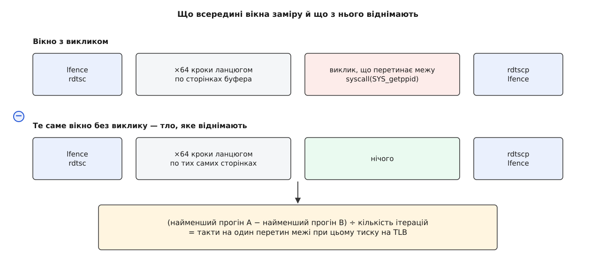
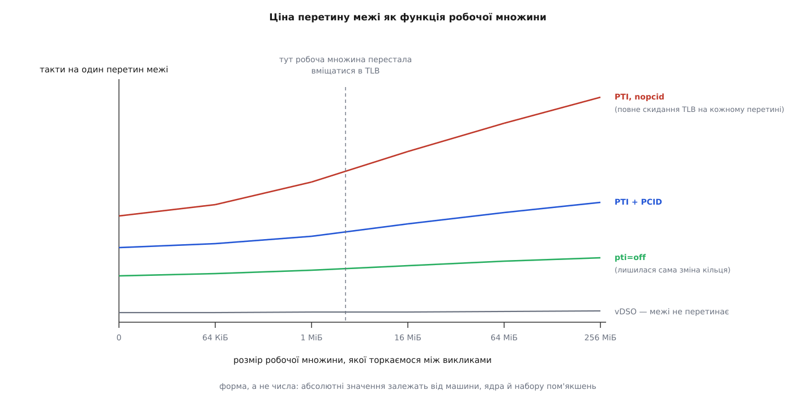

# ⚙️ Стенд: скільки перетин межі коштує саме на цій машині

Будь-який відсоток, який можна прочитати про ціну ізоляції таблиць, стосується чужої машини з чужим ядром і чужим набором пом'якшень. Ця програма на C дає власне число: вона зважує найдешевший системний виклик у тактах і наносекундах, ставить поруч виклик того самого сенсу, що межі не перетинає взагалі, а тоді знімає криву — як та сама ціна росте, коли між викликами програма встигає розворушити пам'ять. Дві години зі стендом варті більше за будь-який чужий звіт: вони відповідають на питання, якого той поставити не міг, — скільки платить **ваше** навантаження.

## Що саме кладемо на терези

Зважити «системний виклик» узагалі неможливо: `read()` із гігабайтом і `read()` із одним байтом коштують геть різного, і майже вся різниця — це робота, а не межа. Тому за вантаж беруть виклик, у якому роботи немає зовсім.

Такий є: `getppid()`. Ядро віддає число, яке вже лежить у структурі задачі, — ні блокувань, ні звернень до пристроїв, ні копіювання буферів. Усе, що лишається в замірі, — це сам перехід: зміна рівня привілею, вхідний код, [два записи в `CR3`](root:sys-unix/syscall-mechanics), повернення. Кличемо його не звичайною функцією libc, а через `syscall(SYS_getppid)`, щоб між нами й ядром не стояла обгортка, яка колись уміла кешувати відповідь: `getpid()` у glibc кешувався роками, і саме такі дрібниці перетворюють вимір на самообман.

Друга пара терезів цікавіша. Візьмімо **один і той самий сенс, добутий двома шляхами**. `clock_gettime(CLOCK_MONOTONIC, …)` у звичайній програмі виконується цілком у просторі процесу: ядро відображає в кожен процес крихітну бібліотеку [vDSO](root:sys-unix/vdso), і код цієї бібліотеки читає поточний час зі спільної сторінки, яку ядро для нього оновлює. Межу тут не перетинають узагалі. Той самий `clock_gettime` можна змусити піти справжнім системним викликом — `syscall(SYS_clock_gettime, …)` обходить vDSO і йде в ядро. Робота обох шляхів однакова з точністю до кількох інструкцій; уся різниця в числах — це плата за межу, і жодного окремого «фонового» виміру для неї не потрібно.

Отже, три проби: `getppid` (межа без роботи), `clock_gettime` через vDSO (робота без межі) і `clock_gettime` крізь межу (робота плюс межа).

## Лінійка, яка сама не бреше

Міряти будемо лічильником міток часу процесора, `RDTSC`. Дві його властивості треба знати наперед, бо кожна з них уміє зіпсувати результат мовчки.

Перша: **`RDTSC` не є бар'єром**. Це звичайна інструкція, і [позачергове ядро процесора](root:hw-arch/out-of-order-execution) має повне право виконати її раніше або пізніше за сусідні — тобто зняти позначку часу тоді, коли вимірюваний код ще не почався або вже закінчився. Огорожа будується так: початок вікна затискають між двома `LFENCE` (перший чекає, поки завершиться все попереднє, другий не пускає наступне поперед позначки), а кінець беруть інструкцією `RDTSCP`, яка сама чекає завершення попереднього, і закривають ще одним `LFENCE`. Огорожа коштує десятки тактів — і саме тому ніколи не міряють один виклик: вікно ставлять навколо десятків тисяч ітерацій, і ціна огорожі розчиняється в діленні.

Друга властивість підступніша. **Такт `RDTSC` — це не такт ядра процесора.** На всіх сучасних машинах лічильник цокає зі сталою частотою незалежно від того, на якій частоті зараз працює ядро й чи працює воно взагалі (прапорці `constant_tsc` і `nonstop_tsc` у `/proc/cpuinfo` саме про це). Частота ця близька до базової, але дорівнює їй не завжди й не зобов'язана. Звідси найпоширеніша помилка всіх саморобних стендів: узяти число з рядка `model name` у `/proc/cpuinfo` і поділити на нього такти. Результат виглядатиме як наносекунди й ними не буде.

Єдиний надійний спосіб — звірити лічильник із годинником ядра: зняти `RDTSC` і `CLOCK_MONOTONIC` на початку й у кінці двохсотмілісекундної паузи й поділити одне на друге. Двісті мілісекунд дають похибку калібрування десь у тисячні частки відсотка — на порядки менше, ніж усе інше в цьому замірі. Про самі [годинники ядра й джерела часу](root:sys-unix/kernel-timekeeping) є окрема розмова; тут вистачить того, що `CLOCK_MONOTONIC` іде рівно й не стрибає, коли правлять настінний час.

## Спершу дізнатися, у якому режимі міряємо

Число без режиму нічого не варте, а режим машина повідомляє сама.

```sh
$ cat /sys/devices/system/cpu/vulnerabilities/meltdown
Mitigation: PTI

$ tr ' ' '\n' < /proc/cpuinfo | grep -xE 'pti|pcid|invpcid|constant_tsc' | sort -u
constant_tsc
invpcid
pcid
pti
```

Перший файл — частина спільного інтерфейсу, у якому ядро звітує про кожну відому апаратну ваду через [псевдофайлову систему](root:sys-unix/pseudo-filesystems); там буває `Not affected` (процесор вадою не вражений), `Mitigation: PTI` (ізоляція працює) і `Vulnerable` (вражений, але захист вимкнено). Прапорець `pti` у переліку можливостей процесора ядро підставляє саме тоді, коли ізоляція справді ввімкнена, а `pcid` та `invpcid` кажуть, чи є [мітки адресних просторів](root:hw-arch/tlb), без яких кожен перетин межі перетворюється на повне скидання кешу перекладів.

`Not affected` — не поразка стенда, а корисний контрольний випадок: на такій машині крива покаже чистий тиск на TLB без домішки ізоляції, і її варто зберегти для порівняння.

Програма читає все це сама й друкує в шапці звіту. Заміри без шапки нікуди не годяться: за тиждень ви вже не згадаєте, у якому режимі знято ці числа.

## Тиск на TLB: чому ланцюг, а не пробіг масивом

Тепер найважливіше в конструкції стенда — те, чим саме «розворушувати пам'ять» між викликами.

Спокуса просто пробігтися буфером від початку до кінця хибна. Суцільний пробіг чіпає кожен байт, тобто тисне передусім на кеш даних; апаратне випереджувальне читання при цьому вгадує наступний крок наперед і майже все встигає підвезти. А нас цікавить не кеш даних, а **кеш перекладів**: саме порожній TLB робить перетин межі дорогим після того, як ізоляція позбавила ядерні відображення глобальності.

Отже, чіпати треба по одному байту на сторінку — тоді кожен дотик вимагає окремого перекладу, а даних читається мізер. І порядок сторінок має бути **непередбачуваним**, інакше апаратура здогадається про наступну сторінку раніше, ніж ми до неї дійдемо.

Обидві вимоги задовольняє перемішаний однозв'язний ланцюг: у першому слові кожної сторінки лежить зсув наступної, а порядок сторінок перетасовано. Перехід ланцюгом — це послідовність залежних читань, кожне за адресою, яку щойно принесло попереднє. Їх не можна ні вгадати, ні виконати наперед, ні перекрити одне одним. Розмір буфера й задає [робочу множину](root:sf-os/working-set) — те, скільки різних перекладів мусить одночасно жити в TLB.

Між двома викликами проходимо фіксовану кількість ланок — шістдесят чотири, — а не весь буфер: інакше велика розгортка тривала б годинами. Позиція в ланцюгу зберігається між ітераціями, тож за десятки тисяч ітерацій програма багато разів обійде навіть найбільший буфер, і в сталому режимі тиск на TLB задає саме розмір буфера.

## Що з чого віднімаємо

Ціну виклику саму по собі вікно не покаже: усередині нього є ще й міряльний цикл, і ті самі шістдесят чотири кроки ланцюгом. Тому вікон завжди два — з викликом і без нього, у тих самих умовах, — а різниця дає шукане.



*Перехід ланцюгом однаковий в обох вікнах і при відніманні зникає. Лишається те, що додав виклик, — разом із тим, як він зіпсував наступні звернення до пам'яті.*

Останнє уточнення важливе, і воно не вада, а суть. Виклик, вирушивши в ядро, витісняє з TLB частину користувацьких перекладів — і наступний перехід ланцюгом стає повільнішим. Різниця вікон припише цей додатковий час викликові, і правильно зробить: **ціна перетину межі — це не лише такти, проведені всередині переходу, а й те, що перехід залишив по собі**. Саме тому ціна залежить від робочої множини, хоча в самому переході ніщо про робочу множину не знає.

За підсумок беремо **мінімум**, а не середнє. Усе, що трапляється під час заміру — переривання, витіснення іншим потоком, міграція, — тільки додає такти й ніколи не віднімає. Найменш потурбований прогін і є найближчим до правди. Це не примха стенда, а обов'язковий мінімум будь-якого [мікробенчмарку](root:sf-release/microbenchmarking).

## Програма

Три частини нижче складаються в один файл `bordercost.c` у наведеному порядку.

**Частина перша — лінійка та калібрування.**

:::tabs
:::code proj-kpti-cost/c/bordercost.c
:::code proj-kpti-cost/cpp/bordercost.cpp
:::

**Частина друга — проби, ланцюг і міряльне вікно.**

:::tabs
:::code proj-kpti-cost/c/prohrama.c
:::code proj-kpti-cost/cpp/prohrama.cpp
:::

**Частина третя — шапка режиму й розгортка.**

:::tabs
:::code proj-kpti-cost/c/prohrama-2.c
:::code proj-kpti-cost/cpp/prohrama-2.cpp
:::

## Як запускати, щоб числа щось означали

Програма прив'язується до вказаного ядра сама, але цього мало.

```sh
# 1. зафіксувати частоту: інакше той самий код дасть різні числа
$ sudo cpupower frequency-set -g performance
$ echo 1 | sudo tee /sys/devices/system/cpu/intel_pstate/no_turbo   # якщо є

# 2. запустити на конкретному ядрі
$ taskset -c 3 ./bordercost 3
```

Фіксувати частоту доводиться саме через сталість лічильника. Такти TSC цокають рівномірно, а ядро процесора під [керуванням частотою](root:hw-arch/dvfs) працює то швидше, то повільніше — тож та сама робота вкладається в різну кількість тактів залежно від того, куди зараз хитнувся регулятор. Розгін до турбо-частот під час першого прогону й спад під час третього дадуть розкид, у якому ефект ізоляції потоне.

Обидві прив'язки — `taskset` зовні й `sched_setaffinity` усередині — навмисно дублюють одна одну: перша діє з першої ж інструкції, ще до того, як завантажувач розкладе бібліотеки, друга рятує, коли стенд запустили без `taskset`. Для серйозних замірів ядро краще ще й відібрати в планувальника цілком (`isolcpus=`, `nohz_full=`) — про це є [окрема розмова про прив'язку задач](root:sys-unix/cpu-affinity).

## Що показує вивід

```
режим вимірювання
  ядро процесора: 3, частота TSC: 2496 МГц
  meltdown: Mitigation: PTI
  прапорці: pti=1 pcid=1 invpcid=1 constant_tsc=1
  великі сторінки: MADV_NOHUGEPAGE

без робочої множини (тактів / нс на виклик)
  clock_gettime через vDSO: 63.4 / 25.4
  clock_gettime крізь межу: 639.8 / 256.3
  getppid: 561.4 / 224.9

getppid під тиском на TLB (тактів / нс на виклик)
         0 КіБ:   561.4 /   224.9
        64 КіБ:   574.9 /   230.3
       256 КіБ:   602.1 /   241.2
      1024 КіБ:   668.3 /   267.7
      4096 КіБ:   781.5 /   313.1
     16384 КіБ:   902.7 /   361.6
     65536 КіБ:   968.0 /   387.7
    262144 КіБ:  1004.2 /   402.3
```

*Вивід з однієї машини — ілюстрація форми, не константа: на іншому процесорі, іншому ядрі й іншому наборі пом'якшень числа будуть інші.*

Читати цей звіт треба відношеннями, а не абсолютними значеннями.

Перше відношення — між першим і другим рядком: та сама робота, здобута без перетину межі й із перетином, різниться приблизно вдесятеро. Це й є плата за межу в чистому вигляді, зважена на одній машині за одну секунду. Вона одразу пояснює, чому `clock_gettime` віддали в vDSO й чому програма, що смикає годинник у циклі, після переходу на прямий системний виклик просідає до невпізнання.

Друге відношення — між першим і останнім рядком розгортки. Той самий `getppid`, той самий код ядра, та сама робота — і майже вдвічі більша ціна тільки тому, що між викликами програма розворушила чверть гігабайта. Ніщо в самому виклику про це не знає; різницю зробив TLB.

> 🔧 **Навіщо це.** Числа зі стенда прямо кажуть, куди дивитися. Якщо ціна перетину стоїть рівно на всій розгортці, ізоляція вашому навантаженню майже нічого не коштує, і шукати треба деінде. Якщо крива круто йде вгору, у вас не «повільні системні виклики», а тиск на TLB — і лікується він не меншою кількістю викликів, а великими сторінками та щільнішим укладанням даних. А якщо `pcid` у шапці стоїть нулем, розмова про оптимізацію починається з питання, чому машина працює без міток адресного простору.



*Зліва, де робоча множина вміщається в TLB, три режими майже збігаються. Розходяться вони праворуч — і чим більший тиск на TLB, тим дорожче обходиться відсутність міток адресного простору.*

## perf: куди пішли такти

Стенд каже, скільки коштує; [підсистема лічильників](root:sys-unix/perf-events) каже, за що.

```sh
$ perf stat -r 3 -e cycles:u,cycles:k,dTLB-loads,dTLB-load-misses,iTLB-load-misses \
      taskset -c 3 ./bordercost 3
```

Розділення `cycles:u` й `cycles:k` показує, яка частка тактів узагалі проведена в ядрі, — і це перша перевірка того, що ви міряєте те, що думаєте: якщо в ядрі опинилося кілька відсотків, вимір потонув у чомусь іншому. `dTLB-load-misses` росте разом із розгорткою й дає незалежне підтвердження, що тиск на TLB справді зростає, а не примарився. `iTLB-load-misses` цікавий окремо: коли ізоляція знімає з ядерних відображень прапорець «глобальний», переклади для **коду** ядра теж перестають переживати перетин межі, і промахи в кеші перекладів інструкцій — прямий слід цього.

Дві застороги. Звичайному користувачеві апаратні лічильники доступні лише за `kernel.perf_event_paranoid` не більшим від одиниці (`sysctl kernel.perf_event_paranoid`) або коли процесові видано окрему [можливість](root:sys-unix/capabilities) на це. І частина подій буває позначена `<not supported>` — усередині віртуальної машини або на мікроархітектурі, де відповідного лічильника просто немає; тоді точні імена доводиться брати з переліку `perf list` для конкретного процесора.

## Три перемикачі, що зсувають криву

Три параметри змінюють режим — і кожен показує окрему складову ціни.

**`pti=off` — вимкнення ізоляції.** Це не налаштування продуктивності, а свідома відмова від захисту: на машині з вимкненою ізоляцією будь-який код, що там виконується, включно з чужим сценарієм у вкладці браузера, може прочитати пам'ять ядра. Робити це можна **лише на відокремленому стенді, де немає ні чужого коду, ні чужих даних**, і тільки на час замірів. Найбезпечніша форма — не правити конфігурацію завантажувача, а дописати параметр разово в меню GRUB (клавіша `e`, дописати в рядок `linux`, `Ctrl-X`): після перезавантаження машина повернеться в захищений стан сама, і ніхто не забуде відкотити.

Що вимкнення справді сталося, підтверджують ті самі два джерела: у файлі `meltdown` з'явиться `Vulnerable`, а прапорець `pti` зникне з `/proc/cpuinfo`. Заразом варто глянути `dmesg | grep -i 'page table isolation'`. І ще: `mitigations=off` вимикає купу пом'якшень одночасно, тож різницю після нього приписати саме ізоляції не вийде — для чистого досліду потрібен лише `pti=off`.

**`nopcid` — ізоляція без міток адресного простору.** Параметр лишає захист на місці, але забирає в ядра механізм, що рятує TLB від скидання на кожному записі в `CR3`. Крива після цього не просто зсувається вгору — вона стає значно крутішою, бо тепер кожен перетин межі викидає з TLB усе. Це та сама конфігурація, з якої взялися страшні числа початку 2018 року, і найкращий спосіб побачити, що більшу частину ціни бере не сам запис у `CR3`, а те, що після нього не лишається перекладів.

**`--thp` — великі сторінки.** Прапорець стенда замінює `MADV_NOHUGEPAGE` на `MADV_HUGEPAGE`, і буфер починає лежати на двомебібайтних сторінках. Кількість перекладів, потрібних для тієї самої робочої множини, падає в п'ятсот разів, тиск на TLB зникає — і крива майже вирівнюється. Це не хитрість стенда, а робочий засіб: [великі сторінки](root:sys-unix/huge-pages-tlb-reach) на навантаженні з великою робочою множиною здатні відіграти більше, ніж ізоляція забрала. Перевірити, що вони справді підклалися, можна за `grep AnonHugePages /proc/meminfo` до й під час прогону — на буфері в чверть гігабайта різниця помітна неозброєним оком.

## Пастки, у які падають усі

**Незакріплений потік.** Без прив'язки планувальник переносить програму між ядрами; кожен перенос — холодні кеші, холодний TLB і, на старих машинах, ще й трохи інакший TSC. Половина замірів припаде на одне ядро, половина на друге, і мінімум по прогонах перестане щось означати.

**Плаваюча частота.** Найпідступніше з усього переліку, бо не дає ні помилки, ні підозрілого числа — лише розкид, який легко списати на шум. Ліки описані вище: `performance` і вимкнене турбо. Симптом, за яким її впізнають, — перший прогін систематично гірший за наступні.

**Розігрів.** Перші ітерації платять за помилки сторінок, холодний кеш і холодне передбачення переходів, а процесор ще не встиг піднятися з низької частоти. Тому буфер заселяють `memset`-ом наперед, а перший прогін кожного заміру викидають без розгляду.

**`rdtsc` без огорожі.** Позначка часу, знята інструкцією, яку процесор має право переставити, показує невідомо що. Огорожа обов'язкова — а що коштує вона сама десятки тактів, вікно ставлять навколо десятків тисяч ітерацій, а не навколо однієї.

**Такти, поділені не на ту частоту.** Найтихіша з помилок: результат виглядає як наносекунди, має правдоподібний порядок — і зсунутий рівно на стільки, на скільки частота TSC розійшлася з написаною в назві моделі процесора. Іноді це частки відсотка, іноді разюча відмінність; передбачити, коли саме, не можна. Частоту TSC беруть тільки калібруванням.

**Компілятор, що прибрав зайве.** Цикл, результат якого нікому не потрібен, [правило «ніби»](root:sf-lang/as-if-rule) дозволяє викинути цілком. Порожня проба зникне першою — і від'ємник перетвориться на нуль. Рятують запис у `volatile` і рядок асемблера, що ховає від компілятора значення покажчика на функцію.

**Прозорі великі сторінки, які ніхто не просив.** Якщо система схильна підкладати їх сама, буфер у 64 МіБ може виявитися розкладеним по двомебібайтних сторінках — і крива вийде рівною, ніби тиску на TLB не існує. `MADV_NOHUGEPAGE` у стенді ставиться саме проти цього.

**Сусід по фізичному ядру.** Два логічні процесори одного фізичного ділять і кеші, і кеш перекладів; активний сусід підніме числа й додасть розкиду. Або вибирайте ядро, чий [напарник](root:hw-arch/simultaneous-multithreading) простоює, або вимикайте багатопотоковість на час замірів.

**Віртуальна машина.** `RDTSC` у гості може перехоплюватися або масштабуватися гіпервізором, а файл `meltdown` описує стан гостьового ядра й нічого не каже про хазяйське. Числа з віртуальної машини порівнянні лише з іншими числами з тієї самої віртуальної машини.
