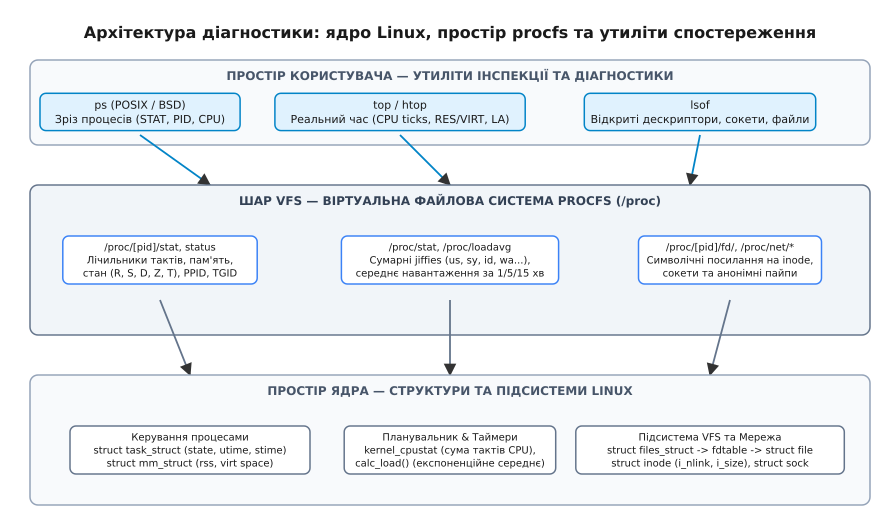
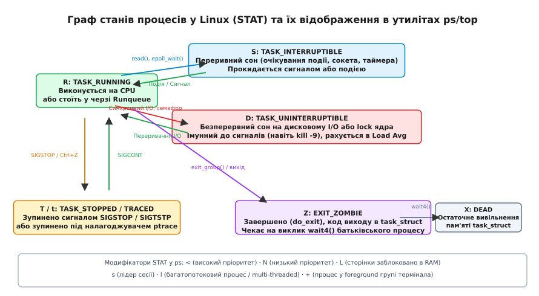
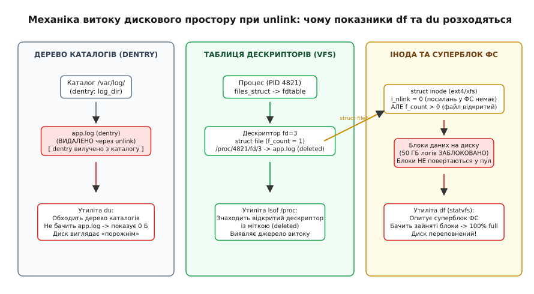

# Подивитися на живу систему: ps, top, lsof

<preknowlist>
- [Віртуальна файлова система procfs](root:sys-unix/proc-reading-process-and-kernel-state) — механізми генерації псевдофайлів ядра та структура дерева `/proc`.
- [Стани процесу в Linux](root:sys-unix/process-states) — життєвий цикл задачі, черги планувальника та семантика сну.
- [Шар віртуальної файлової системи (VFS)](root:sys-unix/vfs-layer) — файлові дескриптори, структури `file`, `dentry` та `inode`.
- [Потоки в Linux: задача як одиниця планування](root:sys-unix/threads-as-tasks) — співвідношення TGID та TID, структури `task_struct` і клонування потоків.
</preknowlist>

Виробничий сервер баз даних раптово надсилає критичне сповіщення: кореневий розділ NVMe-накопичувача обсягом 500 ГБ заповнений на 100%, і процеси завершуються з системною помилкою `ENOSPC` (No space left on device). Черговий інженер запускає утиліту `du -sh /*`, але вона показує лише 45 ГБ фактично зайнятих файлів, тоді як системний виклик `df -h` продовжує наполягати на нульовій кількості вільних блоків. Одночасно моніторинг фіксує підйом показника Load Average до 64 на 8-ядерному процесорі, хоча утиліта `top` звітує про майже порожній користувацький час CPU (3% user) і катастрофічні 94% очікування дискового введення-виведення (`iowait`). Спроба завершити проблемні процеси командою `kill -9` не дає жодного результату — процеси ігнорують сигнал і залишаються в системній таблиці.

Без розуміння того, як ядро операційної системи Linux агрегує та експортує свій внутрішній стан через віртуальну файлову систему `procfs`, як планувальник задач відстежує стани потоків виконання і як рівень VFS утримує видалені з дисків блоки пам'яті, інженер залишається повністю сліпим перед живою системою.

---

## 1. Простір /proc як джерело правди про стан ядра та процесів

Усі базові утиліти діагностики та моніторингу в Linux — від класичного `ps` до інтерактивних `top`, `htop` та інспектора ресурсів `lsof` — не мають жодних «секретних» системних викликів або привілейованих каналів зв'язку з ядром. Вони є звичайними користувацькими програмами, єдиним джерелом правди для яких є віртуальна псевдофайлова система **procfs**, змонтована за шляхом `/proc`.


*Архітектура діагностики ядра Linux: взаємодія користувацьких утиліт ps, top, lsof з псевдофайловою системою procfs та структурами ядра.*

### Генерація даних на льоту без фізичного I/O

Файли у каталозі `/proc` не займають жодного байта на фізичних накопичувачах і не створюють дискового введення-виведення. Коли користувацький процес викликає системні виклики `open()` та `read()` на файлі на зразок `/proc/1482/stat` або `/proc/meminfo`, ядро виконує такі операції:

1. Драйвер VFS перенаправляє файлові операції до обробників псевдофайлової системи `procfs` (функції ядра `proc_file_read` або інтерфейс `seq_file`).
2. Обробник знаходить відповідні внутрішні структури ядра в оперативній пам'яті хоста: дескриптор процесу `struct task_struct`, структуру керування віртуальною пам'яттю `struct mm_struct` або таблицю файлових дескрипторів `struct files_struct`.
3. Для захисту від гонок даних ядро захоплює легковагові блокування читача RCU (`rcu_read_lock()`) або блокування задачі `task_lock()`, швидко форматує текстовий буфер у пам'яті ядра і копіює його в адресний простір користувача функцією `copy_to_user()`.
4. Після завершення читання згенерований текст миттєво відкидається з пам'яті.

Історію відмови від небезпечного прямого читання пам'яті ядра через `/dev/kmem` та народження файлової моделі процесів від Plan 9 до сучасного Linux розібрано у вставці [Історія появи синтаксису ps та віртуальної файлової системи /proc](root:sys-unix/live-system-tools/hist-ps-syntax-and-procfs.md).

### Ключові псевдофайли інспекції

Для отримання повної картини стану операційної системи та процесів використовуються такі ключові вузли `/proc`:

- `/proc/[pid]/stat` — компактний однорядковий зріз метрик процесу (стан планувальника, PID батька, час CPU у просторі користувача та ядра, розміри пам'яті, пріоритети).
- `/proc/[pid]/status` — розширений людиночитаний звіт із текстовими полями, що містить маски сигналів, ліміти пам'яті (Peak Vm, VmRSS, VmSwap) та ефективні ідентифікатори користувача (UID/GID, Capabilities).
- `/proc/[pid]/cmdline` — початкові аргументи командного рядка процесу, розділені нульовими байтами (`\0`).
- `/proc/[pid]/fd/` — каталог, що містить символічні посилання на всі відкриті процесом файлові дескриптори (файли, сокети, пайпи, анонімні іноди таймерів та epoll).
- `/proc/stat` — глобальні лічильники процесорного часу від моменту старту ОС, розбиті за категоріями (user, system, idle, iowait, softirq тощо).
- `/proc/loadavg` — показники середнього навантаження системи за останні 1, 5 та 15 хвилин, а також лічильник активних задач у черзі планувальника.
- `/proc/meminfo` — детальний звіт менеджера віртуальної пам'яті (загальна RAM, сторінкові кеші, анонімні сторінки, dirty-пам'ять, пам'ять SLAB-алокатора).

Детальну специфікацію всіх 52 полів файлу `/proc/[pid]/stat` та структуру лічильників пам'яті наведено у вставці [Довідник полів /proc, метрик top та параметрів lsof](root:sys-unix/live-system-tools/api-proc-stat-and-tools.md).

### Крайові випадки та атомарність при парсингу

Під час розробки системних моніторів або парсингу `/proc` скриптами адміністратори стикаються з двома фундаментальними пастками:

**1. Нестандартні символи в назві процесу (`comm`):** Друге поле у файлі `/proc/[pid]/stat` містить назву виконуваного файлу в круглих дужках. Проте програма може встановити будь-яке довільне ім'я за допомогою системного виклику `prctl(PR_SET_NAME)`, включаючи пробіли, символи нового рядка або самі круглі дужки. Спроба розділити рядок функції за пробілами призводить до зміщення номерів колонок. Надійний алгоритм зобов'язаний шукати першу дужку `(` зліва та останню закривну дужку `)` справа, витягувати ім'я між ними, а числові параметри парсити виключно після останньої дужки.

**2. Гонки зникнення процесів (Process Disappearance):** Процес може завершитися в будь-який момент. Коли утиліта відкриває каталог `/proc` і зчитує список PID через `readdir()`, процес може викликати `exit_group()` до того, як програма встигне відкрити `/proc/[pid]/stat`. Системний виклик `open()` поверне помилку `ENOENT` (No such file or directory). Системний софт зобов'язаний сприймати `ENOENT` як штатну подію зміни списку задач, а не аварійний дефект.

---

## 2. Утиліта ps: подвійність синтаксису, коди станів та аналіз потоків

Утиліта `ps` (Process Status) формує статичний знімок (snapshot) поточної активності процесів у системі. На відміну від інтерактивних моніторів, її вивід оптимізований для фільтрації, обробки конвеєрами bash (`grep`, `awk`) та збереження в аудиторські журнали.

### Подвійність синтаксису: дефіс має значення

Через історичний спадок об'єднання кодових баз System V та BSD у пакеті `procps-ng` синтаксис `ps` підтримує три взаємовиключні моделі введення команд:

:::code live-system-tools-d/sh/podviinist-syntaksysu.sh

Якщо користувач помилково вводить команду `ps -aux` (з дефісом), синтаксичний парсер `ps` інтерпретує її за стандартом POSIX: прапорець `-a` (всі процеси з TTY), прапорець `-u` з наступним обов'язковим аргументом-користувачем `x`. Якщо користувача з іменем `x` у системі не існує, утиліта видає попередження `warning: bad ps syntax, perhaps a bogus '-'?` і застосовує аварійні евристики сумісності.

Головна відмінність між `ps -ef` та `ps aux` полягає у складі колонок:
- `ps -ef` акцентує увагу на ієрархії процесів: виводить ідентифікатор батьківського процесу `PPID` та час старту `STIME`.
- `ps aux` акцентує увагу на споживанні ресурсів: виводить відсоток використання CPU (`%CPU`), пам'яті (`%MEM`), віртуальний розмір (`VSZ`), резидентну пам'ять (`RSS`) та розширений стан процесу (`STAT`).

### Детальний розбір кодів станів процесів (STAT)

Поле стану процесу (колонка `STAT` у стилі BSD або `S` у стилі POSIX) показує, у якому саме стані планувальника ядра перебуває задача.


*Граф переходів станів процесів у Linux (STAT) та їх відображення в утилітах ps і top.*

Базові однолітерні коди станів:

- **`R` (TASK_RUNNING — Running or Runnable):** Процес або виконується на одному з ядер CPU прямо зараз, або перебуває у черзі готовності планувальника (Runqueue), очікуючи на виділення кванта процесорного часу.
- **`S` (TASK_INTERRUPTIBLE — Interruptible Sleep):** Процес спить, очікуючи на подію (надходження даних у сокет, спрацювання таймера `epoll_wait()`, розблокування м'ютекса). Процес миттєво прокидається при надходженні будь-якого сигналу POSIX.
- **`D` (TASK_UNINTERRUPTIBLE — Uninterruptible Sleep):** Безперервний сон. Процес заблокований в очікуванні критичного ресурсу ядра (найчастіше синхронного читання/запису дискового драйвера або очікування блокування на NFS-сховищі).
  > **Важливий інваріант:** Процес у стані `D` не реагує на жодні сигнали, включаючи неперехоплюваний `kill -9` (`SIGKILL`). Ядро забороняє переривати такі задачі, оскільки примусове знищення процесу під час виконання драйверної транзакції призведе до пошкодження внутрішніх структур пам'яті ядра та аварійної паніки (Kernel Panic). Процес зникне зі стану `D` лише тоді, коли апаратний контролер відповість на запит, або коли вичерпається тайм-аут драйвера.
- **`Z` (EXIT_ZOMBIE — Zombie Process):** Процес повністю завершив своє виконання, звільнив усю виділену віртуальну пам'ять, закрив файлові дескриптори і викликав функцію `do_exit()`. Проте запис про нього (`struct task_struct`) залишається в таблиці процесів ядра для збереження коду завершення (Exit Code) та статистики споживання ресурсів доти, доки батьківський процес не прочитає цей статус системним викликом `wait4()` або `waitpid()`.
- **`T` (TASK_STOPPED — Stopped by Signal):** Процес призупинено сигналом керування завданнями термінала (`SIGSTOP`, `SIGTSTP` через натискання `Ctrl+Z`, `SIGTTIN` або `SIGTTOU`). Виконання відновлюється лише після надсилання сигналу `SIGCONT`.
- **`t` (TASK_TRACED — Tracing Stop):** Процес зупинено налагоджувачем (наприклад, `gdb` або `strace`) через механізм системного виклику `ptrace` для інспекції регістрів чи покрокового виконання.
- **`I` (TASK_IDLE — Idle Kernel Thread):** Спеціальний стан фонових потоків ядра Linux (введений у ядрі 4.14), які перебувають у глибокому сні та, на відміну від стану `D`, не враховуються у розрахунку системного середнього навантаження (Load Average).

### Модифікатори та суфікси у колонці STAT

Утиліти `ps` та `top` додають до базового символу стану додаткові суфікси, що описують пріоритети та системне оточення задачі:

- `<` — Високий пріоритет планування (значення `nice < 0`). Процес отримує більше процесорних квантів.
- `N` — Низький пріоритет планування (значення `nice > 0`, поступливий фоновий процес).
- `L` — Сторінки пам'яті процесу заблоковано у фізичній RAM через виклик `mlock()` або апаратний I/O реального часу (заборонено вивантаження у swap).
- `s` — Процес є лідером сесії (Session Leader), наприклад, оболонка bash або демон ініціалізації.
- `l` — Процес є багатопотоковим (містить декілька активних потоків LWP, створених через `pthread_create()`).
- `+` — Процес входить до складу процесної групи переднього плану (Foreground Process Group) керувального термінала TTY.

### Аналіз потоків (LWP проти PID)

В операційній системі Linux ядро не має принципової різниці між процесом та потоком на рівні планувальника: кожна одиниця виконання представлена окремою структурою `task_struct` і має власний унікальний числовий ідентифікатор задачі **TID (Task ID)**.

Для забезпечення стандарту POSIX використовується концепція **TGID (Thread Group ID)**:
- Коли створюється новий процес через `fork()`, його `PID` дорівнює новому `TGID`, який збігається з його власним `TID`.
- Коли процес створює потік через `clone(CLONE_THREAD)`, новий потік отримує унікальний `TID`, але успадковує `TGID` батьківського процесу.
- Стандартні утиліти за замовчуванням показують лише задачі, де `PID == TGID`, приховуючи окремі потоки.

Щоб побачити повний список потоків у системі, використовуються спеціальні прапорці:

```bash
# Відображення кожного потоку як окремого рядка (LWP = Light-Weight Process)
$ ps -eLf
# UID        PID  PPID   LWP  C NLWP STIME TTY          TIME CMD
# mysql     1204     1  1204  0   32 10:00 ?        00:00:12 /usr/sbin/mysqld
# mysql     1204     1  1205  0   32 10:00 ?        00:00:01 /usr/sbin/mysqld

# Альтернативний перегляд потоків через стандарт POSIX (-T)
$ ps -eT
```

Колонка `LWP` містить числовий `TID` конкретного потоку, а `NLWP` показує загальну кількість потоків у цій групі задач.

---

## 3. Монітори реального часу top та htop: метрики CPU, пам'ять та Load Average

На відміну від статичного `ps`, монітори `top` та `htop` здійснюють динамічне періодичне опитування (sampling) стану системи, розраховуючи похідні диференційні показники використання ресурсів між двома послідовними зрізами часу.

### Математика метрик процесора

Значення використання процесора у відсотках не є миттєвою величиною — це відношення різниці лічильників тактів у файлі `/proc/stat` за інтервал вибірки.

Нехай під час першого опитування у момент часу T1 сумарні значення лічильників процесора дорівнювали U1, N1, S1, I1, W1, H1, SI1, ST1, а під час другого опитування у момент T2 — U2, N2, S2, I2, W2, H2, SI2, ST2.

Обчислення виконується за такими формулами:

```text
[Розрахунок дельт за інтервал часу між вибірками]
Delta_user    = U_2 - U_1                    [користувацький час]
Delta_nice    = N_2 - N_1                    [час фонових задач nice]
Delta_system  = S_2 - S_1                    [час системних викликів ядра]
Delta_idle    = I_2 - I_1                    [час простою]
Delta_iowait  = W_2 - W_1                    [час очікування блокового I/O]
Delta_irq     = H_2 - H_1                    [час апаратних переривань]
Delta_softirq = SI_2 - SI_1                  [час програмних переривань]
Delta_steal   = ST_2 - ST_1                  [час, відібраний гіпервізором]

[Загальна сума всіх тактів процесора]
Delta_Total = Delta_user + Delta_nice + Delta_system + Delta_idle + 
              Delta_iowait + Delta_irq + Delta_softirq + Delta_steal

[Відсоток використання для кожної категорії метрик]
%us = (Delta_user / Delta_Total) * 100
%sy = (Delta_system / Delta_Total) * 100
%ni = (Delta_nice / Delta_Total) * 100
%id = (Delta_idle / Delta_Total) * 100
%wa = (Delta_iowait / Delta_Total) * 100
%hi = (Delta_irq / Delta_Total) * 100
%si = (Delta_softirq / Delta_Total) * 100
%st = (Delta_steal / Delta_Total) * 100
```

Інженерна діагностика за категоріями метрик:
- **Високий `%sy` (> 30%):** Програма виконує надмірну кількість дрібних системних викликів (`read`/`write` по 1 байту замість буферизованого I/O) або стикається з частими блокуваннями м'ютексів ядра (Futex contention).
- **Високий `%wa` (> 20%):** Процесор простаює через повільний дисковий накопичувач або насичення черги I/O запитів.
- **Високий `%si` (> 10%):** Мережевий стек ядра перевантажений обробкою пакетів (DDoS-атака або високий PPS — Packets Per Second).
- **Високий `%st` (> 5%):** Хмарний хостинг перевантажений сусідніми віртуальними машинами (CPU noisy neighbors / Overselling).

### Розуміння метрик пам'яті: VIRT проти RES проти SHR

Утиліти моніторингу відображають використання пам'яті кожним процесом через три взаємопов'язані показники:

1. **`VIRT` (Virtual Memory Size):** Загальний обсяг віртуального адресного простору, зарезервованого процесом. Сюди входять:
   - Виконуваний код програми та спільні бібліотеки.
   - Усі алокації `malloc()` або `mmap()`, навіть якщо програма жодного разу не записала туди дані і фізичні сторінки пам'яті під них ще не виділено (Overcommit).
   - Зарезервовані простори пам'яті для пулів потоків.
   > **Правило:** Велике значення `VIRT` (наприклад, 100 ГБ у процесу Java або Go) не означає витоку пам'яті — це лише зарезервована адресна сітка.
2. **`RES` (Resident Set Size):** Фактичний обсяг фізичної оперативної пам'яті (RAM), яку процес займає прямо зараз. Це сторінки, до яких процес реально звертався, і які завантажені у сторінкові таблиці (Page Tables). Сюди не входить пам'ять, скинута у swap.
3. **`SHR` (Shared Memory):** Частина резидентної пам'яті `RES`, яка може бути спільно використана іншими процесами. Сюди входять:
   - Сегменти коду динамічних бібліотек (`libc.so`, `libcrypto.so`), які ядро відображає для сотень процесів в єдиному екземплярі у фізичній RAM.
   - Спільні сегменти пам'яті POSIX Shared Memory (`shm_open`) та файли файлової системи `tmpfs` (`/dev/shm`).

> **Пастка сумування RES:** Якщо скласти значення колонки `RES` для всіх процесів системи, отримана сума може у кілька разів перевищувати загальний фізичний обсяг пам'яті комп'ютера. Це відбувається тому, що спільні бібліотеки (вміст `SHR`) підсумовуються для кожного процесу багаторазово.

### Load Average: експоненційне середнє та поріг насичення ядер

Показник **Load Average (LA)** показує середню кількість задач, які вимагають обчислювальних ресурсів, усереднену за три часові інтервали: 1 хвилину, 5 хвилин та 15 хвилин.

Ядро Linux оновлює ці значення кожні 5 секунд за формулою експоненційного згладженого середнього (Exponential Decaying Moving Average):

```text
[Формула експоненційного згладжування для інтервалу t]
Load(t) = Load(t - 1) * exp(-5 / (60 * m)) + Active_Tasks * (1 - exp(-5 / (60 * m)))
[де m — період усереднення: 1, 5 або 15 хвилин]
```

**Критична відмінність Linux від класичного Unix BSD:**
У традиційних системах Unix (Solaris, BSD) змінна `Active_Tasks` враховувала виключно процеси у стані `TASK_RUNNING` (ті, що виконуються або стоять у черзі на CPU). У 1993 році Маттіас Урліхс (Matthias Urlichs) модифікував ядро Linux, додавши до підрахунку Load Average процеси у стані `TASK_UNINTERRUPTIBLE` (стан `D`).

Через це в Linux високий Load Average може свідчити про два принципово різні типи системного перевантаження:
1. **CPU-bound перевантаження:** Велика кількість обчислювальних процесів у стані `R`. Утиліта `top` показує 100% `%us` або `%sy`.
2. **I/O-bound перевантаження:** Велика кількість процесів, заблокованих на очікуванні повільного диска чи недоступного NFS-сервера у стані `D`. Утиліта `top` показує низький `%us` і високий `%wa`.

**Оцінка відносно кількості ядер процесора:**
- Якщо система має `N` логічних ядер CPU (значення `nproc`), то значення `Load Average = N` є **порогом насичення (Saturating Threshold)**, коли всі ядра завантажені рівно на 100% без утворення черги.
- `Load Average < N`: у системі є вільні обчислювальні потужності.
- `Load Average > N`: утворюється черга очікування, і процеси починають накопичувати затримку виконання (Latency Spike).

---

## 4. Інспекція відкритих ресурсів через lsof: дескриптори, сокети та пайпи

У традиційній філософії Unix «усе є файлом». Процес взаємодіє з дисковими файлами, мережевими з'єднаннями, анонімними каналами IPC та системними пристроями через єдину абстракцію — цілочисельний **файловий дескриптор (File Descriptor, FD)**.

Утиліта **`lsof` (List Open Files)** інспектує стан ядра і показує, які саме ресурси утримує кожен процес у системі.

### Як ядро зв'язує дескриптори з внутрішніми структурами

Коли процес викликає системний виклик `open()` або `socket()`, ядро виконує такі кроки асоціації:

1. У структурі процесу `task_struct` знаходиться покажчик на `struct files_struct`.
2. Таблиця `fdtable` містить масив покажчиків на відкриті файлові структури ядра `struct file *fd_array[]`, де індексом є числовий номер дескриптора (0 для stdin, 1 для stdout, 2 для stderr, 3, 4 тощо).
3. Структура `struct file` містить режим доступу (`O_RDONLY`, `O_WRONLY`), поточне файлове зміщення `f_pos`, лічильник посилань `f_count` та покажчик на об'єкт шляху VFS `struct path`.
4. Через `struct path` ядро зв'язує дескриптор з конкретним типом ресурсу:
   - Для дискового файлу: через `struct dentry` до дискової іноди `struct inode` файлової системи.
   - Для мережевого з'єднання: через віртуальну файлову систему сокетів `sockfs` до структури сокета `struct socket` та мережевого сокета `struct sock`.
   - Для каналу IPC: до структури кільцевого буфера каналу `struct pipe_inode_info`.

### Практичні діагностичні сценарії lsof

:::code live-system-tools-d/sh/praktychni-diahnostychni.sh

### Діагностика витоків дескрипторів

Кожен процес має жорсткий ліміт на максимальну кількість одночасно відкритих файлових дескрипторів, встановлений параметром `RLIMIT_NOFILE` (перевіряється командою `ulimit -n`, зазвичай 1024 за замовчуванням для користувацьких процесів).

Якщо високонавантажений мережевий сервер (наприклад, на Go або C++) у циклі обробки клієнтських підключень викликає `accept()`, але через помилку в коді не викликає `close()` для закритих з'єднань, настає **витік файлових дескрипторів (File Descriptor Leak)**.

Коли кількість дескрипторів досягає ліміту, будь-який наступний виклик `open()`, `socket()` або `accept()` завершується системною помилкою **`EMFILE` (Too many open files)**, і сервіс повністю припиняє приймати нові з'єднання.

Глобальний стан використання дескрипторів у всій системі перевіряється через файл ядра:

```bash
$ cat /proc/sys/fs/file-nr
# 14208   0   9223372036854775807
#   |     |            |
#   |     |            +-- Максимальний системний ліміт (file-max)
#   |     +--------------- Кількість виділених, але невикористаних дескрипторів (застаріле)
#   +--------------------- Поточна кількість відкритих файлових дескрипторів у системі
```

---

## 5. Пастка видалених файлів: розбіжність df та du і безпечне відновлення

Найпоширенішою аварійною ситуацією системного адміністрування Linux є катастрофічна розбіжність між показниками утиліт `df` та `du`.


*Механіка витоку дискового простору при unlink: чому показники df та du розходяться при відкритих дескрипторах.*

### Механіка роботи unlink та звільнення блоків

У файлових системах POSIX (ext4, XFS, btrfs) процес видалення файлу складається з двох повністю незалежних етапів:

1. **Розрив зв'язку в каталозі (Unlink):** Коли користувач або скрипт виконує команду `rm /var/log/app.log`, оболонка викликає системний виклик `unlink()`. Драйвер файлової системи видаляє запис про файл із каталогу (структура `dentry`) і зменшує лічильник жорстких посилань іноди `inode->i_nlink` на 1. Файл миттєво зникає зі списку файлів утиліти `ls`.
2. **Звільнення блоків даних:** Дискові блоки, виділені під цей файл, повертаються у загальний пул вільного простору файлової системи **виключно тоді**, коли одночасно виконано дві умови:
   - Лічильник жорстких посилань іноди дорівнює нулю (`i_nlink == 0`).
   - Лічильник відкритих дескрипторів структури `file` у ядрі дорівнює нулю (`file->f_count == 0`).

Якщо додаток (наприклад, веб-сервер або служба журналювання) відкрив файл перед видаленням і продовжує утримувати його дескриптор відкритим, лічильник `f_count` залишається більшим за нуль. Ядро зберігає іноду та всі виділені дискові блоки на накопичувачі недоторканими, дозволяючи додатку безперешкодно продовжувати запис.

Чому виникає конфлікт між утилітами:
- **Утиліта `du` (Disk Usage):** Працює методом рекурсивного обходу дерева каталогів за допомогою системного виклику `lstat()`. Оскільки запис у каталозі вже вилучено, `du` взагалі не бачить файлу і звітує про малий обсяг зайнятої пам'яті.
- **Утиліта `df` (Disk Free):** Виконує системний виклик `statvfs()`, опитуючи суперблок файлової системи. Суперблок веде точний облік усіх фізично алокованих блоків і показує, що диск заповнений на 100%.

### Виявлення витоку через lsof та /proc

Для виявлення процесів, які утримують видалені файли, застосовується спеціальний фільтр `lsof`:

```bash
# Пошук відкритих файлів із нульовим лічильником посилань (+L1)
$ lsof +L1
# COMMAND   PID USER   FD   TYPE DEVICE  SIZE/OFF NLINK      NODE NAME
# app_srv  4821 app     3w   REG    8,1 450971520     0 148920194 /var/log/app.log (deleted)

# Або за допомогою прямого пошуку за міткою (deleted)
$ lsof | grep -i deleted
```

Утиліта `lsof` та ядро Linux позначають такі файли явним суфіксом `(deleted)`.

### Безпечне усунення витоку на живому сервері

Якщо видалений файл має розмір у десятки гігабайтів, а перезапуск процесу `PID 4821` неможливий через ризик переривання транзакцій клієнтів, адміністратор може звільнити дисковий простір прямо через інтерфейс `/proc`:

```bash
# Миттєве усікання іноди через відкритий файловий дескриптор
$ truncate -s 0 /proc/4821/fd/3
```

Системний виклик `truncate()` звертається безпосередньо до відкритої іноди ядра через дескриптор `fd=3`, змушуючи драйвер файлової системи миттєво вивільнити всі виділені дискові екстенти та скинути лічильник розміру файлу `i_size` до 0. Дисковий простір утиліти `df` негайно відновлюється, а процес продовжує штатно працювати.

Повнофункціональну програму на C та C++ для автоматизованого сканування `/proc` та знаходження видалених утримуваних файлів наведено у вставці [Практикум: інспекція /proc, розрахунок метрик та виявлення видалених файлів](root:sys-unix/live-system-tools/proj-proc-inspect-and-deleted.md).

---

## 6. Програмне зчитування та розрахунок завантаження CPU (C та C++)

Для вбудовування низькорівневого моніторингу у власні високонавантажені сервіси та демони розробники використовують пряме зчитування псевдофайлу `/proc/stat`.

Нижче наведено порівняльний приклад розрахунку відсотка використання процесора за фіксований часовий інтервал мовами C та C++ у вкладках `:::tabs`.

:::tabs
:::code live-system-tools-d/c/main.c
:::code live-system-tools-d/cpp/main.cpp
:::
