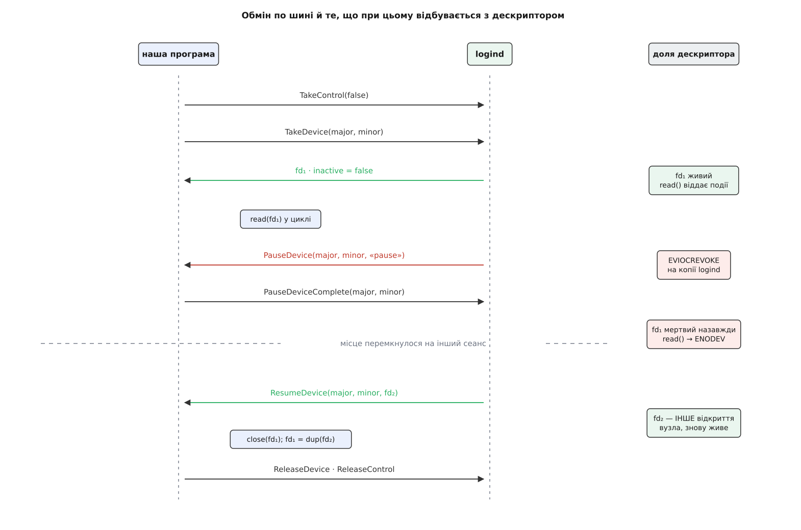

# ⚙️ Взяти клавіатуру з рук logind: програма, що переживає перемикання місця

Напишімо на C сотню рядків, які роблять те саме, з чого починає роботу будь-який сучасний компонувальник: стають розпорядником свого сеансу, дістають клавіатуру готовим дескриптором по шині, читають натиски — і не ламаються, коли людина перемкнулася на інше місце й повернулася назад. Дорогою стане видно річ, яку інакше доводиться приймати на віру: **дескриптор тут не власність, а позичка**, і мить її відкликання можна побачити на власні очі в помилці `read()`.

## Що робимо

Програма знаходить свій сеанс logind, заявляє себе його розпорядником, просить клавіатуру за [старшим і молодшим номерами](root:sys-unix/major-minor-numbers) — бо шина оперує самим пристроєм, а не іменем вузла, — читає з отриманого дескриптора події вводу в циклі, на сигнал `PauseDevice` чемно відпускає пристрій, на `ResumeDevice` бере натомість новий дескриптор — і на виході віддає все назад.

Мова тут не обирається: `sd-bus` і `sd-login` — частини `libsystemd`, а вся суть прикладу лежить у файлових дескрипторах і `ioctl`, тобто на рівні системних викликів. Збірка одна:

```bash
cc take-keyboard.c -o take-keyboard $(pkg-config --cflags --libs libsystemd)
```

## Ідея: одне відкриття на двох

Ключ до всього — те, що logind **сам** відкриває вузол пристрою й пересилає нам копію дескриптора [по шині](root:sys-unix/dbus), а копія їде тим самим способом, яким дескриптори взагалі ходять між процесами: полем допоміжних даних сокета домену Unix, механізмом [`SCM_RIGHTS`](root:sys-unix/unix-domain-sockets).

Наслідок неочевидний, доки не згадати, що дублювання дескриптора не подвоює відкриття. У нас з logind **різні номери дескрипторів, але один [опис відкритого файлу](root:sys-unix/open-file-description)** — один об'єкт у ядрі. Тому все, що logind зробить зі своєю копією, миттю стає правдою й для нашої. Він викликає `EVIOCREVOKE` — і мертвим виявляється не «його» дескриптор, а саме відкриття, спільне: наше читання після цього повертає `ENODEV`, і жоден `dup` не рятує.

Звідси й уся форма протоколу. Ми не просимо дозволу й не віддаємо пристрій добровільно — нам **повідомляють**, а забирають незалежно від нашої згоди. Наша частка домовленості маленька, але обов'язкова: вчасно перестати читати й сказати, що ми готові.



*Після відкликання перший дескриптор не «тимчасово недоступний» — він мертвий назавжди; програма отримує на заміну інше відкриття того самого вузла.*

## Цикл читання й два сигнали

Почнімо з того, заради чого все затівалося, — з читання. Події [підсистеми вводу](root:sys-unix/input-subsystem-event-model) приходять як масив структур `input_event`, і нас цікавить `EV_KEY`: код клавіші та `1`/`0` для натиску й відпускання.

:::code proj-session-device-handover/c/tsykl-chytannia-i-dva.c

Тепер обробник паузи. Тут єдине місце всієї програми, де помилка коштує не збою, а **зависання всього місця**, — і тому воно варте окремої уваги. Аргумент `type` каже, у якому саме становищі ми опинилися: `«force»` — logind уже відібрав пристрій і просто ставить нас до відома; `«pause»` — він чекає на нашу відповідь і **не піде далі без неї**; `«gone»` — пристрою більше немає, повернення не буде.

:::code proj-session-device-handover/c/tsykl-chytannia-i-dva-2.c

Обробник повернення коротший, але містить пастку, на якій горять усі, хто пише таке вперше. Дескриптор у повідомленні **належить повідомленню**: щойно `sd-bus` його звільнить, номер закриється, і подальші читання дадуть `EBADF`. Забрати дескриптор собі можна лише копією.

:::code proj-session-device-handover/c/tsykl-chytannia-i-dva-3.c

## Головна функція

Порядок дій тут не декоративний — кожен крок вимагає попереднього, а два з них ще й мусять статися саме в такій черзі.

:::code proj-session-device-handover/c/holovna-funktsiia.c

## Що видно на живій машині

Запустіть на текстовій консолі, від свого імені, без `sudo` — правами тут нічого не досягається, потрібен саме сеанс із місцем. Вузол клавіатури зручно взяти за стійким іменем із `/dev/input/by-path/`. Натиснули клавішу — програма надрукувала код. Перемкнулися на іншу консоль і назад — у виводі з'явилося

```
PauseDevice(force)
  read() після паузи → No such device
ResumeDevice: новий дескриптор
```

`No such device` — це `ENODEV` від `read()` на відкликаному відкритті: рівно те, що робить пароль, набраний на чужому місці, недосяжним для нашої програми.

Але зверніть увагу на слово `force`, а не `pause`. Це не дрібниця, і саме тут більшість описів помиляється. На місці з віртуальними консолями перемикання веде **ядро**: logind лише підтверджує його — а перед тим безумовно відбирає всі пристрої й аж потім розсилає сповіщення. Домовлятися нема коли й нема з ким. Тип `«pause»`, з очікуванням нашої відповіді, приходить на іншому шляху — на місці **без** консолей, яке заводять `loginctl attach`: там перемикання виконує сам logind, і виконує в два такти.

## Пастки

**Підписатися після `TakeDevice`.** Проміжок між отриманням дескриптора й появою обробника — реальний: сповіщення, надіслане в цю мить, ніхто не підбере, і програма далі читатиме мертвий дескриптор, не розуміючи чому. Спершу обробники, потім `TakeControl`, потім `TakeDevice`. Порядок двох останніх теж жорсткий: `TakeDevice` без розпорядництва відмовляє з `NotInControl` — і повідомлення про помилку природно списують на пристрій, а не на пропущений крок.

**Підписатися на `/org/freedesktop/login1/session/self`.** Зручний шлях-псевдонім працює для викликів методів, але **сигнали на ньому не надсилаються** — logind випромінює їх лише на справжньому шляху конкретного сеансу. Програма мовчки не отримає жодної паузи. Тому в коді й стоїть `GetSession`.

**Проігнорувати `inactive`.** Другий вихідний аргумент `TakeDevice` — не діагностика, а стан: якщо сеанс на ту мить неактивний, дескриптор приходить **уже мертвим**, і `PauseDevice` для нього не буде надіслано ніколи, бо паузити нема чого. Чекати на сповіщення, якого не буде, — найпідступніший з тутешніх способів зависнути.

**Забути `PauseDeviceComplete`.** Спокуса думати, що logind постоїть і забере силою, — хибна: у нього на цьому шляху немає таймера. Перемикання завершує функція, яку викликає **тільки** підтвердження останнього пристрою; поки хоч один не відповів, нове місце не активується. Одна забудькувата програма підвішує перемикання для всіх, і зовні це має вигляд «система не реагує на перехід».

**Поводитися з відеокартою, як із клавіатурою.** Для [DRM](root:sys-unix/drm-kms-object-model) logind не відкликає нічого — він знімає з дескриптора звання майстра пристрою, а при поверненні надає його знову тому самому відкриттю. Дескриптор весь час живий, `read()` не помиляється, і всі виділені на ньому буфери переживають паузу; ламаються лише [виклики `ioctl`](root:sys-unix/ioctl-interface), що вимагають майстра. Значить, для evdev пауза видима в помилці читання, а для DRM — **не видима ніяк**, окрім самого сигналу. Програма, яка визначає паузу «на око», по помилках, для екрана працювати не буде.

**Взяти спільне з'єднання.** Розпорядництво прив'язане до **імені з'єднання** на шині, а не до процесу: зникло ім'я — logind миттю звільняє всі пристрої й повертає консоль. `sd_bus_default_system()` віддає спільне кешоване з'єднання, яке може закрити зовсім інша частина програми чи бібліотека, — і пристрої зникнуть без жодної видимої причини. Тому `sd_bus_open_system()`, своє.

**Списати `ReleaseControl` як зайвий.** Правда, що при виході процесу logind усе прибере сам, — і саме тому виклик легко викинути. Але він потрібен там, де процес не помирає: коли компонувальник передає керування іншому або тимчасово складає повноваження, лишаючись на шині. Без явного звільнення наступний охочий отримає відмову, і причина буде в програмі, яка вже нічим не керує, але формально ще розпоряджається.
