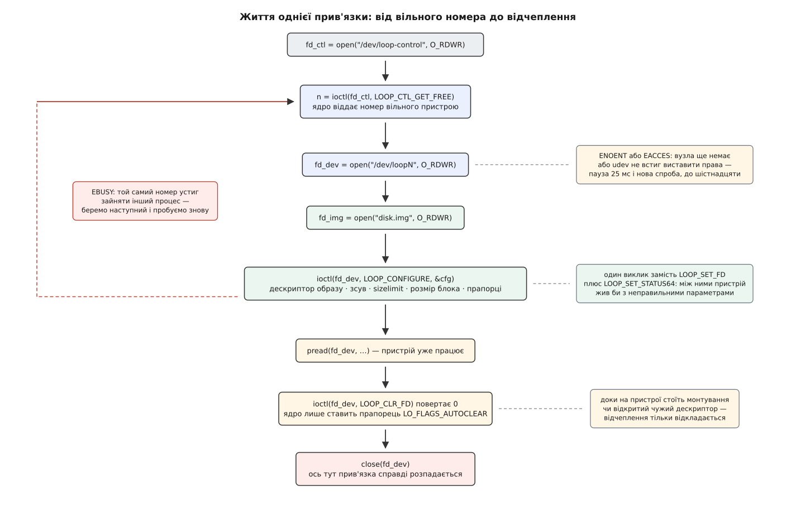

# ⚙️ Приєднати образ власноруч: loop-пристрій без losetup

Усе, що робить `losetup`, зводиться до трьох звертань до ядра: узяти вільний номер, налаштувати на ньому файл, відпустити. Написані власноруч, ці три звертання показують контракт драйвера зблизька — разом із півдесятком місць, де він поводиться не так, як здається з опису.

## Що має вміти програма

Вона приймає шлях до образу й, за бажанням, зсув у байтах. Знаходить вільний loop-пристрій, приєднує до нього образ із указаним зсувом, розміром блока й проханням працювати повз кеш, читає з готового пристрою нульовий сектор і друкує його початок, після чого відчіпляє все за собою. Ключова вимога — остання: пристрій не має лишитися висіти ні при успіху, ні при помилці на півдорозі.

## Три звертання

Пристроями керує [`ioctl`](root:sys-unix/ioctl-interface) — виклик, який передає драйверові команду й структуру даних через звичайний відкритий файл. Файлів тут два різні, і плутати їхні ролі не варто.

`/dev/loop-control` — не пристрій, а окреме віконце для запитів про пристрої. Єдине, чого від нього треба, — `LOOP_CTL_GET_FREE`: він повертає номер пристрою, який зараз ні до чого не прив'язаний, а якщо всі наявні зайняті — створює новий і повертає його. Другий файл, `/dev/loopN`, — уже сам пристрій, і прив'язка робиться на ньому: `LOOP_CONFIGURE` приймає структуру `loop_config` з дескриптором образу, розміром блока й вкладеною `loop_info64`, де лежать зсув, обмеження розміру й прапорці. Відчіплює `LOOP_CLR_FD` — без аргументів узагалі.

*Дві гілки, повз які не пройти: вузол у `/dev` з'являється не миттєво, а номер, виданий як вільний, ніхто за нами не закріплює.*

## Код

:::code proj-loop-attach/c/loop-attach.c

Кожен крок коштує один виклик у ядро, і жоден з них не залежить від розміру образу: приєднання гігабайтного файлу й терабайтного однаково швидкі, бо нічого не копіюється. Увесь відчутний час програми — це очікування вузла в `/dev`; читання сектора коштує стільки ж, скільки читання з файлу, плюс один прохід блоковим шаром.

## Чому ядру дають дескриптор, а не шлях

`cfg.fd` — це число, [дескриптор](root:sys-unix/file-descriptor) уже відкритого файлу. Ім'я образу теж їде в структурі, але як напис: ядро його не розбирає й нікуди за ним не ходить.

Причина в тому, що шлях — не річ, а маршрут, і маршрут залежить від того, хто ним іде. У кожного процесу може бути свій корінь, свій набір монтувань, свої символьні посилання на дорозі; «той самий» рядок у двох процесів приводить до різних файлів. Ядро, отримавши рядок, мусило б відкрити файл ще раз — від свого імені й трохи пізніше, ніж робилася перевірка прав. Це класична гонитва: між перевіркою й ужитком підмінюють саме те, що перевіряли. Дескриптор такої щілини не лишає — файл уже відкритий саме тим, хто просить, і саме з тими правами, які він мав у момент відкриття.

Звідси й решта поведінки. Право на запис пристрій успадковує від режиму відкриття, а не від прав на файл: відкрили образ на `O_RDONLY` — пристрій вийде тільки для читання, і `mount` скаржитиметься саме на це. Причому те саме стосується й другого дескриптора: якщо `/dev/loopN` відкрити на читання, ядро позначить пристрій захищеним від запису, хоч би яким писабельним був образ. Тому в коді обидва `open` — `O_RDWR`.

І навпаки, після `LOOP_CONFIGURE` наш `fd_img` уже не потрібен — ядро тримає власне посилання, тож у програмі він одразу закривається. Перейменування чи видалення образу прив'язку не розірвуть; місце звільниться лише разом із пристроєм.

## Вузол, якого ще немає

`LOOP_CTL_GET_FREE` повернув `3` — це ще не означає, що `/dev/loop3` можна відкрити. Пристрій щойно народився в ядрі; вузол у `/dev` створює `devtmpfs`, а власника, групу й режим доводить до ладу [`udev`](root:sys-unix/udev-rules) — окремим процесом, який лише прокидається на подію. У вікні між цими подіями `open` дає `ENOENT` (вузла ще немає) або `EACCES` (вузол є, але типові права ще не замінено на `root:disk`, режим 0660).

Тому в `open_loop_node` не одна спроба, а цикл із паузою — рівно те, що робить `losetup`: шістнадцять спроб по 25 мілісекунд, разом до 400 мс. Просте «поспати сто мілісекунд» гірше з обох боків: на завантаженій машині цього замало, а на порожній, де вузол готовий за одну спробу, це ті самі сто мілісекунд, викинуті на порожньому місці. Точніший, хоч і громіздкіший, шлях — [стежити за подіями в каталозі](root:sys-unix/inotify-and-fanotify) замість опитування.

## EBUSY: вільний номер ніхто не закріплює

`LOOP_CTL_GET_FREE` знімає стару гонитву — ту, де програма сама перебирала пристрої й питала стан кожного. Але він робить менше, ніж хочеться прочитати в назві: ядро проходить свій перелік, знаходить перший непричеплений пристрій і віддає його номер — **не резервуючи**. Між поверненням номера й нашим `LOOP_CONFIGURE` той самий номер може отримати й зайняти інший процес.

Програш видно одразу: `LOOP_CONFIGURE` повертає `EBUSY`, бо пристрій уже прив'язаний. Правильна реакція — не помилка, а нова спроба з початку: закрити дескриптор, попросити наступний вільний номер, налаштувати. Тому в `loop_attach` увесь блок загорнутий у цикл, а `EBUSY` — єдина помилка, що не перериває його.

## Відчеплення, якого не сталося

Найнесподіваніше в цій програмі — рядок після `LOOP_CLR_FD`.

Виклик повертає нуль, але пристрій, найімовірніше, ще прив'язаний. Ядро в цьому місці нічого не розбирає: воно ставить прапорець `LO_FLAGS_AUTOCLEAR` — «прибрати на останньому закритті» — і виходить. Справжнє відчеплення станеться тоді, коли зникне останній, хто тримає пристрій відкритим. У нашій програмі це `close(fd_dev)` наступним рядком; у житті це може бути змонтована файлова система, чужий `blkid` або той самий `udev`, який саме опитує щойно створений пристрій.

Інакше й не могло бути. Відчепити пристрій, на якому стоїть монтування, — означає висмикнути підлогу з-під працюючої файлової системи; відповідати помилкою теж погано, бо тоді будь-яка стороння проба перетворювала б `losetup -d` на лотерею. Відкладення — єдиний варіант, який не бреше.

Практичних наслідків два. По-перше, «повернуло 0» не можна читати як «файл уже вільний»: якщо після цього одразу видалити образ і перевірити місце, воно ще не звільнилося. Чесна перевірка — `/sys/block/loopN/loop/backing_file` [в sysfs](root:sys-unix/sysfs-device-model): цей файл зникає разом із прив'язкою. По-друге, той самий прапорець можна поставити наперед, прямо в `cfg.info.lo_flags`, — і тоді пристрій помре разом із програмою навіть при аварійному завершенні, бо дескриптори закриє ядро. Саме на цьому тримається `mount -o loop`: прив'язка живе рівно доти, доки на пристрої стоїть монтування, і зникає сама після `umount`.

## Права: не там, де їх шукають

Поширене формулювання «loop потребує `CAP_SYS_ADMIN`» правдиве за наслідком і хибне за механізмом. У самому драйвері на шляху `LOOP_CTL_GET_FREE` → `LOOP_CONFIGURE` перевірок [прав-можливостей](root:sys-unix/capabilities) немає взагалі. Воротами служать права на самі вузли: `/dev/loop-control` і `/dev/loop*` належать `root:disk` із режимом 0660, тож пройти може root або член групи `disk` — а це, до речі, [не пом'якшення, а те саме право](root:sys-unix/device-access-groups) іншими словами, бо `disk` дає прямий доступ до всіх дисків машини.

`CAP_SYS_ADMIN` у драйвері таки згадується, але в несподіваній ролі — як **заміна** відкриттю на запис: `LOOP_SET_STATUS64`, `LOOP_SET_BLOCK_SIZE`, `LOOP_SET_CAPACITY` і `LOOP_SET_DIRECT_IO` проходять або тому, що дескриптор пристрою відкрито на запис, або тому, що є ця можливість. А справжня стіна стоїть за межами драйвера: щоб змонтувати готовий пристрій, `CAP_SYS_ADMIN` потрібен обов'язково — і саме тому непривілейований користувач не приєднає образ так, щоб із цього вийшла користь.

## Прямий ввід-вивід — прохання, а не гарантія

`LO_FLAGS_DIRECT_IO` у конфігурації просить драйвер читати й писати образ повз [кеш сторінок](root:sys-unix/buffered-and-direct-io) господаря, щоб ті самі байти не лежали в пам'яті двічі. Прохання виконується не завжди: якщо файлова система під образом не вміє прямого вводу-виводу або оголошений розмір блока пристрою менший за той, якого вимагає носій, ядро мовчки зніме прапорець і працюватиме як звичайно. Помилки не буде — саме тому в програмі одразу після налаштування стоїть `LOOP_GET_STATUS64`, який показує, що з проханням сталося насправді.

Плутати не варто й напрямки. Прапорець стосується того, як драйвер ходить у файл-образ. Наш власний `pread` із `/dev/loopN` іде через кеш блокового пристрою в будь-якому разі, тож вирівнювати його не треба — на відміну від читання, відкритого з `O_DIRECT`.

## Запасний шлях для старих ядер

`LOOP_CONFIGURE` з'явився в ядрі 5.8 (2020). До того прив'язку складали з кількох викликів:

:::code proj-loop-attach/c/zapasnyi-shliakh-dlia.c

Чим це гірше, видно з першого ж рядка. `LOOP_SET_FD` створює **робочий** пристрій із типовими параметрами: зсув нуль, розмір — весь файл, блок 512 байтів. Пристрій одразу з'являється в системі, `udev` прокидається на подію й береться читати з нього суперблок — тобто не з початку розділу, а з початку образу, і те, що він там знайде, він же й запам'ятає. Наступний виклик міняє геометрію під ногами того, хто вже читає. Вікно маленьке, але цілком реальне: класичний симптом — `blkid` показує не ту файлову систему, а від'єднати пристрій одразу не вдається, бо його ще хтось тримає.

Друга біда — кожен крок є окремою нагодою впасти, і після падіння лишається наполовину налаштований пристрій, який мусить прибрати за собою сам виклик. Саме тому `LOOP_CONFIGURE` і з'явився: він або робить усе, або не робить нічого.

Перемикатися між шляхами доводиться навпомацки. Ядро, яке не знає нової команди, відповідає `EINVAL` — тим самим кодом, яким нове ядро відповідає на негодящий розмір блока. Розрізнити їх зсередини неможливо, тому `losetup` просто пробує старий шлях на будь-якому `EINVAL`, `ENOTTY` чи `ENOSYS` — і на новому ядрі з поганими параметрами марно ходить туди двічі. Дрібниця, але добре показує ціну того, що інтерфейс колись зробили з кількох кроків замість одного.
