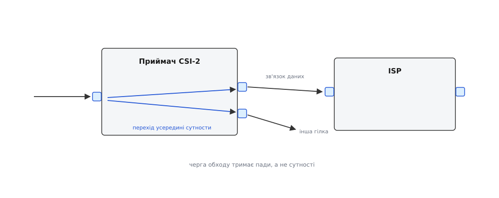
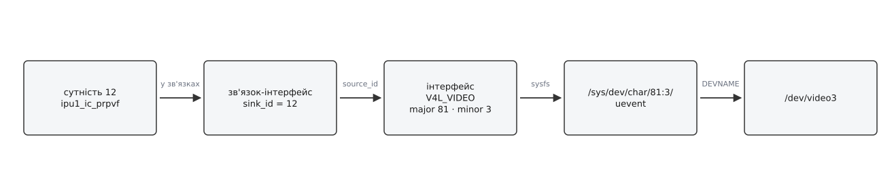

# ⚙️ Пройти граф і скласти тракт: програма на C

Ця програма робить те саме, що дві команди `media-ctl`, — вмикає зв'язки й кладе формати, — але не знає наперед жодного імені: вона читає топологію з `/dev/media0`, сама знаходить дорогу від сенсора до потрібного `/dev/videoN` і налаштовує все, що дорогою трапилося. Тобто запускається на платі, якої автор ніколи не бачив.

## Чому не сценарій із media-ctl

Сценарій із командного рядка складає тракт швидше за будь-яку програму. Але в ньому написано `'ov5640 1-003c':0 -> 'imx6-mipi-csi2':0[1]` — імена сутностей конкретної плати з конкретним сенсором на конкретній адресі I²C. Поставили сенсор іншого виробника — сценарій мовчки перестав збігатися; перенесли код на інший процесор — переписувати геть усе, включно з номерами падів.

Тим часом у самому графі є все, щоб нічого не називати поіменно. Сенсор впізнається за функцією `MEDIA_ENT_F_CAM_SENSOR`, відеовузол — за номером пристрою, під яким його відкриває програма, а між ними лежать зв'язки, кожен зі своїми кінцями. Отже, замість «увімкни оцей зв'язок» можна сказати: «знайди дорогу від того, хто знімає, до того вузла, з якого я читатиму кадри, і зроби її робочою». Це вже задача про граф.

## Граф, по якому йдемо, зроблений не з сутностей

Перша спокуса — вважати вузлами графа сутності, а ребрами зв'язки. Так робити не можна, і причина суто практична: усе, що програма потім робитиме, адресується падом. `MEDIA_IOC_SETUP_LINK` вимагає пару «сутність + номер пада» на кожному кінці, `VIDIOC_SUBDEV_S_FMT` — номер пада, на який лягає формат. Ідучи по сутностях, ми на кожному кроці губимо саме ту половину даних, заради якої йшли: яким падом увійшли й яким виходимо.

Тому вузли обходу — пади, і ребер виходить два різні види:

*Зовнішнє ребро — це зв'язок із графа; внутрішнє в графі не записане, ми додаємо його самі, бо блок, що прийняв дані, віддає їх своїми виходами.*

Внутрішнє ребро — припущення, і чесно це визнати. Ми вважаємо, що всередині сутности кожен вхід дістає кожен вихід; складніші блоки з власною комутацією описують дозволені пари окремо (`VIDIOC_SUBDEV_G_ROUTING`), і для них наш обхід знайде дорогу, якої в залізі немає. Для звичайного тракту «сенсор — приймач — ISP — пам'ять» припущення виконується.

## Витягнути топологію: два проходи

`MEDIA_IOC_G_TOPOLOGY` віддає весь граф одним викликом, але пам'ять під нього виділяє програма — ядро не має куди покласти масиви, які потім ніхто не звільнить. Звідси двопрохідний виклик: перший раз структуру подають обнуленою, і ядро заповнює саму лише кількість сутностей, падів, зв'язків та інтерфейсів; далі програма виділяє масиви, кладе на них покажчики й питає вдруге.

Між проходами граф може змінитися — доїхав модуль сенсора, хтось перемкнув зв'язок. Ядро це помічає й повертає `ENOSPC`, тому другий прохід загорнутий у петлю:

:::code proj-walk-the-graph/c/mcwalk.c

Ідентифікатори з цих масивів — непрозорі числа, а не індекси. Спокуса написати `g->pad[id]` велика й помилка тиха: на одній платі числа збігатимуться з позиціями, на іншій — ні. Тому всюди пошук:

:::code proj-walk-the-graph/c/vytiahnuty-topolohiiu-dva.c

Остання функція важливіша, ніж здається. В одному масиві `lnk` лежать зв'язки двох різних сортів: справжні зв'язки даних між падами й службові зв'язки-інтерфейси, що прив'язують сутність до її вузла в `/dev`. Хто не подивиться на `MEDIA_LNK_FL_LINK_TYPE`, того обхід поведе з пада в інтерфейс — і зламається не одразу, а через кілька плат.

## Хто є хто: від сутности до вузла в /dev

Ось перша по-справжньому неприємна річ. У графі немає жодного рядка `/dev/video3`. Інтерфейс — це [старший і молодший номери пристрою](root:sys-unix/major-minor-numbers), і більше нічого; ім'я у файловій системі роздає [udev](root:sys-unix/udev-rules) і може роздати інше. Тож дорога від сутности до вузла складається з двох перекладів: спершу зв'язком-інтерфейсом до номерів, потім номерами — до імені, і це вже питання до [моделі пристроїв у sysfs](root:sys-unix/sysfs-device-model), де для кожної пари є готовий каталог.

*У зв'язку-інтерфейсі `source_id` — це інтерфейс, а `sink_id` — сутність; напрямок тут не про течію даних, а про те, хто ким керує.*

:::code proj-walk-the-graph/c/khto-ie-khto-vid-sutnosty.c

Зворотний бік — через `stat`, а не через порівняння рядків: користувач має право передати `/dev/v4l/by-path/…`, симлінк чи взагалі інший шлях до того самого вузла, і номери пристрою розсудять це самі.

Маючи обидва переклади, роздрук графа пишеться майже дослівно за структурами — і цінний тим, чого не дає `ls /dev`: біля кожної сутности стоїть її вузол, а біля кожного зв'язку — чи він увімкнений.

:::code proj-walk-the-graph/c/khto-ie-khto-vid-sutnosty-2.c

## Обхід у ширину

Далі — [пошук у ширину](root:sf-algorithms/breadth-first-search) по падах. Ширина тут не випадкова: вона дає найкоротшу дорогу, а найкоротша дорога — це найменше блоків у тракті. Кожен зайвий блок додає затримку, споживання й ще одне місце, де формати можуть розійтися, тож «найкоротший» — розумний вибір за замовчуванням.

Початок обходу — усі пади-джерела сенсора; кінець — будь-який пад-приймач сутности, до якої веде потрібний відеовузол.

:::code proj-walk-the-graph/c/obkhid-u-shyrynu.c

Обхід свідомо не дивиться на прапорець `MEDIA_LNK_FL_ENABLED`: він шукає дорогу серед усього, що залізо взагалі вміє, а вмикати її буде наступний крок. Якби ми ходили лише ввімкненими зв'язками, програма вміла б тільки те, що хтось налаштував до неї.

## Увімкнути зв'язки й розкласти формат

Тепер дорога є, і по ній треба двічі пройтися. Перший прохід вмикає зв'язки: сусідні пади в різних сутностях — це зовнішнє ребро, і йому відповідає зв'язок, який `MEDIA_IOC_SETUP_LINK` переводить у стан «увімкнено». Уже ввімкнені не чіпаємо: зайвий виклик на зв'язку, по якому саме йде потік, поверне `EBUSY` без жодної на те потреби.

:::code proj-walk-the-graph/c/uvimknuty-zviazky-i.c

Другий прохід кладе формат — на кожен пад окремо й строго за течією даних. Порядок не косметичний: у більшості драйверів формат, покладений на вхід сутности, тягне за собою її вихід, тому налаштоване проти течії буде затерте тим, що поставлять пізніше. І кожен пад проходимо двічі: `V4L2_SUBDEV_FORMAT_TRY` питає драйвер, що з такого прохання вийде, той підправляє під свої обмеження й повертає виправлене — це вже й ставимо як `ACTIVE`. Далі несемо не те, що просили, а те, що драйвер справді поставив: наступний блок має отримати опис того, що прийде на його вхід.

:::code proj-walk-the-graph/c/uvimknuty-zviazky-i-2.c

Лишається зібрати все докупи. Перевірка версії тут не для краси: поле `index` у падах з'явилося в ядрі 4.19, і на старішому воно просто нуль — усі звʼязки вмикатимуться на пад 0, тихо й неправильно.

:::code proj-walk-the-graph/c/uvimknuty-zviazky-i-3.c

## Складність і пастки

За часом усе безкоштовно. Обхід у ширину коштує стільки, скільки в графі ребер, а сам граф — це десятки об'єктів; навіть наші лінійні пошуки за ідентифікатором, які формально дають добуток кількостей падів і зв'язків, вимірюються мікросекундами. Ціна тут не в тактах, а в кількості місць, де можна тихо збрехати самому собі, тож на кожній розвилці ми вибирали простіший, зате чесніший варіант.

**`EBUSY` від `SETUP_LINK`** буває з двох різних причин, і плутати їх дорого. Перша: потік уже йде, а зв'язок не позначений `MEDIA_LNK_FL_DYNAMIC` — тоді нічого не вдієш, треба спершу зупинити знімання. Друга: у пада-приймача вже є інший увімкнений зв'язок, і другий він не прийме — ось цей випадок лікується вимкненням старого. Окремо стоїть `EINVAL` на зв'язку з прапорцем `MEDIA_LNK_FL_IMMUTABLE`: він розведений у кремнії, і ядро відмовляє не через стан, а назавжди.

**`EPIPE` від `VIDIOC_STREAMON`** означає, що на якомусь стику формати не збіглися. Шукати навпомацки не треба: пройдіть тим самим `path[]` іще раз із `VIDIOC_SUBDEV_G_FMT` і надрукуйте, що реально стоїть на кожному паді. Стик, де вихід одного блока не дорівнює входу наступного, знайдеться очима за секунду. Найчастіша причина — блок, який мовчки не вміє запитаної роздільности й округлив її до своєї; саме тому ми несемо далі відповідь драйвера, а не власне прохання.

**Кінці тракту** теж уміють підвести. Сутностей із функцією `MEDIA_ENT_F_CAM_SENSOR` на платі з двома камерами буде дві, і взяти першу-ліпшу — підкинути монетку; у справжній програмі сенсор вибирають за іменем або за вузлом у дереві пристроїв. А відеовузол варто перевірити на `V4L2_CAP_IO_MC` у `VIDIOC_QUERYCAP`: без цього прапорця вузол самодостатній, і всю нашу роботу він просто проігнорує.

**Останній формат** — на самому відеовузлі. Наш обхід ставить формати лише на субпристроях, а `VIDIOC_S_FMT` на `/dev/videoN` лишається за викликачем, і там теж є де спіткнутися: код шини (`MEDIA_BUS_FMT_…`) і формат пікселів (`V4L2_PIX_FMT_…`) — різні переліки, відповідність між ними знає драйвер, а багатоплощинні формати вимагають типу буфера `…_MPLANE`. Далі починається звичайна [робота з чергою буферів](root:sys-unix/v4l2-video-devices/proj-capture-loop.md) — така сама, як на будь-якій веб-камері.
