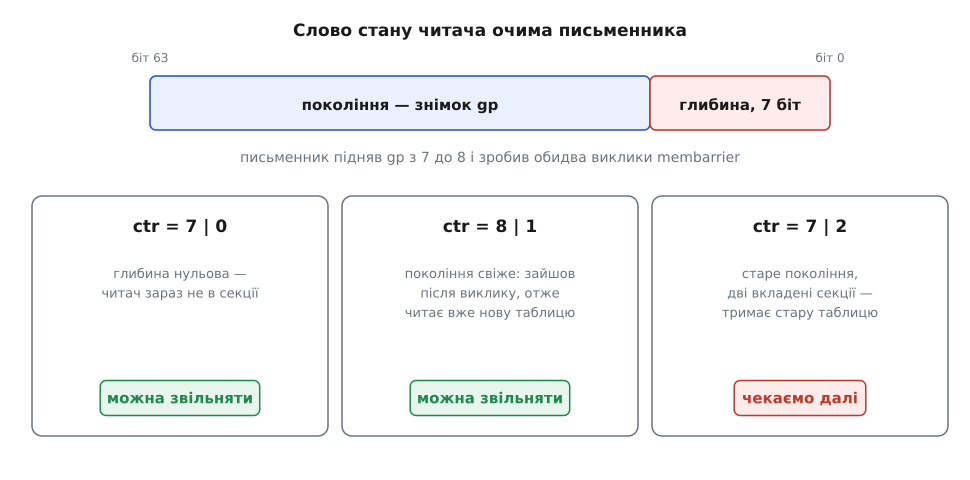

# ⚙️ Асиметричний RCU на membarrier: сто рядків робочого коду

Тут зібрано маленьку бібліотеку, у якій читач заходить у критичну секцію двома звичайними записами в пам'ять — без жодної атомарної операції й без жодного апаратного бар'єра, — а всю ціну впорядкування платить письменник, по два системні виклики на кожну заміну структури. Задача класична для [read-copy-update](root:sf-tasks/read-copy-update): таблицю читають мільйони разів на секунду, підмінюють раз на секунду, і хтось мусить сказати письменникові, коли стара копія вже нікому не потрібна.

## Слово стану: чому число, а не біт

Почнімо з найпростішого, що спадає на думку: у кожного читача власний прапорець «я всередині». Письменник публікує нову таблицю, робить `membarrier`, а потім чекає, доки в кожного читача побачить нуль.

Це безпечно. Прапорець читача, виставлений до його точки впорядкування, письменник після повернення з виклику точно побачить — тож нуль означає, що на момент точки читач був зовні. А будь-яку секцію, яку той почне пізніше, він відкриє вже після своєї точки — і побачить нову таблицю, бо публікацію письменник зробив до виклику.

Небезпеки немає, а от чекати можна нескінченно. Потік, що входить і виходить десять мільйонів разів на секунду, поза секцією перебуває мізерну частку часу; письменник, опитуючи його ззовні, може мільйони разів поспіль натрапляти на одиницю, хоча читач за цей час устиг зайти й вийти безліч разів і давно тримає нову таблицю. Одного біта бракує не для правильності, а для завершення.

Полагодити це можна одним рухом: питати не «ти зараз усередині?», а «ти заходив уже після мене?». Друге питання потребує числа. Заводимо глобальний лічильник поколінь `gp`; читач на **зовнішньому** вході знімає з нього копію й кладе у власне слово. Глибина вкладеності живе в тому ж слові — у семи молодших бітах (до 127 рівнів вкладеності; глибше не буває навіть у найзаплутанішому коді).

*Три випадки: не в секції — вільно; свіже покоління — вільно; старе покоління з ненульовою глибиною — чекаємо.*

## Гарячий бік

:::code proj-asymmetric-rcu/c/hariachyi-bik.c

У згенерованому машинному коді від `__atomic_signal_fence` не лишається жодної інструкції: це бар'єр між потоком і його ж обробником сигналу, тобто рівно заборона оптимізаторові переставляти доступи через цю точку. Дармовий — і водночас незамінний, бо це найтонше місце всієї схеми. Компілятор бачить три незалежні об'єкти (`gp`, `self->ctr`, `table`) і має цілковите право прочитати `table` до запису в `ctr`, а в циклі — ще й підняти читання `table` у регістр над усім циклом. Тоді читач мільйон ітерацій поспіль працюватиме зі вказівником, який давно звільнено, і жоден бар'єр у чужому потоці цього не виправить: потрібної інструкції просто немає в програмі. Апаратне переставляння письменник вибиває щоразу заново, а переставляння компілятора вкарбоване в код назавжди.

Розслаблене читання `rcu_dereference` теж не випадкове: `p->field` залежить від адреси, узятої з `p`, а таку залежність поважає будь-яка жива архітектура — на відміну від пари незалежних читань, яку ARM чи POWER переставлять без сорому. [Порядок доступів до пам'яті](root:sf-tasks/memory-ordering-barriers) тут не декоративна деталь, а те, на чому все тримається.

## Рідкісний бік

:::code proj-asymmetric-rcu/c/ridkisnyi-bik.c

Викликів `membarrier` тут два, і кожен закриває свою діру. Другий очевидний: без нього письменник читав би чужі слова стану, які ще сидять у буферах записів своїх ядер, — і міг би не побачити читача, що вже зайшов у секцію.

Перший потрібен через хитрішу причину — саме він робить чинним висновок «свіже покоління ⇒ читач безпечний». Читач знімає копію `gp` і потім читає `table` двома незалежними читаннями; своїм порядком він їх не скріплює. Якби письменник підняв `gp` до виклику, читач міг би побачити нове покоління і при цьому старий вказівник — і письменник звільнив би таблицю в нього під руками. Викликавши `membarrier` **до** підняття лічильника, ми домагаємося іншого: нове значення `gp` з'являється у світі вже після того, як усі читачі пройшли свої точки. Тепер прочитати його можна лише після власної точки, а отже й `table` читач візьме після неї — тобто вже нову. Та сама послідовність «спершу бар'єр, потім зміна покоління» стоїть і в `synchronize_rcu()` бібліотеки `liburcu`.

Два виклики замість одного подвоюють ціну рідкісного боку — і це нічого не міняє: вісімдесят мікросекунд раз на секунду з'їдають вісім тисячних відсотка часу, тоді як прибраний з гарячого боку бар'єр повертав би п'яту частину ядра. Асиметрія така груба, що на цьому боці рахувати вже нема чого.

І окремо: `membarrier` нікого не зупиняє. Читачі як бігли, так і біжать — виклик лише робить достовірним те, що письменник про них прочитає. Логіку очікування ми пишемо самі, і вона в тілі циклу.

## Реєстрація і старе ядро

:::code proj-asymmetric-rcu/c/reiestratsiia-i-stare.c

Опитування через `MEMBARRIER_CMD_QUERY` повертає бітову маску підтриманих команд; на ядрі, старішому за 4.3, самого виклику немає, і повернеться `-1` з `ENOSYS`. Тоді лишається трюк, яким довго жило середовище виконання .NET: звуження прав на присутню сторінку змушує ядро [розіслати скидання TLB](root:sys-unix/tlb-shootdown), а це переривання на кожне ядро, що виконує наш адресний простір, — і кожне таке переривання дає бар'єр. Сторінку тримають замкненою в пам'яті саме тому, що вивантажена між двома викликами `mprotect` сторінка переривань не породить. Це побічний ефект чужого механізму, а не обіцянка: розробники .NET самі відзначали, що припущення взяте з поведінки x86, і сумнівалися в ньому для ARM64. `membarrier` існує зокрема для того, щоб такі трюки стали непотрібні.

## Пастки

**Вкладеність.** Внутрішній `rcu_read_lock` не має права перезнімати покоління — інакше письменник вирішить, що читач «зайшов заново», і звільнить таблицю, вказівник на яку тримає зовнішня секція. Тому гілка з `gp` виконується лише за нульової глибини.

**Сон усередині секції.** Заблокований виклик у критичній секції перетворює пільговий період із сорока мікросекунд на секунди, а звільнення відкладених копій — на зростання пам'яті. Правило жорстке: у секції не блокуємося. Так само не можна скасовувати чи вбивати потік усередині секції — його слово застрягне ненульовим назавжди, і письменник крутитиметься довіку.

**Реєстрація потоків.** Кожен читач заводить свій `struct reader` і чіпляє у список до першої секції, а при виході — знімає; і те, і те під тим самим замком, що його тримає письменник, тож обхід списку безпечний.

**Сусідство в одному рядку кеша.** Без `_Alignas(64)` слова кількох читачів сядуть в один рядок, і опитування письменником одного з них вибиватиме рядок у сусідів. Гарячий шлях знову почне платити — тепер промахами кеша замість бар'єра, і рівно стільки ж. Механіка цієї пастки — [хибне спільне використання](root:hw-arch/false-sharing).

**Детектори гонок.** [ThreadSanitizer](root:sf-release/thread-sanitizer) на цьому коді закричить: порядок тут забезпечує ядро системи, і жодна бібліотека інструментування про це не знає. Такі місця доводиться глушити анотаціями вручну.

## Мікробенчмарк

Перевірити варто рівно те, заради чого все затівалося, — ціну входу в секцію.

:::code proj-asymmetric-rcu/c/mikrobenchmark.c

Обидва прогони роблять в одному процесі, по черзі й кілька разів, а потік прив'язують до ядра — інакше половину різниці з'їсть [прив'язка до процесора](root:sys-unix/cpu-affinity) з міграціями. Порядок величин, який має вийти на будь-якому сучасному x86: без бар'єра одиниці наносекунд на ітерацію, з бар'єром — вдесятеро більше. Цифру на своїй машині варто отримати самому: вона й буде тим множником, на який множиться десять мільйонів читань за секунду.
