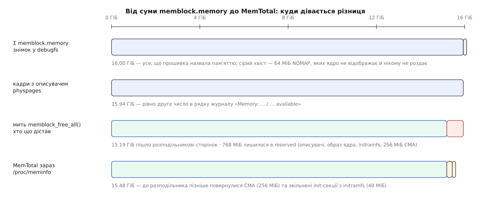

# ⚙️ Знімок memblock на живій системі: порахувати вільні вікна й зійтися з MemTotal

Напишемо програму, яка читає збережений у ядрі знімок ранньої розкладки пам'яті, зливає діапазони, віднімає зайняте від наявного й друкує вільні вікна з розмірами та вирівнюванням — тобто повторює той самий розрахунок, який `memblock` робив під час завантаження. А потім зведемо підсумок із `MemTotal` і з рядком журналу про доступну пам'ять, щоб побачити не просто «скільки пам'яті зникло», а **де саме** кожен мегабайт відстав від дороги.

Питання, на яке ця програма відповідає, звучить буденно: у машині 16 ГіБ, а `MemTotal` показує 15.5 — де решта? Відповідь «накладні витрати ядра» нічого не варта, бо не перевіряється. Відповідь «256 МіБ описувачі, 128 МіБ під аварійне ядро, 64 МіБ прошивці, 64 МіБ на решту раннього» — варта, бо кожен доданок можна назвати адресою.

## Де знімок є, а де його немає

Каталог `/sys/kernel/debug/memblock` існує не завжди, і причина не в налаштуваннях дистрибутива. У `mm/memblock.c` цей код стоїть під подвійною умовою:

```c
#if defined(CONFIG_DEBUG_FS) && defined(CONFIG_ARCH_KEEP_MEMBLOCK)
```

Друга половина умови вирішальна. Масиви `memblock` лежать у секціях, які ядро звільняє наприкінці завантаження разом з усім кодом ініціалізації; уціліють вони лише там, де архітектура попросила їх лишити. `arch/arm64/Kconfig` містить безумовне `select ARCH_KEEP_MEMBLOCK`, бо arm64 і через добу роботи мусить уміти спитати «чи це взагалі пам'ять». RISC-V вмикає його умовно, рядком `select ARCH_KEEP_MEMBLOCK if ACPI`. А в `arch/x86/Kconfig` єдина згадка цього символу — усередині `config INTEL_TDX_HOST`. Наслідок практичний: на звичайному настільному x86-64 каталогу немає взагалі, на серверній збірці з увімкненою підтримкою TDX він раптом з'являється, а на платах з arm64 він є завжди. Тому програма мусить мати запасний шлях, і він буде.

## Що каже один рядок

Формат виводу простий, але має дві пастки, обидві мовчазні. Ядро друкує кожен запис так:

```
   0: 0x0000000040000000..0x0000000043ffffff    0 NOMAP
   1: 0x0000000044000000..0x00000000dfffffff    0 NONE
   2: 0x0000000100000000..0x000000045fffffff    0 NONE
```

Перша пастка — **друге число не є межею діапазону**. Усередині `memblock` запис тримає базу й розмір, тобто межа напіввідкрита; на друк же йде `reg->base + reg->size - 1` — адреса останнього байта. Хто відніме одне від одного й візьме результат за розмір, загубить рівно по байту на діапазон. Сорок діапазонів — сорок байтів; у мегабайтах така похибка не видна ніколи, і саме тому ця помилка живе роками.

Друга пастка — **хвіст рядка є не в кожному ядрі**. У 5.10 функція друкувала лише індекс і пару адрес. Пізніше додали ще дві колонки: номер вузла [NUMA](root:hw-arch/numa) (або `x`, коли вузол не заданий) і назву прапорця — `NONE`, `NOMAP`, `MIRROR`, `HOTPLUG`, `DRV_MNG`. Розбір, який жорстко чекає п'ять полів, на давнішому ядрі не прочитає жодного рядка. Тому беремо два числа після двокрапки, а хвіст читаємо як необов'язковий.

Прапорець `NOMAP` варто впіймати окремо, бо він міняє арифметику. Така пам'ять є в масиві `memory` — окремим записом, бо позначення прапорцем розтинає діапазон рівно по межах позначеного, — її ніхто не заносив у `reserved`, і водночас ядро її нікому не роздає й навіть не заводить на неї описувачів. Якщо просто відняти `reserved` від `memory`, ці діапазони порахуються вільними, і підсумок не зійдеться ні з чим. Найпростіше чесне рішення — дописати їх у масив зайнятого власноруч: злиття діапазонів саме розбереться, якщо якийсь із них уже там є.

## Арифметика

Далі все зводиться до дій над відрізками, і обидві дії варто зробити в правильному порядку.

**Злиття.** Масиви впорядковують за адресою, потім проходять один раз і зшивають усе, що перетинається або стикається. Це не косметика: одну й ту саму сторінку різні шматки раннього коду резервують незалежно один від одного, і подвійний запис — норма, а не збій. Без злиття той самий байт двічі потрапить у суму зайнятого, і підсумок поїде.

**Різниця.** Вільне ніде не зберігається — його щоразу обчислюють. Ідемо впорядкованою наявною пам'яттю, тримаючи курсор `cur` на початку поточного діапазону; кожен зайнятий шматок, що починається праворуч від курсора, відкриває вікно від `cur` до свого початку, після чого курсор перестрибує за його кінець. Другий покажчик по масиву зайнятого рухається лише вперед, тому обидва масиви проходяться по одному разу.

Вартість цілком у сортуванні: `O(n log n + m log m)` для `n` наявних і `m` зайнятих діапазонів, далі `O(n + m)` на прохід. Числа тут маленькі — десятки записів, зрідка сотні, — тож уся програма виконується швидше, ніж відкриваються її вхідні файли.

Крім розміру, кожне вікно варто описати **вирівнюванням** — найбільшою степінню двійки, на яку ділиться його початкова адреса. Це `base & (~base + 1)`, і це саме те, чого від пам'яті хочуть ранні прохачі: [великій сторінці](root:sys-unix/huge-pages-tlb-reach) потрібні два мебібайти, вирівняні на два мебібайти, а області [CMA](root:sys-unix/cma-contiguous-allocator) — суцільний шматок із вирівнюванням на розмір блоку сторінок. Вікно на 300 МіБ, що починається з непарного мебібайта, для таких запитів гірше за вікно на 64 МіБ із гарною адресою.

## Програма

:::code proj-read-memblock/c/memblock-free.c

## Що вона друкує

Плата на arm64 з шістнадцятьма гібібайтами, оперативна пам'ять починається з першого гібібайта адресного простору, у прошивки свій захищений шматок, у ядра — область CMA й місце під аварійне ядро. Числа діапазонів у шапці — уже після злиття: три записи `memory` дали два діапазони (запис із `NOMAP` стикається з рештою пам'яті), сім записів `reserved` — п'ять, бо захищена ділянка прошивки лежить упритул до образу ядра, а таблиці — упритул до масиву описувачів.

```
джерело         : /sys/kernel/debug/memblock
наявна пам'ять  :  2 діап.    16.00 ГіБ
зайнято         :  5 діап.   832.00 МіБ  (з них NOMAP 64.00 МіБ)

вільні вікна:
  0x000046800000..0x000046ffffff     8.00 МіБ  вирівняно на 8.00 МіБ
  0x000048800000..0x00004fffffff   120.00 МіБ  вирівняно на 8.00 МіБ
  0x000058000000..0x00009fffffff     1.12 ГіБ  вирівняно на 128.00 МіБ
  0x0000b0000000..0x0000dfffffff   768.00 МіБ  вирівняно на 256.00 МіБ
  0x000100000000..0x00044bffffff    13.19 ГіБ  вирівняно на 4.00 ГіБ

разом вільного  :  5 вікон    15.19 ГіБ   (найбільше 13.19 ГіБ)
MemTotal        :             15.48 ГіБ
CmaTotal        :            256.00 МіБ

звірка:
  Σ memory − NOMAP             15.94 ГіБ
  Σ reserved − NOMAP − CMA    512.00 МіБ
  те саме з журналу ядра       15.94 ГіБ
    і його ж «K reserved»     512.00 МіБ
  MemTotal − вільне − CMA      40.00 МіБ
```

## Чому саме ці рівності мають зійтися

Жоден із трьох збігів не випадковий — за кожним стоїть своя рівність.

`Σ memory − NOMAP` дорівнює другому числу з рядка `Memory: … available` — бо це число є `physpages`, кількість кадрів, на які ядро завело описувачі. Діапазони з прапорцем `NOMAP` описувачів не отримують; на решту наявної пам'яті їх заводять усі до одного.

`Σ reserved − NOMAP − CMA` дорівнює числу перед словом `reserved` у тому ж рядку — бо ядро друкує його як `physpages − totalram_pages − totalcma_pages`, а `totalram_pages` у ту мить є рівно тим, що щойно віддали розподільникові сторінок. Розкриття цієї різниці й дає суму зайнятого без `NOMAP` і без CMA.

`MemTotal` більший за пораховане вільне, і різниця має два джерела. Перше — CMA: ці області зайняті в `memblock`, але потім кадри в них таки віддають розподільникові з позначкою «рухомі», тож у `MemTotal` вони присутні. Друге — пізні звільнення вже після передачі естафети: секції ініціалізації (рядок `Freeing unused kernel image (initmem) memory`) та `initramfs` (`Freeing initrd memory`). Знімок `memblock` про них не знає, бо його масиви ніхто не переписує, а лічильник доступної пам'яті знає. Сорок мегабайтів у прикладі — це саме вони, і сума двох рядків журналу мусить збігтися з ними до кілобайта.



*Кожна сходинка має ім'я. Різниця, для якої імені не знайшлося, — це привід шукати зайве резервування.*

> 🔧 **Навіщо це.** На платі з увімкненою підтримкою камери «зникло» пів гібібайта: `MemTotal` менший за очікуваний рівно на цю величину. Знімок відповідає за десять секунд: у зайнятому стоїть великий діапазон, чия адреса збігається з вузлом `reserved-memory` в дереві пристроїв. Виявляється, конфігурація описала дві області CMA замість однієї, і друга не використовується ніколи. Без такої звірки ту саму пропажу шукають у драйверах.

## Коли знімка немає

Ключ `--iomem` будує картину з `/proc/iomem` — файлу, який, як і решта [псевдофайлових систем](root:sys-unix/pseudo-filesystems), не існує на диску, а складається в мить читання. Верхній рівень із назвою `System RAM` дає наявну пам'ять, вкладені рядки з відступом — те, що всередині неї вже комусь належить.

Треба чесно сказати, чого цей шлях **не** дає. Дерево ресурсів знає лише про те, що хтось попросив у ньому зареєструвати: `Kernel code`, `Kernel data`, `Crash kernel`, вузли `reserved-memory`. Ранні виділення `memblock` — масив описувачів, таблиці сторінок, ділянки на кожен процесор — туди не потрапляють. Тому «вільне» за `/proc/iomem` завжди більше за справжнє: як розкладка адрес цей файл бездоганний, а як звіт про ранні резервування — ні. Саме тому програма в цьому режимі мовчки пропускає звірку: порівнювати завищене число з `MemTotal` означало б вигадувати пояснення розбіжності.

## Пастки

**Потрібен root.** Каталог `/sys/kernel/debug` має права `0700`, а `/proc/iomem` без [можливості](root:sys-unix/capabilities) `CAP_SYS_ADMIN` віддає всі адреси нулями — не помилку, не порожній файл, а правдоподібний вивід із нулями замість чисел. Програма ловить це за сумою розмірів; без перевірки такий вивід виглядає як «пам'яті немає».

**Остання адреса включна** в обох файлах, тоді як усередині ядра межа напіввідкрита. Розмір — це `end − base + 1`.

**Тридцять два біти не вміщають адресу.** На 32-бітній платі з розширеною фізичною адресацією пам'ять живе вище четвертого гібібайта, і `unsigned long` там завширшки чотири байти. Тому в програмі всюди `uint64_t`, `SCNx64` і `PRIx64`, а не `%lx`.

**Це знімок, а не поточний стан.** Масиви заморожені на кінці завантаження. Гаряче під'єднана пам'ять, звільнені секції ініціалізації, будь-які пізніші рухи в масивах не відображені — саме тому звірка з `MemTotal` дає ненульовий залишок, і саме тому цей залишок має бути малим.

**Рядок у журналі може не дожити.** Кільцевий буфер [журналу ядра](root:sys-unix/kernel-log-printk) перекручується, і на машині з балакучими драйверами повідомлення про доступну пам'ять зникає за години. Тоді його беруть із `journalctl -k -b`, де збережено весь поточний запуск.
