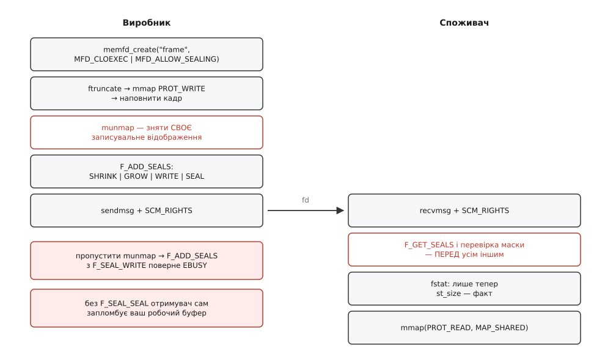

# ⚙️ Обмін запломбованим буфером: два процеси, один кадр, жодної копії

Тут зібрана робоча програма на C, у якій один процес готує кадр у безіменному файлі, назавжди заморожує його пломбами й віддає дескриптор сусідові, а сусід **сам питає ядро**, чи справді все заморожено, перш ніж торкнутися бодай байта. Виклики тут прості; уся суть — у **порядку**, бо майже кожна помилка в цій схемі є помилкою порядку, і кожна має свій окремий код відмови або свій сигнал.

## Що будуємо

Два процеси зв'язані `socketpair` — парою вже з'єднаних сокетів домену Unix, якими можна [переслати відкритий дескриптор допоміжними даними повідомлення](root:sys-unix/unix-domain-sockets). Батьківський процес — виробник: створює файл на кадр 640×360, малює в ньому зелений градієнт, пломбує й віддає дескриптор. Дочірній — споживач: питає пломби, і лише переконавшись, що вміст і розмір заморожені, відображає файл на читання й розбирає його просто у відображенні, нікуди не копіюючи.



*Обидві сторони мусять робити своє саме в цьому порядку: виробник знімає власне відображення перед пломбуванням, споживач питає пломби перед розміром і відображенням.*

Програма одна й розгалужується через `fork`, тож зібрати й запустити її можна однією командою, а вивід обох сторін лягає в один потік.

## Дескриптор поштою

Дескриптор — число, дійсне лише в межах свого процесу, тож переслати треба не число, а сам об'єкт ядра. Це вміє один-єдиний механізм — допоміжні дані `SCM_RIGHTS` на сокеті домену Unix.

:::code proj-sealed-buffer/c/deskryptor-poshtoiu.c

Три деталі тут неочевидні. Разом із дескриптором надсилають хоч один звичайний байт: на потоковому сокеті повідомлення без даних може не піти взагалі, та й отримувачеві потрібен привід повернутися з `recvmsg` — дескриптор приїде причепом до цього байта. Буфер під допоміжні дані оголошено через об'єднання з `struct cmsghdr` не з любові до трюків: `CMSG_DATA` рахує зсуви від правильно вирівняного початку, а масив `char` сам собою такого вирівнювання не має. І `MSG_CMSG_CLOEXEC` — щоб щойно отриманий дескриптор не проліз у наступний `exec`; для дескрипторів, що приходять ззовні, це має бути звичкою.

Прапорець `MSG_CTRUNC` перевіряють не для краси: якщо буфера забракло, частина дескрипторів не доїде, а ті, що доїхали, лишаться відкритими без вашого відома.

## Виробник: наповнити, прибрати руки, запломбувати

:::code proj-sealed-buffer/c/vyrobnyk-napovnyty.c

Перший `fcntl` тут навмисно приречений: поки в таблицях сторінок процесу стоять записи з дозволом на запис, ядро не має як пообіцяти, що ніхто більше не пише — процесор пише в пам'ять напряму, ядра не питаючи ([відображення й таблиці сторінок](root:sys-unix/mmap-model)). Тому `F_SEAL_WRITE` за наявного спільного записувального відображення відмовляє з `EBUSY`, і `munmap` — не прибирання за собою, а обов'язковий крок протоколу.

Друга навмисність — `ftruncate(fd, 0)` наприкінці. Пломба `F_SEAL_WRITE` заморожує **вміст**, але не **довжину**: скорочення забороняє тільки `F_SEAL_SHRINK`. Так виробник грає роль недбалого сусіда й показує, що саме купує кожна з двох пломб окремо.

## Споживач: спершу спитати ядро

:::code proj-sealed-buffer/c/spozhyvach-spershu-spytaty.c

`F_GET_SEALS` стоїть першим не з педантизму. Він відповідає на два питання разом: чи це взагалі об'єкт із пломбами (на звичайному файлі повернеться `-1` і `EINVAL`) і які саме гарантії на ньому вже незворотні. Доти жоден інший виклик не має сенсу — зокрема `fstat`, бо `st_size` до `F_SEAL_SHRINK` є не властивістю файлу, а миттєвим знімком числа, яке сусід перепише через такт. Після пломби те саме число стає фактом, і на ньому вже можна будувати довжину відображення.

Спроба споживача додати `F_SEAL_FUTURE_WRITE` — перевірка дзеркального боку. Дескриптор, що приїхав `SCM_RIGHTS`, відкритий на читання-запис, тож пломбувати ним **можна**; єдине, що зупиняє гостя, — поставлена виробником `F_SEAL_SEAL`. Без неї отримувач одним викликом заморозив би чужий робочий буфер назавжди.

Саме тут і окупається вся конструкція. Споживач читає `f->w`, `f->h`, а далі пікселі просто за вказівником у чужу пам'ять — і не мусить копіювати їх до себе, щоб перевірка не застаріла між читанням і використанням. Без пломби довелося б робити навпаки: спершу копію, потім перевірку, потім роботу з копією. Ціна цієї обережності на кадрі 640×360 виглядає так:

```
кадр               = 8 + 640·360·4 = 921 608 байтів
при 60 кадрах/с    = 921 608 · 60  ≈ 55.3 МБ/с на КОЖНОГО клієнта
```

Для однієї програми це дрібниця, але множиться воно на кількість клієнтів, іде подвійно (запис копії, потім читання копії) і щоразу вимиває з кешу те, що композиторові справді потрібне. А головне — це рівно те копіювання, заради усунення якого спільну пам'ять і брали: інакше кадр так само пересилається, просто не каналом, а через пам'ять. Пломба знімає його одним викликом `fcntl` на весь буфер.

Запасний `MAP_PRIVATE` — не забобон: до Linux 6.7 ядро відхиляло **будь-яке** нове спільне відображення запломбованого на запис файлу, навіть суто читальне, бо лічильник записувальних відображень збільшувався на кожне `MAP_SHARED` (виправлено 2023 року, коли `VM_MAYWRITE` для читальних відображень почали просто гасити). На старіших ядрах `PROT_READ | MAP_SHARED` повертає `EPERM`, і читачеві лишається приватне відображення — для незмінного вмісту воно так само безкопійне.

## Каркас

Лишилося зшити все в один файл `sealed.c`: заголовки й `die` згори, далі `send_fd`/`recv_fd`, `producer`, `consumer`, а `main` — останнім.

:::code proj-sealed-buffer/c/karkas.c

`memfd` створюється **після** `fork`, тож дочірній процес не успадковує його випадково — єдина його дорога до файлу лежить через сокет. Пара сокетів узята `SOCK_SEQPACKET`: межі повідомлень зберігаються, тож однобайтові підтвердження не зіллються в потік.

## Складання й запуск

```
$ cc -O2 -Wall -Wextra -o sealed sealed.c
```

Обгортку `memfd_create` glibc має з версії 2.27; на старішій системі виклик роблять напряму — `syscall(SYS_memfd_create, "frame", flags)`. Перший запуск — усе запломбовано як слід:

```
$ ./sealed
[виробник] F_SEAL_WRITE до munmap → Device or resource busy
[виробник] пломби 0xf, 921608 байтів → віддаю дескриптор
[споживач] пломби 0xf — усе на місці
[споживач] моя спроба допломбувати → Operation not permitted
[споживач] кадр 640x360, перший піксель 0xff000000
[виробник] ftruncate(fd, 0) → Operation not permitted
[споживач] торкаюся останнього пікселя...
[споживач] останній піксель 0xff00ff00
```

Маска `0xf` — це `F_SEAL_SEAL | F_SEAL_SHRINK | F_SEAL_GROW | F_SEAL_WRITE` (0x1, 0x2, 0x4 і 0x8). Другий запуск — те саме, але виробник «забув» `F_SEAL_SHRINK`:

```
$ ./sealed --no-shrink
[виробник] F_SEAL_WRITE до munmap → Device or resource busy
[виробник] пломби 0xd, 921608 байтів → віддаю дескриптор
[споживач] пломби 0xd — БРАКУЄ потрібних
[споживач] моя спроба допломбувати → Operation not permitted
[споживач] кадр 640x360, перший піксель 0xff000000
[виробник] ftruncate(fd, 0) пройшов — файл тепер порожній
[споживач] торкаюся останнього пікселя...
[батько] споживач загинув від сигналу 7 (Bus error)
```

Останній рядок і є ціна пропущеної пломби. Адреса лишилася законною, відображення нікуди не поділося — але сторінки, яку туди підставляти, у файлі більше немає, і [сторінковий збій](root:sf-os/page-fault) нема чим закрити. Ядро шле `SIGBUS`, типова дія якого — убити процес. Зверніть увагу, хто загинув: **читач**, а не той, хто вкоротив файл.

Наш споживач помітив брак пломби, надрукував попередження й пішов читати далі — навмисно, щоб показати наслідок. Справжній читач на цьому місці закриває дескриптор і відмовляється від буфера: після `F_GET_SEALS` перевірка коштує одне порівняння масок, а її відсутність коштує процес.

> 🔧 **Навіщо це.** Той самий кістяк — `memfd` під кадр, пломби, дескриптор сокетом, перевірка на боці читача — лежить під буферами Wayland і аудіобуферами PipeWire. Різниця лише в наборі пломб: буфер, який віддають раз і назавжди, замикають `SHRINK | WRITE`, а той, що клієнт переписує щокадру, — самим `SHRINK | GROW`, лишаючи «хто зараз пише» на відповідальність протоколу.

## Пастки, зібрані в одному місці

**`EBUSY` замість пломби.** `F_SEAL_WRITE` не поставити, поки живе бодай одне спільне записувальне відображення — власне теж. Якщо буфер потрібно тримати відображеним і далі, пломба не та: беріть `F_SEAL_FUTURE_WRITE` (Linux 5.1), яка лишає чинними наявні відображення. Тільки й гарантія в неї слабша — «нових записувачів не буде», а не «вміст незмінний», і читач мусить розуміти цю різницю.

**`F_SEAL_WRITE` без `F_SEAL_SHRINK`.** Ця пара розділяє дві незалежні властивості: вміст і довжину. Одна без одної не рятує — саме це показує другий запуск.

**`st_size` до перевірки.** Число, прочитане `fstat`, стає надійним лише після `F_SEAL_SHRINK`; інакше воно застаріває просто між викликами. Порядок «пломби → розмір → відображення» — не стиль, а єдина послідовність, у якій кожен наступний крок спирається на вже незворотний факт.

**Забута `F_SEAL_SEAL`.** Дескриптор, який ви віддали, дає гостю право пломбувати ваш файл. Якщо буфер робочий і має ще заповнюватися — замикайте набір, інакше отримувач заморозить його вам першим же `F_SEAL_WRITE`.

**`MFD_ALLOW_SEALING` при створенні.** Без цього прапорця файл народжується вже з `F_SEAL_SEAL`, і жодної пломби на нього не поставити ніколи. Помилка виявиться аж на `F_ADD_SEALS`, кодом `EPERM`, — за кілька сотень рядків від справжньої причини.
