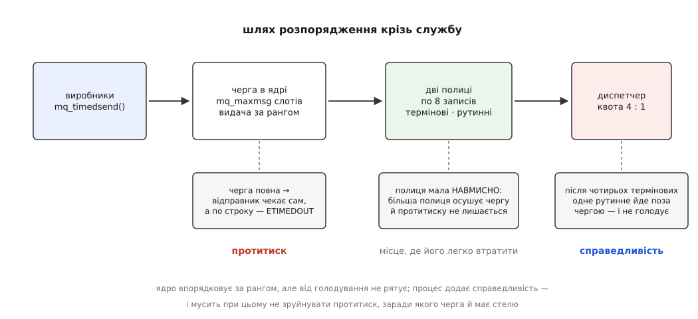

# ⚙️ Диспетчер розпоряджень: служба з двома рангами

Це робоча служба на C — `drived`, невеликий демон, що приймає розпорядження від кількох незалежних програм через POSIX-чергу, виконує аварійні поперед рутинних, нічого не губить мовчки й після падіння не оживає з чужими намірами. Кожна з цих вимог коштує окремого рішення в коді: черга дає механізм, а політику — терміновість, живучість, поведінку на переповненні — доводиться дописувати самому.

Формат розпорядження тут найпростіший: рядок до 256 байтів, а важливість несе не тіло, а пріоритет повідомлення. Умовимось, що все з рангом від 9 і вище — термінове, решта — рутинне.

## Скільки слотів нам узагалі дадуть

Геометрію POSIX-черги фіксують один раз при створенні, і взяти «із запасом» не вийде: обидва числа впираються у стелі, причому в різні й з різними симптомами.

Перша стеля — `RLIMIT_MSGQUEUE`, сумарний обсяг усіх черг реального користувача ([ліміти ресурсів](root:sys-unix/resource-limits) — м'яка й тверда межа на процес, звідки береться типове значення й хто має право його підняти). Ядро рахує не самі байти даних, а й службовий запис на кожен слот; `getrlimit(2)` наводить формулу дослівно:

```
bytes = mq_maxmsg · sizeof(struct msg_msg)
      + min(mq_maxmsg, MQ_PRIO_MAX) · sizeof(struct posix_msg_tree_node)
      + mq_maxmsg · mq_msgsize
```

Друга стеля — `/proc/sys/fs/mqueue/msg_max`, типово **10**: непривілейований процес більшого `mq_maxmsg` не попросить узагалі, хай як багато місця лишає йому ліміт.

**Слот на 256 байтів за типових налаштувань.**

```
RLIMIT_MSGQUEUE (типово)   = 819200 байтів
службове на слот           ≈ sizeof(struct msg_msg)
                           + sizeof(struct posix_msg_tree_node)  ≈ 96 байтів (x86-64)

бюджет цій черзі (пів ліміту) = 409600
слотів за лімітом             = 409600 / (256 + 96) = 1163

/proc/sys/fs/mqueue/msg_max   = 10          ← спрацьовує перша
mq_maxmsg = min(1163, 10)     = 10
```

Ліміт зв'язує руки на товстих слотах, sysctl — на тонких. Помилки при цьому різні: завелике `mq_maxmsg` дає `EINVAL`, а невдалий облік за лімітом — на Linux `EMFILE`, той самий код, що й «забагато відкритих файлів». Хто цього не знає, шукає витік дескрипторів там, де насправді вперлися в обсяг черг.

Точні розміри тих двох структур — усередині ядра, вони залежать від архітектури й конфігурації, тому в коді ми беремо їх із запасом, а результат обрізаємо стелею з sysctl:

:::code proj-priority-dispatcher/c/drived.c

## Відкриття: черга могла нас пережити

Черга живе в ядрі окремо від процесів, тож наш демон майже ніколи не бачить чистого поля. Наївне `mq_open` з `O_CREAT` мовчки відкриє те, що лишилося з попереднього запуску, **проігнорувавши переданий `attr`** — і служба працюватиме зі вчорашньою геометрією, не підозрюючи про це. Тому створюємо з `O_EXCL`, ловимо `EEXIST` і після цього дивимося на дійсність через `mq_getattr`:

:::code proj-priority-dispatcher/c/vidkryttia-cherha-mohla.c

Права `0620` — читання й запис власникові, лише запис групі: виробники кладуть, забирає служба. Як і в `open`, біти проходять крізь `umask`, тож демон із `umask 027` мовчки втратить право групи на запис і потім довго дивуватиметься на `EACCES` у виробників.

## Спадок попереднього запуску

Після `mq_unlink` старе ім'я звільнене, але сам об'єкт живе, доки хтось тримає на нього дескриптор: виробник, який відкрив чергу до перезапуску, і далі складатиме розпорядження — тепер уже в об'єкт-сироту, куди ніхто ніколи не загляне. Ліки не в коді служби, а в дисципліні виробників: відкривати чергу коротко, на час відправлення, або відкривати її наново після невдачі.

А коли геометрія збіглася й ми успадкували чергу з розпорядженнями, потрібна свідома політика. Ознака давності тут дається задарма: **усе, що лежить у черзі на момент старту, надійшло до цього запуску** — жодних міток часу вигадувати не треба. Далі вирішує сенс, якого ядро не знає: віддати виконавцеві аварійне «стоп» невідомо через скільки хвилин після аварії небезпечно, а рутинне «оновити налаштування» ідемпотентне й нешкідливе.

:::code proj-priority-dispatcher/c/spadok-poperednoho-zapusku.c

## Дві межі: протитиск і справедливість

Тепер найцікавіше. Ядро завжди видає верхівку черги, і `mq_receive` не вміє попросити «щось інше» — отже, рівний потік термінових не залишить рутинним жодного шансу. Справедливість доводиться будувати в процесі: розібрати прочитане на дві полиці за рангом і видавати виконавцеві за власним правилом — чотири термінові, тоді одне рутинне поза чергою.

Тільки тут чигає пастка, у яку легко втрапити з розгону. Якщо перекладати чергу ядра в необмежений список у пам'яті процесу, черга завжди буде порожня — а разом із нею зникне єдине, що гальмувало виробників. Стеля `mq_maxmsg` була не прикрістю, а сигналом ([протитиск](root:sf-tasks/backpressure) — чому конструкція без зворотного гальмування рано чи пізно або губить дані, або роздувається до вичерпання пам'яті); осушивши чергу, ми той сигнал стерли й перенесли переповнення туди, де його вже ніхто не помітить.

Тому полиці **навмисно крихітні** — вісім записів на ранг. Їхня єдина робота — дати диспетчерові кілька записів на вибір; усе інше має лишатися в ядрі, де воно видиме виробникам.



*Ранг наступного повідомлення наперед невідомий, тому вичерпування спиняється, щойно заповнилася бодай одна полиця.*

:::code proj-priority-dispatcher/c/dvi-mezhi-protytysk-i.c

## Головний цикл

Сповіщення `mq_notify` спрацьовує лише на краю «порожньо → непорожньо» й лише один раз, тож реєстрація мусить передувати вичерпуванню. Наш цикл робить за оберт рівно три речі: озброює сторожа, забирає з ядра все, що вміщається, і виконує **одне** розпорядження. Спати він має право тільки тоді, коли обидві полиці порожні — а це, за побудовою `drain`, можливо лише після зупинки на `EAGAIN`. Так безвихідний сон над непорожньою чергою просто не має де виникнути.

:::code proj-priority-dispatcher/c/holovnyi-tsykl.c

`EBUSY` тут не помилка, а звичайний стан: доки сповіщення не спрацювало, реєстрація ще діє, і повторний `mq_notify` просто каже про це. Зворотний випадок — сповіщення надійшло під час виконання розпорядження — дає одне зайве пробудження: сигнал лежить у стані очікування, `sigsuspend` віддає його негайно, `drain` бачить порожньо, цикл засинає знову. Нічого не ламається.

## Виробник: гальмувати, а не губити

На повній черзі `mq_send` блокується, а з `O_NONBLOCK` — повертає `EAGAIN`. Обидва варіанти правильні, неправильний лише третій: не подивитися на код повернення. Служба, яка «іноді не виконує розпоряджень», майже завжди виявляється саме цим.

:::code proj-priority-dispatcher/c/vyrobnyk-halmuvaty-a-ne.c

`mq_timedsend` перетворює протитиск на обмежене чекання: дві секунди ми гальмуємо разом зі службою, а далі повідомляємо, що вона не встигає. Кому блокуватися не можна взагалі — обробникові кнопки, реальночасовому циклу — той бере `O_NONBLOCK` і на `EAGAIN` ухвалює рішення на місці: відкинути найменш важливе, злити на диск, підняти тривогу.

> 🔧 **Навіщо це.** Дві межі цієї служби — стеля черги й розмір полиці — насправді одна конструкція: місце, де швидкість виробників упирається в швидкість споживача. Пересунувши її вглиб процесу, ви не прискорите систему, а лише зробите переповнення невидимим — і воно проявиться як тихо втрачені розпорядження за кілька тижнів.

## Варіант через epoll

Щойно поряд із чергою з'явиться сокет чи таймер, сигнальна конструкція стає затісною: `sigsuspend` чекає на одну подію. На Linux `mqd_t` — звичайний файловий дескриптор, тож чергу можна покласти в `epoll` разом з усім іншим ([select, poll, epoll](root:sys-unix/select-poll-epoll) — очікування готовності багатьох джерел в одній точці програми):

:::code proj-priority-dispatcher/c/variant-cherez-epoll.c

Тут зникає вся морока з краєм: `epoll` за замовчуванням сповіщає за рівнем, тобто повторюватиме «є що читати», доки черга непорожня, і пропустити нічого не можна навіть помилившись із порядком. Заплачено за це портативністю — приведення `mqd_t` до `int` і чекання на дескриптор черги є розширенням Linux, якого стандарт не обіцяє: на FreeBSD чи Solaris лишається `mq_notify`.

## Де воно ламається

- **Буфер `mq_receive`.** Менший за `mq_msgsize` — `EMSGSIZE`, незалежно від того, що лежить у черзі. Розмір беруть у `mq_getattr`, а не з власних уявлень.
- **`attr` на наявній черзі.** Ігнорується без жодного натяку. Єдина надійна перевірка — `O_EXCL` плюс `mq_getattr`.
- **`EINTR`.** `mq_receive`, `mq_send` і їхні `timed`-варіанти перериваються сигналом, але, на відміну від `msgrcv`/`msgsnd` із System V, **перезапускаються** обробником із `SA_RESTART` ([EINTR](root:sys-unix/eintr-and-restart) — коли виклик повертає помилку лише через сигнал і що робить прапорець `SA_RESTART`). Покладатися на це в чужому коді не варто: цикл `if (errno == EINTR) continue;` коштує один рядок і працює скрізь.
- **Реєстрація `mq_notify`.** Одна на чергу в цілій системі (`EBUSY` другому), належить процесові, не успадковується через `fork` і зникає із закриттям дескриптора. Читач, що вже спить у `mq_receive`, забирає повідомлення поперед будь-якої реєстрації.
- **Обробник сигналу.** Наш порожній — і це не випадковість: у ньому не можна ні писати в полиці, ні викликати `printf` ([що можна в обробнику](root:sys-unix/async-signal-safety) — перелік async-signal-safe функцій і чому решта здатна зіпсувати стан у довільний спосіб).
- **Хто робить `mq_unlink`.** Наша служба не видаляє чергу при виході навмисно — саме тому розпорядження переживають перезапуск. Прибирає її або оператор (`rm /dev/mqueue/drived.cmd`, коли примонтовано `mqueue`), або юніт із `ExecStopPost`, коли політика вимагає чистого аркуша.
- **Ціна.** Один зайвий `mq_notify` на оберт циклу — це ще один перехід у ядро поряд із двома копіями й двома переходами на кожне повідомлення. Для потоку розпоряджень це не видно взагалі; було б видно, якби через чергу йшли кадри.
