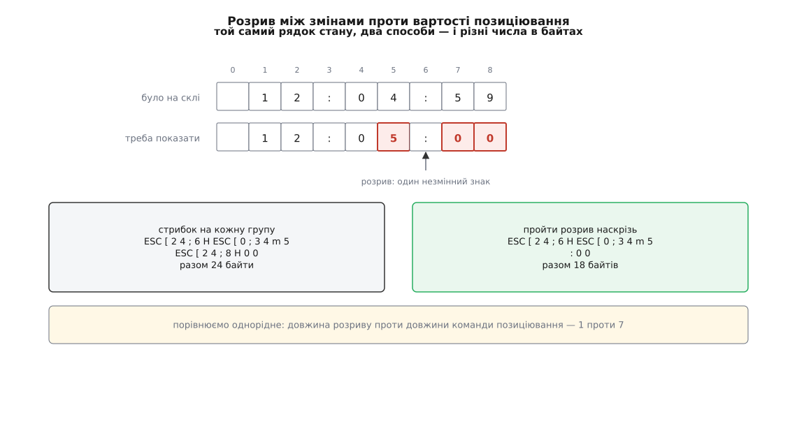

# ⚙️ Мініатюрне оновлення екрана: два буфери й ціна в байтах

Триста рядків на C без жодного виклику curses: два буфери комірок, кілька функцій, що зводять перший до другого, і лічильник, який показує, у скільки байтів обійшовся кожен із них. Мета — не повторити бібліотеку, а побачити на власних числах, звідки в оновленні екрана беруться двадцятикратні різниці.

Уся конструкція тримається на одній хитрості у вимірюванні. Якщо програма справді друкує в термінал, порівняти два способи на **тому самому** кадрі неможливо: перший уже змінив стан скла, і другий працює вже з іншого початку. Тому «дріт» тут — структура, яка приймає байти й може їх або надіслати, або просто порахувати. Вимикаємо надсилання — і той самий кадр можна звести трьома різними способами, а три числа покласти поруч.

## Комірка, буфер і дріт, що вміє мовчати

:::code proj-minimal-updater/c/mini-update.c

Три останні поля `Wire` — це вся пам'ять про приймач, і без них нічого не порахуєш чесно. Позицію курсора й ввімкнені ознаки термінал тримає в собі; кожна надіслана команда їх міняє. Хто цього не веде, той друкує позиціювання там, де курсор уже стоїть, і вмикає колір, який уже ввімкнений, — на кадр набігають сотні зайвих байтів.

Від'ємне значення означає «не знаємо», і одне таке місце варте окремої згадки. Після знака в останній колонці термінали розходяться: одні переносять курсор на наступний рядок одразу, інші тримають його «за краєм» до наступного знака. Гадати тут не можна, тож ми просто оголошуємо позицію невідомою — і платимо за наступне позиціювання повну ціну.

## Три способи звести один буфер до другого

Перший спосіб не порівнює нічого: малює весь кадр від першої комірки до останньої. Другий іде по комірках і друкує тільки відмінні, стрибаючи курсором на кожну групу. Третій відрізняється від другого однією думкою — **курсор уже десь стоїть**, і якщо між двома змінами лежить кілька незмінних знаків, передрукувати їх дешевше, ніж переставляти курсор. Позиціювання на двадцять четвертий рядок коштує сім-вісім байтів; незмінна двокрапка між двома цифрами годинника коштує один.



*Порівнюємо однорідне: довжину розриву в байтах проти довжини команди позиціювання — і беремо менше.*

:::code proj-minimal-updater/c/try-sposoby-zvesty-odyn.c

Зверніть увагу, що `gap_cost` рахує не самі лише знаки. Якщо всередині розриву міняється колір, за нього теж треба заплатити — і цілком може вийти, що незмінних знаків мало, а вартість їх передруку більша за стрибок. Порівнювати можна лише однорідне: байти проти байтів.

## Прокрутка: коли різниця по комірках бреше

Тепер випадок, на якому обидві різниці програють. У списку з'явився рядок, решта з'їхала на позицію. Порівняння комірка за коміркою каже, що змінився майже весь екран: у кожному рядку тепер стоїть вміст сусіднього. А потрібна одна команда — вставити чи вилучити рядок.

Помітити це порівнянням комірок неможливо в принципі: воно дивиться на позиції, а прокрутка позиції зсуває. Тому перед різницею йде окремий крок — узяти від кожного рядка обох буферів [коротке число замість вмісту](root:sf-algorithms/non-cryptographic-hash) і питати вже про рядки цілком: чи не є новий екран старим, зсунутим на кілька позицій? Це варіант алгоритму Гекеля для [порівняння двох послідовностей](root:sf-algorithms/sequence-diff) — Пол Гекель описав його в *Communications of the ACM* за квітень 1978 року; ncurses використовує саме його, прискорений хешуванням, і хеш там — той самий зсув-плюс, що й у коді нижче.

Головна пастка тут одна, і вона тиха. Порожній рядок збігається з порожнім при **будь-якому** зсуві. Якщо дати голосувати всім рядкам, двадцять порожніх рядків підтвердять будь-яку нісенітницю. Тому голосують лише ті, чий хеш неповторний з обох боків, — і саме так робить оригінал: спершу однозначні пари, і аж потім смуга навколо них розростається на сусідні рядки.

:::code proj-minimal-updater/c/hashmap.c

> 🔧 **Навіщо це.** Коли текстовий інтерфейс на повільному з'єднанні відчутно «дихає» на кожне натискання, міряти треба не час, а байти: поставте `emit = 0`, проженіть свій кадр і подивіться на число. Найчастіше виявляється, що програма щоразу передруковує рамку й рядок стану, які не змінилися, — і виграш лежить у різниці, а не в швидшому дроті.

Дві дрібниці в цій функції важливіші, ніж здаються. Перша — смуга: команда вставлення рядка тягне за собою **все** до низу екрана, тобто й рядок стану, який нікуди їхати не мав. Тому перед нею виставляють межі прокручування, а після — знімають; без цього виграш у байтах оплачується зіпсованим рядком унизу. Друга — останній цикл: те саме перетворення треба зробити й у власній копії. Бібліотека, яка надіслала терміналові команду й не оновила свою пам'ять, з цієї миті бреше сама собі.

## Числа

Кадр — переглядач журналу: двадцять три рядки повідомлень і рядок стану внизу з годинником і лічильниками. Кожен сьомий рядок червоний і жирний, рядок стану синій — щоб у грі брали участь і ознаки.

:::code proj-minimal-updater/c/chysla.c

```
екран 80×24, ціна оновлення в байтах

лічильник 41 → 42
   повне перемальовування     2128
   різниця по комірках          16
   різниця з курсором           16
   прокрутки не видно

годинник 04:59 → 05:00
   повне перемальовування     2128
   різниця по комірках          24
   різниця з курсором           18
   прокрутки не видно

список поїхав на рядок
   повне перемальовування     2128
   різниця по комірках        1954
   різниця з курсором         1479
   + прокрутка (зсув -1)       100   смуга 0…21
```

Число 2128 варте окремої уваги. Голих знаків у кадрі 80 × 24 рівно 1920; решта — 159 байтів на позиціювання в кожен рядок і 49 на перемикання кольорів. Навіть найтупіший спосіб коштує помітно більше, ніж каже проста арифметика «рядки на колонки».

Числа кажуть три різні речі. На одній зміненій цифрі різниця виграє у сто тридцять разів — і це та сама причина, з якої редактор на повільному каналі взагалі можливий. На годиннику видно, чого варта пам'ять про курсор: 24 байти проти 18, і весь виграш — з одного не зробленого стрибка через двокрапку. А на прокрутці різниця по комірках майже наздоганяє повне перемальовування (1954 проти 2128) — вона чесно бачить, що змінилося все, і чесно все передруковує. Одна команда вилучення рядка робить те саме за 100 байтів разом із дорисовуванням того, що прокрутка не покриває.

## Ціна й пастки

Обидві різниці — один прохід по комірках, тобто `ROWS · COLS` порівнянь на кадр незалежно від того, скільки насправді змінилося: для 80×24 це 1920 порівнянь у пам'яті — дешевше за один зайвий стрибок курсора в дроті. Пошук зсуву в цьому вигляді квадратичний за рядками, а `uniq` усередині додає ще множник — для двадцяти чотирьох рядків це нічого, але ncurses не дарма будує хеш-таблицю й обходиться лінійним проходом. Ще одна межа з оригіналу перенесена сюди свідомо: смуга коротша за три рядки не вважається прокруткою — команда та її наслідки не окупляться.

**Буферизація й вивід перед читанням клавіші.** Поставте `emit = 1` — і програма справді малюватиме. Тоді з'ясується, що `fwrite` кладе байти в буфер `stdio`, а не в термінал, і на екрані нічого немає, доки буфер не заповниться. Правило просте: перед кожним читанням клавіші — `fflush(stdout)`. Інакше програма чекає на людину, людина чекає на екран, і обидві мають рацію ([буферизація stdio](root:sys-unix/stdio-buffering) — три режими й те, як вибір між ними залежить від того, термінал на іншому кінці чи файл). Ncurses цю пастку прибирає тим, що тримає власний буфер і сама спорожняє його наприкінці оновлення.

**Ознаки — частина комірки, а не окремий шар.** Спокуса тримати кольори осторонь від знаків велика, і вона неправильна. Порівняння `cell_eq` дивиться на обидва поля: знак не змінився, а колір змінився — комірку треба перемалювати. Якби ознаки жили окремим масивом, різниця по знаках сказала б «усе гаразд», і на склі лишився б старий колір. Із цієї ж вимоги — тримати все про комірку в одному місці — виріс і `chtype` у справжній бібліотеці.

**А ще ознаки липкі.** Термінал не має «ознак комірки»: увімкнений колір діє на все, що друкується далі. Тому `Wire` веде поточний стан і перемикає його лише на межах, а `gap_cost` про це пам'ятає. Хто про липкість забув, той або фарбує пів екрана в чужий колір, або платить сім байтів на кожен знак.

**Власна копія — віра, а не знання.** Увесь виграш побудований на припущенні, що `cur` збігається зі склом. Жодного способу це перевірити немає: намальоване з термінала не читається. Досить чужого `printf` у той самий дескриптор — і копія стала брехнею, а різниця й далі старанно оминатиме комірки, яких на склі вже немає. Тому кожна така бібліотека має кнопку «забути»: оголосити копію невідомою й намалювати кадр повністю. У нашій програмі це один рядок — заповнити `cur` неможливими комірками (скажімо, знаком `0xFF`) перед наступним `redraw_full`.

Три способи можна не вибирати наперед. Порахуйте два-три варіанти на однакових вхідних даних, візьміть найдешевший — саме це робить справжній оптимізатор, і саме тому [керуючі послідовності](root:sys-unix/terminal-escape-sequences) в ньому ніде не зашиті: вартість кожної команди приходить з опису конкретного термінала, і на різних приймачах виграє різна стратегія.
