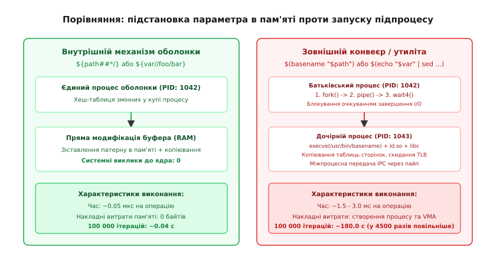
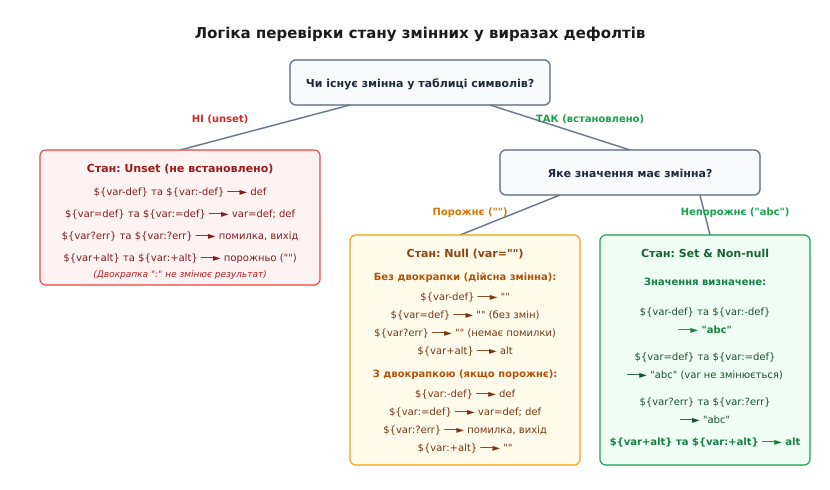
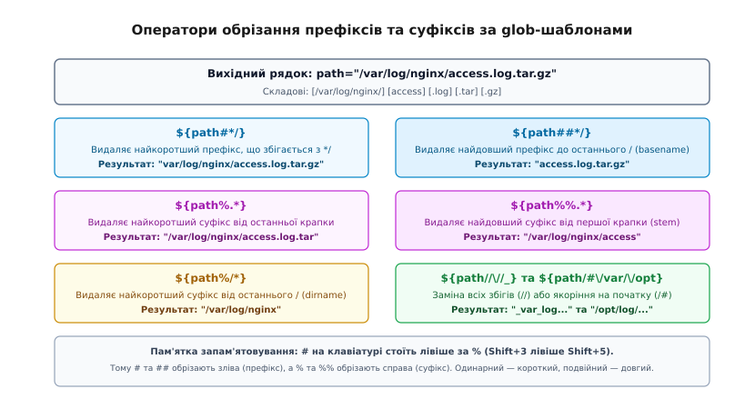

# Підстановка параметра: дефолти, обрізання, заміна

<preknowlist>
- [Оболонка: що вона робить насправді](root:sys-unix/shell-role) — синтаксичний розбір, абстрактне синтаксичне дерево (AST) та фази конвеєра розгортання.
- [Розкриття й лапки: коли текст стає аргументами](root:sys-unix/expansion-and-quoting) — порядок етапів розгортання слів, поділ на слова (Word Splitting) та видалення лапок (Quote Removal).
- [argv, оточення й що успадковує дитина](root:sys-unix/argv-and-environment) — вектори аргументів, структури пам'яті процесу та змінні оточення.
</preknowlist>

Обробка ста тисяч файлових шляхів або рядків журналу подій у циклі оболонки з використанням зовнішніх команд перетворює просту задачу маніпуляції текстом на важке навантаження для операційної системи. Якщо на кожній ітерації скрипт викликає `dir=$(dirname "$path")`, `base=$(basename "$path")` або `clean=$(echo "$str" | sed 's/foo/bar/')`, ядро Linux змушене виконати сотні тисяч системних викликів `clone(2)` (або `fork(2)`), дублювати структури пам'яті та таблиці сторінок віртуальної пам'яті процесу, завантажити виконуваний файл через `execve(2)`, викликати динамічний лінкер `ld-linux.so`, ініціалізувати стандартну бібліотеку C, створити анонімні канали IPC (`pipe(2)`) і здійснити багаторазове перемикання контексту між простором користувача і ядром. Загальний час виконання такої операції на сучасному сервері сягає десятків секунд при повному завантаженні одного ядра процесора.

Натомість вбудований у командну оболонку механізм **підстановки параметрів (Parameter Expansion)** виконує всі операції над рядками безпосередньо в адресному просторі поточного процесу інтерпретатора. Змінні зберігаються у внутрішній хеш-таблиці оболонки як звичайні null-terminated масиви байтів `char*` у купі (heap). Операції обрізання префіксів `${path##*/}`, виділення каталогів `${path%/*}`, заміни символів `${str//foo/bar}` чи зрізів підрядків `${str:0:5}` виконуються виключно через вказівникову арифметику та копіювання пам'яті за допомогою функцій рівня `memcpy(3)` і `memmove(3)`. Та сама обробка ста тисяч рядків без створення підпроцесів завершується за лічені мілісекунди, не здійснюючи жодного системного виклику до ядра ОС.


*Порівняння виконання операцій над рядками в пам'яті процесу оболонки проти створення підпроцесів утиліт.*

---

## 1. Анатомія виконання: розкриття параметра у пам'яті оболонки

Командний рядок, введений користувачем інтерактивно або зчитаний інтерпретатором зі сценарію, проходить суворий фазовий конвеєр розкриття слів (Word Expansion Pipeline), зафіксований стандартом POSIX.1-2017 (Section 2.6). Підстановка параметрів не існує ізольовано — вона займає чітко визначене місце в ланцюжку трансформацій тексту.

### Повний конвеєр розкриття слів у POSIX та Bash

Кожне слово командного рядка піддається послідовній обробці за наступними етапами:

1. **Розкриття фігурних дужок (Brace Expansion — розширення Bash/Ksh/Zsh)**:
   Конструкції виду `file_{A,B}.txt` або `{1..5}` розгортаються у список слів `file_A.txt file_B.txt`. Цей етап виконується **до будь-яких підстановок параметрів**. Через це вираз `{$a,$b}` спершу створить два слова `$a` і `$b`, і лише потім вони набудуть значень змінних. Навпаки, запис `${var:-{a,b}}` не виконує brace expansion для `{a,b}`, оскільки фаза фігурних дужок на цей момент уже минула.
2. **Розкриття тильди (Tilde Expansion)**:
   Символ `~` або `~username` на початку слова замінюється на абсолютний шлях до домашнього каталогу (`$HOME` або запис із `/etc/passwd`).
3. **Паралельне розкриття параметрів, команд та арифметики (Parameter, Command and Arithmetic Expansion)**:
   - **Parameter Expansion** (`$var`, `${var:-default}`, `${var#pattern}`) — підстановка та модифікація рядків у пам'яті.
   - **Command Substitution** (`$(command)` або `` `command` ``) — запуск команди в підшелі та читання її stdout через анонімний пайп.
   - **Arithmetic Expansion** (`$(( expression ))`) — обчислення цілочисельних виразів у пам'яті.
   Усі три типи підстановок обчислюються зліва направо в один прохід сканування рядка.
4. **Підстановка процесів (Process Substitution — розширення Bash/Ksh/Zsh)**:
   Конструкції `<(cmd)` та `>(cmd)` створюють іменовані канали у `/dev/fd/N` або FIFO для передачі даних між процесами без створення проміжних тимчасових файлів.
5. **Поділ на слова (Word Splitting)**:
   Результати кроків 3 та 4, які **не були взяті у подвійні лапки**, скануються на наявність символів-роздільників зі змінної `IFS` (за замовчуванням — пробіл, табуляція, новий рядок). Рядок розбивається на окремі елементи списку аргументів `argv[]`.
6. **Розкриття шляхів (Pathname Expansion / Globbing)**:
   Нелапковані слова, що містять метасимволи `*`, `?`, `[...]`, зіставляються з іменами файлів та каталогів у файловій системі через системний виклик `getdents64(2)` або функцію `glob(3)`.
7. **Видалення лапок (Quote Removal)**:
   Усі неанульовані одинарні лапки `'...'`, подвійні лапки `"..."` та екрануючі зворотні слеші `\`, що виконали свою синтаксичну функцію захисту на попередніх етапах, остаточно видаляються з результуючих слів перед передачею у системний виклик `execve(2)`.

```text
[Вхідне слово]
   │
   ▼
1. Brace Expansion ────────► "app_{prod,dev}" ──► "app_prod" "app_dev"
   │
   ▼
2. Tilde Expansion ────────► "~/data" ──► "/home/user/data"
   │
   ▼
3. Parameter / Command / ──► "${VAR#prefix}" / "$(date)" / "$((x + 1))"
   Arithmetic Expansion
   │
   ▼
4. Process Substitution ───► "<(sort keys.txt)" ──► "/dev/fd/63"
   │
   ▼
5. Word Splitting ─────────► Застосовується до нелапкованого виводу за IFS
   │
   ▼
6. Pathname Expansion ─────► "*.log" ──► "auth.log" "sys.log"
   │
   ▼
7. Quote Removal ──────────► Зняття захисних лапок ' ' та " "
   │
   ▼
[Вектор аргументів argv[] для системного виклику execve]
```

### Внутрішні структури оболонки: хеш-таблиця, `SHELL_VAR` та керування пам'яттю

Інтерпретатор оболонки (на прикладі архітектури GNU Bash та Dash) не використовує лінійний пошук рядків. Усі змінні зберігаються у динамічних хеш-таблицях пам'яті (`HASH_TABLE *shell_variables`). Хеш-таблиця організована як масив кошиків (buckets) із розв'язанням колізій через однозв'язні списки структур `BUCKET_CONTENTS`.

Хеш-функція `hash_string(name)` обчислює 32-бітний хеш ідентифікатора за алгоритмом поліноміального накопичення, після чого індекс кошика визначається за модулем розміру таблиці: `bucket = hash_string(name) % table->nbuckets`. Кожен елемент таблиці зберігає покажчик на структуру опису змінної `SHELL_VAR` (у кодовій базі Bash — `struct variable`):

```text
typedef struct variable {
    char *name;                         /* Ім'я змінної в купі (null-terminated рядок) */
    char *value;                        /* Значення змінної або покажчик на структуру масиву */
    char *exportstr;                    /* Кешований рядок "NAME=VALUE" для середовища execve */
    sh_var_value_func_t *dynamic_value; /* Колбек динамічного читання (SECONDS, RANDOM тощо) */
    sh_var_assign_func_t *assign_func;  /* Колбек динамічного запису */
    int attributes;                     /* Бітова маска прапорців стану */
    int context;                        /* Глибина контексту виклику (індекс фрейму стека) */
} SHELL_VAR;
```

Бітове поле `attributes` зберігає системний стан та тип змінної:
- `att_exported` (`var_exported`) — змінна експортується у дочірні процеси.
- `att_readonly` (`var_readonly`) — заборона модифікації та знищення через `unset`.
- `att_integer` (`var_integer`) — арифметичний режим (присвоєння автоматично обчислює арифметичний вираз).
- `att_array` / `att_assoc` — індексований або асоціативний масив.
- `att_nameref` — змінна-посилання на інший ідентифікатор (`declare -n`).
- `att_local` — змінна прив'язана до поточного локального фрейму функції.

```text
[Хеш-таблиця HASH_TABLE *shell_variables]
  │
  ├── Bucket 012 ──► BUCKET_CONTENTS { key: "PATH", data: SHELL_VAR* }
  │                   └── SHELL_VAR { name: "PATH", value: "/usr/bin:/bin", attributes: att_exported }
  │
  ├── Bucket 089 ──► BUCKET_CONTENTS { key: "FILE", data: SHELL_VAR* }
  │                   └── SHELL_VAR { name: "FILE", value: "/var/log/app.log", attributes: 0 }
  │
  └── Bucket 245 ──► BUCKET_CONTENTS { key: "SECONDS", data: SHELL_VAR* }
                      └── SHELL_VAR { dynamic_value: get_seconds, attributes: att_special }
```

Коли синтаксичний аналізатор під час обходу AST зустрічає токен `$`, він запускає внутрішню функцію `expand_word_internal()`:
1. Якщо наступним символом є літера, цифра або позиційний знак (`$?`, `$$`, `$!`, `$1`), парсер виділяє ідентифікатор і викликає функцію `find_variable(name)`. Вона виконує швидкий пошук `O(1)` у хеш-таблиці, витягує покажчик `var->value` і копіює байти безпосередньо у буфер вихідного слова. Якщо встановлено хук `dynamic_value`, функція викликає колбек для генерації актуального значення (наприклад, системний час у `SECONDS` або псевдовипадкове число `RANDOM`).
2. Якщо після `$` стоїть відкриваюча фігурна дужка `${`, активується спеціалізований парсер підстановок `parameter_brace_expand()`. Він знаходить закриваючу дужку `}`, враховуючи лапки та екранування, після чого розщеплює вираз на три компоненти:
   - **Параметр**: ім'я змінної, числовий індекс або спеціальний знак.
   - **Оператор**: перевірка стану (`:-`, `:=`, `:?`, `:+`), обрізання (`#`, `##`, `%`, `%%`), зріз (`:`), заміна (`/`), зміна регістру (`^^`, `,,`), трансформація (`@Q`, `@E`, `@P`) або непряма адресація (`!`).
   - **Тіло аргументу**: шаблон пошуку, значення за замовчуванням або числові зміщення.

Усі маніпуляції здійснюються над внутрішніми буферами в купі (heap) процесу інтерпретатора. При видаленні префікса чи суфікса функція виконує пошук через внутрішній алгоритм `strmatch()` (аналог бібліотечного `fnmatch(3)`), після чого створює результуючий рядок зсувом покажчика `value + offset` або прямим копіюванням `memcpy(3)`, без звернення до ядра ОС.

### Скоупи видимості, динамічний стек фреймів та змінні оточення `environ`

Командна оболонка реалізує модель **динамічної області видимості (Dynamic Scoping)**, на відміну від лексичної моделі більшості компільованих мов програмування.

Керування просторами імен під час виклику функцій організовано через стек контекстів змінних:

```text
[Стек контекстів VAR_CONTEXT]
  │
  ├── top_level_var_context (Глобальний скоуп процесу)
  │     ├── "PORT"  ──► 8080
  │     └── "ENV"   ──► "production"
  │
  └── Function Frame: handle_request() (Локальний скоуп context=1)
        ├── "PORT"  ──► 9000  (Затіняє глобальний PORT завдяки att_local)
        └── "TMP"   ──► "/tmp/req_42"
```

Коли інтерпретатор входить у тіло функції:
1. При першому виклику директиви `local var=val` або `typeset var=val` оболонка створює новий локальний фрейм контексту `VAR_CONTEXT` або використовує поточний рівень вкладеності `variable_context`.
2. Створюється нова структура `SHELL_VAR` із прапорцем `att_local` та поточним значенням `context`.
3. Пошук змінної функцією `find_variable(name)` завжди починається з найглибшого (поточного) контексту `current_var_context` і піднімається вгору до глобального `top_level_var_context`. Якщо змінна з таким ім'ям уже існувала на вищому рівні, локальна змінна **затіняє (shadows)** її значення на час виконання функції та всіх дочірніх функцій, які вона викликає.
4. При виході з функції оболонка викликає `pop_var_context()`, яка знищує всі структури `SHELL_VAR` із прапорцем `att_local`, звільняє їхню динамічну пам'ять через `free(3)` і відновлює пряму видимість попередніх значень змінних.

#### Взаємодія з системним масивом `environ` та команда `export`

Кожен процес у POSIX-системі отримує від ядра блок пам'яті зі змінними оточення у вигляді глобального масиву покажчиків `extern char **environ`, який завершується нульовим покажчиком `NULL`.

Оболонка керує цим масивом за спеціальною лінивою схемою:
1. **Ініціалізація (`initialize_shell_variables`)**: При запуску інтерпретатор читає масив `environ`, розбиває кожен рядок `KEY=VALUE` за першим знаком `=` і наповнює внутрішню хеш-таблицю структурами `SHELL_VAR`, автоматично виставляючи їм прапорець `att_exported`.
2. **Звичайна модифікація змінних**: Коли у скрипті виконується присвоєння `VAR=value` без ключового слова `export`, змінна зберігається **виключно у внутрішній хеш-таблиці процесу**. Вона не потрапляє у системний вектор `environ` і є невидимою для будь-яких дочірніх бінарних програм.
3. **Експорт змінної (`export VAR`)**: Команда виставляє біт `att_exported` у структурі `SHELL_VAR`. Оболонка не викликає системну функцію `setenv(3)` на кожне присвоєння, оскільки це спричинило б надлишкову фрагментацію пам'яті. Натомість вона інвалідує внутрішній кеш оточення `export_env`.
4. **Формування вектора оточення для `execve(2)`**: Лише безпосередньо перед запуском зовнішньої програми (`/bin/ls`, `/usr/bin/curl`) оболонка обходить хеш-таблицю, збирає всі структури з прапорцем `att_exported`, формує компактний масив покажчиків `char **envp` і передає його третім аргументом у системний виклик `execve(file, argv, envp)`.

### Взаємодія з лапками: захист від поділу на слова

Критично важливим для надійності системних скриптів є розуміння різниці між виконанням самої підстановки та подальшою обробкою результату:

:::code parameter-expansion-d/sh/vzaiemodiia-z-lapkamy.sh

Усі операції модифікації рядка всередині `${...}` відбуваються абсолютно ідентично як у подвійних лапках, так і без них. Проте подвійні лапки `"${var#pattern}"` захищають згенерований рядок від подальшого проходження через фази Word Splitting (поділ за пробілами) та Pathname Expansion (розгортання символів `*` і `?` у файлові шляхи).

---

## 2. Стани змінної та матриця операторів дефолтів

У системному програмуванні та написанні скриптів ініціалізації сервісів для коректної обробки параметрів конфігурації необхідно розрізняти три фундаментальні стани змінної в пам'яті інтерпретатора:

1. **Unset (не встановлено)** — змінна повністю відсутня в таблиці символів процесу оболонки. Її ніколи не оголошували або було явно знищено системною командою `unset var`.
2. **Null (порожнє значення)** — змінна зареєстрована в таблиці символів, структура `SHELL_VAR` існує, але покажчик `value` вказує на нульовий рядок (`""`, буфер містить лише термінальний байт `\0`).
3. **Set & Non-Null (встановлено зі значенням)** — змінна існує в таблиці символів і містить рядок довжиною щонайменше 1 байт (`var="production"`).

Стандарт POSIX визначає чотири базові родини операторів перевірки стану: дефолт (`-`), присвоєння дефолту (`=`), аварійна зупинка (`?`) та альтернатива (`+`).

Кожен із цих чотирьох операторів має дві форми запису:
- **Форма без двокрапки** (`-`, `=`, `?`, `+`) — перевіряє **лише факт існування** змінної (стан *Unset*). Якщо змінна існує в пам'яті, навіть маючи нульову довжину `var=""`, вона вважається повністю валідною і її порожнє значення повертається без змін.
- **Форма з двокрапкою** (`:-`, `:=`, `:?`, `:+`) — перевіряє **як існування, так і непорожність** змінної (об'єднує стани *Unset* та *Null*). Якщо змінна порожня, вона обробляється за тією ж логікою, що й неоголошена.


*Дерево рішень та стани змінних при обчисленні дефолтних параметрів оболонки.*

Нижче наведено вичерпну матрицю поведінки для всіх станів:

| Синтаксис | Стан: Unset | Стан: Null (`var=""`) | Стан: Set (`var="abc"`) | Побічна дія (мутація таблиці символів) |
| :--- | :--- | :--- | :--- | :--- |
| `${var-def}` | `def` | `""` (порожній рядок) | `abc` | Немає (значення `var` не змінюється) |
| `${var:-def}` | `def` | `def` | `abc` | Немає (значення `var` не змінюється) |
| `${var=def}` | `def` | `""` (порожній рядок) | `abc` | При Unset: записує `var="def"` у пам'ять |
| `${var:=def}` | `def` | `def` | `abc` | При Unset/Null: записує `var="def"` у пам'ять |
| `${var?err}` | Друк `err` у `stderr`, вихід | `""` (порожній рядок) | `abc` | Аварійна зупинка скрипту при Unset |
| `${var:?err}` | Друк `err` у `stderr`, вихід | Друк `err` у `stderr`, вихід | `abc` | Аварійна зупинка скрипту при Unset/Null |
| `${var+alt}` | `""` (порожній рядок) | `alt` | `alt` | Немає (значення `var` не змінюється) |
| `${var:+alt}` | `""` (порожній рядок) | `""` (порожній рядок) | `alt` | Немає (значення `var` не змінюється) |

### 1. Використання дефолтного значення: `${var-default}` та `${var:-default}`

Оператор повертає значення за замовчуванням, якщо змінна не визначена (або порожня у формі з `:`). Значення самої змінної `var` у середовищі процесу залишається незмінним.

:::code parameter-expansion-d/sh/1-vykorystannia-defoltnoho.sh

Ці оператори можна безпечно вибудовувати у вкладені ланцюжки пріоритетів:

```bash
# Пріоритет: CLI-аргумент -> змінна середовища -> системний дефолт
BIND_IP="${CLI_IP:-${ENV_IP:-${DEFAULT_IP:-"127.0.0.1"}}}"
```

#### Взаємодія з режимом `set -u` (`set -o nounset`)

У режимі суворої перевірки `set -u` пряме звернення до неоголошеної змінної `$UNSET_VAR` призводить до фатальної помилки `unbound variable` та аварійного завершення скрипту. Проте оператори дефолтів `${var:-default}` та `${var-default}` згідно зі стандартом POSIX є **безпечними точками перехоплення**: вони коректно обробляють неоголошені змінні й ніколи не викликають аварії під `set -u`.

### 2. Присвоєння дефолтного значення: `${var=default}` та `${var:=default}`

На відміну від звичайного дефолту, оператор присвоєння не лише підставляє значення у поточний вираз, а й **виконує мутацію таблиці символів** — записує нове значення безпосередньо у змінну `var`.

```bash
unset CACHE_TTL
echo "${CACHE_TTL:=3600}"  # CACHE_TTL unset -> записує CACHE_TTL=3600 у пам'ять і повертає "3600"
echo "$CACHE_TTL"          # Вивід: "3600" (змінна тепер існує)

CACHE_TTL=""
echo "${CACHE_TTL=1800}"   # Без ":" -> змінна існує (null), мутації немає, вивід: ""
echo "${CACHE_TTL:=1800}"  # З ":" -> змінна порожня, перезаписує CACHE_TTL=1800, вивід: "1800"
```

#### Системні обмеження та пастки присвоєння

1. **Заборона присвоєння позиційним параметрам**: Оператори `=` та `:=` заборонено застосовувати до позиційних параметрів (`$1`, `$2`), спеціальних параметрів (`$@`, `$*`, `$#`, `$?`, `$$`) та змінних із прапорцем `readonly`. Спроба виконати `${1:=default}` завершується синтаксичною помилкою `cannot assign to positional parameter`.
2. **Пастка ізоляції підшелів (Subshell Isolation)**: Якщо присвоєння викликається всередині конвеєра `|` або блоку `( ... )`, воно виконується в окремому дочірньому процесі, створеному через `fork(2)`:
   ```bash
   unset DB_PORT
   echo "Init" | { echo "${DB_PORT:=5432}"; }
   echo "DB_PORT is: $DB_PORT"  # Вивід: "DB_PORT is: " (у батьківському процесі лишився unset!)
   ```
   Зміна відбулася лише в адресному просторі дочірнього процесу, який після завершення конвеєра знищився.

### 3. Аварійна валідація обов'язкових параметрів: `${var?error}` та `${var:?error}`

Оператор гарантує, що критично важливі змінні ініціалізовані перед виконанням потенційно небезпечних або деструктивних дій. Якщо змінна не визначена (або порожня для `:?`), інтерпретатор друкує повідомлення у потік `stderr` і **негайно перериває роботу неінтерактивного скрипту** з ненульовим кодом завершення (зазвичай 1).

```bash
# Захист від ненавмисного видалення кореневого каталогу:
DATA_DIR="${TARGET_VOLUME:?Помилка: змінна TARGET_VOLUME не встановлена або порожня}"
rm -rf "${DATA_DIR}/tmp_cache"
```

Якщо змінна `TARGET_VOLUME` не була ініціалізована, без конструкції `:?` вираз `rm -rf "${TARGET_VOLUME}/tmp_cache"` розгорнувся б у `rm -rf "/tmp_cache"`. Завдяки валідації виконання сценарію зупиниться на першому рядку.

### 4. Підстановка альтернативного значення: `${var+alternate}` та `${var:+alternate}`

Дзеркальний оператор: підставляє заданий рядок `alternate` лише тоді, коли змінна **встановлена** (і непорожня для `:+`). Якщо змінна відсутня в пам'яті (або порожня для `:+`), оператор повертає порожній рядок.

:::code parameter-expansion-d/sh/4-pidstanovka.sh

Ця конструкція незамінна для побудови аргументів командного рядка: прапорець `--token` з'являється у векторі аргументів лише за умови, що сам токен існує, не створюючи "порожніх" аргументів виду `""`.

Детальний довідник усіх граматичних правил та таблицю сумісності між різними оболонками наведено у вставці [Повний довідник синтаксису розкриття параметрів](root:sys-unix/parameter-expansion/api-parameter-expansion-syntax.md).

---

## 3. Підрахунок довжини: `${#var}`, локалі та вектори

Оператор `${#var}` обчислює довжину рядкового значення змінної. Проте на рівні системних викликів та пам'яті існує принципова різниця між розміром буфера у байтах та кількістю друкованих символів.

### Багатобайтові кодування та вплив локалі `LC_CTYPE`

У POSIX-сумісних оболонках поведінка оператора довжини визначається категорією поточної локалі `LC_CTYPE`. Якщо активовано локаль з підтримкою кодування UTF-8 (наприклад, `uk_UA.UTF-8`), інтерпретатор використовує внутрішні виклики функцій типу `mbrtowc(3)` (multibyte to wide character) або `mblen(3)`, які підраховують кількість повних юнікодних символів:

:::code parameter-expansion-d/sh/3-pidrakhunok-dovzhyny-var.sh

Якщо локаль примусово перевести в однобайтовий режим `LC_ALL=C`, функція сканує рядок як простий масив байтів `char*` за допомогою `strlen(3)`, повертаючи фізичну кількість байтів у пам'яті.

### Підрахунок кількості аргументів та елементів масивів

Синтаксис `${#}` має спеціалізовані форми для векторних типів даних та колекцій:
- `$#` або `${#*}` / `${#@}` — повертає загальну кількість позиційних аргументів, переданих скрипту чи функції.
- `${#array[@]}` або `${#array[*]}` — повертає кількість реально існуючих (ініціалізованих) елементів в індексованому або асоціативному масиві.
- `${#array[index]}` / `${#array[key]}` — повертає довжину рядка (у символах або байтах залежно від `LC_CTYPE`), збереженого в конкретному елементі масиву за числовим індексом або рядковим ключем.

#### Внутрішні структури масивів у Bash: `ARRAY *` проти `HASH_TABLE *`

На рівні кодової бази Bash реалізація індексованих та асоціативних масивів принципово відрізняється:

1. **Індексовані масиви (`ARRAY *` у `array.c`)**:
   Зберігаються як двозв'язні списки або динамічні масиви структур `ARRAY_ELEMENT`:
   ```text
   typedef struct array_element {
       intmax_t ind;                 /* 64-бітний знаковий числовий індекс */
       char *value;                  /* Значення елемента в купі */
       struct array_element *next;   /* Покажчик на наступний елемент */
       struct array_element *prev;   /* Покажчик на попередній елемент */
   } ARRAY_ELEMENT;
   ```
   Поле `num_elements` у заголовку структури `ARRAY` відстежує точну кількість вузлів у списку. Оператор `${#array[@]}` зчитує це значення за час `O(1)`.

2. **Асоціативні масиви (`HASH_TABLE *` у `assoc.c`)**:
   Асоціативні масиви реалізовані на базі окремої хеш-таблиці `assoc_t` (структура `HASH_TABLE`). Кожен елемент є кошиком `BUCKET_CONTENTS`, де ключем і значенням є рядки `char*` у купі. Оператор `${#assoc[@]}` повертає лічильник `table->nentries`, що також виконується за `O(1)`.

#### Особливість розріджених (Sparse) масивів у Bash

В індексованих масивах Bash елементи можуть розташовуватися з довільними числовими розривами (розріджені масиви):

```bash
declare -a SPARSE_ARR
SPARSE_ARR[0]="first"
SPARSE_ARR[100]="hundredth"
SPARSE_ARR[1000000]="millionth"

echo "${#SPARSE_ARR[@]}"        # Вивід: 3 (кількість існуючих елементів, а не максимальний індекс 1000000)
echo "${#SPARSE_ARR[100]}"      # Вивід: 9 (довжина рядка "hundredth")
echo "${#SPARSE_ARR[1000000]}"  # Вивід: 9 (довжина рядка "millionth")
```

Оскільки неініціалізовані індекси між `0`, `100` та `1000000` не створюють вузлів `ARRAY_ELEMENT` у пам'яті, пам'ять виділяється виключно під три наявні структури, а лічильник довжини масиву повертає фактичну кількість заповнених комірок.

---

## 4. Обрізання префіксів та суфіксів: механіка зіставлення glob-шаблонів

Оператори обрізання префіксів (`#`, `##`) та суфіксів (`%`, `%%`) виконують зіставлення рядка змінної з шаблоном підстановки імен файлів (Shell Globbing Pattern) і видаляють ту частину, що збіглася. Вони є стандартизованою частиною POSIX.1.

Для надійного запам'ятовування діє клавіатурне правило: символ `#` (Shift+3) знаходиться лівіше від символу `%` (Shift+5). Відповідно:
- `#` та `##` обрізають **зліва** (видаляють префікс).
- `%` та `%%` обрізають **справа** (видаляють суфікс).
- Одинарний символ (`#`, `%`) вмикає **нежадібний (найкоротший)** пошук збігу.
- Подвійний символ (`##`, `%%`) вмикає **жадібний (найдовший)** пошук збігу.


*Зіставлення префіксів та суфіксів у рядковому буфері за допомогою операторів обрізання.*

### Globbing проти регулярних виразів: принципова різниця механізмів

У практиці системного адміністрування часто виникає плутанина між Shell Globbing та регулярними виразами (POSIX BRE/ERE чи PCRE). Це дві принципово різні системи зіставлення рядків:

1. **Семантика метасимволів:**
   - У **Globbing** символ `*` означає *довільну послідовність будь-яких символів* довжиною від 0 до нескінченності (еквівалент `.*` у регулярних виразах). Символ `*` є самостійним токеном.
   - У **Регулярних виразах** символ `*` не є самостійним токеном, а виступає *постфіксним квантифікатором* (повторення попереднього атома 0 або більше разів). Одиночний `*` на початку виразу є синтаксичною помилкою.
   - Символ `?` у globbing відповідає *рівно одному довільному символу* (еквівалент `.` у regex). У регулярних виразах ERE символ `?` — це квантифікатор «0 або 1 входження».
   - Класи символів `[...]` мають схожий синтаксис, проте заперечення у POSIX Glob записується як `[!abc]` (у Bash також дозволено `[^abc]`), тоді як у regex — виключно `[^abc]`.

2. **Внутрішній рушій та алокації пам'яті:**
   - Рушії регулярних виразів (`regcomp(3)`, `pcre2_compile`) компілюють шаблон у проміжне представлення — недетермінований (NFA) або детермінований (DFA) скінченний автомат, що потребує виділення динамічної пам'яті під таблиці переходів станів.
   - Підстановка параметрів оболонки використовує внутрішню функцію `strmatch()` (прямий аналог `fnmatch(3)`). Вона не будує скінченних автоматів і не виділяє пам'яті в купі. Зіставлення виконується безпосередньо над байтами рядка `const char *str` та шаблону `const char *pat` за допомогою швидкого рекурсивного сканування покажчиків.

### Механіка пожадливого та непожадливого зіставлення в пам'яті

Розглянемо покрокову роботу алгоритму при скануванні рядка:

```text
Рядок:  / v a r / l o g / a p p . l o g . t a r . g z
Індекс: 0 1 2 3 4 5 6 7 8 9 ...
```

#### 1. Непожадливий префікс `${var#pattern}`
Оболонка перевіряє префікси рядка зліва направо, починаючи з нульової довжини:
- Префікс довжини 0: `""` -> зіставляється з `*/` -> Ні.
- Префікс довжини 1: `"/"` -> зіставляється з `*/` -> **Так (перший збіг)**.
- Сканування негайно зупиняється. Повертається покажчик на залишок рядка `str + 1`: `"var/log/app.log.tar.gz"`.

#### 2. Пожадливий префікс `${var##pattern}` (Ідіома `basename`)
Оболонка шукає максимальний префікс, що задовольняє шаблон. Вона сканує рядок вперед до самого кінця, фіксуючи кожну позицію, де підрядок від початку збігається з `*/`:
- Збіг на позиції 1: `"/"`
- Збіг на позиції 5: `"/var/"`
- Збіг на позиції 9: `"/var/log/"` -> **Найдовший збіг**.
- Оболонка повертає покажчик `str + 9`: `"app.log.tar.gz"`.

#### 3. Непожадливий суфікс `${var%pattern}` (Видалення розширення / Ідіома `dirname`)
Оболонка сканує суфікси від правого краю рядка наліво, шукаючи найкоротший підрядок, що закінчується на кінці рядка і відповідає шаблону:
- Для `${FILE%.*}`: перевіряє суфікс `".gz"`. Він відповідає `.*` і є найкоротшим. Результат: `"/var/log/app.log.tar"`.
- Для `${FILE%/*}`: перевіряє суфікс `"/app.log.tar.gz"`. Це перший знайдений справа збіг із `/*`. Результат: `"/var/log"`.

#### 4. Пожадливий суфікс `${var%%pattern}` (Виділення кореневого імені)
Оболонка шукає найдовший суфікс, тобто найпершу позицію зліва, починаючи з якої підрядок і до кінця задовольняє шаблон:
- Для `${FILE%%.*}`: перша крапка знаходиться на позиції 12 (`.log.tar.gz`). Суфікс від позиції 12 до кінця відповідає `.*` і є найдовшим. Результат: `"/var/log/app"`.

### Розширене зіставлення шаблонів `extglob`

При активації опції розширеного зіставлення (`shopt -s extglob` у Bash або автоматично у Ksh) оператори обрізання отримують підтримку квантифікаторів:
- `+(pattern)` — одне або більше повторень шаблону.
- `*(pattern)` — нуль або більше повторень.
- `?(pattern)` — нуль або одне входження.
- `@(pat1|pat2)` — точний збіг з одним із варіантів.
- `!(pattern)` — будь-який рядок, крім вказаного шаблону.

```bash
shopt -s extglob

# 1. Обрізання провідних нулів у десяткових числах (запобігання помилковій вісімковій системі):
VAL="00004580"
CLEAN="${VAL##*(0)}"
echo "$CLEAN"                     # Вивід: "4580"

# 2. Видалення мітки версії з префікса файлу "release_v124_build.tar":
ARCHIVE="release_v124_build.tar"
echo "${ARCHIVE#release_v+([0-9])_}" # Вивід: "build.tar"

# 3. Видалення відомих мультимедійних суфіксів:
MEDIA="track_01.audio.flac"
echo "${MEDIA%.@(mp3|ogg|flac|wav)}" # Вивід: "track_01.audio"
```

### Інженерні крайові випадки обробки шляхів (Edge Cases)

При заміні зовнішніх бінарних утиліт `dirname` та `basename` на вбудовані оператори слід враховувати поведінку на нестандартних шляхах:

1. **Шлях без слешів (`path="file.txt"`)**:
   Вираз `${path%/*}` поверне початковий рядок `"file.txt"`, оскільки шаблон не знайдено. Проте утиліта `dirname` у такому випадку повертає поточний каталог `"."`.
2. **Шлях у кореневому каталозі (`path="/file.txt"`)**:
   Вираз `${path%/*}` видалить `/file.txt` і поверне порожній рядок `""`. Утиліта `dirname` повертає `"/"`.
3. **Шлях із кінцевим слешем (`path="/var/log/"`)**:
   Вираз `${path##*/}` поверне порожній рядок `""`.

Ідіоматична функція безпечного виділення каталогу та базового імені без виклику підпроцесів:

```bash
# Безпечний еквівалент dirname на чистому shell:
get_dirname() {
    local p="${1%/}"        # Видаляємо кінцевий слеш, якщо він є
    local d="${p%/*}"       # Відрізаємо останній сегмент
    if [[ "$d" == "$p" ]]; then
        echo "."            # Слешів не було взагалі
    else
        echo "${d:-/}"      # Якщо порожньо — це корінь "/"
    fi
}

# Безпечний еквівалент basename:
get_basename() {
    local p="${1%/}"        # Видаляємо кінцевий слеш
    echo "${p##*/}"
}
```

---

## 5. Зрізи підрядків: зміщення та довжина (Bash / Ksh / Zsh)

Оболонки Bash 2.0+, Ksh93 та Zsh підтримують прямий доступ до підрядків за числовими індексами:
`${var:offset:length}` або `${var:offset}`

Індексація починається з нуля (`0`). Якщо довжина `length` опущена, зріз повертає всі символи від позиції `offset` до кінця рядка.

```bash
STRING="METRIC_CPU_USAGE"

echo "${STRING:0:6}"    # Починаючи з 0, довжина 6 -> "METRIC"
echo "${STRING:7:3}"    # Починаючи з 7, довжина 3 -> "CPU"
echo "${STRING:11}"     # Починаючи з 11 до кінця  -> "USAGE"
```

### Від'ємні зміщення та синтаксична колізія з `:-`

Якщо зміщення `offset` є від'ємним числом, відлік позиції починається з кінця рядка (індекс `-1` відповідає останньому символу).

> **СИНТАКСИЧНА ПАСТКА:** Якщо записати вираз як `${STRING:-3}`, лексичний аналізатор розпізнає послідовність `:-` як оператор дефолтного значення. Якщо змінна `STRING` непорожня, повернеться весь її вміст, а якщо порожня — підставиться число `3`.

Щоб повідомити парсеру, що знак мінус є частиною числового зміщення, необхідно використовувати один із трьох синтаксичних прийомів:
1. **Пробіл після двокрапки**: `${STRING: -4}`
2. **Круглі дужки навколо числа**: `${STRING:(-4)}`
3. **Передача через окрему числову змінну**: `pos=-4; echo "${STRING:pos}"`

```bash
SERVER_ID="node-eu-west-042"

# Виділення останніх 3 символів:
echo "${SERVER_ID: -3}"     # Вивід: "042"
echo "${SERVER_ID:(-3)}"    # Вивід: "042"

# Виділення 4 символів з позиції -11:
echo "${SERVER_ID: -11:4}"  # Вивід: "west"
```

### Від'ємна довжина (Bash 4.2+)

Якщо параметр `length` вказано як від'ємне число `${var:offset:-drop}`, воно інтерпретується не як розмір вибірки, а як **кількість символів, яку необхідно відкинути з кінця рядка**:

```bash
PAYLOAD="<<<PAYLOAD_DATA_CONTENT>>>"

# Відкидаємо 3 символи на початку (offset=3) та 3 символи в кінці (length=-3):
CLEAN="${PAYLOAD:3:-3}"
echo "$CLEAN"               # Вивід: "PAYLOAD_DATA_CONTENT"
```

### Зрізи позиційних параметрів та масивів

Оператор зрізу застосовується не лише до скалярних рядків, а й до векторних структур даних: списку позиційних аргументів та масивів у Bash 4+.

#### 1. Зрізи позиційних параметрів (`$@` та `$*`)

- `${@:1}` — усі передані аргументи, починаючи з `$1` і до кінця.
- `${@:2:3}` — три позиційні параметри, починаючи з `$2` (тобто `$2 $3 $4`).
- `${@:0:2}` — повертає ім'я сценарію `$0` та перший аргумент `$1` (зміщення `0` адресує `$0`).
- `"${@: -2}"` — останні два аргументи (з обов'язковим пробілом перед мінусом).

Взаємодія з подвійними лапками підпорядковується стандартному правилу: `"${@:2:3}"` розгортає кожен вибраний аргумент в окреме захищене слово у векторі `argv[]`, тоді як `"${*:2:3}"` зливає всі три аргументи в один скалярний рядок через перший символ `IFS`.

#### 2. Зрізи індексованих масивів: порядкова навігація по списку

Синтаксис `${array[@]:offset:length}` виділяє підмасив елементів. Проте для індексованих масивів діє критично важливе правило внутрішньої реалізації: **параметр `offset` вказує не на числовий індекс елемента, а на його порядкову позицію у списку існуючих вузлів `ARRAY_ELEMENT`**.

Якщо масив є розрідженим (Sparse Array), оболонка обходить внутрішній список вузлів від початку, відраховуючи `offset` активних елементів, і вибирає наступні `length` елементів:

```bash
declare -a SPARSE=([5]="alpha" [50]="beta" [500]="gamma" [5000]="delta")

# Пропускаємо 1 існуючий елемент ([5]) і беремо наступні 2 ([50] та [500]):
SUB=("${SPARSE[@]:1:2}")

printf '[%s] ' "${SUB[@]}"
# Вивід: [beta] [gamma] 
```

#### 3. Зрізи асоціативних масивів у Bash 4+

Для асоціативних масивів (`declare -A`) оператор зрізу `${assoc[@]:offset:length}` також є синтаксично валідним, проте його поведінка обумовлена внутрішньою структурою хеш-таблиці `HASH_TABLE`:
- Елементи асоціативного масиву не мають зафіксованого алфавітного чи хронологічного порядку.
- Зріз виконує послідовний обхід кошиків `buckets` та колізійних ланцюжків `BUCKET_CONTENTS`, відраховуючи `offset` записів і вибираючи `length` значень.
- Порядок повернення значень є функцією від хешів ключів і розміру таблиці кошиків, тому зрізи асоціативних масивів не гарантують детермінованого сортування.

```bash
declare -A HTTP_HEADERS=([Host]="example.com" [User-Agent]="curl/8.0" [Accept]="*/*" [Auth]="Bearer xyz")

# Вибірка перших двох елементів за внутрішнім порядком хеш-таблиці:
SAMPLE=("${HTTP_HEADERS[@]:0:2}")
```

#### 4. Від'ємні зміщення та від'ємна довжина у масивах

Починаючи з Bash 4.2+, у масивах підтримується синтаксис від'ємних зміщень і довжин:
- `"${array[@]: -3}"` — вибирає останні 3 елементи масиву (незалежно від їхніх фактичних індексів).
- `"${array[@]:1:-1}"` — відкидає перший елемент (`offset=1`) та останній елемент масиву (`length=-1`), повертаючи всі проміжні вузли:

```bash
PIPELINE_STAGES=("fetch" "validate" "transform" "encrypt" "upload")

# Відкидаємо першу ітерацію (fetch) та фінальну (upload):
CORE_STAGES=("${PIPELINE_STAGES[@]:1:-1}")

printf '%s ' "${CORE_STAGES[@]}"
# Вивід: validate transform encrypt
```

Завдяки лапкам `"${array[@]:offset:length}"` кожен виділений елемент гарантовано зберігає власні пробіли і не піддається небажаному розділенню за `IFS`.

---

## 6. Пошук і заміна за шаблоном (Pattern Substitution)

Оператори пошуку та заміни виконують зіставлення glob-шаблону всередині рядка та підстановку нового тексту без залучення зовнішніх утиліт `sed` або `awk`.

:::code parameter-expansion-d/sh/6-poshuk-i-zamina-za.sh

### Якоріння шаблону на початку та в кінці рядка

Модифікатори `#` та `%` на початку шаблону фіксують місце пошуку:
- `${var/#pattern/replacement}` — зіставляє `pattern` **виключно на початку** рядка (аналог регулярного виразу `^pattern`).
- `${var/%pattern/replacement}` — зіставляє `pattern` **виключно на кінці** рядка (аналог регулярного виразу `pattern$`).

```bash
ENDPOINT="http://auth.internal.corp:8080"

# Заміна протоколу на початку рядка:
echo "${ENDPOINT/#http:\/\//https:\/\/}"
# Вивід: "https://auth.internal.corp:8080"

# Заміна порту на кінці рядка:
echo "${ENDPOINT/%:8080/:443}"
# Вивід: "http://auth.internal.corp:443"
```

### Захист шаблонів від glob-інтерпретації (Bash 4.3+)

Оскільки `pattern` у виразі `${var//pattern/repl}` інтерпретується як glob-маска, наявність символів `*`, `?`, `[` або `]` може призвести до непередбачуваного зіставлення. Починаючи з Bash 4.3, якщо взяти рядок шаблону в лапки всередині фігурних дужок, він інтерпретується як **чистий літерал**:

```bash
TEXT="Formula: [a * b] + [c * d]"
SEARCH="[a * b]"

# Без лапок: [...] розпізнається як клас символів glob:
echo "${TEXT//${SEARCH}/REPLACED}" # Помилковий результат

# З лапками всередині підстановки: пошук точного літерального збігу:
echo "${TEXT//"${SEARCH}"/REPLACED}"
# Вивід: "Formula: REPLACED + [c * d]"
```

### Векторизована заміна у масивах

Застосування оператора заміни до синтаксису `${array[@]}` автоматично виконує трансформацію над кожним елементом масиву окремо:

```bash
HEADERS=("content-type: json" "cache-control: no-cache" "x-trace-id: 12345")

# Додавання префікса -H до кожного заголовка для curl:
CURL_ARGS=("${HEADERS[@]/#/-H }")

# Вміст CURL_ARGS: ("-H content-type: json" "-H cache-control: no-cache" "-H x-trace-id: 12345")
```

---

## 7. Модифікація регістру та оператори розширеної трансформації

Починаючи з версії 4.0, у Bash впроваджено внутрішні оператори конвертації регістру рядків, а у версіях 4.4 та 5.1 — сімейство операторів розширеної трансформації `${var@op}`.

### Зміна регістру: toupper, tolower та вибіркові маски (Bash 4.0+)

Оператори зміни регістру виконують перетворення символів безпосередньо у пам'яті процесу за допомогою внутрішніх викликів `towupper(3)` та `towlower(3)`:

- `${var^^}` — переведення **всіх** символів у верхній регістр (`toupper`).
- `${var,,}` — переведення **всіх** символів у нижній регістр (`tolower`).
- `${var^}` — капіталізація **лише першого** символу рядка.
- `${var,}` — переведення у нижній регістр **лише першого** символу рядка.

```bash
LOG_LEVEL="debug"
echo "${LOG_LEVEL^^}"       # Вивід: "DEBUG"

HEADER_KEY="X-REQUEST-ID"
echo "${HEADER_KEY,,}"      # Вивід: "x-request-id"

USER_NAME="administrator"
echo "${USER_NAME^}"        # Вивід: "Administrator"
```

#### Вибіркова трансформація за маскою символів

Оператор регістру може приймати glob-маску: зміні піддаються лише ті символи, які потрапляють під заданий шаблон:

```bash
HEX_KEY="0x4f8a9b"

# Переведення у верхній регістр лише літер у діапазоні a-f:
echo "${HEX_KEY^^[a-f]}"
# Вивід: "0x4F8A9B"
```

Трансформація повністю підтримує символи Unicode при коректно налаштованій системній локалі `LC_CTYPE=*.UTF-8`.

### Оператори розширеної трансформації `${var@op}`: безпечне екранування та рефлексія

Оператори з префіксом `@` (Bash 4.4+ / 5.1+) застосовують спеціалізовані алгоритми серіалізації, екранування та інтерпретації метаданих змінної:

#### 1. Безпечне екранування для повторного розбору: `${var@Q}`
Оператор огортає значення змінної у захисні одинарні лапки або формат ANSI-C `$'...'`, надійно екрануючи всі спеціальні символи оболонки (пробіли, лапки, перенесення рядків, знаки `$`, `;`, `|`, `&`). Це головний інструмент захисту від ін'єкцій при генерації динамічних команд або серіалізації параметрів:

```bash
USER_INPUT='admin"; rm -rf /data; echo "'
SAFE_ARG="${USER_INPUT@Q}"

echo "$SAFE_ARG"
# Вивід: 'admin"; rm -rf /data; echo "'
# Рядок надійно ізольований в одинарних лапках і безпечний для передачі в конфігурації чи підшели.
```

#### 2. Розкриття керуючих escape-послідовностей: `${var@E}`
Розгортає бекслеш-послідовності (`\n`, `\t`, `\r`, `\x1b`, `\033`) безпосередньо у значенні рядка в пам'яті без виклику команди `printf` або зовнішньої утиліти:

```bash
BANNER_TEMPLATE="Server: edge-01\nStatus: \x1b[32mOK\x1b[0m\nLoad: 0.14"
echo -e "${BANNER_TEMPLATE@E}"
# Виводить відформатований багаторядковий текст із ANSI-кольорами.
```

#### 3. Розкриття формату командного рядка: `${var@P}`
Інтерпретує рядок змінної за правилами розкриття системного промпта Bash (`PS1`), підставляючи динамічні системні поля: `\u` (користувач), `\h` (коротке ім'я хоста), `\w` (поточний робочий каталог), `\t` (час):

```bash
PROMPT_FMT="[\u@\h \w]\$ "
CURRENT_PROMPT="${PROMPT_FMT@P}"
echo "$CURRENT_PROMPT"  # Вивід: "[root@prod-srv /var/log]$ "
```

#### 4. Генерація коду оголошення та стану: `${var@A}`
Розгортає змінну у повний синтаксично валідний вираз присвоєння разом з її типом і атрибутами. Ідеально підходить для клонування складних структур даних і масивів між функціями чи процесами:

```bash
declare -A APP_CONFIG=([host]="127.0.0.1" [port]="8080" [debug]="true")
SERIALIZED="${APP_CONFIG@A}"

echo "$SERIALIZED"
# Вивід: declare -A APP_CONFIG=([port]="8080" [host]="127.0.0.1" [debug]="true" )
```

#### 5. Рядок прапорців атрибутів: `${var@a}`
Повертає рядок символів, що відображає активні бітові прапорці у структурі `SHELL_VAR`:
- `a` — індексований масив (`indexed array`).
- `A` — асоціативний масив (`associative array`).
- `i` — цілочисельний атрибут (`integer`).
- `r` — лише для читання (`readonly`).
- `x` — експортовано у середовище (`exported`).
- `n` — посилання за ім'ям (`nameref`).

```bash
declare -rx IMMUTABLE_KEY="sec_token_99"
echo "${IMMUTABLE_KEY@a}"  # Вивід: "rx" (readonly + exported)
```

---

## 8. Непряме розгортання, namerefs та захист від Command Injection

У системних сценаріях автоматизації часто виникає потреба динамічно читати або змінювати змінні, чиї імена формуються під час виконання програми.

### 1. Непряме розгортання: `${!var_name}`

Якщо першим символом всередині фігурних дужок є знак оклику `!`, інтерпретатор розглядає значення змінної `var_name` як ім'я цільової змінної та витягує її значення з таблиці символів:

:::code parameter-expansion-d/sh/1-nepriame-rozhortannia.sh

### 2. Посилання за ім'ям (Namerefs — `declare -n` у Bash 4.3+)

Команда `declare -n ref=target` створює справжній псевдонім (аліас) змінної. Читання або запис у `ref` прозоро мутує саму змінну `target`. Це дає змогу організувати безпечну передачу структур та масивів у функції за посиланням:

```bash
# Модифікація масиву у функції без повернення рядків через stdout:
append_log_entry() {
    local -n arr_ref="$1"
    local msg="$2"
    arr_ref+=("[$(date +%T)] $msg")
}

SYSTEM_EVENTS=()
append_log_entry SYSTEM_EVENTS "Daemon started"
append_log_entry SYSTEM_EVENTS "Listening on port 8080"

printf '%s\n' "${SYSTEM_EVENTS[@]}"
```

### 3. Рефлексія: перелік змінних та ключів масивів

Механізм рефлексії через префіксний знак оклику дозволяє інспектувати таблицю символів без знання точних імен наперед:

#### Розкриття імен змінних за префіксом
- `${!PREFIX*}` або `${!PREFIX@}` — повертає список імен усіх існуючих змінних у таблиці символів, чиї імена починаються з `PREFIX`:
  ```bash
  BACKUP_SRC="/data"
  BACKUP_DST="/backup"
  BACKUP_RETENTION=7

  echo "${!BACKUP_*}"
  # Вивід: "BACKUP_DST BACKUP_RETENTION BACKUP_SRC"
  ```

#### Розкриття ключів та індексів масивів: `${!array[@]}` проти `${!array[*]}`
Синтаксис `${!array[@]}` повертає колекцію всіх активних індексів або ключів:

1. **Для індексованих масивів**: повертає список числових індексів існуючих вузлів `ARRAY_ELEMENT`, що критично для обходу розріджених масивів:
   ```bash
   declare -a SPARSE=([0]="start" [42]="answer" [999]="end")
   echo "${!SPARSE[@]}"
   # Вивід: "0 42 999" (неіснуючі індекси повністю пропускаються)
   ```

2. **Для асоціативних масивів**: повертає повний набір ключів, що зберігаються у кошиках внутрішньої хеш-таблиці `assoc.c`:
   ```bash
   declare -A HEADERS=(
       ["Content-Type"]="application/json"
       ["X-Auth-Token"]="secret_tok_99"
       ["User Agent"]="System Daemon v2"
   )

   # Безпечний обхід ключів, що містять пробіли:
   for key in "${!HEADERS[@]}"; do
       printf 'Key: [%s] -> Value: [%s]\n' "$key" "${HEADERS[$key]}"
   done
   ```

3. **Вплив лапок на розкриття ключів**:
   - `"${!array[@]}"` — розгортає кожен ключ в окремий захищений аргумент `argv[]`. Це єдиний надійний спосіб ітерації за ключами асоціативного масиву, якщо ключі можуть містити пробіли (як `"User Agent"` у прикладі вище).
   - `"${!array[*]}"` — склеює всі ключі в один суцільний рядок через перший символ `IFS` (`IFS[0]`).

### 4. Інженерний аналіз безпеки: непряма адресація проти `eval` та запобігання ін'єкціям

У багатьох застарілих скриптах для динамічного читання змінних використовується вбудована команда `eval`:

```bash
# КРИТИЧНО НЕБЕЗПЕЧНИЙ ПІДХІД (Vulnerable Pattern):
read -r user_param
eval "val=\$CONFIG_${user_param}"
```

#### Анатомія вразливості `eval`
Команда `eval` змушує інтерпретатор **повторно передати весь згенерований рядок у початковий лексичний та синтаксичний парсер оболонки**. Якщо користувач передасть у `user_param` значення `PORT; rm -rf /data; echo`, сформований для `eval` рядок набуде вигляду:
`val=$CONFIG_PORT; rm -rf /data; echo`

Синтаксичний парсер розпізнає символ `;` як роздільник команд, побудує в AST три окремі команди і негайно виконає команду видалення `rm -rf /data` з привілеями поточного процесу.

#### Чому непряме розгортання `${!var}` та `declare -n` повністю безпечні
Під час виконання `${!TARGET}` інтерпретатор **не викликає лексичний аналізатор чи парсер команд**. Він бере байти змінної `TARGET` і передає їх безпосередньо у функцію пошуку хеш-таблиці `find_variable(target_str)`.
- Будь-які метасимволи (`;`, `|`, `&`, `$()`, `` `cmd` ``, `>`, `<`) розглядаються виключно як буквальні символи імені змінної.
- Оскільки змінної з ім'ям `CONFIG_PORT; rm -rf /data` у хеш-таблиці не існує, пошук повертає `NULL`, або оболонка видає помилку `bad substitution`. Жодний сторонній код не може бути згенерований чи виконаний в принципі.

#### Пастки та крайові випадки використання `declare -n`

1. **Циклічні посилання (Circular References)**:
   Якщо посилання замикається саме на себе або утворює кільце:
   ```bash
   declare -n ref1=ref2
   declare -n ref2=ref1
   echo "$ref1" # Помилка Bash: "warning: ref1: circular name reference"
   ```
2. **Колізія локальних імен у функціях (Local Shadowing Collision)**:
   Якщо функція створює `local -n ref="$1"`, а викликач передав аргументом ім'я `"ref"`:
   ```bash
   mutate() {
       local -n ref="$1" # Спроба створити nameref на власну локальну змінну "ref"
       ref="new_value"
   }
   ref="global_value"
   mutate ref # Фатальна помилка: circular reference на локальну змінну!
   ```
   *Інженерне правило:* для локальних namerefs у функціях завжди слід використовувати унікальні префікси з підкресленнями (наприклад, `local -n __mutate_ref_ptr="$1"`).

Практичний приклад створення захищеного парсера логів на основі непрямих розгортань наведено у статті [Високопродуктивний розбір структурованих логів та URI на чистій підстановці параметрів](root:sys-unix/parameter-expansion/proj-fast-log-parser.md).

---

## 9. Взаємодія зі спеціальними параметрами ядра оболонки

Спеціальні параметри оболонки (`$*`, `$@`, `$#`, `$$`, `$!`, `$?`, `$-`, `$_`) не є звичайними змінними з виділеними записами у таблиці символів `shell_variables`. Вони представляють системний стан процесу інтерпретатора, таблиці процесів ядра ОС або вектори позиційних аргументів `dollar_vars[]`. Більшість операторів Parameter Expansion застосовуються до них за суворими системними правилами.

### Анатомія та життєвий цикл спеціальних параметрів

| Параметр | Системне джерело значення | Поведінка під час розгортання | Підтримувані оператори |
| :--- | :--- | :--- | :--- |
| `$*` | Вектор позиційних аргументів `dollar_vars` | Склеює всі аргументи в один скалярний рядок через `IFS[0]` (`"$*"` -> `"$1 $2 $3"`). | `${*:-def}`, `${*#pat}`, `${*//a/b}`, `${*^^}` |
| `$@` | Вектор позиційних аргументів `dollar_vars` | Розгортає кожен аргумент в окреме захищене слово (`"$@"` -> `"$1"` `"$2"` `"$3"`). | `${@:offset:len}`, `${@#pat}`, `${@%pat}`, `${@//a/b}`, `${@^^}` |
| `$#` | Кількість елементів у `dollar_vars` | Цілочисельне значення кількості переданих аргументів. | `${#}` (значення `$#`), `${##}` (кількість десяткових цифр у числі `$#`) |
| `$$` | Системний виклик `getpid(2)` при старті | PID головного процесу оболонки. Інваріантний усередині subshell `( ... )`. | `${$$}` (значення PID) |
| `$!` | Таблиця фонових задач `bgpids` | PID останнього асинхронного процесу (`&` або `coproc`). Стан *Unset* до запуску першої джоби. | `${!:-fallback}`, `${!:?err}` |
| `$?` | Код завершення `last_command_exit_value` | 8-бітний статус попередньої команди (0–255) або `128 + signal` при аварії. | `${?:-0}`, `${?#0}` |
| `$-` | Бітова маска опцій `shell_flags` | Рядок активованих прапорців (`hBims`, `euxB` тощо). | `${-#*x}`, `${-//i/}` |
| `$_` | Останній аргумент попередньої команди | Шлях до бінарника при старті або останній аргумент в `argv` попередньої інструкції. | `${_##*/}`, `${_%.*}` |

#### 1. Векторні трансформації над `$@`: групове обрізання та заміна

Коли оператори модифікації рядка застосовуються до спеціального параметра `$@`, оболонка векторизує операцію, застосовуючи її до кожного позиційного аргументу окремо зі збереженням меж слів:

```bash
# Функція санітизації прапорців CLI:
sanitize_args() {
    # 1. Видалення префіксів -- або - з усіх переданих параметрів:
    local -a clean_args=("${@#--}")
    clean_args=("${clean_args[@]#-}")

    # 2. Переведення всіх аргументів у нижній регістр на льоту:
    local -a normalized=("${clean_args[@],,}")

    printf 'Arg: [%s]\n' "${normalized[@]}"
}

sanitize_args --VERBOSE --Output-Dir=/tmp/build -F
# Вивід:
# Arg: [verbose]
# Arg: [output-dir=/tmp/build]
# Arg: [f]
```

#### 2. Зрізи списку аргументів та семантика нульового зміщення

Зріз позиційних аргументів `${@:offset:length}` дозволяє гнучко відокремлювати підмножини параметрів:
- `${@:2}` — повертає всі аргументи, починаючи з другого (`$2 $3 ... $N`).
- `${@:2:2}` — виділяє рівно два аргументи (`$2` та `$3`).
- `${@:0:2}` — при зміщенні `0` першим елементом повертається назва виконуваного сценарію або оболонки (`$0`), після чого додається `$1`.

#### 3. Інваріантність `$$` проти динамічного `$BASHPID` у підпроцесах

При створенні дочірнього процесу підшелу через круглі дужки `( ... )` ядро Linux викликає `clone(2)` або `fork(2)`. Проте спеціальний параметр `$$` згідно зі стандартом POSIX **не змінює свого значення** — він продовжує повертати PID початкового батьківського процесу оболонки.

Якщо необхідно отримати реальний PID поточного форкнутого процесу в пам'яті ядра, використовують неекспортовану змінну Bash `$BASHPID`:

```bash
echo "Parent Shell PID: $$ (BASHPID: $BASHPID)"

(
    # Усередині форкнутого subshell:
    echo "Subshell \$$: $$"           # Повертає PID батька!
    echo "Subshell BASHPID: $BASHPID" # Повертає реальний новий PID із ядра
)
```

#### 4. Обробка стану неоголошеності `$!` для фонових задач

Доти, доки у поточному сеансі не було запущено жодної команди у фоні (`command &`), спеціальний параметр `$!` знаходиться у стані *Unset*. Пряме звернення до `$!` під дією суворого режиму `set -u` викликає фатальну помилку `unbound variable`. Безпечний шаблон перевірки та отримання PID:

```bash
# Безпечне читання PID останньої фонової джоби з резервним дефолтом:
CURRENT_BG_PID="${!:-0}"

if [ "$CURRENT_BG_PID" -eq 0 ]; then
    echo "Немає активних фонових процесів"
fi
```

#### 5. Інтроспекція прапорців режиму виконання `$-`

Параметр `$-` повертає конкатенацію однолітерних опцій, увімкнених для поточного інтерпретатора (наприклад, `i` для interactive, `e` для errexit, `u` для nounset, `x` для xtrace). Завдяки операторам зіставлення зразків можна виконувати швидку інтроспекцію стану оболонки без виклику підпроцесів:

```bash
# Перевірка, чи ввімкнено покрокове трасування (set -x):
if [[ "$-" == *x* ]]; then
    echo "Режим трасування xtrace активний"
fi

# Видалення прапорця 'i' з рядка опцій для перевірки неінтерактивності:
NON_INTERACTIVE_FLAGS="${-//i/}"
```

### Матриця допустимості: чому заборонена мутація спеціальних параметрів

Стандарт POSIX чітко розмежовує операції **читання/трансформації** та операції **модифікації (присвоєння)**:

1. **Дозволені оператори**: усі форми перевірки дефолтів без запису (`${1:-def}`, `${!:-none}`, `${?:-0}`), обрізання (`${1#prefix}`, `${@%suffix}`), зрізи (`${@:1:3}`), заміна (`${@//a/b}`) та регістр (`${1^^}`). Вони зчитують значення, виділяють тимчасовий буфер у купі і повертають модифікований результат у потік розгортання слів.
2. **Категорично заборонені оператори мутації (`:=`, `=`)**: спроби виконати `${1:=default}`, `${@:=def}`, `${?:=0}` або `${$$:=1234}` викликають синтаксичну помилку компіляції AST:
   `bash: 1: cannot assign to positional parameter`
   
**Архітектурна причина:** Спеціальні та позиційні параметри не мають повноцінної мутабельної структури `SHELL_VAR` у хеш-таблиці `shell_variables`. Вони прив'язані до системних регістрів і внутрішніх скалярів ядра оболонки (`dollar_vars`, `last_command_exit_value`, `bgpids.last_proc`). Зміна позиційних параметрів дозволена виключно через системну команду `set -- arg1 arg2` або зсув `shift`.

---

## 10. Системний аналіз продуктивності: внутрішня пам'ять проти форків

Чому заміна конвеєра `$(echo "$path" | sed 's/.*\///')` на `${path##*/}` дає прискорення у сотні разів? Щоб відповісти на це питання, розглянемо ланцюжок дій ядра Linux під час виконання кожної ітерації зовнішнього процесу:

### Накладні витрати виклику зовнішніх утиліт

Кожен запуск `$(basename "$path")` або `$(echo "$var" | cut ...)` викликає:
1. **Системний виклик `clone(2)` або `fork(2)`**: Ядро виділяє нову структуру `task_struct`, виділяє новий ідентифікатор процесу (PID), копіює дескрипторну таблицю та дублює структури віртуальної пам'яті (VMA) батьківського процесу з прапорцями Copy-On-Write (COW).
2. **Системний виклик `pipe(2)` та `dup2(2)`**: Для захоплення стандартного виводу утиліти ядро виділяє кільцевий буфер міжпроцесної взаємодії IPC та перевизначає дескриптори `stdout`.
3. **Системний виклик `execve(2)`**: Ядро знищує старий адресний простір, читає та валідує заголовок бінарного файлу ELF, ініціалізує сегменти пам'яті `.text`, `.rodata`, `.data`, `.bss` та передає керування динамічному компонувальнику `ld-linux.so`.
4. **Ініціалізація динамічних бібліотек**: Компонувальник знаходить і завантажує `libc.so`, налаштовує глобальну таблицю зміщень (GOT) та процедурну таблицю зв'язування (PLT), після чого викликає функцію ініціалізації середовища C `_start()`.
5. **Мимовільні перемикання контексту (Involuntary Context Switches)**: Процесор змушений зберігати регістри та перемикати сторінкові таблиці (CR3 в архітектурі x86_64), що скидає кеш асоціативної трансляції (TLB flush) та призводить до масових промахів апаратних кешів L1/L2/L3.
6. **Очікування та збір стану `wait4(2)`**: Батьківська оболонка блокується в очікуванні сигналу `SIGCHLD`, зчитує статус завершення процесу та заповнює структуру `struct rusage`.

### Механізм Parameter Expansion

При використанні `${path##*/}`:
- Не виконується **жодного системного виклику до ядра** (Sys CPU = 0.00s).
- Не виділяються структури процесів, не споживаються PID операційної системи.
- Змінна зчитується безпосередньо з оперативної пам'яті процесу оболонки.
- Зіставлення виконується за лінійний час у просторі користувача, а результуючий покажчик або буфер формується за частки мікросекунди (~0.05 мкс проти 1.5–3.0 мс для форка).

---

## 11. Системна реалізація операцій у C/C++ та компіляторні оптимізації LLVM/GCC

Для глибокого розуміння внутрішньої механіки нижче наведено реалізацію операторів дефолтів, `dirname` та `basename` на мовах низького рівня C та C++.

:::tabs
=== "C"
:::code parameter-expansion-d/c/main.c
=== "C++"
:::code parameter-expansion-d/cpp/main.cpp
:::

Як видно з коду, виділення базового імені (`trim_longest_prefix_slash`) взагалі не потребує алокації пам'яті — воно зводиться до пошуку останнього роздільника `strrchr(3)` або `rfind()` та повернення зміщеного покажчика `char*` чи легкої структури `std::string_view`.

### Низькорівнева оптимізація строкових операцій у LLVM та GCC: SIMD-векторизація, SROA та нульові алокації

Сучасні оптимізуючі компілятори (GCC та LLVM/Clang на рівнях `-O2` та `-O3`) застосовують складний каскад оптимізацій до операцій зі зрізами рядків та пошуком роздільників:

#### 1. Скалярна заміна агрегатів (SROA) та представлення у SSA IR

Структура `std::string_view` на 64-бітній платформі складається з двох 8-байтних полів `{ const char* ptr, size_t len }` (загальний розмір 16 байтів). Фаза оптимізації SROA (Scalar Replacement of Aggregates) у проміжному представленні LLVM IR декомпонує цю структуру на два незалежні скалярні SSA-реєстри.

При виконанні зрізу `path.substr(pos + 1)` компілятор не створює проміжних об'єктів у стеку й не здійснює записів у пам'ять:
- Зсув покажчика трансформується в одну апаратну інструкцію обчислення ефективної адреси `lea rax, [rdi + rdx + 1]`.
- Обчислення довжини зводиться до операції віднімання `sub rsi, rdx`.
- Обидва значення передаються безпосередньо через регістри процесора `rax` (або `rdi`) та `rdx` (або `rsi`), повністю усуваючи накладні витрати на передачу структур.

#### 2. Згортання констант часу компіляції (`constexpr` Constant Folding)

Якщо вхідний рядок є константою часу компіляції (`constexpr std::string_view file_path = "/var/log/nginx/access.log"`), механізм `constexpr` у GCC/Clang обчислює результат `rfind('/')` та `substr()` ще під час компіляції вихідного коду:
- Виклики функцій `trim_longest_prefix_slash` та `trim_shortest_suffix_slash` повністю видаляються з виконуваного бінарного файлу (0 інструкцій у рантаймі).
- Компілятор розміщує літерали `"access.log"` та `"/var/log/nginx"` у сегменті констант `.rodata` і генерує прямі інструкції завантаження готових адрес: `mov rdi, offset .rodata+19`.

#### 3. Апаратна SIMD-векторизація пошуку роздільників (AVX2 та AVX-512)

При обробці динамічних рядків виклики `strrchr` (у C) або `path.rfind('/')` (у C++) реалізуються через оптимізовані інтринсики стандартних бібліотек C (`glibc`, `musl`) або автовекторизуються компілятором за допомогою інструкцій AVX2 / AVX-512:
- Інструкція `vmovdqu` завантажує 32 байти рядка (256 біт) у векторний регістр `ymm0` за один такт ЦП.
- Інструкція `vpcmpeqb` паралельно порівнює всі 32 байти з векторною маскою, заповненою символом `'/'` (`_mm256_set1_epi8('/')`).
- Інструкція `vpmovmskb` збирає результати порівняння у 32-бітний масковий цілочисельний регістр `eax`.
- Інструкція апаратного підрахунку бітів `tzcnt` (або `lzcnt` / `bsf`) визначає точну позицію роздільника за 1 такт процесора.

Такий підхід є повністю безрозгалуженим (**branchless**): він виключає операції умовного переходу всередині циклу сканування, запобігаючи промахам блоку передбачення переходів (Branch Predictor) і забезпечуючи пропускну здатність обробки рядків на рівні 20–30 ГБ/с.

#### 4. Аналіз псевдонімів пам'яті (Alias Analysis / TBAA) та `__restrict__`

У C-функції `trim_shortest_suffix_slash` при виділенні нового буфера через `malloc` компілятор застосовує інформацію про відсутність аліасингу: новостворений буфер гарантовано не перекривається з вхідним рядком `path`. Завдяки цьому виклик `memcpy(result, path, len)` інлайниться у прямі векторні інструкції пересилання `vmovups`/`vmovaps` без виклику функції з `libc.so`.

---

## 12. Комплексні крайові випадки, пастки та взаємодія з лапками

На практиці системні скрипти стикаються зі специфічними тонкощами обробки аргументів і пам'яті.

### 1. `"$@"` проти `"$*"` та розгортання елементів масивів

При роботі зі списками аргументів та масивами вибір між символами `@` та `*` визначає спосіб токенізації:

- `"$*"` — склеює **всі елементи в один єдиний рядок**, використовуючи перший символ змінної `IFS` як роздільник (за замовчуванням — пробіл):
  `"$1 $2 $3"`
- `"$@"` — розгортає кожен елемент в **окремий захищений аргумент**:
  `"$1"` `"$2"` `"$3"`

```bash
set -- "arg 1" "arg 2 with spaces" "arg 3"

# Використання "$*":
for item in "$*"; do
    echo "[$item]"
done
# Результат: рівно 1 ітерація:
# [arg 1 arg 2 with spaces arg 3]

# Використання "$@":
for item in "$@"; do
    echo "[$item]"
done
# Результат: 3 окремі ітерації з повним збереженням внутрішніх пробілів:
# [arg 1]
# [arg 2 with spaces]
# [arg 3]
```

Для масивів діє абсолютно аналогічне правило: `"${arr[@]}"` гарантує збереження меж кожного елемента, тоді як `"${arr[*]}"` зливає масив у суцільний рядок.

### 2. Побічні ефекти присвоєння у конвеєрах та `lastpipe`

Оскільки стандарт POSIX дозволяє оболонці запускати кожен елемент конвеєра `cmd1 | cmd2` в окремому форкнутому підпроцесі, оператори мутації `${var:=val}` не зберігають свої зміни у батьківському середовищі:

```bash
unset SERVICE_STATUS
echo "Starting service" | { read -r msg; SERVICE_STATUS="${SERVICE_STATUS:=RUNNING}"; }

echo "Status: '$SERVICE_STATUS'" # Вивід: Status: '' (змінна не змінилася у батьківській оболонці!)
```

**Шляхи вирішення проблеми:**
1. Використання Process Substitution замість конвеєра:
   ```bash
   { read -r msg; SERVICE_STATUS="${SERVICE_STATUS:=RUNNING}"; } < <(echo "Starting service")
   echo "Status: '$SERVICE_STATUS'" # Вивід: Status: 'RUNNING'
   ```
2. Активація опції `lastpipe` (Bash 4.2+) при вимкненому job control (`set +m` у скриптах), що змушує останній елемент конвеєра виконуватися безпосередньо у батьківському процесі:
   ```bash
   shopt -s lastpipe
   echo "Starting service" | { read -r msg; SERVICE_STATUS="${SERVICE_STATUS:=RUNNING}"; }
   echo "Status: '$SERVICE_STATUS'" # Вивід: Status: 'RUNNING'
   ```

### 3. Резюме інженерних правил безпеки

1. **Завжди огортайте підстановки у подвійні лапки `"${var}"`:**
   Це запобігає поділу рядків за пробілами (Word Splitting) та випадковому розкриттю файлових масок (Pathname Expansion).
2. **Використовуйте `:?` для захисту шляхів у деструктивних командах:**
   Запис `rm -rf "${TARGET_DIR:?}/cache"` захищає систему від видалення кореневого каталогу при випадковому виклику з неініціалізованою змінною.
3. **Екрануйте змінні в шаблонах заміни `${var//"$pattern"/repl}`:**
   Це вимикає інтерпретацію спеціальних символів glob (`*`, `?`, `[`) всередині пошукового рядка.
4. **Замінюйте цикли з зовнішніми утилітами на внутрішню підстановку:**
   Використання `${path##*/}`, `${path%/*}`, `${var//a/b}` та `${var^^}` усуває накладні витрати на системні виклики `fork`/`exec` і зменшує час виконання скриптів на кілька порядків.
