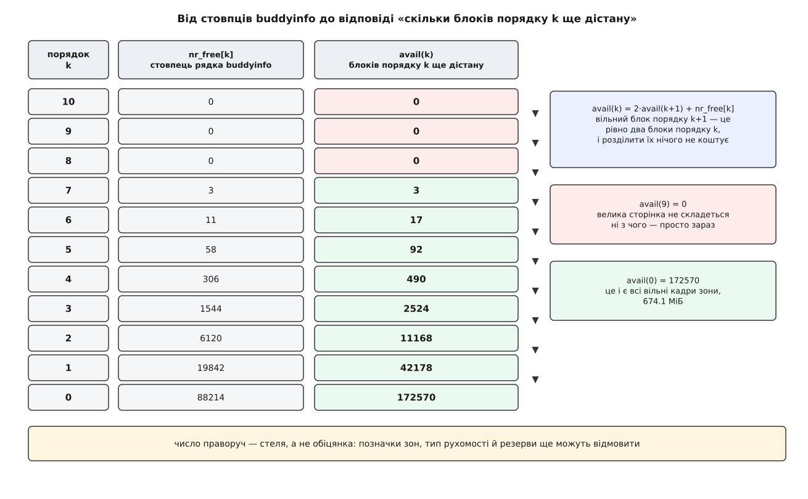
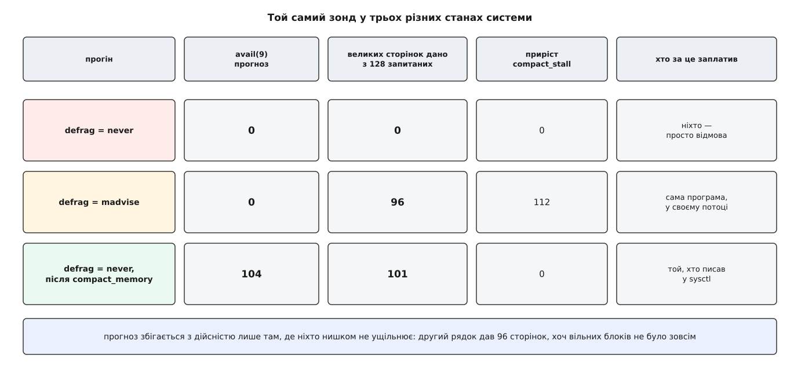

# ⚙️ Читач buddyinfo: прогноз найбільшого блоку і перевірка його дійсністю

Дві невеликі програми на C. Перша перетворює рядок `/proc/buddyinfo` на пряму відповідь: скільки вільно в кожній зоні, який найбільший суцільний блок є просто зараз і скільки блоків кожного порядку ще можна зібрати, не рухаючи жодної сторінки. Друга йде до системи й просить саме такі блоки — щоб побачити, де прогноз збігся, а де ні, і чим саме розбіжність пояснюється.

Порядок тут не декоративний. Прогноз без перевірки — вправа з арифметики: `buddyinfo` показує списки вільних блоків, а не те, що вам віддадуть. Між цими двома речами стоять рівневі позначки зон, типи рухомості й резерви, і жодна з цих перепон у файлі не видна. Тому корисна тільки пара: число, яке ми вивели, і число, яке ми зняли.

Домовимося про одне слово. **Порядок k** — це блок із 2ᵏ кадрів поспіль, вирівняний на власний розмір; на x86-64 з кадром у 4 КіБ порядок 9 — це рівно два мебібайти, тобто розмір великої сторінки.

## Питання, на яке файл не відповідає сам

Рядок `/proc/buddyinfo` — це `nr_free[k]`: скільки вільних блоків лежить у списку кожного порядку. Питання ж, яке ставлять насправді, звучить інакше: **скільки блоків порядку k я взагалі можу отримати**. Це не те саме число, бо великий вільний блок годиться і на менші запити.

Вільний блок порядку j — це, без жодного перенесення сторінок, два блоки порядку j−1, чотири блоки порядку j−2 і так далі вниз. Розділити його нічого не коштує: розподільник виймає блок зі свого списку, кладе половину в список нижчого порядку й віддає другу. Тому:

```
avail(k) = Σ (по j ≥ k) nr_free[j] · 2^(j−k)
```

Ця сума рахується одним проходом згори вниз, і в такому вигляді вона очевидніша:

```
avail(kmax) = nr_free[kmax]
avail(k)    = 2 · avail(k+1) + nr_free[k]
```

Усе, що є вище, дає вдвічі більше блоків тут — плюс те, що лежить у власному списку.



*Та сама пам'ять, два різні числа. Ліворуч — скільки блоків лежить у списку порядку; праворуч — скільки блоків цього порядку взагалі складеться з наявного.*

Два наслідки перевіряють правильність згортки. Перший: `avail(0)` — це всі вільні кадри зони, бо будь-який блок розпадається на одинарні кадри. Другий: найбільший порядок, у якого `nr_free` не нуль, і є найбільший суцільний шматок, доступний просто зараз, — вище нього нема чого ділити.

Та сама згортка живе в ядрі: функція `fill_contig_page_info()` у `mm/vmstat.c` рахує `free_blocks_suitable += blocks << (order − suitable_order)` — ті самі доданки, з яких ядро потім виводить свій показник фрагментації.

Головне застереження варто поставити одразу, а не в кінці. **`avail(k)` — це стеля, а не обіцянка.** Розподільник відмовить, навіть коли блок є, щонайменше з трьох причин: він не спускається нижче рівневої позначки `min` для звичайного запиту; він не віддасть блок із блоку сторінок чужого типу рухомості, якщо є куди відмовити; і він притримає низьку зону для тих, хто не має вибору. Розрив між `avail(k)` і тим, що видали, — це не похибка розбору, а якраз те, що вимірює друга програма.

## Що не можна зашивати в розбір

Файл виглядає простим, і саме тому його розбирають неправильно. Три речі в ньому — не сталі.

**Кількість стовпців.** Їх стільки, скільки в ядрі порядків: `NR_PAGE_ORDERS`, що дорівнює `MAX_PAGE_ORDER + 1`. На x86-64 це типово 11 (порядки 0…10), але `CONFIG_ARCH_FORCE_MAX_ORDER` межу міняє, і на arm64 чи на ядрі з увімкненим CMA число буде інше. Плутанини додає історія самої сталої, і її варто знати точно, бо старі поради з мережі досі спираються на попередній зміст. У ядрі 6.3 `MAX_ORDER` дорівнював 11 і означав *кількість* порядків, тож найбільший дозволений порядок був `MAX_ORDER - 1`. У 6.4 значення поміняли на 10, зробивши його включним. У 6.8 сталу перейменували на `MAX_PAGE_ORDER` — саме щоб код, написаний за старим змістом, не зібрався мовчки з новим; тоді ж з'явилося й `NR_PAGE_ORDERS`. Наслідок для нас простий: «одинадцять» ніде не пишемо, стовпці рахуємо.

**Розмір кадру.** Порядок 9 — це 2 МіБ на машині з кадром 4 КіБ і 32 МіБ на машині з кадром 64 КіБ. Береться з `sysconf(_SC_PAGESIZE)`.

**Набір рядків.** Рядок — це пара «вузол × заселена зона». `ZONE_DMA` може не існувати, `ZONE_DMA32` є лише на 64-бітних, `ZONE_MOVABLE` з'являється за налаштуванням, а вузлів на великій машині кілька — це [нерівномірний доступ до пам'яті](root:hw-arch/numa). Ні кількості рядків, ні набору імен зон припускати не можна.

Звідси форма розбору: знайти номер вузла, взяти слово після `zone`, а далі — **усі числа, скільки їх є**.

## Читач

Файл читаємо одним `read()` у великий буфер. Причина не в швидкості. `/proc/buddyinfo` не існує на диску — його текст ядро складає в мить читання, обходячи зони ([як `/proc` віддає стан ядра текстом](root:sys-unix/proc-reading-process-and-kernel-state)). Один рядок ядро друкує, тримаючи `spin_lock_irqsave(&zone->lock)`, тож усередині рядка числа узгоджені між собою. А от між рядками замок відпускають — і чим меншими порціями ви тягнете файл, тим більше різних митей у ньому змішано. Великий буфер зводить це до мінімуму.

:::tabs
:::code proj-buddyinfo-reader/c/budinfo.c
:::code proj-buddyinfo-reader/cpp/budinfo.cpp
:::

Розбір одного рядка. Він працює з рядком, уже відрізаним по `'\n'`, — інакше `strtoul` радо перескочив би через перенос і затягнув числа наступної зони.

:::tabs

:::code proj-buddyinfo-reader/c/chytach.c

:::code proj-buddyinfo-reader/cpp/budinfo-2.cpp

:::

Варіант на C++ тут виграє в одному конкретному місці: довжину масивів задає сам файл, а не наша стеля `MAX_ORDERS`, тож ядро з сорока порядками не мовчки обріжеться, а просто спрацює. Розбір теж коротший — `string_view` ріже рядок без копіювань, `from_chars` читає число без локалі й без `errno`. Решта програми далі йде на C: там самі системні виклики й `printf`, і вибір мови в них нічого не змінює.

Ще два помічники: людські одиниці й вилов посторінкових запасів, до яких ще повернемося.

:::tabs
:::code proj-buddyinfo-reader/c/chytach-2.c
:::code proj-buddyinfo-reader/cpp/chytach.cpp
:::

Обв'язка: прочитати, розібрати, порахувати, надрукувати.

:::tabs
:::code proj-buddyinfo-reader/c/chytach-3.c
:::code proj-buddyinfo-reader/cpp/chytach-2.cpp
:::

## Що видно на живій машині

Прогін на робочому сервері з 16 ГіБ пам'яті та місяцем безперервної роботи:

```sh
$ ./budinfo
кадр 4.0 КіБ, порядків 11 → MAX_PAGE_ORDER = 10, найбільший блок 4.0 МіБ

Node 0, zone DMA       вільно      12.1 МіБ   найбільший блок: порядок 10 = 4.0 МіБ
Node 0, zone DMA32     вільно     158.7 МіБ   найбільший блок: порядок 8 = 1.0 МіБ
Node 0, zone Normal    вільно     674.1 МіБ   найбільший блок: порядок 7 = 512.0 КіБ
```

Три рядки, і в них уже видно головне. У головній зоні вільно шістсот сімдесят чотири мебібайти, а найбільший шматок, який з неї можна взяти, — 512 кілобайтів. А `ZONE_DMA`, у якій вільно всього дванадцять мебібайтів, спокійно віддасть блок на чотири — бо туди майже ніхто не ходить і псувати її форму нема кому.

Повна картина по зоні:

:::code proj-buddyinfo-reader/sh/shcho-vydno-na-zhyvii.sh

Останні три рядки — вирок. Жодної великої сторінки в цій зоні не збереться: `avail(9)` дорівнює нулю, і жодне ділення цього не змінить, бо ділити нема чого.

Запит на конкретний розмір відповідає одним рядком на зону:

```sh
$ ./budinfo --need 262144
кадр 4.0 КіБ, порядків 11 → MAX_PAGE_ORDER = 10, найбільший блок 4.0 МіБ

Node 0, zone DMA       вільно      12.1 МіБ   найбільший блок: порядок 10 = 4.0 МіБ
    під 256.0 КіБ треба порядок 6 → таких блоків ще дістану: 47
Node 0, zone DMA32     вільно     158.7 МіБ   найбільший блок: порядок 8 = 1.0 МіБ
    під 256.0 КіБ треба порядок 6 → таких блоків ще дістану: 16
Node 0, zone Normal    вільно     674.1 МіБ   найбільший блок: порядок 7 = 512.0 КіБ
    під 256.0 КіБ треба порядок 6 → таких блоків ще дістану: 17
```

Драйвер, якому потрібна чверть мебібайта поспіль, на цій машині ще житиме — але сімнадцять спроб у головній зоні, і все.

> 🔧 **Навіщо це.** Число `avail(k)` варто знімати не тоді, коли щось уже впало, а періодично — раз на хвилину в ту саму систему збору показників, куди йдуть інші лічильники. Тоді відмова великого виділення перестає бути раптовою: на графіку видно, як `avail(9)` місяць повзе до нуля, і втручатися можна за тижні до аварії.

## Чим із простору користувача взагалі можна помацати порядок

Тепер друга половина: перевірка. І одразу неприємна правда — **з простору користувача не можна попросити суцільну фізичну пам'ять**. Ні `malloc`, ні `mmap`, ні `posix_memalign` про фізичні кадри нічого не кажуть: вони роздають діапазони віртуальних адрес, а те, як ті лягли на кадри, лишається справою ядра. Тому «перевірка прогнозу» вимагає обхідного шляху, і кандидатів рівно три — з них два оманливі.

**`posix_memalign` на межу 2 МіБ** вирівнює адресу *віртуально* ([звідки алокатор бере пам'ять](root:sys-unix/allocator-and-kernel)). Це необхідно — велику сторінку кладуть лише на вирівняний діапазон адрес, і без вирівнювання її не буде ніколи, скільки б вільних блоків не лежало. Але це не *достатньо* й нічого не міряє: сам виклик коштує однаково на свіжій і на вкрай пофрагментованій машині.

**`mmap` з `MAP_POPULATE`** просить ядро одразу заповнити всю ділянку, замість роздавати кадри по одному на дотик ([mmap як механізм](root:sys-unix/mmap-model), [чому кадр підставляють у мить першого дотику](root:sf-os/page-fault)). Спокуса зрозуміла: узяти гігабайт, поміряти час, оголосити це вимірюванням фрагментації. Це неправда. `MAP_POPULATE` набирає кадри порядку 0 — а порядок 0 не закінчується доти, доки в системі взагалі є вільна пам'ять. Гальмує він від [витіснення](root:sys-unix/swap-and-reclaim), тобто від браку, а не від форми, і вимірює зовсім іншу стіну. Якщо все-таки треба саме заповнення, чесніший інструмент — `madvise(MADV_POPULATE_WRITE)` (з Linux 5.14): він повертає `ENOMEM`, замість того щоб довести до вбивства процесу.

**Велика сторінка** — єдиний із трьох, що справді впирається в порядок. Запис таблиці, який покриває два мебібайти одним номером кадру, вимагає рівно блоку порядку 9 ([великі сторінки: HugeTLB і прозорі](root:sys-unix/huge-pages-tlb-reach)). І тут є два способи попросити.

Перший — `madvise(MADV_HUGEPAGE)` і дотик: ядро спробує велику сторінку, а не вийде — мовчки покладе звичайні кадри. Мовчки — це і є проблема: відмови не видно, її треба вираховувати з `AnonHugePages`.

Другий — `madvise(MADV_COLLAPSE)`, що з'явився в Linux 6.1. Він робить те саме синхронно й **повертає помилку**. Причому не абияку: у `madvise_collapse_errno()` випадок `SCAN_ALLOC_HUGE_PAGE_FAIL` перетворюється рівно на `ENOMEM`. Тобто `ENOMEM` від `MADV_COLLAPSE` означає буквально «блоку порядку 9 не склалося» — саме те число, яке передбачає `avail(9)`. Кращого зонда з простору користувача не існує.

## Зонд

:::tabs
:::code proj-buddyinfo-reader/c/thpprobe.c
:::code proj-buddyinfo-reader/cpp/thpprobe.cpp
:::

Серце зонда. Ділянку беремо з запасом і вирівнюємо руками — покладатися на те, що ядро саме віддасть вирівняну адресу, не варто: воно так робить лише коли великі сторінки ввімкнені, а нам потрібен той самий дослід і з вимкненими.

:::tabs
:::code proj-buddyinfo-reader/c/zond.c
:::code proj-buddyinfo-reader/cpp/zond.cpp
:::

Ключове тут — не сам дотик, а те, що навколо нього. Затримка на шматок розділяє світ надвоє: узяти готовий блок зі списку — це одиниці мікросекунд, а ущільнити зону задля нього — сотні мікросекунд або мілісекунди. Приріст `compact_stall` каже, скільки разів наш власний потік пішов ущільнювати замість того, щоб отримати пам'ять.

Хто саме за це заплатить, вирішує не програма, а вимикач `defrag`:

```sh
$ cat /sys/kernel/mm/transparent_hugepage/defrag
always defer defer+madvise [madvise] never
```

Значень п'ять. `never` — не ущільнювати взагалі, а не вийшло, то дати звичайні кадри. `madvise` (типове) — ущільнювати просто в шляху збою, але тільки для ділянок, позначених `MADV_HUGEPAGE`. `defer` — не чекати самому, а розбудити `kswapd` і `kcompactd` і піти далі. `defer+madvise` — те саме, але для позначених ділянок усе-таки чекати. `always` — чекати завжди. Для нашого досліду це головний важіль: щоб поміряти **наявний** стан, треба `never`; щоб поміряти, **скільки ущільнення додає**, треба `madvise`.

Поруч живе другий вимикач, `enabled`, і без нього зонд не працює зовсім: він вирішує, чи ядро взагалі пробує велику сторінку. Значення `always` пробує на кожну відповідну ділянку, `madvise` — тільки на позначені `MADV_HUGEPAGE`, `never` вимикає механізм. Для наших прогонів потрібне `madvise`: воно лишає нам повний контроль над тим, які ділянки беруть участь у досліді.

## Три прогони, з яких усе складається

Порядок дій на тій самій машині, чий `buddyinfo` показано вище.

:::code proj-buddyinfo-reader/sh/try-prohony-z-iakykh-use.sh

Прогноз збігся точно: нуль означав нуль. Затримки крихітні, бо ніхто нічого не збирав — просто підставили звичайні кадри.

```sh
$ echo madvise | sudo tee /sys/kernel/mm/transparent_hugepage/defrag > /dev/null
$ ./thpprobe --count 128
велика сторінка 2097152 Б = порядок 9; прошу 128 штук (256.0 МіБ)
дано великих сторінок: 96 з 128   (відмов: 32, інших помилок: 0)
затримка на шматок, мкс: медіана 412.0, 90% 3180.5, найгірша 9944.2
приріст: thp_fault_alloc +96, thp_fault_fallback +32, compact_stall +112, compact_success +71
```

Дев'яносто шість великих сторінок там, де вільних блоків порядку 9 не було **жодного**. Ніякої суперечності: їх не було — їх зробили. Сто дванадцять зупинок на ущільнення, і ціна цих зупинок стоїть у тому ж рядку: медіана виросла з двох мікросекунд до чотирьохсот, а найгірший шматок обійшовся в десять мілісекунд. Заплатив за це наш власний потік, у своєму часі — і саме так виглядає збій великої сторінки на бойовій машині, коли хтось скаржиться на «випадкові підвисання».

:::code proj-buddyinfo-reader/sh/try-prohony-z-iakykh-use-2.sh



*Вільних кадрів у зоні весь час однаково — 674 мебібайти. Змінюється тільки те, як вони лежать і хто за перекладання платить.*

Вільної пам'яті після ущільнення стільки ж, до кадра: 674.1 МіБ. Найбільший блок піднявся з половини мебібайта до чотирьох. Прогноз `avail(9)` став 104 — і зонд дістав 101 замість 104, не заплативши жодної зупинки. Розрив у три сторінки й є те, чого з файла не видно: рівнева позначка `min` не дозволяє вигребти зону до дна, а частина блоків лежить у блоках сторінок такого типу рухомості, звідки їх нашому запитові не віддадуть.

Ще одне число варто прочитати уважно: у рядку після ущільнення `nr_free[0]` лишився величезним — 86850 замість 88214. Ущільнення пересуває **рухомі** сторінки — сторінки процесів і кеш файлів. Одинарні вільні кадри, розсипані серед структур ядра й закріплених буферів, воно не чіпає, і саме тому «полагодити геть усе» ним не вийде.

Найпряміша ж перевірка виглядає так, і саме її варто мати під рукою, коли треба відповісти «чи є зараз блок порядку 9» без жодних припущень:

```sh
$ ./thpprobe --count 128 --collapse
велика сторінка 2097152 Б = порядок 9; прошу 128 штук (256.0 МіБ)
дано великих сторінок: 99 з 128   (відмов: 29, інших помилок: 0)
затримка на шматок, мкс: медіана 268.4, 90% 1904.7, найгірша 8112.5
приріст: thp_fault_alloc +0, thp_fault_fallback +0, compact_stall +31, compact_success +4
```

Тут `MADV_COLLAPSE` двадцять дев'ять разів повернув `ENOMEM` — не «щось пішло не так», а точну заяву ядра: блоку порядку 9 зібрати не вдалося. І заява вагома, бо просить `MADV_COLLAPSE` не пошепки: у `alloc_charge_folio()` він іде з прапорцями `GFP_TRANSHUGE`, тобто з дозволом на пряме витіснення й ущільнення — звідси й тридцять одна зупинка в лічильнику. `ENOMEM` тут означає «блоку немає навіть після того, як ми спробували його зробити».

Лічильники `thp_fault_*` при цьому не ворухнулися: жодного збою сторінки не сталося, сторінки вже стояли, їх лише зводили в одну велику. Затримка теж іншої природи — це не пошук блоку, а копіювання двох мебібайтів і переписування всіх записів таблиць на кожен зібраний шматок. І пам'ятайте, що цей прогін перед вимірюванням сам зайняв 256 мебібайтів звичайними кадрами: він міряє не ту саму машину, яку бачив `budinfo` хвилиною раніше.

Про сам вимикач ущільнення варто знати три речі, і кожна колись обійдеться в загублений вечір. По-перше, `/proc/sys/vm/compact_memory` має права `0200` — його не можна прочитати навіть із-під root, лише записати; `cat` поверне помилку. По-друге, значення мусить бути рівно `1`: обробник `sysctl_compaction_handler()` на будь-яке інше повертає `EINVAL`, тож звичне «записати нуль, щоб вимкнути» тут просто не спрацює. По-третє, запис **синхронний**: ядро ущільнює всі зони всіх вузлів у контексті того, хто пише, і на великій машині `echo` повертається за секунди. Якщо потрібен один вузол, є вужчий шлях — `/sys/devices/system/node/node0/compact`.

## Складність і пастки

Обчислювальна складність тут не варта розмови: розбір — прохід по рядку, згортка — один прохід по одинадцяти числах. Уся ціна лежить на боці ядра, і саме тому перша пастка виглядає так, як виглядає.

**Опитування псує те, що міряє.** Друк одного рядка ядро робить, тримаючи `spin_lock_irqsave(&zone->lock)` — той самий замок, під яким усі процесори беруть і віддають кадри, ще й з вимкненими перериваннями. На машині з шістдесятьма чотирма ядрами читання `buddyinfo` у щільному циклі стає власним джерелом затримок. Раз на секунду — межа, за яку в бойовій системі краще не заходити.

**Рядок узгоджений сам із собою, файл — ні.** Кожну зону друкують під її замком, але між зонами замок відпускають. Тож числа сусідніх рядків узяті з різних митей, і сума по всьому файлу — величина приблизна за побудовою. Тому й читаємо одним `read()` у великий буфер: дрібними порціями розкид тільки більший.

**Посторінкові запаси не видно ніде.** Перед списками вільних блоків стоїть кеш: у кожного процесора свій невеликий запас одинарних кадрів, щоб не битися за замок зони на кожному сторінковому збої. Кадр, виданий у цей запас, знімають з обліку одразу — тому його немає ні в `buddyinfo`, ні в `MemFree`. Обидва числа однаково применшують справжню кількість вільної пам'яті:

```sh
$ ./budinfo --hidden | grep -A1 'zone Normal'
Node 0, zone Normal    вільно     674.1 МіБ   найбільший блок: порядок 7 = 512.0 КіБ
    у запасах ядер, поза цим рядком: 9412 кадрів (36.8 МіБ)
```

Майже тридцять сім мебібайтів, яких немає ні в `buddyinfo`, ні в `MemFree`. Наслідок глибший за арифметику: щойно звільнений кадр не одразу стає кандидатом на злиття з приятелем — спершу він осідає в запасі свого процесора. Механізм швидкості сам додає трохи тимчасової фрагментації, і тому перед серйозним ущільненням ядро ці запаси спорожняє.

**`MemFree` і сума по рядку можуть не збігтися — і це не помилка.** `nr_free[k]` у `buddyinfo` — звичайне поле зони, надруковане під замком. `MemFree` — статистика `NR_FREE_PAGES`, яку кожен процесор накопичує в себе й зливає в спільний лічильник лише коли набереться `stat_threshold`. Розбіжність у кілька тисяч кадрів на великій машині — норма. А ще під час гарячого вимкнення планки чи роботи CMA частина блоків має тип `MIGRATE_ISOLATE`: вони лежать у списках і рахуються в `nr_free`, але з `NR_FREE_PAGES` виключені — і тоді сума по рядку виявиться *більшою* за `MemFree`.

**`AnonHugePages` рахує не всі великі сторінки.** Від ядра 6.8 працюють великі сторінки проміжних розмірів (mTHP) — не лише порядок 9, а й менші, увімкнені окремо в `/sys/kernel/mm/transparent_hugepage/hugepages-*kB/enabled`. У `AnonHugePages` вони не потрапляють: там лише сторінки розміру PMD. Якщо схоже, що ваша пам'ять «не отримала великих сторінок», а лічильники не сходяться, дивіться в `hugepages-*kB/stats/anon_fault_alloc`.

**Велика сторінка — не завжди порядок 9.** Порядок міряє кадри, а розмір великої сторінки задає апаратура. На x86-64 з кадром 4 КіБ це 2 МіБ, тобто 512 кадрів, порядок 9. На arm64 з кадром 16 КіБ запис PMD покриває 32 МіБ — порядок 11; з кадром 64 КіБ — 512 МіБ, порядок 13. І там-таки видно, звідки береться `CONFIG_ARCH_FORCE_MAX_ORDER`: у `arch/arm64/Kconfig` він дорівнює 13 для 64-кілобайтних кадрів, 11 для шістнадцятикілобайтних і 10 в решті випадків — рівно стільки, щоб велика сторінка взагалі влізла в межу розподільника. Тому в зонді розмір читається з `hpage_pmd_size`, а порядок виводиться з нього діленням на розмір кадру.

**Сусідній рядок `pagetypeinfo` вимагає прав.** `/proc/buddyinfo` має режим `0444` і читається ким завгодно, а `/proc/pagetypeinfo` — `0400`, тільки root. Причина в ціні: щоб розписати блоки за типами рухомості, ядро обходить самі списки, а не читає готове число, і на великій машині це помітно довше під тим самим замком.

**Дотик можуть викинути.** Цикл, що пише в буфер, який ніхто не читає, нічого спостережуваного не змінює — а отже, оптимізатор має право його прибрати. У зонді `base` оголошено `volatile` саме тому; заберіть це слово, зберіть із `-O2` — і програма пролетить за мікросекунду, «не знайшовши» жодної проблеми.

**Один прогін не доводить нічого.** Стан пам'яті змінюється між двома читаннями `buddyinfo` — сусідні процеси беруть і віддають кадри весь час. Порівнювати треба медіани кількох прогонів у обидва боки, а не два поодинокі числа; звичайна дисципліна вимірювання [діє тут так само, як усюди](root:sf-release/microbenchmarking).
