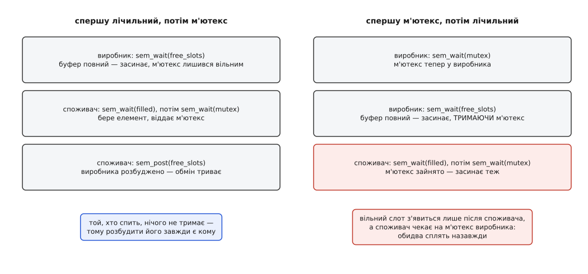

# ⚙️ Обмежений буфер на двох процесах: два лічильники й один м'ютекс

Дві окремі програми — не потоки й не батько з дитиною, а просто дві запущені руками команди — передають одна одній записи через кільце на вісім слотів: виробник спить, коли кільце повне, споживач спить, коли воно порожнє, і поки триває обмін, жоден не крутить порожнього циклу (єдине опитування — коротке, на старті, поки область ще не готова). Нижче — повний код обох плюс чотири місця, де ця конструкція розсипається, якщо писати її «як здається природним».

## Що саме будуємо

У спільній ділянці пам'яті лежить кільце на `SLOTS` слотів, два індекси й три семафори:

- `free_slots` — скільки місць вільно, початкове значення `SLOTS`;
- `filled` — скільки записів готово, початкове значення `0`;
- `mutex` — двійковий семафор навколо індексів, початкове значення `1`.

Перші два — та сама пара, заради якої семафор і придумано: кожен рахує свій ресурс, а сума `free_slots + filled` ніколи не перевищує `SLOTS`. Виробник витрачає одиницю з `free_slots` і додає одиницю до `filled`, споживач — навпаки. Жодної перевірки «чи повний буфер» у коді не буде взагалі: перевірку разом із засинанням робить `sem_wait`, і робить неподільно.

Третій семафор потрібен не завжди, і це варто побачити відразу. Якщо виробник рівно один і споживач рівно один, `tail` чіпає тільки перший, `head` — тільки другий, і захищати нема чого. М'ютекс стає обов'язковим у ту мить, коли з'являється другий виробник: двоє тепер сперечаються за один і той самий `tail`, а «прочитати індекс, збільшити, записати назад» — не одна дія, а три ([атомарність і гонки](root:sf-tasks/atomicity-races)). Ми лишаємо м'ютекс у прикладі саме тому, що на ньому виростає найповчальніша з помилок.

Ділянка пам'яті береться звичайним способом: іменований об'єкт [спільної пам'яті POSIX](root:sys-unix/posix-shared-memory) — це файл на tmpfs, який обидві програми відкривають за домовленим рядком і відображають до себе з `MAP_SHARED`, після чого пишуть у нього як у власну пам'ять. Сама кільцева розкладка — звичайний [кільцевий буфер](root:sf-algorithms/ring-buffer): два індекси за модулем розміру.

## Спільний заголовок

:::code proj-producer-consumer/c/pc.h

Структури `sem_t` лежать **усередині** області, а не поруч із нею: семафор — це кілька байтів у пам'яті, і спільним його робить не прапорець `pshared`, а те, що обидва процеси дивляться на ті самі фізичні сторінки.

## Виробник — той, хто створює область

:::code proj-producer-consumer/c/producer.c

## Споживач — той, хто приєднується до готового

:::code proj-producer-consumer/c/consumer.c

Копіювання відбувається **всередині** критичної ділянки, і це не перестрахування. Якби кожен виносив `memcpy` за м'ютекс, лишивши під ним самий індекс, то з двома виробниками сталося б таке: перший зайняв слот 0, другий — слот 1, другий скопіював швидше й зробив `sem_post(&filled)`, споживач прокинувся й узяв слот за своїм `head`, тобто нульовий — той, у який ще досі пишуть.

## Гонка ініціалізації: чому в споживача два очікування до першого `sem_wait`

Семафор уміє захистити все, крім самого себе в момент народження. Виробник створює файл, задає йому розмір і лише потім викликає `sem_init`; між цими подіями область уже існує й уже відкривається. Споживач, який устиг відобразити її раніше, побачить не семафор, а нулі — і `sem_wait` над цими нулями поводитиметься як завгодно.

Дірок тут насправді дві, і закриваються вони різними засобами. Перша — розмір: якщо відобразити область до `ftruncate`, за відображенням не стоїть сторінок, і перший же доступ дасть `SIGBUS`, а не помилку повернення. Тому споживач чекає на `fstat`, доки файл не доросте до `sizeof(struct ring)`. Друга — власне вміст: його стереже поле `ready`, яке виробник записує **останнім**, з `memory_order_release`, а споживач читає **першим**, з `memory_order_acquire`. Ця пара робить не тільки видимість самого прапорця: усе, що виробник записав до нього, гарантовано видно тому, хто побачив прапорець установленим ([порядок доступу до пам'яті](root:sf-tasks/memory-ordering-barriers)). Звичайне `unsigned` без атомарності тут не годиться: компілятор має право винести читання з циклу, і той закрутиться назавжди.

Коротший шлях є, коли процеси споріднені: батько відображає область і робить `sem_init` **до** `fork` — тоді дитина від народження бачить готове ([fork](root:sys-unix/fork-semantics)). Наш приклад свідомо цим не користується: дві незалежні команди спорідненості не мають.

## Порядок двох очікувань — не смак, а умова життя

Виробник чекає спершу на `free_slots`, і тільки потім на `mutex`. Переставте ці два рядки — і програма перестане працювати не іноді, а гарантовано, щойно кільце заповниться.



*Той, хто спить, не повинен нічого тримати: інакше розбудити його стає нікому.*

Причина одна й проста. Виробник із зворотним порядком засинає на `free_slots`, **тримаючи** м'ютекс. Вивільнити слот може тільки споживач, а споживач, узявши `filled`, упирається в зайнятий м'ютекс і засинає теж. Кожен чекає на дію іншого — це [дедлок](root:sf-tasks/deadlock) у найчистішому вигляді, і жодна з двох сплячок сама не скінчиться.

Звідси правило, ширше за цей приклад: **лічильний семафор — зовні, взаємне виключення — усередині**. Спати можна лише з порожніми руками. З `sem_post` такої суворості нема; м'ютекс віддають першим просто тому, що тримати його довше нема сенсу.

## Чому `sem_wait` загорнуто в цикл

`sem_wait` може повернути `−1` з `errno == EINTR`: під час очікування прийшов сигнал з обробником, очікування обірвалося, і значення семафора не змінилося. Прийняти це за помилку — означає загубити елемент або вийти з програми на рівному місці.

Linux, починаючи з 2.6.22, `sem_wait` і `sem_timedwait` перезапускає сам, якщо обробник встановлено з прапорцем `SA_RESTART` (доти вони завжди падали з `EINTR`). Але прапорець ставите не завжди ви — його могла не поставити бібліотека, — а POSIX жодного перезапуску не обіцяє. Цикл коштує один рядок і знімає питання назавжди ([EINTR і перезапуск викликів](root:sys-unix/eintr-and-restart)).

## Що станеться, якщо процес помре посередині

Споживач узяв `filled`, узяв `mutex` — і в цю мить його вбито `SIGKILL`. М'ютекс лишається зі значенням нуль назавжди. Виробник дійде до `wait_retry(&r->mutex)` і засне на віки, хоча в системі більше немає нікого, хто міг би зробити `sem_post`.

Семафор цього не лікує **принципово**, а не через недогляд реалізації. У ньому не записано, хто саме зменшив значення: `sem_post` вільно робить будь-хто, і саме ця свобода й робить його дешевим засобом сповіщення. А раз власника нема, то ядро при завершенні процесу не має що відкотити — воно не знає, які одиниці належали померлому.

Наслідок практичний: як засіб взаємного виключення між процесами семафор — поганий вибір. Для цього є живучий м'ютекс (`PTHREAD_MUTEX_ROBUST` разом із `PTHREAD_PROCESS_SHARED`): він власника пам'ятає й наступному охочому повертає `EOWNERDEAD`, даючи шанс полагодити структуру ([синхронізація між процесами](root:sys-unix/process-shared-sync)). Втрата ж однієї одиниці `free_slots` (процес помер після `sem_wait`, до `sem_post`) непомітна одразу й невиправна: кільце назавжди стало на слот меншим.

## Прибирання

Найсуворіше з правил `sem_destroy` — не чіпати семафор, у якому хтось спить. Саме заради цього виробник наприкінці збирає всі `SLOTS` одиниць `free_slots`: повний набір вільних слотів означає, що споживач прочитав порожній запис, вийшов із циклу й у жодному семафорі більше не спить.

`shm_unlink` знімає ім'я. Сама область живе, доки її хтось відображає, тож порядок «зняти ім'я, потім відпустити відображення» безпечний. Забудете — файл лишиться в `/dev/shm/pc.ring` до перезавантаження; його видно звичайним `ls -l /dev/shm/`.

## Те саме на іменованих семафорах

Якщо винести три семафори з області назовні, зміниться небагато. Зі `struct ring` зникають поля `sem_t`, у ній лишаються індекси й слоти; кожна програма робить своє відкриття:

```c
sem_t *free_slots = sem_open("/pc.free",  O_CREAT, 0600, SLOTS);
sem_t *filled     = sem_open("/pc.fill",  O_CREAT, 0600, 0);
sem_t *mutex      = sem_open("/pc.mutex", O_CREAT, 0600, 1);
if (free_slots == SEM_FAILED || filled == SEM_FAILED || mutex == SEM_FAILED)
    return 1;
/* … sem_wait(free_slots) замість sem_wait(&r->free_slots) … */
sem_close(free_slots); sem_close(filled); sem_close(mutex);
sem_unlink("/pc.free"); sem_unlink("/pc.fill"); sem_unlink("/pc.mutex");
```

Виграш — гонки ініціалізації для самих семафорів більше нема: `sem_open` створює й ініціалізує атомарно. У glibc це зроблено вручну тим самим прийомом, який довелося б винаходити нам: семафор записують у файл з тимчасовим іменем, уже налаштованим, і лише потім `link` дає йому остаточне ім'я — під кінцевим іменем недоліченого об'єкта не буває ніколи. Хто прийшов другим, дістає `EEXIST` і просто відкриває наявний.

Програш — семафори тепер переживають обидва процеси. Виробник упав із `filled` = 5; наступний запуск викликає `sem_open` з `O_CREAT` і дістає **старий** об'єкт зі старим значенням, бо початкове значення застосовується лише при створенні. Кільце вважає, що в ньому п'ять записів, яких там нема. Лікується це свідомо: `sem_unlink` перед створенням і потім `O_CREAT | O_EXCL`, щоб значення завжди було відомим.

І плата за зручність: три окремі файли в `/dev/shm` замість трьох структур по тридцять два байти всередині вже наявної області, три прибирання замість одного — при тій самій швидкодії.

Для цього прикладу висновок однозначний: спільна пам'ять тут є за означенням — кільце ж десь лежить, — тож безіменні семафори всередині неї природніші. Іменовані стають доречними, коли спільної області нема взагалі: коли процеси лише обмежують одночасність, нічого не передаючи одне одному. А якщо блокування на семафорах узагалі не потрібне й обидві сторони можуть обійтися атомарними індексами, є коротший шлях — [кільце на двох процесах без блокувань](root:sys-unix/posix-shared-memory/proj-shm-ring.md).
