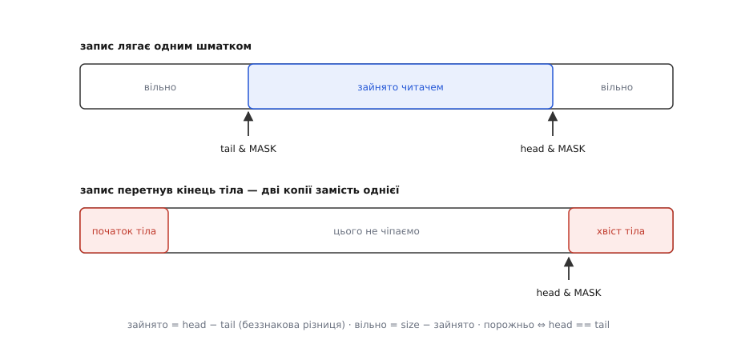
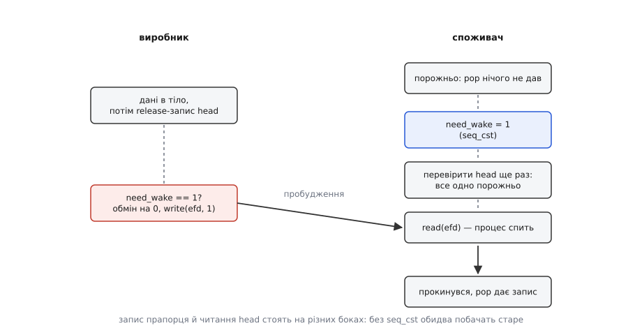

# ⚙️ Кільце на двох процесів: /dev/shm, атомарні індекси, eventfd

Дві програми, запущені окремо одна від одної, передають потік записів так, щоб жоден байт не проходив через ядро, а читач при цьому не крутив цикл, а спав. Нижче — повний робочий код цієї конструкції: один сегмент спільної пам'яті, два атомарні лічильники й один дескриптор на пробудження.

## Що будуємо

Виробник збирає телеметрію й раз на кілька мікросекунд викидає короткий запис змінної довжини. Споживач ці записи вичитує й складає на диск. Спільного предка немає: обидва запускаються самі по собі, тож успадкувати відображення нема від кого.

З цього тягнуться чотири вимоги, і кожна далі перетвориться на конкретний рядок коду. Записи різної довжини — отже, потрібне обрамлення. Гарячий шлях без системних викликів — отже, індекси живуть у самому сегменті. Читач, коли даних нема, мусить заснути — отже, поруч потрібен об'єкт ядра, на якому можна чекати. І переповнення не має ані блокувати виробника, ані псувати вже покладене.

## Розкладка сегмента

Тіло — суцільний масив байтів, у якому запис може лягти «через край»: почнеться в кінці й продовжиться на початку. Це звичайний [кільцевий буфер](root:sf-algorithms/ring-buffer), у якого позиція перетворюється на зсув узяттям остачі від довжини. Ділення на гарячому шляху зайве, тож довжину тіла беремо **степенем двійки** — тоді остача це просто `pos & (RING_BYTES − 1)`, одна інструкція замість цілочисельного ділення, яке коштує на порядок більше тактів.

Індекси не скидаємо на нуль після обороту, а лишаємо рости й переповнюватися разом із 32-бітним типом. Виграш у тому, що зникає вічна двозначність кільця: коли індекси обрізані до довжини тіла, стан «повне» й стан «порожнє» дають однакову пару чисел, і їх доводиться розрізняти зайвим прапорцем. У вільних лічильниках такого нема — беззнакова різниця `head − tail` дає зайняте місце правильно навіть у момент, коли `head` уже перескочив через нуль, а `tail` ще ні.

*Зайнято = head − tail, і жодних окремих прапорців «повне/порожнє».*

Далі — розміщення самих лічильників. `head` рухає тільки виробник, `tail` тільки споживач, але читає кожен обидва. Оголошені поруч, вони лягли б в одну кеш-лінію — а це [хибне спільне використання кеш-лінії](root:hw-arch/false-sharing) на кожному записі. Тому кожен лічильник отримує `_Alignas(64)` — власну лінію цілком.

Усередині сегмента немає жодного вказівника: `mmap` кладе той самий об'єкт у двох процесах за різними адресами, тож адреса, записана одним, у другого не означає нічого. Тому все, що зберігається в заголовку, — це числа-зсуви від початку відображення.

## Порядок, а не лише вміст

Спільні байти ще не дають спільного **порядку**: порядком відає процесор і компілятор, а не ядро.

Тому публікація запису розпадається на дві різні за природою дії: спершу дані копіюються в тіло звичайним `memcpy`, і лише потім новий `head` записується атомарно з семантикою випуску. Читач, побачивши цей `head` захопленням, дістає гарантію: усе, що виробник записав **до** випуску, для нього вже видиме. Без цієї пари він цілком міг би побачити свіжий індекс над ще не дописаним тілом ([упорядкування пам'яті](root:sf-tasks/memory-ordering-barriers)).

Приємний побічний наслідок: якщо виробник помре посеред копіювання, кільце лишиться цілим. Наполовину покладений запис ніхто не побачить, бо `head` так і не зрушив — читач просто не знає про його існування.

## Як розбудити того, хто спить

Спільна пам'ять німа: у ній нема на чому заснути. Потрібен об'єкт ядра — беремо [eventfd](root:sys-unix/eventfd-and-futex), лічильник із дескриптором: запис вісьмох байтів додає до нього, читання повертає накопичене й обнуляє, а на порожньому лічильнику читач блокується. У Linux він є з версії 2.6.22.

Тут вилазить те, про що зазвичай згадують надто пізно: **eventfd не має імені**. Сегмент пам'яті два чужі процеси знаходять за рядком у `/dev/shm`, а дескриптор так знайти не можна — його або успадковують через `fork`, або передають [сокетом домену Unix](root:sys-unix/unix-domain-sockets) допоміжним повідомленням `SCM_RIGHTS` (механіка розібрана окремо — [передати дескриптор](root:sys-unix/unix-domain-sockets/proj-pass-a-descriptor.md)). Рандеву-сокет у цій конструкції неминучий — і, з'явившись, окупає себе тричі: приносить дескриптор, задає момент «сегмент уже готовий» і своїм розривом повідомляє про смерть сусіда.

Будити на кожному записі не можна — це знищило б увесь сенс: `write` в eventfd коштує стільки ж, скільки запис у канал, і ми повернулися б до тисяч системних викликів на секунду. Тому в заголовку є прапорець `need_wake`: читач піднімає його **перед** тим, як заснути, а виробник смикає eventfd лише тоді, коли бачить прапорець піднятим. На повному кільці системних викликів не робиться взагалі.

*Прапорець піднімають до перевірки, а не після: інакше запис устигає прослизнути в проміжок.*

І саме тут звичного випуску-захоплення **не досить**. Читач пише прапорець і читає `head`; виробник пише `head` і читає прапорець — записи в різні комірки, які кожен бік мусить побачити раніше за своє читання. Буфер запису процесора має повне право затримати обидва записи, і тоді читач не побачить даних, виробник не побачить прапорця, і читач засне назавжди при повному кільці. Ліки — повний бар'єр (`atomic_thread_fence(memory_order_seq_cst)`) між записом і читанням на **обох** боках; напівбар'єрами тут не обійтися.

## Код

Одна програма у двох ролях: `./shmring r` — споживач (він же власник сегмента), `./shmring w` — виробник.

:::tabs

:::code proj-shm-ring/c/shmring.c

:::code proj-shm-ring/cpp/shmring.cpp

:::

Версія на C++ відрізняється не синтаксисом, а тим, де живуть гарантії. Дескриптор і відображення закриваються деструктором, а не рядком, який легко забути. `std::span` носить довжину разом з даними, тож перевірка меж перестає бути справою уважності. І `static_assert` на `is_always_lock_free` ловить дуже підступну річ: коли апаратної атомарності для типу нема, [`std::atomic`](root:sys-plang-cpp/std-atomic) підставляє замок із таблиці, що живе в адресному просторі **свого** процесу, — два процеси замикали б різні замки й нічого б не помітили.

## Ціна операції

На гарячому шляху немає ані системних викликів, ані динамічної пам'яті, ані ділень. Запис коштує один `memcpy` завдовжки із сам запис — час залежить від довжини запису й **не** залежить від того, скільки байтів уже лежить у кільці, — плюс два атомарні звертання й один повний бар'єр. Читання симетричне.

Витрати, які лишаються, — комунікаційні: кожне оновлення `head` тягне його кеш-лінію на чуже ядро (десятки наносекунд), а повний бар'єр гальмує конвеєр процесора. Обидва зникають, коли працювати **пачками**: покласти сотню записів, а тоді один раз опублікувати `head` і один раз перевірити прапорець. У цьому коді бар'єр стоїть на кожному записі навмисно — так видно логіку; у бойовому виробнику він виноситься за цикл пачки.

## Пастки

**Довжина сегмента — не довжина відображення.** `mmap` радо відобразить більше, ніж об'єкт займає, і помилки не буде. Вона прийде пізніше й у найгіршому вигляді: доторк до сторінки за межею об'єкта дає `SIGBUS` посеред звичайного розіменування вказівника. Тому виробник перевіряє `fstat` **до** відображення, а не покладається на те, що творець усе зробив правильно.

**Зсув, а не вказівник.** У сегменті не можна зберігати ані вказівників, ані нічого, що тримає їх усередині: рядків, векторів, об'єктів із таблицею віртуальних методів. Обидві програми мусять однаково розуміти розмір і вирівнювання полів — саме тому в заголовку стоїть `magic` із версією розкладки, і міняти його треба разом зі структурою, інакше свіжий виробник мовчки писатиме за старою.

**Числу з чужого боку не можна вірити двічі.** У `pop` довжина спершу копіюється в локальну змінну й лише потім перевіряється: якби перевірка й використання читали спільну пам'ять окремо, сусід устиг би підмінити значення між ними, і копіювання вийшло б за буфер. Порядок перевірок теж не випадковий — спочатку `n > cap`, і лише тоді `n + 4`, бо на неперевіреному `n` саме додавання може переповнитися.

**Смерть учасника пам'ять не помічає.** Впав виробник — сегмент і його вміст лишаються, і наступний запуск підхопить чужий недописаний стан; тому споживач починає зі `shm_unlink` і створює сегмент із `O_EXCL`. Впав споживач — `tail` завмирає, кільце заповнюється, і виробник вічно губить записи, не маючи звідки дізнатися чому. Помітити це можна лише поза пам'яттю: рандеву-сокет при смерті сусіда дає розрив, і саме за ним варто стежити разом із рештою подій. Спільна пам'ять на такі питання не відповідає взагалі.

**Ім'я в `/dev/shm` — глобальний ресурс.** Два незалежні запуски однієї програми зіткнуться на ньому лобами. Коли учасники вже мають сокет, ім'я можна прибрати зовсім: `memfd_create` дає безіменний об'єкт у пам'яті, який передають тим самим `SCM_RIGHTS`, а «пломби» дозволяють ще й заборонити зміну розміру — і тоді перевірка `fstat` перестає бути перегонами ([memfd_create і пломби](root:sys-unix/memfd-create)).
