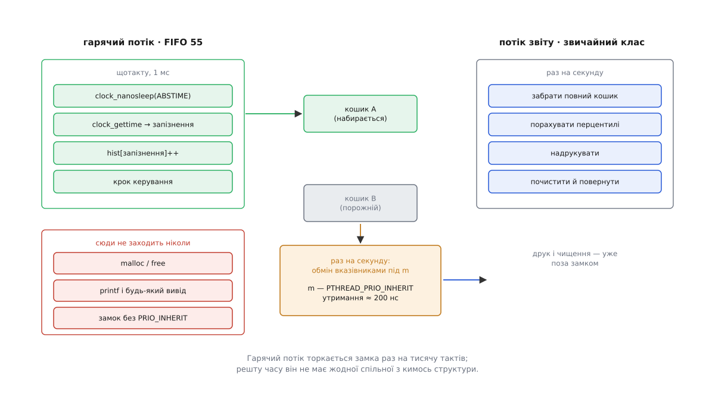
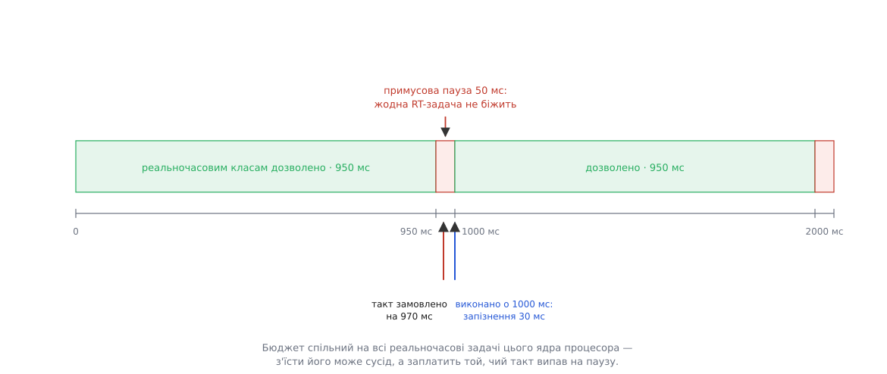

# ⚙️ Реальночасовий цикл, який справді встигає

Це готова програма на C — періодичний контур керування на 1 кГц, доведений до пуску на ядрі з `PREEMPT_RT`, тобто до стану, коли кожну затримку в ньому можна назвати на ім'я. Ядро вже прибрало своє джерело затримки й на цьому свою частину роботи закінчило; усе, що лишилося після нього, живе у прикладній програмі — і саме це «усе» тут зібрано в один файл.

## Задача

Привід, який треба тримати в заданій точці. Раз на мілісекунду програма читає положення, рахує поправку й віддає її пристроєві. Умова успіху сформульована не через середнє, а через межу: **жодне пробудження не сміє запізнитися більш ніж на 100 мкс**. Далі поправка приходить не в ту фазу й контур починає розгойдувати сам себе. Машина при цьому не порожня — на ній живуть звичайні задачі, і саме через них уся ця робота взагалі має зміст.

Другий потік програмі теж потрібен: хтось мусить рахувати статистику й друкувати її. Реальночасовим він не є й бути не мусить; уся хитрість — як передати йому дані, не зашкодивши першому.

## Чотири способи стати не готовим

`PREEMPT_RT` дає таку гарантію: у системі не лишилося споживача процесора без числа. Це твердження про ядро, а не про вашу програму. Планувальник вибирає лише **серед готових** задач — і найважливіша задача системи все ще може перестати бути готовою, а тоді її число нікого ні до чого не зобов'язує.

Способів рівно чотири, і кожен закривається кількома рядками коду.

Задача **впирається в сторінку**, якої ще немає: сторінковий збій — це робота ядра від імені вашої задачі, і поки ядро її робить, задача не готова ([сторінковий збій](root:sf-os/page-fault) — звернення до ще не заселеної сторінки перериває виконання й змушує ядро знайти й підставити фізичну сторінку). Задача **засинає на замку**, власник якого має менше число: інверсію пріоритетів у ядрі полагодили, а у вашому власному м'ютексі ніхто не лагодив. Задача **накопичує дрейф** — прокидається пізніше не тому, що ядро спізнилося, а тому, що вона сама попросила пізніший момент. І задача **впирається в запобіжник ядра**, який стежить саме за реальночасовими класами й сам їх спиняє.

## Під ким саме стояти

Число, яке ви собі берете, під `PREEMPT_RT` уперше має сенс порівнювати з числом переривання: обробники тут — звичайні потоки класу `SCHED_FIFO`, типово з пріоритетом 50. Дані з вашого приводу приносить один із них. Поставите собі 99 — станете вище за того, хто вас годує: керуючий цикл прокинеться вчасно й побачить старі дані, бо потік переривання не дістав процесора, доки ви рахували.

Тому пріоритет не вибирають, а вимірюють — у самої системи:

:::code proj-rt-application/c/pid-kym-same-stoiaty.c

Далі програма ставить собі число **на одиницю менше** знайденого й відмовляється стартувати, якщо не знайшла нічого. Відмова тут корисніша за здогад: повернене `-1` означає або звичайне ядро без примусової потоковості переривань, або що ви помилилися в назві пристрою, — і в обох випадках мовчазний запуск дав би загадкові затримки в бою замість чесної помилки на старті.

> 🔧 **Навіщо це.** Розкладка чисел — не властивість програми, а властивість машини, тож програма її не встановлює, а перевіряє. Робоча розкладка проста: потік переривання вашого пристрою вище за ваш цикл, ваш цикл вище за все інше реальночасове, потоки сторонніх пристроїв нижче за все. Ставлять її під час налаштування системи (`chrt -f -p 60 <pid потоку irq>`), а програма лише переконується, що не опинилася зверху над власним джерелом даних.

## Замок, який беруть раз на секунду

Гарячий цикл не має права ділити з кимось жодну структуру — і не ділить. Гістограма запізнень набирається у власний кошик, до якого більше ніхто не торкається. Але раз на секунду накопичене треба комусь віддати, і в цю мить два потоки мусять домовитися.

Домовляються найдешевшим способом: кошиків два, і обмін — це обмін вказівниками. Гарячий потік під замком віддає повний кошик і бере порожній; потік звіту під тим самим замком забирає повний, а рахує перцентилі й друкує вже поза замком, бо забраний кошик належить тільки йому.



*Замок стоїть на межі між потоками й тримається лише стільки, скільки триває присвоєння двох вказівників; уся довга робота — друк, чищення, перцентилі — уже поза ним.*

Утримання виходить наносекунд двісті, і саме тут з'являється спокуса сказати: двісті наносекунд — то й хай собі, звичайного м'ютекса вистачить. Спокуса хибна, і хибна вона рівно тим, чим взагалі відрізняється реальний час від швидкодії.

**Замок беруть раз на секунду, тримають 200 нс; потік звіту — звичайного класу на завантаженій машині, де його знімають з процесора приблизно раз на 4 мс.**

```
імовірність, що власника знімуть саме всередині утримання
    p ≈ 200 нс / 4 мс                    = 5·10⁻⁵
взять за добу                            = 86 400
таких випадків за добу                   = 86 400 · 5·10⁻⁵ ≈ 4

ціна одного випадку без успадкування:
    гарячий потік чекає, доки власник знову дістане процесор
    ≈ квант чужої задачі                 ≈ 4 мс  (у 40 разів більше за бюджет)
з успадкуванням: власник не втрачає процесора взагалі
    гарячий потік чекає                  ≈ 200 нс
```

Чотири рази на добу — це і є форма найгіршого випадку: подія рідкісна, а ціна її не обмежена нічим. `PTHREAD_PRIO_INHERIT` перетворює її на ніщо: за стандартом власник такого м'ютекса виконується з пріоритетом найвищого з тих, хто на нього чекає, тож момент, коли гарячий потік заснув, є моментом, коли потік звіту дістає його число й добігає до `unlock` без зупинок ([інверсія пріоритетів](root:sf-os/priority-inversion) — важлива задача чекає на замок у руках неважливої, а між ними встигає побігати третя, ні до чого не причетна). Механізм цей не належить `PREEMPT_RT` — успадкування для м'ютексів простору користувача робить `futex` на будь-якому ядрі ([eventfd і futex](root:sys-unix/eventfd-and-futex) — дешеве очікування, яке заходить у ядро лише тоді, коли справді доводиться спати). Просто на реальночасовому ядрі це стає найвищим, що лишилося у вашій програмі, — усе нижче за нього вже прибрано.

## Програма

:::code proj-rt-application/c/rtapp.c

## Запуск

```sh
uname -a | grep -q PREEMPT_RT || echo 'ядро не реальночасове'
ps -eo pid,class,rtprio,comm | grep '^ *[0-9]* FF'   # хто які числа має

gcc -O2 -Wall -pthread -Wl,-z,now -o rtapp rtapp.c
sudo setcap cap_sys_nice,cap_ipc_lock+ep ./rtapp    # клас RT і прибивання пам'яті

taskset -c 3 ./rtapp eth0 &
stress-ng --cpu 8 --io 4 --vm 2 --timeout 300s      # без навантаження міряти нічого
```

Дві останні команди йдуть разом невипадково. Запізнення пробудження — це те, що станеться, **коли ядро зайняте чимось іншим**; на порожній машині ви зміряєте ідеальні умови, яких у бою не буде. І прив'язка до одного ядра теж не декорація: доки ядро процесора не відрізане від загального планування, ваш цикл ділить його з ким завгодно ([ізоляція ядер процесора](root:sys-unix/cpu-isolation), [прив'язка задач до ядер](root:sys-unix/cpu-affinity)).

## Пастки

**Запобіжник спрацьовує тоді, коли все нарешті працює.** Ядро віддає реальночасовим класам 950 мс із кожної секунди — і рахує цей бюджет спільно для всіх реальночасових задач ядра процесора, а не для кожної задачі окремо. Правильний періодичний цикл у цю межу не впирається, бо більшу частину періоду спить. Впираються в неї троє: цикл, у якого робота розрослася майже на весь період; цикл, який замість `clock_nanosleep` чекає крутінням; і — найпідступніше — ваш цикл поруч із чужою реальночасовою задачею, яка з'їла спільний бюджет. Заплатить той, чий такт випав на паузу.



*Пауза не розтягує ваш період на 50 мс — вона зсуває один такт; але для контуру з бюджетом 100 мкс це відмова, а не затримка.*

Вимикається запобіжник записом `-1` у `sched_rt_runtime_us`, і разом із ним зникає єдина сітка, що ловить зациклену реальночасову задачу. Хто його вимикає, той натомість ставить `RLIMIT_RTTIME`: ліміт на безперервний час у класі RT, за перевищення якого задачу вб'ють сигналом ([ліміти ресурсів](root:sys-unix/resource-limits)).

**`printf` у гарячому циклі — не повільність, а інверсія.** Він бере блокування потоку виводу, і те блокування — звичайний внутрішній замок бібліотеки, **без** успадкування пріоритету. Якщо в цю мить його тримає звичайний потік, вас нічого не витягне: ви заснули на замку, який не вміє піднімати свого власника. Саме тому в програмі є другий потік, а не рядок `printf` у циклі.

**`MCL_FUTURE` не робить `malloc` у циклі безпечним.** Він лише переносить ціну: нове відображення заселяється не пізніше, а одразу — усередині самого виклику, який тепер триває сотні мікросекунд і бере блокування адресного простору. Пам'ять беруть до входу в цикл і не віддають ([прибивання пам'яті: mlock і сторінки, яких не можна віддати](root:sys-unix/memory-locking)). Тому й лічильник `overrun` у звіті — не прикраса: він рахує такти, які пропущено цілком, і будь-яке ненульове значення означає, що в циклі є затримка, довша за цілий період, — а перший підозрюваний тут саме взяття пам'яті.

**Клас ставлять потокові, а не програмі.** `sched_setscheduler(0, …)` діє на потік, що викликав, і в програмі це навмисно: реальночасовим стає лише `rt_loop`. Запустивши те саме через `chrt -f 55 ./rtapp`, ви зробите реальночасовими **обидва** потоки — і потік звіту почне друкувати з пріоритетом 55, витрачаючи на `printf` той самий спільний бюджет, який стереже запобіжник.

**Звичайне ядро не скаржиться.** `sched_setscheduler` успішно поверне нуль і на ньому: клас `SCHED_FIFO` існує всюди, змінюється лише те, наскільки він щось означає ([пріоритети, nice і реальночасові класи](root:sys-unix/priority-nice-realtime)). Тому підміну ловить не він, а перевірка на початку: якщо переривання не стали потоками, ядро інше — і числа з такого запуску нема з чим порівнювати.
