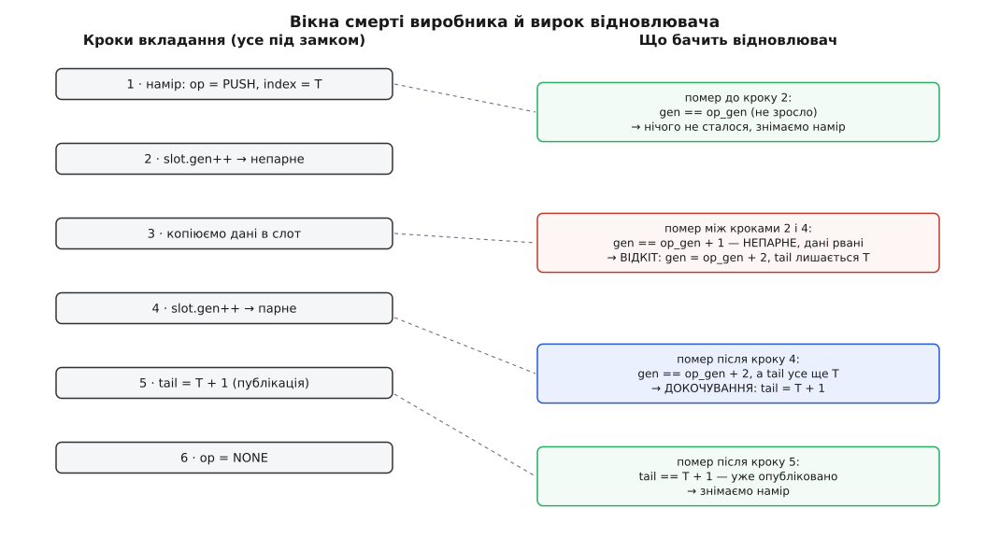

# ⚙️ Черга задач на два процеси, що переживає `kill -9`

Це повна програма на C: два незалежні процеси — виробник і споживач — обмінюються задачами через кільце у спільному сегменті пам'яті, а коли виробникові прилітає `kill -9` рівно посеред запису, споживач сам приводить чергу до ладу й працює далі. Живучий м'ютекс тут не рятує дані: він лише каже «власник помер під замком». Лагодити доводиться самим, і вся вага прикладу — у тому, як улаштувати структуру, щоб недороблену зміну взагалі **можна було** розпізнати й довершити або скасувати.

Мова тут не обирається: розкладка спільного сегмента, `pthread_mutex_t` усередині нього й атомарні слова — це рівень, де працюють саме C і C++.

## Правило, за яким усе будується

Черга спирається на [кільцевий буфер](root:sf-algorithms/ring-buffer) із двома монотонними лічильниками: `tail` — скільки задач укладено, `head` — скільки забрано. Різниця дає довжину, а індекс слота — молодші біти лічильника. Це та частина, яку кожен знає.

Смерть посеред роботи додає до неї одну вимогу, і вона визначає решту конструкції. **Стан має бути таким, щоб зі спільних байтів однозначно читалося, на якому кроці зупинився мрець.** Якщо цього не забезпечити, відновлювач бачить кільце й не знає найголовнішого: чи той запис, на який указує `tail`, уже цілий — чи це половина від старого й половина від нового.

Звідси два засоби. Перший — **лічильник поколінь** у кожному слоті: парне значення означає «запис цілий», непарне — «його зараз пишуть». Другий — **намір**, записаний у заголовок ще до першого дотику до кільця: що саме робимо, з яким номером і яким було покоління слота на початку. Намір коштує три записи в пам'ять, а дає відновлювачеві точну відповідь замість здогаду.

## Розкладка сегмента

:::code proj-shared-work-queue/c/wq.c

Три дрібниці в цій розкладці варті окремого слова. Поля оголошені `_Atomic` не заради швидкодії — під замком вона й так не потрібна, — а щоб компілятор не переставив запис наміру після запису даних: звичайні присвоєння на `_Atomic` дають найсуворіше впорядкування, і на кількох операціях за задачу його ціна невидима. Статичне твердження про неблокувальні атоміки ловить архітектуру, де 64-бітна атомарна операція реалізується через приховану таблицю замків усередині процесу — у спільній пам'яті така «атомарність» бреше. А `hdr_size` і `slot_size` записані в сам сегмент, бо `sizeof(pthread_mutex_t)` у glibc дорівнює 24 байтам на 32-бітних архітектурах і 40 на x86-64: узгодити ці два погляди неможливо, зате можна чесно відмовитися.

## Одноразова ініціалізація

Право ініціалізувати належить тому, кому вдався `O_EXCL`. Решта чекають на ознаку готовости — і читають її з семантикою захоплення, щоб побачити не лише саму одиницю, а й усі байти, записані до неї ([впорядкування пам'яті](root:sf-tasks/memory-ordering-barriers)). Сегмент і його відображення — звичайні `shm_open` та `mmap` ([спільна пам'ять POSIX](root:sys-unix/posix-shared-memory)).

:::code proj-shared-work-queue/c/odnorazova.c

Лічильники, наміри й покоління починають з нулів, які й так лежать у свіжому сегменті, — і це єдине, що дозволено взяти нулями. М'ютекс і умовні змінні ініціалізуються явно, з атрибутами; чому саме обнулення тут не годиться — у пастках наприкінці.

## Захоплення, що вміє прийняти спадок

:::code proj-shared-work-queue/c/zakhoplennia-shcho-vmiie.c

## Намір, покоління, публікація

Порядок дій у виробнику підібраний так, щоб кожна пара сусідніх кроків лишала по собі розпізнаваний слід.

:::code proj-shared-work-queue/c/namir-pokolinnia.c

Точка невороття тут одна — крок 5. Усе до нього коїться поза відрізком `[head, tail)`, тобто поза чергою, і нікого не обходить; усе після нього вже видиме споживачеві. Тому й вироків у відновлювача рівно чотири, за числом проміжків.



*Записаний намір із початковим поколінням робить кожне вікно смерті розпізнаваним: три перших вироки різняться лише тим, чи покоління зросло на нуль, один чи два.*

## Відновлення

:::code proj-shared-work-queue/c/vidnovlennia.c

У відкоті ми не рятуємо вміст слота — він поза `[head, tail)` і нікому не потрібен. Ми відновлюємо **інваріант**: після відкоту жодне покоління не лишається непарним, і наступне відновлення знову зможе судити за парністю.

Вирок для `OP_POP` навмисно порожній, і ця порожнеча — рішення, а не недогляд. Мрець устиг скопіювати задачу собі, але встиг чи ні виконати її — у спільній пам'яті сліду не лишає. Не зрушений `head` означає, що задача лишиться в черзі й дістанеться наступному: черга гарантує «щонайменше раз», а не «рівно раз». Хочете протилежного — досить у відновленні зробити `head = op_index + 1`, і задача мовчки зникне. Третього не дано: без підтвердження з боку самого обробника вибір стоїть між повтором і втратою, і зробити його мусить той, хто знає, чи задача ідемпотентна.

> 🔧 **Навіщо це.** Заманливо тримати відновлення «на око»: побачив дивний стан — перезаписав нулями й поїхав далі. Різниця між таким кодом і наміром із поколіннями видна не в день написання, а в день розбору аварії. Тут кожен вирок спирається на арифметику — покоління зросло на нуль, один чи два, — тож у журналі стоїть точна фраза «слот 2 рваний, відкинуто», і питання «а чи не з'їла черга задачу мовчки» закривається за секунди. Механізм, який після смерті не вміє пояснити, що саме він зробив, доводиться перевіряти цілком щоразу, коли щось загубилося.

Найцікавіше в цій функції — її падіння. Якщо перевірка кільця не пройшла, `CK` виходить із процесу, тримаючи замок і **не** підтвердивши цілісности. Тут важлива межа, яку легко проґавити: смерть власника і звільнення замка без підтвердження — різні речі. Мрець лише знову вмикає `FUTEX_OWNER_DIED`, тож наступний дістане черговий `EOWNERDEAD`, зайде в те саме відновлення й упреться в ту саму перевірку. Непоправним (`ENOTRECOVERABLE`) замок стає рівно тоді, коли власник, який дістав `EOWNERDEAD`, зробив `unlock` без `pthread_mutex_consistent`. Тобто вирок «більше не пробуйте» треба виносити свідомо — відпустивши замок перед виходом; лишений як є, він щоразу пропонуватиме наступному спробувати ще раз.

## Споживач і чому тайм-аут тут обов'язковий

:::code proj-shared-work-queue/c/spozhyvach-i-chomu-taim.c

Тут ховається наслідок, через який тайм-аут у цій конструкції не розкіш, а частина механізму. Ядро, проходячи робустний список мерця, будить **одного, хто спить на самому м'ютексі**. Споживач у `pthread_cond_timedwait` спить не на м'ютексі — він спить на умовній змінній, свій замок він віддав, засинаючи. Смерть виробника його не будить узагалі. Він прокинеться сам, за строком, і аж тоді, беручи замок назад, дістане `EOWNERDEAD`. Без строку споживач спав би вічно поруч із чергою, яку нікому було полагодити.

Строк відлічується за `CLOCK_MONOTONIC`, бо типовим для умовної змінної є `CLOCK_REALTIME` — годинник, який переводять. Годинник задається один раз, атрибутом при створенні; `clock_gettime` при обчисленні строку мусить брати той самий, інакше строк вийде безглуздим числом.

## Головна програма

:::code proj-shared-work-queue/c/holovna-prohrama.c

## Дослід

```sh
rm -f /dev/shm/wq-demo
./wq consumer &
./wq producer --die-at 3        # помре посеред копіювання третьої задачі
```

```
виробник: уклав задача №1
споживач: узяв задача №1
виробник: уклав задача №2
споживач: узяв задача №2
Killed
                                ← тиша: споживач спить на умовній змінній,
                                  і смерть сусіда його не будить
[віднов] слот 2 рваний — відкинуто
споживач: дві секунди тиші
```

Тепер найважливіше — черга жива. Запустіть виробника вдруге, вже без `--die-at`, і задачі підуть далі, без перезавантаження, без перестворення сегмента, без адміністратора. Замініть `--die-at 3` на `kill -9` із сусіднього термінала — вийде те саме, лише момент смерті випаде випадковий, і частина спроб потрапить у вікно між кроками 4 і 5, де в журналі буде «докочено» замість «відкинуто».

## Скільки це коштує

Незаперечуване захоплення живучого м'ютекса — одна атомарна операція над словом, десятки наносекунд; за живучість платять хіба тим, що glibc додає адресу замка до списку у власній пам'яті — без системного виклику. Намір додає до кожної задачі три записи в пам'ять. Відновлення пробігає всі слоти по разу, тобто `O(slots)` — для 64 слотів це одиниці мікросекунд, і трапляється воно раз на смерть, а не раз на задачу. Ціна конструкції — не в тактах, а в тому, що кожну зміну спільного стану доводиться будувати як послідовність із розпізнаваними межами.

## Пастки

**`pshared` на умовній змінній.** Про м'ютекс пам'ятають усі, про `pthread_condattr_setpshared` — не всі. Забутий атрибут не дає ані помилки, ані попередження: сигнал іде в чергу очікування, яку сусід не бачить.

**Ініціалізація нулями.** Спокуса покластися на те, що свіжий сегмент обнулено, а обнулений `pthread_mutex_t` у glibc поводиться як вільний. Поводиться — але як **приватний і неживучий**: ні спільного ключа, ні `EOWNERDEAD`. Такий код проходить усі тести й розсипається в бою.

**Різна розрядність.** 32-бітний учасник поруч із 64-бітним бачить у тих самих байтах інші поля, бо навіть `pthread_mutex_t` у них різного розміру. Узгодити це не можна; перевірка `hdr_size` перетворює тихе псування на чесну відмову при під'єднанні.

**Тайм-аут за `CLOCK_REALTIME`.** Типовий годинник умовної змінної переводиться службою часу. Служба, що стартує до синхронізації годинника, дістає стрибок на години — і чекання або обривається негайно, або розтягується. Лікує `pthread_condattr_setclock(CLOCK_MONOTONIC)` **разом** із `clock_gettime` того ж годинника при обчисленні строку.

**`EINTR` у циклі.** `pthread_cond_wait` і `pthread_cond_timedwait` за POSIX **не повертають** `EINTR` — але мають право прокинутися без причини, тож умова стоїть у `while`, а не в `if`. Натомість `sem_wait` і `sem_timedwait` `EINTR` таки повертають, і код, що змішує обидва механізми, потребує обох шаблонів ([EINTR і перезапуск](root:sys-unix/eintr-and-restart)).

**Мертвонароджений сегмент.** Якщо творець помер між `O_EXCL` і записом ознаки готовости, сегмент лишиться назавжди з `ready == 0`, і всі решта чекатимуть на нього. Тому чекання обмежене; після вичерпання строку правильна дія — `shm_unlink` і створення заново, а не ще один цикл.

**Довжина з чужої пам'яті.** `s->len` пише сусід, і саме він міг померти посеред запису. Будь-яка довжина, лічена зі спільного сегмента, обмежується перед `memcpy` — інакше відновлюваність черги куплена ціною переповнення буфера.
