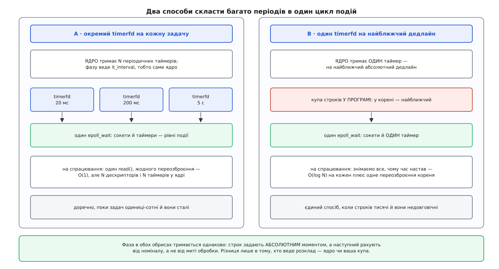

# ⚙️ Планувальник періодичних задач: два обриси на timerfd

Служба мусить робити кілька справ із різними періодами — опитувати датчик кожні 20 мс, відсилати телеметрію кожні 200 мс, перевертати журнал раз на п'ять секунд — і при цьому не переставати обслуговувати сокети. Зберемо це двічі: спершу окремим дескриптором на кожну задачу, потім одним дескриптором на найближчий дедлайн і купою строків у програмі. Різниця між обрисами не стильова: вона визначає, скільки задач кожен витримає.

## Що саме має вийти

Три вимоги, і кожна далі перетвориться на конкретний рядок коду.

**Фаза не дрейфує.** Сотий тик задачі з періодом 20 мс має статися на двотисячній мілісекунді від старту, а не десь пізніше — там, куди його зсунула сотня дрібних затримок. Отже, наступний строк відлічують від **номіналу**, а не від миті, коли ми доробили попередню роботу.

**Запізнення видно.** Планувальник, який не міряє власного запізнення, бреше про свій період тихо й довго. Тому кожне спрацювання порівнюємо з номінальним моментом і тримаємо найгірше значення.

**Політика пропуску свідома.** Якщо задача проспала три періоди, чесних варіантів рівно два: виконати її тричі («надолужити») або один раз, зарахувавши решту як пропущені. Для телеметрії правильне друге — застарілі виміри нікому не потрібні; для лічильника спожитих кіловат-годин правильне перше. Ядро цього за вас не вирішує: `read()` з timerfd просто віддає число спрацювань, і що з ним робити — ваша справа.



*Обидва обриси тримають фазу однаково — абсолютним строком. Різниця в тому, хто веде розклад: ядро чи ваша купа.*

## A. Окремий дескриптор на кожну задачу

Найпростіший обрис: кожна задача дістає свій timerfd із власним `it_interval`, і всі вони лежать в одному наборі [epoll](root:sys-unix/select-poll-epoll) — механізму, що присипляє потік одразу на багатьох дескрипторах і будить, щойно готовий бодай один, — поряд зі звичайними сокетами.

:::code proj-timerfd-scheduler/c/a-okremyi-deskryptor-na.c

Тут працюють дві різні речі, і плутати їх не варто. Фазу періоду веде `it_interval` — ядро щоразу додає період до попереднього **дедлайну**, а не до миті доправлення, тож відставання нема де накопичуватися. А `TFD_TIMER_ABSTIME` стосується лише першого строку: він каже, що в `it_value` лежить не «через скільки», а точний момент на монотонному годиннику.

Саме це й дає третю, неочевидну вигоду. Усі задачі дістають **один спільний нуль фази**, тому кожен десятий тик датчика збігається з тиком телеметрії секунда в секунду. Ядро прокидається один раз замість двох, а близькі строки воно й так має право склеювати в межах timer slack. Якби кожна задача почала відлік від власного `clock_gettime()`, збіги були б випадковими.

Тепер саме спрацювання:

:::code proj-timerfd-scheduler/c/a-okremyi-deskryptor-na-2.c

Номінал тут не зберігають — його **обчислюють**: `origin + n·period`. Тому запізнення міряється відносно ідеального розкладу, а не відносно попереднього спрацювання, і одна затримка не робить наступний вимір «своєчасним». `TFD_NONBLOCK` робить дескриптор [неблокуючим](root:sys-unix/blocking-and-nonblocking) — виклик, якому нема чого віддати, повертає `EAGAIN` замість того, щоб приспати потік, і цикл подій не завмирає через чуже пробудження.

> 🔧 **Навіщо це.** `worst_late_ns` — найдешевший детектор перевантаження, який у вас буде. Якщо він осідає на десятках-сотнях мікросекунд і зрідка стрибає — це нормальні slack і планувальник. Якщо він росте від запуску монотонно, ваш період — вигадка: цикл фізично не встигає, і жоден таймер цього не виправить.

## B. Один таймер і купа строків

Обрис A має ціну, пропорційну кількості задач: дескриптор, таймер у ядрі й запис у наборі epoll на кожну. Поки задач три — байдуже. Але коли строк заводиться **на кожне з'єднання** (десять тисяч сокетів, у кожного таймаут читання, що зсувається з кожним байтом), кожен зсув коштує системного виклику, а більшість тих строків взагалі ніколи не спрацює.

Тоді розклад тримають у програмі, а ядро просить розбудити рівно один раз — на **найближчий** дедлайн. Потрібна структура, що за O(log N) вставляє строк і миттєво показує найменший: [купа (черга з пріоритетом)](root:sf-algorithms/priority-queue-adt) — двійкове дерево в масиві, де кожен батько не пізніший за своїх дітей.

:::code proj-timerfd-scheduler/c/b-odyn-taimer-i-kupa.c

Цикл `while` знімає **все**, чому час уже настав, — одного пробудження досить на скільки завгодно задач, що дозріли разом. Внутрішній `do…while` і є політикою пропуску: він проштовхує строк у майбутнє одним ривком. Прибравши його — лишивши просте `j->due = ts_add_ns(j->due, j->period_ns)`, — ви дістанете «надолужити» задарма: строк, що й далі в минулому, зовнішній цикл підбере ще раз, і задача виконається стільки разів, скільки пропустила.

Переозброєння в кінці обов'язкове й безумовне: корінь майже напевно змінився. Те саме треба зробити скрізь, звідки в купу лягає новий строк, — інакше він мовчки чекатиме, поки ядро розбудить нас через якийсь пізніший дедлайн. Якщо строки додаються часто, а виграш у мілісекундах ні на що не впливає, тримайте поряд копію вже озброєного моменту й пропускайте `timerfd_settime`, коли новий корінь відрізняється менше ніж на поріг: це прибирає більшість системних викликів і не псує фази.

## Скільки це коштує

```
A · окремий timerfd на задачу
    у ядрі           N таймерів + N описів відкритого файлу + N записів в epoll
    на спрацювання   1 × read(), 0 переозброєнь            → O(1)
    завести/зняти    timerfd_create + epoll_ctl + close    → 3 системні виклики

B · один timerfd + купа
    у ядрі           1 таймер + 1 опис + 1 запис в epoll
    на спрацювання   k знятих × O(log N) + 1 × timerfd_settime
    завести/зняти    O(log N) у пам'яті + переозброєння, лише якщо змінився корінь
```

Межа переходу проста. Задач одиниці-сотні, вони заводяться на старті й живуть до кінця — беріть A: він коротший і кожна задача сама себе називає через `data.ptr`. Строків тисячі, вони народжуються й гинуть разом зі з'єднаннями — беріть B: там ціна за строк перестала бути системним викликом і стала логарифмом у власній пам'яті.

## Пастки

**Відносне переозброєння в перевдязі.** У обрисі B спокусливо написати `j->due = ts_add_ns(now, j->period_ns)` — адже `now` уже під рукою. Це та сама помилка, що й `it_value` без `TFD_TIMER_ABSTIME`: у фазу назавжди осідає час, який ми витратили на пробудження й на роботу. Наступний строк рахують **від попереднього строку**, і тільки так.

**Нульовий `it_value` роззброює.** `timerfd_settime()` не має окремої команди «скасувати»: нею є нульовий `it_value`. Абсолютний момент, що випадково дорівнює нулю годинника, роззброїть таймер замість негайного спрацювання — звідси затискач до однієї наносекунди. Момент у минулому, навпаки, цілком законний: таймер спрацює одразу.

**Забутий `TFD_CLOEXEC`.** Дескриптор таймера успадковується при `fork()` і переживає `exec()`. Дитина дістає копію, що вказує на той самий [опис відкритого файлу](root:sys-unix/open-file-description), а отже — на той самий лічильник спрацювань: чужий `read()` забирає тики у вас. Помилка тим підліша, що виявляється не одразу, а коли хтось у службі надумає запустити зовнішню утиліту.

**Довга робота з'їдає власний період.** Якщо `run()` датчика триває 25 мс при періоді 20 мс, `ticks` росте назавжди. З політикою `SKIP` ви це принаймні побачите в лічильнику пропусків; з `CATCH_UP` внутрішній цикл почне ганятися за власним хвостом і ніколи не поверне керування в `epoll_wait()` — сокети просто перестануть обслуговуватися. Тому довгу роботу виносять у робочий потік, а в циклі подій лишають тільки постановку в чергу.

**`EAGAIN` після готовності — норма.** Те, що epoll назвав дескриптор готовим, не обіцяє успішного `read()`: тик міг забрати інший потік того самого набору, а сама готовність могла означати не спрацювання. Коротке читання ніколи не трактують як фатальну помилку. Зате зворотне тішить: лічильник timerfd вичищається **одним** читанням, тож навіть у режимі `EPOLLET` дочитувати до `EAGAIN` не треба.

**`ECANCELED` і календарні задачі.** Усе вище стоїть на `CLOCK_MONOTONIC`, який не стрибає ніколи, — і саме тому не годиться для «щодня о 03:00». Календарний строк живе на `CLOCK_REALTIME`, а той годинник адміністратор чи NTP можуть посунути. Ліки — прапорець `TFD_TIMER_CANCEL_ON_SET`, який діє тільки в парі з абсолютним строком на `CLOCK_REALTIME` (або `CLOCK_REALTIME_ALARM`): після розривної зміни годинника дескриптор стає готовим, а `read()` один раз повертає `ECANCELED` — «під тобою переставили час, перерахуй строк».

:::code proj-timerfd-scheduler/c/pastky.c

Звідси й підсумкова форма планувальника, що має обидва види задач: **два дескриптори на дві часові площини**. Періоди — на монотонному годиннику, де немає ні стрибків, ні `ECANCELED`; календарні події — на реальному, з `TFD_TIMER_CANCEL_ON_SET` і перерахунком дати після кожного зсуву. Змішувати їх в одному таймері не можна: годинник у timerfd обирається один раз, при створенні.
