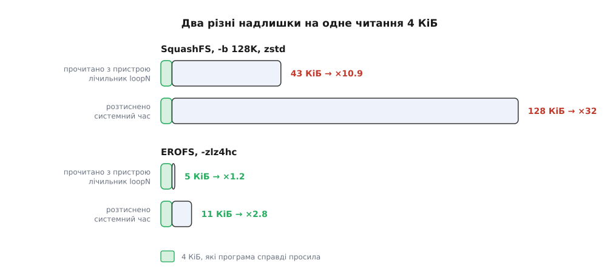

# ⚙️ Лабораторія: два образи з одного дерева і чесний вимір надлишку

Півгодини на власній машині перетворюють «SquashFS читає більше» на число: скільки байтів блоковий пристрій справді віддав на кожні 4 КіБ, що дійшли до програми. Треба `mksquashfs`, `mkfs.erofs`, петлевий пристрій і невелика програма на C, яка знімає лічильник ядра до й після серії читань.

## Дерево, на якому міряють

Джерело має бути справжнім. Найзручніше взяти вже наявне дерево дистрибутива: `/usr/share` разом із `/usr/lib` дає кілька сотень мегабайтів тексту, ELF-файлів, шрифтів і локалізацій — саме ту суміш, заради якої стиснені образи існують.

Спокуса нагенерувати дерево з `/dev/urandom` губить дослід ще до початку. Випадкові байти не стискаються, обидва складачі це помічають і кладуть такі дані **як є**, без стиснення. Надлишок тоді чесно вийде ×1 в обох образах — не тому, що формати однакові, а тому, що жоден із них нічого не робив.

Другий обов'язок дерева — мати всередині хоча б один **великий** файл, на якому власне міряти. Хвости дрібних файлів обидві системи ховають у спільні блоки (SquashFS — у фрагментний, EROFS — одразу за inode), і читання з них міряє зовсім іншу механіку. Потрібен файл на кілька десятків мегабайтів: скажімо, склеєні докупи сторінки довідника або великий журнал.

## Складання

:::code proj-image-lab/sh/main.sh

Порядок доводів у двох складачів різний: `mksquashfs` бере спершу джерело, `mkfs.erofs` — спершу образ. Без `-z` у `mkfs.erofs` вийде **нестиснений** образ; це теж корисний рядок у таблиці, бо показує, скільки коштує сама щільна розкладка без жодного стискача.

## Монтування так, щоб знати номер петлі

Образ — звичайний файл, а `mount` хоче блоковий пристрій. Місток між ними — [петлевий пристрій](root:sys-unix/loop-device): фіктивний блоковий пристрій, усі звернення до якого ядро перетворює на читання з підставленого файлу. Звичне `mount -o loop` заводить його само й ховає номер — а нам потрібен саме номер, бо лічильник живе під ним.

```sh
LOOP=$(sudo losetup --find --show --read-only "$OUT/sq-128K.sqfs")   # → /dev/loop7
DEV=${LOOP#/dev/}
echo 0 | sudo tee /sys/block/$DEV/queue/read_ahead_kb
sudo mkdir -p /mnt/img
sudo mount -t squashfs -o ro "$LOOP" /mnt/img
```

Лічильники цього пристрою — у `/sys/block/loop7/stat`. Це [псевдофайл sysfs](root:sys-unix/pseudo-filesystems): вміст не лежить на диску, а формується ядром у мить читання, тож звичайного `open`/`read` досить. Третє число рядка — прочитані **сектори**, і це завжди сектори по 512 байтів незалежно від того, якими шматками працює справжній носій ([домовленість блокового шару](root:sys-unix/block-device-model)).

## Вимірювач

Задум простий: зняти лічильник, зробити тисячі читань по 4 КіБ у випадкових місцях великого файлу, зняти лічильник ще раз. Різниця секторів, поділена на віддані байти, і є надлишок.

:::code proj-image-lab/c/main.c

Одне зерно `srandom` на всі образи — навмисно: усі прогони б'ють у ті самі зміщення, тож різниця в результатах іде від формату, а не від того, кому пощастило влучити в сусідні місця.

```sh
cc -O2 -o readamp readamp.c
sudo sh -c 'echo 3 > /proc/sys/vm/drop_caches'
./readamp /mnt/img/big.dat loop7 2000
```

## Що виходить

Дерево на 780 МіБ, 2000 випадкових читань по 4 КіБ. Абсолютні числа залежать від даних; тримається співвідношення.

```
образ                  розмір   складання   надлишок вводу   розтискання
sq-16K.sqfs   zstd-15   306 МіБ     44 с          ×1.7           0.08 с
sq-128K.sqfs  zstd-15   264 МіБ     38 с         ×10.9           0.34 с
sq-1M.sqfs    zstd-15   252 МіБ     47 с         ×82             2.4  с
er-lz4hc               339 МіБ     96 с          ×1.2           0.03 с
er-lzma                260 МіБ    305 с          ×1.3           0.21 с
```

Ось де числа стають цікавими. Стовпчик «надлишок вводу» для `sq-1M` дає ×82, а не ×256, як можна було б чекати від мегабайтного шматка. Причина в тому, що з пристрою читається шматок **уже стиснений**: мегабайт вхідних даних лежить на носії як приблизно 330 КіБ, і саме їх забирає ядро, щоб віддати чотири кілобайти. Тож на одне читання припадає **два різні надлишки**, і вони міряються різними приладами. Надлишок вводу — це стиснений розмір шматка, його бачить лічильник петлі. Надлишок розтискання — це розмір шматка нестисненого, і за нього платять процесором; його видно в стовпчику системного часу.



*Лічильник петлі показує стиснений розмір одиниці стиснення, системний час — нестиснений; обидва числа справжні й обидва різні.*

> 🔧 **Навіщо це.** Якщо образ живе на повільному носії, вас душить перший стовпчик і треба зменшувати шматок. Якщо носій швидкий, а процесор слабкий — телефон, роутер, віртуалка з одним ядром, — душить другий, і рятує не менший шматок, а швидший стискач. Два надлишки лікуються різними ліками, тому й міряти їх треба нарізно.

## Пастки

**Кеші.** Між прогонами `echo 3 > /proc/sys/vm/drop_caches`, а надійніше — розмонтувати й змонтувати образ наново: тоді ядро гарантовано забуває і сторінки самого файлу, і внутрішній кеш розтиснених блоків файлової системи. Без цього другий прогін покаже надлишок ×0, бо всі дані [вже лежать у кеші сторінок](root:sys-unix/page-cache-durability) і до пристрою ніхто не звертається.

**Третій кеш — і чому він тут не заважає.** Файл образу лежить на господарській файловій системі й теж кешується. Але лічильник `/sys/block/loop7/stat` стоїть **над** цим кешем: він рахує те, що стиснена файлова система зажадала від свого пристрою, незалежно від того, чи дійшов запит до заліза. Саме тому вимога «образ має бути більший за вільну пам'ять» тут не потрібна — вона з'являється лише тоді, коли ви міряєте `/proc/diskstats` справжнього диска, бо там господарський кеш сховає майже все.

**Випереджувальне читання.** Без `POSIX_FADV_RANDOM` ядро [підвозить сусідні сторінки наперед](root:sys-unix/readahead) і роздуває всі числа, причому нерівномірно: EROFS від такого підказування виграє більше, ніж SquashFS, і картина перекошується. Ця одна порада ядру ставить вікно випередження в нуль для конкретного дескриптора; `read_ahead_kb` на черзі петлі закриває той самий шлях з іншого боку.

**Розтискання не в тому процесі.** EROFS може віддавати розтискання робітникам ядра — тоді час осяде не на вашому процесі й стовпчик системного часу збреше в менший бік. Змусити розтискати на місці можна записом `1` у `/sys/fs/erofs/loop7/sync_decompress` (`0` — вирішує ядро, `2` — завжди в робітнику). Скільки процесорного часу з чийого рахунку списано — [окрема довга розмова](root:sys-unix/cpu-time-accounting).

**Чужий трафік.** Лічильник належить пристрою, а не вашій програмі. Відкритий термінал із `ls -R /mnt/img` у сусідньому вікні додасть у вимір своє. Міряйте на щойно змонтованому образі й нічого більше на ньому не чіпайте.

**Перший прогін дорожчий.** Він додає читання суперблока, inode та індексів, яких у наступних уже не буде. Різниця між першим і другим прогоном після `drop_caches` — це і є ціна метаданих, і її варто подивитися окремо: у SquashFS вона помітно більша, бо метадані там теж стиснені.

Коли таблиця зійшлася, лишається один дослід, який робить думку остаточною: зберіть EROFS із `-C65536`. Кластер тоді росте до 64 КіБ, образ трохи меншає — і надлишок вводу відразу підстрибує на порядок. Компроміс не є властивістю формату; це той самий важіль, і в EROFS він теж є.
