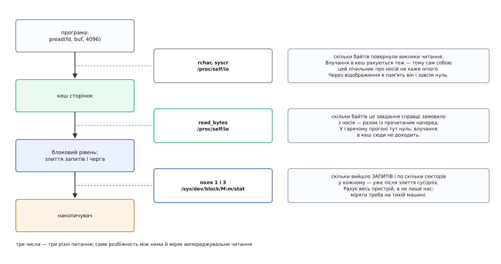

# ⚙️ Стенд: виміряти, скільки байтів приїхало без запиту

Секундомір на читанні файлу бреше: той самий прогін удруге «пришвидшується» в рази, бо дані вже в пам'яті, і годинник чесно міряє швидкість пам'яті замість швидкості носія. Тут зібрано робочу програму мовою C, яка бере два незалежні числа — скільки часу програма стояла й скільки байтів справді доїхало з накопичувача, — і показано, як з цих чисел прочитати, що саме ядро прочитало наперед і скільки з того було марно.

## Одного числа замало

Спокуса очевидна: заміряти час послідовного обходу великого файлу, потім час випадкового, поділити одне на одне й назвати частку виграшем від читання наперед. Але час — наслідок щонайменше трьох різних причин, і за самим часом їх не розрізнити. Прогін міг бути швидким, бо ядро прочитало наперед. Міг — бо дані лишилися в пам'яті з попереднього разу. Міг — бо накопичувач сам угадав послідовність і потримав сектори у власному кеші.

Тому мірок треба дві, і питання в них різні. Перша: скільки часу програма чекала — заради цього механізм і живе. Друга: скільки байтів довелося взяти з носія — стільки він коштував. Дивитися на них можна лише разом. Прогін, удвічі швидший і водночас удвічі щедріший на читання з носія, — не перемога, а позика в сусіднього навантаження, яке за це заплатить витісненим кешем.

## Три лічильники на одному шляху

Байти, що йдуть від виклику до пластини або кристала, минають кілька рівнів, і на кожному є свій лічильник. Вибрати правильний важливіше, ніж написати сам цикл.

*Влучання в кеш зупиняє шлях на другому поверсі — і саме тому верхній лічильник росте, а нижні стоять.*

**`rchar` і `syscr` з `/proc/self/io`** рахують на межі виклику: перше — байти, які повернули успішні `read` і подібні виклики, друге — кількість самих викликів. Ці числа не знають нічого про носій: влучання в кеш рахується так само, як промах.

**`read_bytes` із того самого файлу** — байти, які справді забрали зі сховища. Лічильник збільшують у той момент, коли запит іде на блоковий рівень, у контексті того завдання, яке його подало. Звідси два наслідки, на яких і тримається весь стенд. Перший: влучання в кеш сюди не потрапляє взагалі, тож на гарячому прогоні тут буде рівний нуль. Другий: прочитане наперед потрапляє — бо замовляє його те саме завдання, у своєму ж контексті, просто не чекаючи на результат. Отже, різниця між `read_bytes` і фактично спожитим обсягом і є той надлишок, який приніс здогад ядра.

**Поля 1 і 3 з `/sys/dev/block/<major>:<minor>/stat`** — кількість завершених читань і кількість прочитаних секторів. Тут облік ведеться нижче, після злиття сусідніх запитів, і не на завдання, а на весь пристрій. Це єдине джерело середнього розміру запиту — числа, якого `read_bytes` дати не може. Сектор у цьому файлі завжди по 512 байтів, незалежно від того, які блоки в самого носія.

Обидва набори полів у `/proc/<pid>/io` необов'язкові: символьні лічильники дає збірка ядра з `CONFIG_TASK_XACCT`, байти з носія — з `CONFIG_TASK_IO_ACCOUNTING`; у дистрибутивних ядрах увімкнені обидва, у зібраному вручну потрібних рядків може просто не бути. Доступ до чужого такого файлу керується тими самими правилами, що й приєднання зневаджувача, — але свій власний читає будь-хто. Обидва файли — звичайні текстові вікна в структури ядра, як і решта [вмісту `/proc`](root:sys-unix/proc-reading-process-and-kernel-state).

> 🔧 **Навіщо це.** Пара «`rchar` проти `read_bytes`» працює не лише на стенді. Коли служба несподівано впирається в носій, її `/proc/<pid>/io` дає діагноз без жодного профілювальника: якщо `read_bytes` у кілька разів більший за `rchar`, програма платить за дані, яких не просила, і шукати треба стелю вікна та спосіб обходу, а не вузьке місце в коді.

## Вистудити кеш — і переконатися, що вистудив

Чесний замір починається з порожнього кеша, і тут є три різні за грубістю інструменти.

Найточніший — сказати ядру звільнити сторінки саме цього файлу: `posix_fadvise(fd, 0, 0, POSIX_FADV_DONTNEED)`. Прав адміністратора не треба, чужих даних не зачіпає. Одна умова: брудні сторінки так не викидаються, тож перед порадою файл треба записати на носій — `fsync` або `fdatasync` ([чому саме так і чому брудна сторінка не зникає на прохання](root:sys-unix/page-cache-durability)). Для щойно створеного стендового файлу це не формальність: одразу після `dd` він увесь брудний і в пам'яті.

Найгрубіший — `sync; echo 3 > /proc/sys/vm/drop_caches`. Потрібен адміністратор, викидає кеш усієї системи разом із кешованими каталогами та inode. Документація ядра називає цей файл засобом для випробувань і зневадження й радить не вживати його поза ними — саме тому, що після нього платить уся машина. Коли треба лише дані, вистачає `echo 1`; трійка додатково викидає розібрані шляхи, і наступний прогін платитиме ще й за них.

І третій інструмент — перевірка, що перші два спрацювали. Виклик `mincore` каже, які сторінки відображення зараз є в пам'яті, і не тягне жодної з носія. Одне відображення файлу, один виклик, підрахунок одиниць — і замість надії маємо число.

## Годинник, який не стрибає

Час треба брати монотонним годинником: `clock_gettime(CLOCK_MONOTONIC, …)`. Стінний годинник система підводить — служба синхронізації часу здатна відкотити його назад просто посеред заміру, і інтервал вийде від'ємним. Монотонний росте завжди й не залежить від того, що адміністратор зробив із датою; його швидкість плавно підправляють, але за секунди заміру ця поправка тонша за шум ([як ядро взагалі рахує час і чим джерела часу різняться](root:sys-unix/kernel-timekeeping)).

Годинник вмикають рівно навколо циклу читання. Вистуджування коштує помітних часток секунди, побудова порядку обходу — теж, і в замір ці витрати потрапити не повинні.

## Порядок обходу, який не бреше

Випадковий обхід легко зіпсувати двома способами.

Перший — брати зсуви звичайним `rand() % n`. Тоді блоки повторюються, повтор влучає в кеш, і замір тихо стає оптимістичнішим за правду.

Другий, менш очевидний, — крокувати сталим приростом на кшталт `(i · просте_число) % n`. Ядро такий обхід послідовним не вважає, а от сам накопичувач має власне вгадування наступного блока, і сталий крок — саме той візерунок, який його прошивка ловить.

Тож порядок будуємо як справжню перестановку — тасуванням Фішера–Йейтса з наперед заданим зерном: повторів немає, візерунка немає, а прогін відтворюваний. Ціна — масив на чотири байти на блок, який починають будувати до вистуджування, щоб він не з'їв кеш і не потрапив у замір.

## Стенд

:::code proj-measure-readahead/c/rabench.c

## Як ганяти

:::code proj-measure-readahead/sh/main.sh

## Що видно на прогоні

Числа нижче — з одного конкретного стенда, і важать у них не самі значення, а співвідношення між рядками. Машина: накопичувач NVMe (послідовно близько 2.6 ГБ/с, одиночне читання 4 КіБ близько 85 мкс), файлова система ext4, 16 ГіБ пам'яті, `read_ahead_kb` = 128, файл 8 ГіБ, більше нічого на машині не працює. Обсяги — у мебібайтах, середній запит — у кібібайтах.

| обхід | порада | час | `rchar` | `read_bytes` | надлишок | запитів | сер. запит |
|---|---|---:|---:|---:|---:|---:|---:|
| послідовний, 4 КіБ | `none` | 5.9 с | 8192 | 8196 | 1.00× | 65 700 | 128 |
| послідовний, 4 КіБ | `normal` | 5.9 с | 8192 | 8196 | 1.00× | 65 700 | 128 |
| послідовний, 4 КіБ | `sequential` | 3.6 с | 8192 | 8196 | 1.00× | 33 000 | 254 |
| послідовний, 4 КіБ | `random` | 148 с | 8192 | 8192 | 1.00× | 2 097 200 | 4 |
| послідовний, 1 МіБ | `direct` | 3.3 с | 8192 | 8192 | 1.00× | 8 200 | 1024 |
| випадковий, 4 КіБ | `none` | 17.2 с | 781 | 784 | 1.00× | 200 400 | 4 |
| випадковий, 4 КіБ | `sequential` | 17.3 с | 781 | 784 | 1.00× | 200 400 | 4 |
| випадковий, 4 КіБ | `random` | 17.1 с | 781 | 781 | 1.00× | 200 000 | 4 |
| випадковий, 512 Б | `none` | 16.9 с | 97.7 | 781 | 8.00× | 200 000 | 4 |
| випадковий, 512 Б | `direct` | 15.4 с | 97.7 | 97.7 | 1.00× | 200 000 | 0.5 |
| відображення, випадково | `none` | 18.0 с | 0 | 793 | 1.02× | 201 500 | 4 |
| відображення, випадково | `random` | 17.6 с | 0 | 781 | 1.00× | 200 000 | 4 |

Перші два рядки — перевірка самого стенда. Не давати поради взагалі й попросити `POSIX_FADV_NORMAL` — це те саме, бо порада лише повертає стелю до типової для пристрою; якби числа розійшлися, шукати треба було б помилку в замірі, а не в ядрі.

Перший рядок варто одразу звірити з моделлю, бо порівняти їх напрошується само. 8 ГіБ за 5.9 с — це близько 1.5 ГБ/с, тобто трохи більше за половину паспортної смуги, тоді як [арифметика вікна](root:sys-unix/readahead/math-window-and-bandwidth.md) обіцяє для 128 КіБ при `B·T ≈ 220 000 Б` лише 37 %. Розходження в той бік, у який модель і мусить помилятися: вона рахує так, ніби в польоті завжди рівно одне вікно й ніщо його не здешевлює, а насправді блоковий рівень зливає суміжні запити, і сам накопичувач читає наперед у власний кеш. Модель тут — оцінка знизу; збіг за порядком величини — найбільше, чого від неї варто чекати.

Найважливіший рядок — четвертий. `POSIX_FADV_RANDOM` на послідовному обході вимикає механізм, і виходить чиста ціна: той самий обсяг, у тридцять два рази більше запитів, у двадцять п'ять разів довше. Це й є відповідь на питання «що робить випереджувальне читання»: воно не читає зайвого, воно робить запити більшими й ранішими. Рядок із `sequential` показує другу половину тієї ж думки: подвоєна стеля вдвічі зменшує кількість запитів і забирає майже чотири десятих часу — не половину, бо частина цього часу вже не чекання, а копіювання байтів і самі виклики.

Далі — три рядки випадкового обходу, і вони суперечать поширеному переказу, ніби `POSIX_FADV_RANDOM` рятує базу даних від шістнадцятикратного надлишку. Надлишку немає й без поради: ядро не бачить ані продовження попереднього читання, ані сусідніх сторінок у пам'яті, тож вікна не відкриває з першого ж запиту. Порада тут страхує від помилки, якої не сталося. Цінною вона стає там, де обхід не чисто випадковий — короткі послідовні шматки врозбивку виглядають для ядра як початок проходу, — і там, де стеля тому величезна, бо тоді ціна кожної хибної здогадки множиться.

Рядок із блоком у 512 байтів показує зовсім інший надлишок, який легко сплутати з випереджувальним читанням. Восьмиразовий він тому, що кеш працює сторінками: за півкілобайта корисних даних із носія однаково приїде ціла сторінка на 4 КіБ. Жодна порада цього не змінює, бо це не вікно, а зернистість. Змінює лише `O_DIRECT` — [прямий ввід-вивід оминає кеш повністю](root:sys-unix/buffered-and-direct-io) і бере рівно те, що попросили, ціною відмови й від кешування, і від будь-якого читання наперед.

Два останні рядки — про [файл, відображений у пам'ять](root:sys-unix/mmap-model). Читань немає, тож `rchar` дорівнює нулю: стенд, побудований на лічильниках викликів, дійшов би висновку, що не читалося нічого. Надлишок у 1.02× — це перші кілька вікон, поки лічильник промахів відображення не перевалив за сотню й ядро не вимкнуло здогад для нього самотужки. `MADV_RANDOM` прибирає і ці відсотки, сказавши правду наперед.

## Пастки

**Гарячий кеш.** Найчастіша й найтихіша. Ознака однозначна: `read_bytes` дорівнює нулю, а до пристрою не пішло жодного запиту.

| прогін | час | `rchar` | `read_bytes` | запитів |
|---|---:|---:|---:|---:|
| холодний (файл 4 ГіБ) | 3.0 с | 4096 МіБ | 4098 МіБ | 32 800 |
| той самий одразу вдруге | 0.42 с | 4096 МіБ | 0 | 0 |

Ці 0.42 секунди — це вже не носій, а мільйон викликів і мільйон копіювань по 4 КіБ із пам'яті в пам'ять.

**Закороткий прогін.** Вікно розганяється з чотирьох сторінок і виходить на стелю аж після сотні кілобайтів. Прогін на мегабайті міряє розгін, а не усталений режим, і дає числа помітно менші за правду — тим сильніше, чим коротший прогін.

**Замалий файл.** Він увесь уміщається у вільну пам'ять — і тоді гарячим прогін стає від будь-чого: від нічної архівації, від індексатора робочого столу, від сусіднього `grep`. Перевірка `mincore` перед циклом саме на такий випадок: якщо в пам'яті лишилися сторінки, замір уже зіпсований.

**Стеля тому.** Її корисно перевіряти власним стендом, а не вірою: прочитати перших 256 блоків і зупинитися — наперед замовлений хвіст так і лишиться незатребуваним, і саме його видно в таблиці нижче.

| стеля `read_ahead_kb` | прочитано корисно | узято з носія | надлишок | запитів |
|---|---:|---:|---:|---:|
| 128 КіБ | 1.00 МіБ | 1.23 МіБ | 1.23× | 12 |
| 4096 КіБ | 1.00 МіБ | 3.83 МіБ | 3.83× | 6 |

Друга стеля не вигадана: [том, зібраний із кількох пристроїв](root:sys-unix/device-mapper), успадковує її вгору по стеку й легко доростає до мегабайтів. Для потокового читання це виграш, для читача, який щоразу бере трохи й зупиняється, — чотирикратна плата за нічого. І ще одна деталь того ж шару: розмір одного запиту обмежений зверху полем `max_sectors_kb` черги, тож середній запит може впертися в стелю нижчу за вікно, скільки те вікно не піднімай.

**Лічильник пристрою спільний.** У `/sys/dev/block/…/stat` потрапляє все, що робить машина, а не лише стенд. Тому середній розмір запиту звідти чесний тільки на тихій машині, і його варто звіряти: сектори, помножені на 512, мають бути близькі до `read_bytes`. Розбіжність означає, що поруч працював хтось іще. Сам `read_bytes` цим не хворіє, бо ведеться на завдання ([як блоковий рівень зливає сусідні запити й чому число запитів менше за число вікон](root:sys-unix/block-device-model)).

**Порада живе в описі відкритого файлу.** Закрили дескриптор — поради немає. Бібліотека, яка тихцем перевідкриває файл, забирає її з собою, і навантаження повертається до типової стелі. І `posix_fadvise`, і `madvise` — саме поради: ядро має право їх не виконати, і `POSIX_FADV_WILLNEED` під тиском пам'яті може обернутися подвійною роботою, бо прочитані сторінки витіснять раніше, ніж по них прийдуть.

**Накопичувач теж угадує.** Порожній кеш сторінок не означає холодного пристрою: і диск, і твердотільний накопичувач мають власний кеш і власне читання наперед. Той самий прогін у тому самому порядку може виявитися швидшим просто тому, що пристрій його пам'ятає. Ліки прості: різні зерна перестановки й медіана з трьох-п'яти прогонів замість одного числа.

**`posix_fadvise` повертає номер помилки.** Не `-1` і не `errno`, а саме номер значенням. Перевірка `if (posix_fadvise(...) < 0)` не спрацює ніколи, і стенд роками мірятиме прогони, у яких вистуджування мовчки не відбулося.
