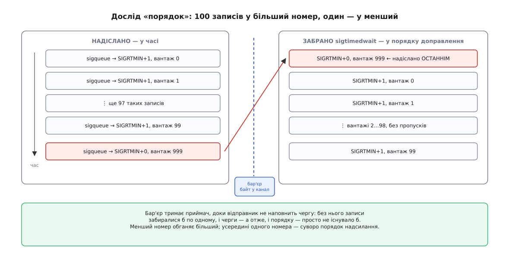

# ⚙️ Диспетчер завдань на реальночасових сигналах: дослід із числами

Три твердження про реальночасові сигнали доводиться приймати на віру: що менший номер справді обганяє більший, що черга скінченна й закінчується раніше, ніж здається, і що надсилання коштує приблизно як байт у канал. Тут вони перевіряються програмою на сто рядків, яка друкує числа замість обіцянок.

## Що заважає це просто побачити

Задум досліду очевидний: один процес кладе записи, другий їх забирає й показує порядок. Але наївна пара процесів не покаже нічого, і причина цікавіша за сам дослід.

Якщо приймач уже стоїть у `sigtimedwait()`, він забиратиме кожен запис одразу, як той з'явиться. Черга ніколи не назбирає більше за один елемент — а порядок вибору існує лише тоді, коли є з чого вибирати. Ви побачите просто те, що надіслали, у тому ж порядку, і зробите з цього хибний висновок.

Отже, приймач треба **притримати**, доки відправник не наповнить чергу. Найпростіший засіб — байт у [каналі](root:sys-unix/pipe-and-fifo): приймач читає й блокується, відправник кладе сотню записів і аж тоді пише той байт. Тепер у черзі одночасно лежить усе, і ядро мусить вибирати.

Звідси ж і вибір `sigtimedwait()` замість `sigwaitinfo()`: приймачеві потрібен спосіб дізнатися, що черга **скінчилася**. Порожня черга нічим себе не виявляє — виклик просто засинає навіки. Тайм-аут перетворює «більше нічого немає» на звичайне повернення з `EAGAIN`, і цикл добігає кінця сам.

Друга річ, яку не можна переставити: маску блокують **до** [`fork()`](root:sys-unix/fork-semantics). Дитина дістає копію батькової маски (і зберігає її навіть через `exec`), тож заблокувати один раз у батька — надійніше, ніж сподіватися, що дитина встигне зробити це сама. Не встигне — і перший же запис уб'є її мовчки, бо типова дія для цих номерів — «завершити процес».



*Бар'єр існує лише заради того, щоб у черзі одночасно було більше за один запис — інакше вибирати ядру нема з чого.*

## Код

Один файл, три досліди, вибір — першим аргументом. Збирати `cc -O2 -Wall -o rtlab rtlab.c`.

:::code proj-rt-signal-dispatch/c/rtlab.c

## Що воно показує

**Порядок.** Прогін `./rtlab order` друкує, що першим забрано `SIGRTMIN+0` з вантажем 999 — той самий запис, який поклали **сто першим**. Сто записів `SIGRTMIN+1` чекали в черзі й пропустили його поперед себе, бо ядро щоразу шукає найменший номер, для якого є що віддати. Збоїв порядку — нуль: усередині одного номера черга віддає рівно те, що клали, і в тій самій послідовності.

Переставте номери місцями — пустіть завдання в `SIGRTMIN+0`, а зупинку в `SIGRTMIN+1` — і зупинка чекатиме, доки розсмокчуться всі сто завдань. Це правка одного рядка, і саме вона перетворює пріоритет на його протилежність.

**Бюджет.** `./rtlab budget` кладе записи, доки `sigqueue()` не поверне `EAGAIN`, і показує рядок `SigQ:` з `/proc/self/status`: перше число в ньому каже, скільки записів очікує **на реального власника процесу**, а друге і є `RLIMIT_SIGPENDING`. Ліміт узятий не зі стелі: ядро виводить його з обсягу пам'яті.

```
RAM 16 ГіБ         = 17179869184 Б
THREAD_SIZE (x86-64) = 16384 Б, множник 8
max_threads = 17179869184 / (16384 · 8) = 131072   ← /proc/sys/kernel/threads-max
ulimit -i   = max_threads / 2           = 65536
```

Круглим число виходить лише в такому ідеальному рахунку: у формулу йде не паспортний обсяг пам'яті, а той, що дістався ядру після всіх резервувань, тож на живій машині ліміт буде трохи меншим за рівні 65536. Сам зв'язок усе одно перевіряється просто: `cat /proc/sys/kernel/threads-max` має вийти вдвічі більшим за `ulimit -i`. На платі з 2 ГіБ пам'яті це вже близько 8192 записів — той самий код упирається в `EAGAIN` увосьмеро раніше. Причина такого зв'язку прозора: кожен запис — це кількадесят байтів ядерної пам'яті, яку не можна ані витіснити, ані звільнити інакше, ніж забравши сигнал; повна квота коштує кілька мегабайтів.

Покладених виявиться трохи менше за ліміт — решту вже займають інші процеси того самого користувача. Це і є друга виміряна річ: квота **спільна**, а не ваша. Запустіть дві копії `budget` одночасно — кожна покладе приблизно половину. Опустіть межу `ulimit -i 100` перед прогоном — лічильник слухняно піде за нею ([обмеження ресурсів](root:sys-unix/resource-limits)).

І ще один вимір, що дається задарма. Черга щойно відмовила — спробуймо той самий номер, але іншим викликом:

```c
    /* одразу після EAGAIN, ще до спорожнення черги */
    printf("  kill() при вичерпаній квоті: %d\n", kill(getpid(), SIG_JOB));
```

Він поверне `0`. Це не поблажливість, а вимушений компроміс: програми десятиліттями покладаються на те, що `kill()` не відмовляє, тому ядро, не знайшовши місця під запис, не повертає помилку, а доправляє сигнал звичайним бітом — без вантажу й без черги. Отже, кілька таких злипнуться в один. Саме на цьому й тримається запасний шлях нижче.

**Ціна.** Обидва шляхи в `cost` — це двоє системних викликів на подію, тож і виходять вони одного порядку: сотні наносекунд, у межах двох разів один від одного. Точні числа залежать від машини, ядра й увімкнених пом'якшень проти спекулятивних атак, тому міряти треба в себе; стале інше — що вибір між сигналом і каналом **не про швидкість**. `sigqueue()` щоразу виділяє новий запис зі [слаб-кеша](root:sys-unix/kernel-memory-slab) ядра й тому здатен відмовити; канал копіює байти в буфер, який уже існує, і під тиском чемно гальмує відправника замість відмовляти.

Одна засторога до самих чисел. `cost` міряє надсилання й приймання **в одному процесі** — тобто чисту ціну двох викликів, без переходу до іншої задачі. Між двома процесами до неї додається перемикання контексту, а це вже одиниці мікросекунд, і воно накриває всю різницю з головою. На справжній парі процесів сигнал і канал секундоміром не розрізнити взагалі; розрізняє їх тільки поведінка на межі — і про неї говорить не `cost`, а `budget`.

## План на відмову

`EAGAIN` під сплеском — не аварія, а розклад. Порятунок будується на факті, який дає документація `getrlimit`: межа перевіряється **лише** для `sigqueue()`, а `kill()` завжди зможе поставити один примірник сигналу, який ще не очікує. Тобто коли квота скінчилася, дзвінок без вантажу пройде однаково.

:::code proj-rt-signal-dispatch/c/plan-na-vidmovu.c

Приймач розрізняє їх за `si_code`: `SI_QUEUE` — прийшов повноцінний запис із вантажем, `SI_USER` — прийшов дзвінок, і треба піти в [спільну пам'ять](root:sys-unix/posix-shared-memory) по те, що туди злилося. Кілька таких дзвінків злипнуться в один — і це саме те, що потрібно: скільки подій пропущено, каже лічильник, а не кількість сигналів. Так само влаштований `timer_getoverrun()` у POSIX-таймерів.

## Пастки, на яких дослід ламається

**Типова дія — смерть.** Приберіть `sigprocmask()` перед `fork()` — і дитина мовчки помре від першого ж запису, а `order` надрукує тільки заголовок. У журналі не буде нічого пояснювального.

**`sigtimedwait()` на незаблокованому сигналі** нічого не гарантує: ядро доправить сигнал раніше, ніж виклик устигне його побачити. Або спрацює обробник, або процес загине, а виклик поверне `EINTR` — і той, хто трактує `-1` як «нічого не прийшло», тихо втрачає записи.

**`sival_ptr` між процесами безглуздий.** Тому в досліді їде `sival_int` — номер завдання; усе інше лежить там, де обидві сторони домовилися. Вказівник із чужого адресного простору у вашому вказує в нікуди.

**Квота чужа теж.** Поки `budget` тримає чергу повною, `sigqueue()` відмовляє **всім** іншим процесам цього користувача. На спільній машині це помітять; програма спорожнює чергу одразу, але секунду-другу тримає.

Побачити самі виклики, не читаючи коду, можна через `strace -f -e trace=rt_sigqueueinfo,rt_sigtimedwait ./rtlab order` ([трасування системних викликів](root:sys-unix/syscall-tracing)) — там-таки видно й номери: `rt_sigqueueinfo` з 35 сто разів, потім один із 34.
