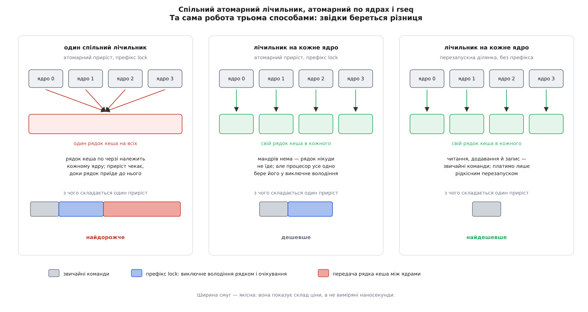

# ⚙️ Лічильник подій по ядрах процесора: робоча програма й чесний вимір

Це повна програма на C, яку можна зібрати одним рядком і запустити: вона рахує події в багатьох потоках, розкладаючи лічильник по ядрах процесора на перезапускних ділянках, сама відкочується на атомарний приріст там, де ядро такого не вміє, і в кінці міряє, скільки коштує та сама робота трьома різними способами. Сам лічильник тут — найпростіше, що взагалі можна покласти в ділянку; цінність програми в тому, що вона проходить усі місця, де спотикається справжній код: як знайти вже зареєстровану бібліотекою табличку замість своєї, як не вбити програму на старому ядрі, як написати ділянку так, щоб її не зіпсував компілятор, і що саме показує вимір.

## Завдання

Бібліотека рахує події — віддані пакети, видані блоки пам'яті, влучання в кеш. Потоків десятки, подій мільйони за секунду, кожна подія це один приріст. Читають лічильник рідко: раз на секунду його забирає збирач метрик. Отже, ціна приросту важить у мільйони разів більше за ціну читання, а сума мусить бути точною — «приблизно порахували» не годиться, бо на цих числах хтось виставляє рахунки.

Одна змінна й атомарний приріст ламаються саме там, де лічильник потрібен. Рядок кеша в кожну мить належить одному ядру процесора у виключне володіння — так влаштована [когерентність кешів](root:hw-arch/cache-coherence), — тому кожен приріст мусить спершу відібрати рядок у попереднього власника, а ця передача коштує від десятків до сотень наносекунд залежно від того, чи ядра сусідні, чи в різних сокетах. Рядок один на всіх, і доки він їде до одного ядра, решта чекає. Пропускна здатність не просто перестає рости з кількістю потоків — вона падає, бо до корисної роботи додається перевезення рядка туди-сюди.

Звідси задум: не один лічильник, а таблиця комірок, по одній на номер ядра процесора. На одному ядрі в кожну мить біжить рівно одна задача, тож за конкретну комірку нема кому змагатися — рядок кеша нікуди не їде й лишається гарячим у власному L1. Приріст стає трьома звичайними командами: прочитати, додати, записати. Сума на читанні — простий обхід таблиці.

Складність рівно одна: між «дізнатися свій номер ядра» і «записати результат» задачу можуть перенести на інше ядро, і тоді запис піде не в ту комірку — гірше, у ту саму комірку водночас полізе інший потік. Саме цю щілину й закриває перезапускна ділянка.

## Крок 1. Знайти табличку, а не заводити свою

Перше, об що спотикається кожен, хто пише таку програму вперше: власний виклик `rseq(2)` повертає `EINVAL`. Причина не в аргументах — у ядрі на потік дозволена рівно одна реєстрація, і місце вже зайняте чужою табличкою: glibc, починаючи з версії 2.35, реєструє свою для кожного потоку сама, бо через неї реалізує `sched_getcpu()`. Тобто на будь-якій сучасній системі місце вже зайняте, і правильна дія — не боротися за нього, а взяти те, що вже є.

Бібліотека віддає своє через три змінні: `__rseq_offset`, `__rseq_size` і `__rseq_flags`. Нуль у `__rseq_size` означає, що реєстрації немає — або ядро не підтримує, або її вимкнули налаштуванням `glibc.pthread.rseq=0`. Тоді табличку заводимо власну.

Зсув відлічують від вказівника потоку — того самого, на якому тримається [локальна пам'ять потоку](root:sys-unix/elf-tls): у кожного потоку свій блок, а вказівник на нього лежить у регістрі (на x86-64 це база сегмента `fs`, причому за адресою `fs:0` лежить вказівник сам на себе). Адреса таблички — вказівник потоку плюс `__rseq_offset`, і сам зсув однаковий для всіх потоків програми. Оголошувати ці три змінні доводиться [слабкими символами](root:sf-lang/weak-symbols): адреса слабкого символу, якого в бібліотеці немає, дорівнює нулю, і це можна перевірити під час виконання. Так програма збереться й запуститься навіть там, де glibc стара й про `__rseq_offset` не чула.

Скільки полів у табличці справді працює — окреме питання, і `__rseq_size` на нього відповідає не завжди. У glibc 2.35–2.39 туди клали розмір зареєстрованої області, тобто завжди 32, незалежно від того, чи вміє ядро останні поля; лише з версії 2.40 там розмір справді доступного набору можливостей. Надійне джерело — [допоміжний вектор](root:sys-unix/auxiliary-vector), набір пар «ключ-значення», який ядро кладе в стек нової програми поруч із аргументами й середовищем і який читають без системного виклику. Запис `AT_RSEQ_FEATURE_SIZE` з'явився в Linux 6.3 одночасно з полем `mm_cid`, тож відтоді він повідомляє щонайменше 28 байтів, а на новіших ядрах більше — поля дописують у хвіст структури, і саме тому розмір є ознакою набору можливостей. На ядрах до 6.3 запису у векторі немає взагалі, і `getauxval` повертає нуль; цей нуль треба читати як «вихідні 20 байтів», тобто без `node_id` і без `mm_cid`.

:::code proj-percpu-counter/c/rseqcount.c

Три подробиці тут не косметичні. По-перше, довжина реєстрації: ядро вимагає `rseq_len` не менше за 32 і, коли передано рівно 32, ще й вирівнювання адреси на 32 байти — звідси `aligned(32)` в оголошенні. По-друге, розрізнення `cpu_id` і `cpu_id_start`: перше поле призначене для перевірки (`−1` означає «не зареєстровано»), друге — для вживання всередині ділянки, і саме воно завжди містить придатне число. По-третє, `−1` в ініціалізації потрібне тому, що доти, доки ядро туди нічого не написало, поле мусить чесно казати «мене не реєстрували».

## Крок 2. Ділянка

Тепер сама ділянка. Її пишуть асемблером не з любові до асемблера, а тому, що вся домовленість із ядром складається з адрес: `start_ip` — перша команда, довжина в байтах, `abort_ip` — куди зривати. Мовою C немає жодного способу сказати «оці байти машинного коду й є діапазон»; мітки в асемблері є єдиною формою, якою це виражається. Тому потрібен [вбудований асемблер](root:sf-lang/inline-assembly), причому в різновиді `asm goto`: до звичайних операндів і переліку зіпсованих регістрів він додає ще й перелік міток C, куди асемблерний код має право стрибнути. Саме це дозволяє обробникові зриву повернути керування в цикл повторної спроби, написаний уже мовою C.

:::code proj-percpu-counter/c/krok-2-dilianka.c

Мітки навмисно числові (`1:`, `2:`, `3:`, `4:`). Компілятор має право розмножити асемблерну вставку — наприклад, продублювати хвіст циклу, — і кожна копія дістане власний комплект числових міток разом із власним дескриптором. Іменована мітка після такого дублювання дала б помилку компонування, а числова просто працює.

Крок комірки 128 байтів — не забобон, а те, без чого поділ по ядрах не дає нічого. Два незалежні лічильники в одному рядку кеша поводяться так, ніби вони одна змінна: запис в один відбирає рядок у власника другого. Це [хибне спільне використання](root:hw-arch/false-sharing), і воно зводить нанівець увесь поділ — комірки лишаються різними, а рядок знову один і знову мандрує. Розвести їх по різних рядках обов'язково, а запас у два рядки додатково знімає вплив випереджального читання сусіднього рядка.

## Крок 3. Читання суми

Читання — найдешевша частина й водночас та, де легко пообіцяти зайве.

```c
static long counters_total(void)
{
	long t = 0;
	for (unsigned i = 0; i < nr_slots; i++)
		t += __atomic_load_n(&counters[i * SLOT_STRIDE_LONGS],
		                     __ATOMIC_RELAXED);
	return t;
}
```

Поки триває обхід, потоки далі рахують, тож сума не відповідає жодній конкретній миті: перші комірки прочитано раніше за останні. Для лічильника, який лише росте, це не вада, і сформулювати чесно можна так: результат лежить між справжнім значенням на початку обходу й справжнім значенням у кінці. Отримати миттєвий знімок неможливо без того, щоб спинити всіх, — а спиняти всіх ми якраз і не хотіли.

## Крок 4. Три варіанти й вимір

Щоб зрозуміти, звідки береться виграш, порівнювати треба не два варіанти, а три. Різниця між першим і другим показує ціну бійки за рядок кеша; різниця між другим і третім — ціну самого префікса `lock`, коли бійки вже немає.

:::code proj-percpu-counter/c/krok-4-try-varianty-i.c

Відкат зроблено чесно: коли `rseq_thread_init()` повертає `−1` — а це трапляється на ядрі без `CONFIG_RSEQ`, під `seccomp`-фільтром, що не пускає виклик, або в системі, де реєстрацію заборонено, — програма не падає й не робить вигляду, що все гаразд. Вона друкує «немає» й рахує атомарними приростами по ядрах: результат той самий, ціна вища. Зверніть увагу, що номер ядра в цьому режимі доводиться питати `sched_getcpu()`, і на старій системі це звернення до [vDSO](root:sys-unix/vdso), а не просте читання з пам'яті.

## Що показує вимір і звідки береться різниця



*Ліворуч усі ядра б'ються за один рядок кеша; посередині бійки вже немає, але префікс lock лишається; праворуч не лишається й префікса.*

Перша сходинка — від спільного лічильника до поділу по ядрах. На одному потоці різниці майже немає: рядок і так у власному кеші. На двох вона вибухає, бо кожен приріст тепер починається з відбирання рядка в сусіда: одна корисна команда обростає десятками наносекунд очікування. Далі стає ще виразніше: пропускна здатність спільного лічильника не росте з кількістю потоків узагалі, вона обмежена швидкістю, з якою рядок кеша здатний мандрувати між ядрами. Вимірювання Тревіса Даунса на чотириядерному Skylake показують саме таку картину: одиниці наносекунд на приріст без поділу, близько десятка наносекунд на неконкурованому атомарному прирості й понад сотню, щойно за ту саму комірку беруться два потоки.

Друга сходинка — від атомарного приросту по ядрах до перезапускної ділянки. Тут ніякої бійки вже немає: комірка своя, рядок гарячий у власному L1. Але префікс `lock` коштує й без суперників. Процесор мусить утримати рядок у виключному володінні на весь час читання-зміни-запису й не дати командам навколо переїхати через цю точку — на x86 атомарна операція з читанням-зміною-записом заразом працює як повний бар'єр і зливає буфер записів. Це десь півтора десятка тактів, які нікуди не подіти. Ділянка ж складається зі звичайних команд: читання йде з L1, додавання виконується поруч, запис лягає в буфер записів і не змушує нікого чекати. Звідси й типове відношення в кілька разів.

Числа з першоджерела виглядають так — це вимір із супровідного листа дванадцятої редакції патчів rseq (2017):

**Приріст лічильника по ядрах: атомарна команда проти перезапускної ділянки**

```
x86-64, Intel Xeon E5-2630 v3 @ 2.40 GHz, 8 ядер із гіперпотоковістю на сокет
  getcpu + atomic     15.3 нс/операцію
  rseq                 2.0 нс/операцію      прискорення 7.7×

arm32, ARMv7 rev 4 «Cubietruck», 2 ядра
  getcpu + atomic    344.0 нс/операцію
  rseq                31.4 нс/операцію      прискорення 11.0×
```

Читати ці числа треба з поправкою: у знаменнику там не лише атомарна команда, а й виклик `sched_getcpu()`, який на той час був зверненням до vDSO. Сьогодні, коли glibc реалізує `sched_getcpu()` через ту саму табличку одним читанням із пам'яті, різниця між другим і третім стовпчиком нашої програми буде скромнішою — вона зведеться до чистої ціни префікса `lock`. А от перша сходинка, від спільного лічильника до поділу по ядрах, з роками лише росте: ядер у машинах більшає, а рядок кеша так само один.

Ціна, яку платить ділянка, теж має бути в розрахунку. Це один зайвий запис вказівника на дескриптор перед кожним приростом (у гарячий рядок власного кеша, тобто майже задарма) і рідкісний перезапуск:

**Ділянка на п'ять команд, звичайний відрізок часу планувальника:**

```
тривалість ділянки          t = 2·10⁻⁹ с
відрізок часу планувальника T = 4·10⁻³ с
шанс потрапити витісненням  p = t / T = 5·10⁻⁷
середня кількість спроб       = 1 / (1 − p) ≈ 1.0000005
```

Тобто на два мільйони приростів припадає один зайвий прохід. Головне навіть не мализна числа, а те, що воно не залежить від кількості потоків: перезапустити нас може лише планувальник, а не суперник.

Наостанок про сам вимір: його легко непомітно перетворити на вимір чогось іншого, і [мікробенчмарк](root:sf-release/microbenchmarking) тут має три власні пастки. Перший прохід платить за сторінкові промахи в щойно виділеній таблиці — тому програма заповнює її нулями ще до заміру. Частота процесора піднімається до робочої лише на другому-третьому прогоні, тож перший результат треба викидати. А число для спільного лічильника сильно залежить від того, які саме ядра дав планувальник: два ядра під одним L3 і два ядра в різних сокетах дадуть значення, що різняться в рази, — тому поруч із числом завжди називають топологію.

## Пастки

**Покроково під зневаджувачем ділянка не завершується ніколи.** [Зневаджувач](root:sys-unix/ptrace-model) спиняє й пускає підопічного через сигнали, і покроковий режим реалізовано доставкою `SIGTRAP` після кожної команди. А сигнал — це подія, тобто перезапуск: ви натискаєте «крок» і знову опиняєтеся на першій команді ділянки, скільки не тисни. Це не хиба реалізації, а прямий наслідок правила «будь-яка подія — перезапуск». Практичний вихід: ставити точку зупину не всередині, а після ділянки (мітка `3:`) або в гілці повторної спроби й доходити туди виконанням, а не кроками. Вибіркове профілювання, до речі, ділянці не заважає: `perf record` складає вибірки в кільцевий буфер і сигналу потокові не доставляє.

**Системний виклик усередині ділянки — це смерть програми.** У ядрі, [зібраному](root:sys-unix/kernel-config-and-build) з параметром `CONFIG_DEBUG_RSEQ`, на шляху повернення з кожного системного виклику стоїть перевірка: якщо лічильник команд лежить у діапазоні активної ділянки, ядро надсилає `SIGSEGV`, і програма помирає. У ядрі, яке приходить із дистрибутивом, такої перевірки немає — і буде гірше за падіння: виклик може заблокуватися, задачу витіснять, і на поверненні ділянку зірве — тобто виклик виконається вдруге з усіма своїми побічними діями. Пастка в тому, що системні виклики бувають непомітні: `printf` це `write`, `malloc` це `brk` або `mmap`, а часом ще й `futex`, і навіть `assert` у зневаджувальній збірці. Тому правило формулюють коротко: усередині ділянки взагалі немає викликів функцій.

**Мовою C цього не написати.** Компілятор має право переставити команди, підняти обчислення вище, зберегти регістр у стек посеред ділянки, згенерувати два записи там, де в джерелі був один, або розмножити код так, що діапазон адрес перестане описувати те, що ви мали на увазі. Частина цих вольностей нешкідлива — запис у власний стек ніхто не бачить, — але дві смертельні: другий видимий запис ламає правило одного завершального запису, а втрата контролю над мітками ламає сам опис діапазону. До того ж підпис перед точкою повернення — це чотири байти в потоці машинного коду в точно визначеному місці, а такого запису в C просто немає. Додайте сюди інструментування санітайзерами чи `-pg`, яке вставляє виклики туди, де їх у джерелі не було, — і стає видно, що ділянка мусить бути асемблером не «для швидкості», а щоб узагалі бути ділянкою.

**Комірок може забракнути.** `sysconf(_SC_NPROCESSORS_CONF)` — зручне, але не найточніше джерело: номери ядер процесора бувають розріджені, а гаряче підключення здатне додати ядро вже після старту програми. Чесне джерело — `/sys/devices/system/cpu/possible`. Помилка тут особливо неприємна тим, що виявляється лише на великій машині: запис у комірку з номером за межами таблиці псує чужу пам'ять. Та сама розрідженість шкодить і без помилок: коли програмі [дозволено лише кілька ядер](root:sys-unix/cpu-affinity) із двохсот, номери в неї великі й рідкі, тож таблиця на 256 комірок обслуговує чотири потоки, а решта пам'яті лежить дарма. Саме на це й відповідає поле `mm_cid` — номер конкурентності в межах програми, який ядро тримає меншим за кількість потоків.

Перейти на `mm_cid` у цій програмі — правка на одне зміщення: у ділянці замість `movl (%[rs])` читати `movl 24(%[rs])`, а таблицю виділяти за кількістю потоків, а не ядер. Умова одна — `kernel_feature_size()` мусить повернути щонайменше 28, інакше поля просто немає й у цих байтах будуть нулі.

**Власну реєстрацію треба знімати.** Поки реєстрація жива, ядро вважає, що має право писати в ту пам'ять. Задачу, яка завершується, ядро розреєструє саме, а от бібліотека, що зареєструвала табличку у власній пам'яті й була вивантажена через `dlclose` при живих потоках, залишить ядру вказівник на звільнену область — і наступне ж витіснення обернеться `SIGSEGV`. Звідси `rseq_thread_fini()` у кінці потоку. І ще одна асиметрія, про яку легко забути: після `fork` дитина успадковує реєстрацію батька (адресний простір у неї копія), а новий потік не успадковує нічого й мусить реєструватися сам — саме тому `rseq_thread_init()` стоїть першим рядком у `worker()`.
