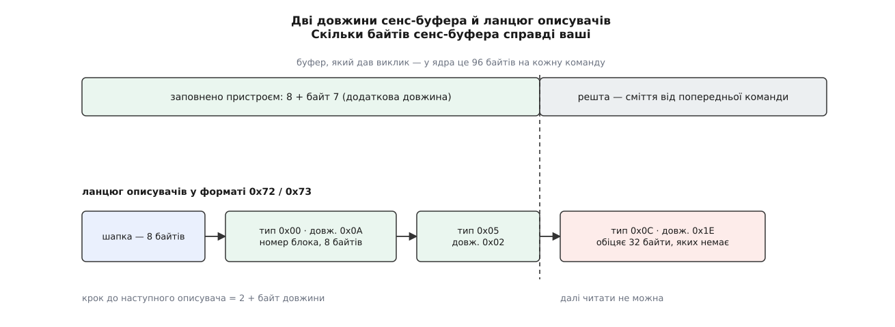

# ⚙️ Розібрати сенс-дані власноруч: від купи байтів до вироку

Напишемо програму, яка бере сирий сенс-буфер — той самий рядок шістнадцяткових чисел, що видно в журналі ядра або в дампі після `SG_IO`, — і друкує з нього чотири речі: сенс-ключ, пару ASC/ASCQ, номер збійного блока й вирок, що його над цією командою ухвалило б ядро. Жодної бібліотеки: усе потрібне тут — уміння не повірити байтам, які самі про себе брешуть.

Спокуса написати розбирач у чотири рядки величезна: ключ — молодші біти байта 2, ASC — байт 12, ASCQ — байт 13, номер блока — чотири байти від байта 3. Кожен із цих чотирьох рядків неправильний, і неправильний по-своєму. Цікавий тут не результат, а перелік перевірок, що до нього ведуть: у ядрі вони займають три невеликі функції, і жодна з них не зайва.

## Чим брешуть байти

**Розкладок дві, і вони не схожі.** Молодші сім бітів байта 0 — код відповіді: `0x70` і `0x71` означають фіксовану розкладку, `0x72` і `0x73` — описову. У фіксованій сенс-ключ лежить у байті 2, в описовій на цьому місці вже ASC, а ключ переїхав у байт 1. Розбирач, який цього не питає, на буфері `72 03 11 00 …` упевнено доповість «сенс-ключ 0x11» — число, якого серед шістнадцяти ключів навіть немає.

**Старший біт байта 0 — не частина коду.** Це біт VALID, і стосується він лише одного поля — того, де лежить номер блока. Пристрій ставить його, коли номер справді щось означає, і знімає, коли причина провалу до конкретного блока не прив'язана: зміна стану, неготовність, невідома команда. Тому `f0` і `70` — той самий код відповіді `0x70` з різною довірою до чотирьох байтів посередині.

**Довжин у буфера дві, і вірити треба меншій.** Одну називає той, хто нас покликав: у ядра це 96 байтів, відведених під сенс-дані кожної команди. Другу називає сам пристрій — байт 7, «додаткова довжина»: скільки байтів після восьмого він насправді заповнив. Буфер один на команду й уживається повторно, тому за межею заповненого лежать не нулі, а рештки попереднього провалу. А в описовій розкладці до цих двох додається третя довжина — власна в кожного описувача ланцюга.

Коротка відповідь буває й цілком чесною. Пристрій має право покласти в байт 7 трійку — тобто заповнити всього одинадцять байтів — і тоді ASC із ASCQ у звіті просто немає, бо їхнє місце — байти 12 і 13. Розбирач, який прочитає їх усе одно, доповість пару, узяту з чужого провалу, — і це найпідступніша з усіх помилок, бо пара буде цілком правдоподібна. Тому читання ASC у коді стоїть під умовою про довжину, а не під умовою про розкладку.



*Дві межі, за які не можна ступити: та, до якої пристрій заповнив буфер, і та, до якої дотягується описувач.*

**Номер блока має два розміри.** У фіксованій розкладці на нього відведено чотири байти, в описовій — вісім. Це не примха: чотирма байтами найбільший адресований блок — 4294967295, тобто близько двох тебібайтів при секторі 512 байтів, і саме тіснота цього поля породила описову розкладку. Наслідок для розбирача підступний: чотири байти, прочитані в описовій розкладці за звичкою, — це **старша** половина восьмибайтового числа, а вона в будь-якого реального диска нульова. Програма не впаде й не пожаліється: вона впевнено доповість «збійний блок 0».

## Три питання, які ядро тримає нарізно

Розбір розпадається на три дії, що нічого не знають одна про одну, — так само, як у самому ядрі.

Перша: **нормалізація** — з'ясувати розкладку й дістати ключ, ASC і ASCQ. У ядрі це `scsi_normalize_sense()`. Друга: **пошук описувача заданого типу** в ланцюгу описової розкладки — `scsi_sense_desc_find()`. Третя: **поле «інформація»** — номер блока, який у двох розкладках лежить у різних місцях і має різний розмір; `scsi_get_sense_info_fld()`.

Усі три — чисті функції над масивом байтів, і саме тому вони живуть у `scsi_common.c`, спільному для тієї частини ядра, що надсилає команди, і тієї, що їх приймає. Четверта дія — **вирок** — уже не чиста: щоб вирішити долю команди, треба знати сам пристрій (скільки повторів лишилося, чи дозволено будити мотор), тож `scsi_decide_disposition()` разом із `scsi_check_sense()` лежить окремо, в обробнику помилок.

Складати багатобайтові числа доведеться руками, старшим байтом уперед: SCSI — світ [великого порядку байтів](root:sf-algorithms/bits-bytes-endianness), і накладати на буфер структуру з `uint64_t` тут не можна ні за вирівнюванням, ні за порядком.

## Код

Головну мову тут задає сама справа — C: ідеться про сирі байти зі стандарту, зразок для звірки написаний тією ж мовою, а результат мусить читатися поруч із кодом ядра. Другою вкладкою — коротший варіант на Python, коли треба просто вкинути рядок із `dmesg` і побачити відповідь.

:::tabs
:::code proj-decode-sense/c/sensedecode.c
:::code proj-decode-sense/py/sensedecode.py
:::

## Що воно друкує

Один і той самий провал — непоправна помилка читання на блоці 8195 — у двох розкладках виглядає геть по-різному на дроті й однаково на виході.

```
$ ./sensedecode f0 00 03 00 00 20 03 0a 00 00 00 00 11 00 00 00 00 00
статус       : 02
формат       : фіксований
сенс-ключ    : 3  MEDIUM ERROR
ASC/ASCQ     : 11/00
збійний блок : 8195
вирок        : SUCCESS        — суд закінчено, віддати нагору

$ ./sensedecode 72 03 11 00 00 00 00 0c 00 0a 80 00 00 00 00 00 00 00 20 03
статус       : 02
формат       : описовий
сенс-ключ    : 3  MEDIUM ERROR
ASC/ASCQ     : 11/00
збійний блок : 8195
вирок        : SUCCESS        — суд закінчено, віддати нагору
```

Двадцять байтів проти вісімнадцяти, номер блока в іншому місці й іншого розміру — а діагноз той самий. Тепер поміняймо в описовому буфері єдиний біт: `72` на `73`.

```
$ ./sensedecode 73 03 11 00 00 00 00 0c 00 0a 80 00 00 00 00 00 00 00 20 03
статус       : 02
формат       : описовий, ВІДКЛАДЕНА помилка
сенс-ключ    : 3  MEDIUM ERROR
ASC/ASCQ     : 11/00
збійний блок : 8195
вирок        : NEEDS_RETRY    — повторити ту саму команду
```

Той самий ключ, той самий блок — інший вирок. І третій випадок, де номера блока немає, хоч байти на його місці ненульові:

```
$ ./sensedecode 70 00 06 00 00 20 03 0a 00 00 00 00 29 00 00 00 00 00
статус       : 02
формат       : фіксований
сенс-ключ    : 6  UNIT ATTENTION
ASC/ASCQ     : 29/00
збійний блок : не вказано
вирок        : SUCCESS        — суд закінчено, віддати нагору
```

## Пастки

**Відкладена помилка — не про вашу команду.** Непарний код відповіді (`0x71`, `0x73`) означає, що пристрій звітує про провал, який стався *раніше*: типово це запис, що осів у кеші пристрою й розсипався аж тоді, коли дійшов до носія. Команда, якій цей звіт причепили, ні в чому не винна, тому ядро першою ж перевіркою в `scsi_check_sense()` віддає `NEEDS_RETRY`. Номер блока в такому звіті теж стосується старого запису — приліпити його до поточного запиту означає звинуватити невинного.

**Ключ — чотири біти, а не байт.** Старші біти того самого байта зайняті окремими ознаками, здебільшого стрічковими: мітка файлу, кінець носія, невідповідність довжини запису. Маска `0x0f` тут не косметика: стрічковий привід, що дочитався до мітки файлу, кладе в байт 2 значення `0x80` — ключ `NO SENSE` плюс піднята ознака. Без маски розбирач доповість про ключ `0x80`, якого не існує; з маскою — про `NO SENSE`, тобто саме те, що сталося.

**Ознака дійсності перевіряється лише в одній розкладці.** У фіксованій біт VALID — єдина підстава вірити чотирьом байтам номера. В описовій ядро цього біта не питає взагалі: там сама присутність описувача типу `0x00` із довжиною `0x0a` і є сигналом, що номер справжній. Тому в коді це дві різні перевірки, і замінити одну одною не можна.

**Обрізаний ланцюг.** Пристрій міг покласти в байт 7 більше, ніж встиг передати транспорт, а описувач наприкінці — пообіцяти тридцять байтів, коли лишилося чотири. Тому в `desc_find()` дві незалежні межі: спершу затиск обіцяної довжини реальною, потім перевірка кожного кроку. Ядро тут трохи вільніше — його пошук може повернути описувач із обрізаним тілом, і саме тому місце виклику ще раз звіряє довжину описувача з `0x0a`, перш ніж читати вісім байтів.

**Описувач у ланцюгу не один.** Поряд із номером блока там може лежати ознака невідповідної довжини, показник ходу тривалої операції, ATA-статус від транслятора SATA. Тому пошук іде за типом, а не за місцем: перший описувач у ланцюгу нічим не зобов'язаний бути тим, по який ви прийшли.

**Зарезервовані коди проходять як описові.** Перевірка `(rc & 0x70) == 0x70` пропускає й `0x74`…`0x77`, а гілка вибирається за `>= 0x72`. Це навмисно: невідомий код відповіді краще розібрати новішою розкладкою, ніж відкинути звіт цілком.

## Ціна

Уся робота — один прохід по буферу, не довшому за 263 байти, без жодного виділення пам'яті й без залежностей. Це не оптимізація, а наслідок: розбирач мусить працювати в обробнику помилок, тобто там, де вже щось зламалося і де просити пам'яті — найгірша ідея.

Три перші функції — чисті функції над масивом байтів, і це робить їх смішно легкими для перевірки: подав масив, звірив поля. Заплатили за це тим, чого в них немає, — вирок тут спрощений. Справжній `scsi_decide_disposition()` дивиться ще й на байт хоста (мовчання дроту, розрив каналу), рахує залишок дозволених повторів і питає прапорці конкретного пристрою — саме тому `NEEDS_RETRY` у ядра означає «повторити, **якщо** спроби ще лишилися», а не «повторити завжди».

Отримати живий буфер для перевірки нескладно: [наскрізний канал до пристрою](root:sys-unix/scsi-generic-passthrough) віддає сенс-дані тієї команди, яку ви надіслали власноруч, — разом зі статусом і байтом хоста, тобто рівно тим набором, над яким судить ядро.
