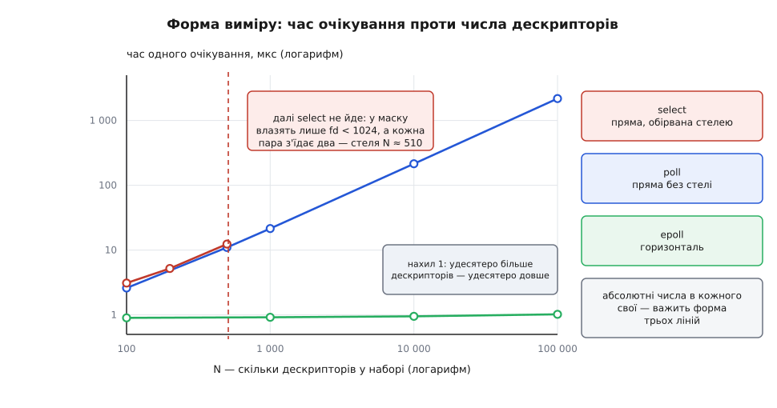

# ⚙️ Виміряти ціну очікування: сто тисяч дескрипторів і один активний

Твердження «`epoll` не залежить від числа з'єднань, а `select` і `poll` залежать» перевіряється не міркуванням, а програмою на півтори сотні рядків: тримаємо N пар сокетів, робимо активною рівно одну й міряємо тривалість одного виклику очікування — при N від сотні до ста тисяч.

## Що саме міряємо

Ціна очікування складається з двох доданків. Перший — ціна **запитати**: скільки роботи метод виконує, перш ніж узагалі дізнатися, чи є події. Другий — ціна **віддати**: скільки припадає на кожну знайдену подію. Другий доданок в усіх трьох способів однакового порядку — подію треба скопіювати користувачеві. І якщо в наборі активна половина дескрипторів, обидва доданки ростуть разом, другий заступає перший, і вимір чесно показує «різниці майже немає». Саме так гинуть недбалі порівняння.

Тому в досліді активний рівно один дескриптор, скільки б їх не лежало в наборі. Ціна віддати стає сталою, і будь-яка залежність від N — це чистий перший доданок. Умова не штучна: у справжній службі мовчить переважна більшість з'єднань, і саме ця пропорція робить питання вартим виміру.

Друге рішення: байт у сокет ми штовхаємо **до** того, як запускаємо годинник. Виклик очікування застає подію вже готовою й повертається негайно, нікого не приспавши. Отже, ми міряємо роботу самого методу — зібрати набір, перенести його через межу, обійти, доповісти, — а не затримку пробудження. Затримка пробудження — величина іншої природи: у ній сидять планувальник, міжпроцесорне переривання й перетягування рядків кешу між ядрами, тобто десятки мікросекунд шуму, у якому потрібний ефект потонув би без сліду.

## Звідки взяти сто тисяч дескрипторів

`socketpair` віддає два дескриптори за раз ([сокети домену Unix](root:sys-unix/unix-domain-sockets) — пара з'єднаних кінців усередині однієї машини, без мережі й без портів), тож сто тисяч пар — це двісті тисяч відкритих дескрипторів плюс кілька службових. Типова м'яка межа `RLIMIT_NOFILE` — 1024: systemd від версії 240 роздає службам саме `1024:524288`, залишивши м'яку межу низькою навмисно, щоб не поламати програми, які досі викликають `select`. Тверда межа при цьому щедра, а підняти м'яку до твердої процес може сам, без жодних привілеїв ([межі ресурсів](root:sys-unix/resource-limits) — пара «м'яка/тверда» на кожен вид ресурсу; тверду вгору рухає лише `CAP_SYS_RESOURCE`). Стелею для твердої межі служить `fs.nr_open`, типово 1048576.

`select` до цих чисел не дійде ніколи. Його маска `fd_set` — це масив із `FD_SETSIZE` = 1024 бітів, і дескриптор із номером 1024 туди не влазить: `FD_SET` мовчки пише повз масив, псуючи сусідню пам'ять. Тому в програмі стоїть перевірка `maxfd < FD_SETSIZE` — не з обережності, а тому що без неї дослід перетворюється на випадкове псування власного стеку. А оскільки кожна пара з'їдає два номери, практична стеля тут — близько 510 пар, а не 1024.

## Програма

Мова тут не обирається: `fd_set`, `struct epoll_event` і `setrlimit` — це двійковий інтерфейс ядра, і будь-яка обгортка додала б до виміру власну ціну.

:::code proj-scaling-measure/c/main.c

Збирати — `cc -O2 -o waitbench waitbench.c`; ніяких бібліотек, ніяких прав.

## Що виходить

**Вивід на пересічній машині x86-64 із ядром 6.x. Абсолютні числа у вас будуть інші — важить форма.**

```
      N    select      poll     epoll   (мкс на одне очікування)
    100      3.10      2.61      0.90
    500     12.42     11.03      0.91
   1000        --     21.54      0.92
  10000        --    215.30      0.95
 100000        --   2181.40      1.02
```



*Форма результату: дві прямі й одна горизонталь*

Читається це так. Стовпчик `poll` ділиться на N майже точно: 22 наносекунди на дескриптор, плюс близько 0.4 мікросекунди сталої ціни переходу в ядро ([механіка системного виклику](root:sys-unix/syscall-mechanics) — той самий фіксований податок, що дає ненульовий початок прямої). Це і є пряма: удесятеро довший набір — удесятеро довший виклик. `select` іде поруч, трохи дорожче за рахунок трьох масок замість однієї, і просто обривається на стелі. А `epoll` за тисячократного зростання набору дорожчає на тринадцять відсотків — це вже не залежність від N, а слід того, що велике дерево гірше лежить у кеші.

У подвійних логарифмічних осях різниця видно без арифметики: лінійна залежність стає прямою з нахилом одиниця, стала — горизонталлю. Дві прямі й одна горизонталь — це не «на скільки відсотків швидше», а різні закони росту, і жодне вдосконалення `poll` цього не змінить.

> 🔧 **Навіщо це.** Числа перетворюють гасло на проєктне обмеження. Хай службі треба обертати цикл подій десять тисяч разів на секунду при десяти тисячах з'єднань:
> ```
> poll:   10 000 обертів/с · 215 мкс = 2.15 с процесорного часу на секунду
> epoll:  10 000 обертів/с ·   1 мкс = 0.01 с процесорного часу на секунду
> ```
> Перший варіант не влазить не те що в ядро процесора — йому треба понад два ядра, щоб лише **питати**, ще до першого байта корисної роботи. Другий з'їдає один відсоток одного ядра.

## Пастки виміру

**Прогрів обов'язковий.** Перші виклики платять за помилки сторінок на щойно виділених масивах, за холодні кеші, за ще не створені структури ядра й за процесор, який не встиг підняти частоту. Тому в програмі перед кожним заміром іде тисяча відкинутих обертів; без неї малі N виглядають дорожчими за великі й уся картина перевертається ([мікробенчмаркінг](root:sf-release/microbenchmarking) — чому вимір без прогріву й повторів міряє що завгодно, крім потрібного).

**Кеш видно у стовпчику `poll`.** Масив `pollfd` на сто тисяч записів — це 800 кілобайтів, тобто на більшості машин уже поза кешем другого рівня; частина «22 наносекунд на дескриптор» — не робота ядра, а очікування пам'яті. Із тієї ж причини активним не можна робити щоразу один і той самий дескриптор: його структури залишаться в кеші першого рівня й дадуть красиві, але брехливі числа. Звідси `k % n` у циклі.

**`O_NONBLOCK` не бажаний, а обов'язковий.** Спорожнення сокета написане як «читати, доки не скінчиться», і на блокуючому дескрипторі другий `read` засне назавжди ([блокуючий і неблокуючий режим](root:sys-unix/blocking-and-nonblocking) — що саме повертає `EAGAIN` і чому це не помилка). Оскільки в очікування ми передали `-1` замість тайм-ауту, така помилка не впаде й не діагностується — програма просто мовчки повисне.

**Час виклику — не затримка.** Отримане число не можна називати затримкою відповіді службі: це фіксований податок на один оберт циклу. Реальна затримка додасть до нього пробудження задачі та власне обробник. Дві величини міряються різними дослідами, і плутанина між ними — найчастіша причина суперечок про «швидкість epoll».

**Одного прогону не буває.** Витіснення планувальником, переривання, чужий процес на тому ж ядрі — і один оберт із тисячі дасть викид у сотні мікросекунд, який середнє чесно розмаже по всьому виміру. Тому в програмі медіана семи прогонів, а не середнє, і прив'язка до одного ядра ([прив'язка до процесорів](root:sys-unix/cpu-affinity) — як процес просить планувальник не переносити його між ядрами). Якщо сусідні прогони розходяться більше ніж на кілька відсотків — машина зайнята, і міряти на ній немає сенсу.

**Реєстрацію ми не міряємо навмисно.** `epoll_ctl` для ста тисяч дескрипторів коштує помітних мілісекунд, але платиться один раз на з'єднання, тоді як очікування повторюється мільйони разів. Проте сказати це треба вголос: інакше порівняння виглядає підтасованим, а на короткоживучих з'єднаннях, де одна реєстрація припадає на кілька очікувань, висновок був би вже не таким однозначним.

І ще одне, дрібне, але вперте: годинник має бути `CLOCK_MONOTONIC`. Настінний час стрибає від синхронізації, і посеред довгого виміру ви дістанете від'ємний інтервал ([монотонний час проти настінного](root:sf-apps/monotonic-vs-wall-time) — які саме годинники стрибають і чому тривалості міряють лише монотонним).
