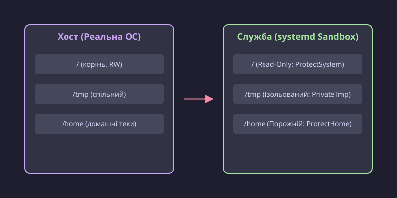

# Пісочниця служби: ProtectSystem, PrivateTmp і решта обмежень юніта

<preknowlist>
- [systemd: юніти, залежності, цілі](root:sys-unix/systemd-model) — служба описана текстовим юнітом, а запускає її менеджер служб, він же PID 1.
- [Життєвий цикл служби й політика перезапуску](root:sys-unix/service-lifecycle) — що робить `systemctl start` і як юніт проходить шлях від запуску до зупинки.
- [Користувачі, групи й ідентичність процесу](root:sys-unix/uid-gid-identity-model) — процес несе числову ідентичність (UID і GID), і саме за цими числами ядро вирішує, що йому дозволено.
- [Біти прав і як їх перевіряють](root:sys-unix/permission-bits) — режим `rwx` на файлі й каталозі та порядок перевірки доступу.
- [Простори імен: ізоляція погляду на систему](root:sys-unix/namespaces) — процесові можна дати власний простір монтувань, мережі чи IPC, у якому система виглядає інакше, ніж на хості.
- [Обов'язковий контроль доступу: SELinux і AppArmor](root:sys-unix/mac-selinux-apparmor) — мандатні правила ядра обмежують процеси незалежно від прав UNIX-користувача.
- [Спільна пам'ять POSIX](root:sys-unix/posix-shared-memory) — сегменти пам'яті та примітиви синхронізації, доступні через спільні дескриптори та `/dev/shm`.
- [chroot і його межі](root:sys-unix/chroot) — підміна кореневого каталогу процесу та чому класичний chroot не дає повної ізоляції без просторів імен.
</preknowlist>

Коли фонова служба стає жертвою віддаленого виконання коду (RCE), зловмисник отримує доступ до середовища, у якому запущено процес. Якщо це монолітний хост без ізоляції, навіть непривілейований користувач бачить дерево процесів усієї системи, читає конфігурації у `/etc`, сканує відкриті абстрактні сокети IPC, зондує спільний `/tmp` на залишені паролі чи тимчасові файли інших демонів і шукає бінарники з SUID-бітами або вразливості в рідко вживаних системних викликах ядра.

Розв'язання цієї проблеми часто шукають у важких контейнерах (Docker, Podman, containerd). Але контейнери тягнуть за собою додатковий стек: окремі фонові демони керування, віртуальні мережеві мости (`veth`/`bridge`), прошарки багатошарових файлових систем (`overlayfs`) та накладні витрати на запуск і дублювання образів.

Менеджер служб systemd реалізує **декларативну ізоляцію безпосередньо на примітивах ядра Linux** (простори імен, cgroups v2, Seccomp BPF, POSIX Capabilities, LSM). PID 1 самостійно готує контекст ізоляції між системними викликами `fork()` та `execve()`. Це означає нульові накладні витрати під час виконання: служба працює як звичайний процес хоста, але бачить лише виділену для неї частину системи.


*Порівняння файлової системи хоста та ізольованого простору монтувань служби.*

## Архітектура виконання: покроковий конвеєр між fork() та execve()

Коли systemd запускає службу з увімкненими директивами пісочниці, він не передає керування стороннім проміжним процесам. Усі обмеження накладаються послідовно у дочірньому процесі після розгалуження:

1. **Створення просторів імен (Linux Namespaces):** за допомогою системного виклику `unshare()` або відповідних прапорців `clone()` створюються нові простори монтувань (`CLONE_NEWNS`), мережі (`CLONE_NEWNET` для `PrivateNetwork=yes`), IPC (`CLONE_NEWIPC` для `IPCNamespace=yes`), UTS (`CLONE_NEWUTS` для `ProtectHostname=yes`), cgroups (`CLONE_NEWCGROUP`) або користувачів (`CLONE_NEWUSER` для `PrivateUsers=yes`).
2. **Перебудова кореня та простору монтування:**
   - Прапорець `MS_REC|MS_PRIVATE` робить дерево монтувань незалежним від подій монтування на хості.
   - Якщо вказано `RootDirectory=` або `RootImage=`, systemd монтує базовий образ (із верифікацією через `dm-verity` за потреби), накладає додаткові шари розширень `ExtensionImages=` через `overlayfs` і перемикає корінь за допомогою системного виклику `pivot_root()` (або `chroot()`).
   - Якщо увімкнено `MountAPIVFS=yes`, у новому корені автоматично монтуються віртуальні псевдофайлові системи ядра (`/proc`, `/sys`, `/dev`, `/dev/pts`, `/dev/shm`, `/run`).
   - Застосовуються директиви `ProtectSystem=`, `ProtectHome=`, `PrivateTmp=`, монтуються екземпляри пам'яті `TemporaryFileSystem=`, накладаються шляхи `BindPaths=` / `BindReadOnlyPaths=`, `ReadWritePaths=`, `ReadOnlyPaths=`, а заборонені каталоги перекриваються через `InaccessiblePaths=`.
   - Псевдофайлові системи `/proc/sys`, `/sys`, `/sys/fs/cgroup` перемонтовуються в режим `MS_RDONLY` за директивами `ProtectKernelTunables=` та `ProtectControlGroups=`.
3. **Ізоляція IPC та синхронізації:** якщо активовано `IPCNamespace=yes`, ядро створює нову таблицю SysV IPC та POSIX message queues, а systemd монтує приватний екземпляр `tmpfs` у точку `/dev/shm`, блокуючи доступ до спільної пам'яті інших служб.
4. **Підготовка мандатного контексту (LSM):** якщо в юніті задано директиви `SELinuxContext=`, `AppArmorProfile=` або `SmackProcessLabel=`, PID 1 викликає API відповідного модуля безпеки (`setexeccon()`, `aa_change_onexec()`), плануючи перехід у вказаний домен безпеки ядра під час наступного виклику `execve()`.
5. **Блокування підвищення привілеїв:** виклик `prctl(PR_SET_NO_NEW_PRIVS, 1)` фіксує заборону на виконання SUID/SGID-бінарників і блокує небезпечні LSM-переходи для процесу та всіх його нащадків.
6. **Скидання та передача POSIX Capabilities:** маніпуляція масками `CapabilityBoundingSet=` через `cap_set_proc()` та підняття дозволених прав у набір Ambient Capabilities (`prctl(PR_CAP_AMBIENT, PR_CAP_AMBIENT_RAISE, ...)`).
7. **Компіляція та завантаження Seccomp BPF фільтрів:** systemd збирає правила `SystemCallFilter=`, перевірку архітектури `SystemCallArchitectures=native` та обмеження пам'яті `MemoryDenyWriteExecute=yes` у компактну програму cBPF і завантажує її в ядро через системний виклик `seccomp(SECCOMP_SET_MODE_FILTER, 0, &prog)`.
8. **Зміна ідентичності (UID/GID):**
   - Налаштування додаткових груп через `setgroups()`.
   - Зміна дійсного, ефективного та збереженого ідентифікатора групи через `setresgid()`.
   - Зміна ідентифікаторів користувача через `setresuid()`. Для `DynamicUser=yes` systemd виділяє UID/GID з пулу та оновлює ACL на персистентні каталоги.
9. **Запуск цільової програми:** виклик `execve()`, який замінює образ пам'яті процесу на бінарник служби, активуючи Seccomp-фільтри та LSM-профілі.

Оскільки всі ці кроки виконуються ядром один раз під час ініціалізації процесу, нативна пісочниця не вносить жодних затримок у процесорні обчислення чи операції введення-виведення самої служби.

## Ізоляція файлової системи: Mount Namespaces

Більшість атак починається зі спроби змінити бінарники, підкинути конфігураційні файли або вичитати чутливі дані інших користувачів. Простори імен монтування дозволяють побудувати для служби індивідуальну проєкцію файлової системи.

### Захист кореня та системних каталогів: ProtectSystem=

Директива `ProtectSystem=` керує режимом доступу до загальносистемних каталогів:

- `ProtectSystem=no` (за замовчуванням) — служба успадковує дерево файлової системи хоста з правами на запис туди, куди дозволяють стандартні UNIX-права її UID/GID.
- `ProtectSystem=yes` — каталоги `/usr`, `/boot` та `/efi` монтуються в режимі лише для читання (`MS_RDONLY`). Процес не зможе змінити системні бінарники та бібліотеки, навіть якщо якимось чином отримає `root`.
- `ProtectSystem=full` — до переліку `read-only` додається каталог системних конфігурацій `/etc`.
- `ProtectSystem=strict` — **уся файлова система хоста** монтується в режимі `read-only`. Служба не може створити або змінити жодного файлу за межами явно дозволених каталогів або спеціальних псевдофайлових систем (`/dev`, `/proc`, `/sys`).

Якщо ввімкнено `ProtectSystem=strict`, точки монтування для запису відкриваються директивою `ReadWritePaths=`:

```ini
[Service]
ProtectSystem=strict
ReadWritePaths=/var/lib/my_service /var/log/my_service /run/my_service
```

### Тонке маскування та перевизначення шляхів

Для точкового керування видимістю файлів systemd надає чотири взаємодоповнюючі директиви:

- `ReadWritePaths=` — монтує вказані каталоги з правами читання та запису. Шлях має існувати на момент запуску служби, інакше запуск завершиться помилкою (якщо перед шляхом не стоїть префікс `-`, який робить відсутність шляху некритичною).
- `ReadOnlyPaths=` — примусово монтує підкаталог у режимі `read-only`, навіть якщо батьківський каталог відкрито через `ReadWritePaths=`.
- `InaccessiblePaths=` — повністю приховує вказані шляхи. Systemd монтує поверх них порожній каталог або файл із правами доступу `0000`, що робить будь-яку спробу відкриття невдалою з кодом `EACCES` або `ENOENT`. Це використовується для захисту чутливих файлів (наприклад, конфігурацій бази даних або приватних ключів):
  ```ini
  InaccessiblePaths=/etc/ssl/private /etc/shadow /root
  ```
- `TemporaryFileSystem=` — монтує чистий екземпляр пам'яті `tmpfs` поверх заданого шляху. Це дозволяє надати службі тимчасовий каталог потрібного розміру без доступу до реального диска:
  ```ini
  TemporaryFileSystem=/var:ro
  TemporaryFileSystem=/var/tmp:size=64M,mode=1777
  ```
- `BindPaths=` та `BindReadOnlyPaths=` — монтують зовнішні каталоги або файли з хоста у довільні точки файлового простору служби у режимах читання-запису або лише для читання:
  ```ini
  BindReadOnlyPaths=/opt/shared/libs:/usr/local/lib
  BindPaths=/mnt/storage/service_data:/var/data
  ```

### Захист користувацьких даних: ProtectHome=

Каталоги користувачів зберігають SSH-ключі (`~/.ssh`), історію команд (`~/.bash_history`), токени API та персональні документи. Системні демони не повинні мати до них доступу:

- `ProtectHome=yes` — каталоги `/home`, `/root` та `/run/user` перекриваються порожніми невразливими монтуваннями `tmpfs` з правами `0000`. Вміст домашніх каталогів стає фізично невидимим для служби.
- `ProtectHome=read-only` — робить ці каталоги доступними лише для читання.
- `ProtectHome=tmpfs` — монтує порожні `tmpfs`, дозволяючи службі записувати тимчасові файли у власну віртуальну домівку, яка знищується при зупинці юніта.

### Ізоляція тимчасових файлів: PrivateTmp=

Каталоги `/tmp` та `/var/tmp` у традиційному Linux є спільними для всіх користувачів і мають встановлений sticky-біт (`mode 1777`). Це створює ґрунт для атак класу TOCTOU (Time-of-Check to Time-of-Use), створення підроблених символьних посилань (symlink attack) та зондування імен тимчасових файлів інших процесів.

`PrivateTmp=yes` розв'язує цю проблему через простір імен монтування:

1. PID 1 створює на хості ізольовані каталоги під маскою `/tmp/systemd-private-<boot_id>-<unit_name>-<hash>/tmp` та аналогічний каталог для `/var/tmp`.
2. У просторі імен монтування служби ці підкаталоги монтуються як `/tmp` та `/var/tmp`.
3. Служба працює зі стандартними шляхами `/tmp/app.sock` або `/tmp/tempfile.dat`, але жоден інший процес на хості (крім `root` у кореневому просторі імен) не бачить цих файлів.
4. Після зупинки служби systemd автоматично та безповоротно очищає виділені тимчасові каталоги з диска.

### Захист ядра та cgroups: ProtectKernel*=

Навіть якщо файлова система хоста перебуває у режимі `read-only`, ядро експортує сотні інтерфейсів керування через псевдофайлові системи `/proc` та `/sys`. Зміна цих параметрів може дестабілізувати всю операційну систему.

- `ProtectKernelTunables=yes` — монтує каталоги `/proc/sys`, `/sys`, `/proc/sysrq-trigger`, `/proc/latency_stats`, `/proc/acpi` у режимі лише для читання. Процес втрачає можливість модифікувати змінні ядра через `sysctl` або змінювати налаштування енергоощадження та пам'яті через `/sys`.
- `ProtectKernelModules=yes` — забороняє службі завантажувати або вивантажувати модулі ядра. Systemd скидає capability `CAP_SYS_MODULE` і монтує каталог `/usr/lib/modules` як недоступний (`InaccessiblePaths`).
- `ProtectControlGroups=yes` — монтує ієрархію контрольних груп `/sys/fs/cgroup` у режимі лише для читання. Це блокує спроби процесу модифікувати власні ліміти пам'яті/CPU або змінити параметри сусідніх cgroups для втечі з пісочниці.
- `ProtectKernelLogs=yes` — забороняє процесу читати кільцевий буфер журналу ядра через `/dev/kmsg` або системний виклик `syslog()` (скидає `CAP_SYSLOG`).
- `ProtectClock=yes` — блокує прямий запис у системний та апаратний годинник (`/dev/rtc`), скидаючи `CAP_SYS_TIME`.
- `ProtectProc=invisible` та `ProcSubset=pid` — обмежують доступ до `/proc`. Режим `invisible` приховує всі процеси інших користувачів у `/proc` (аналог опції монтування `hidepid=invisible`), а `ProcSubset=pid` дозволяє бачити виключно каталоги числових PID, приховуючи непов'язані системні файли ядра на кшталт `/proc/cpuinfo` чи `/proc/uptime`.

## Повна заміна кореневого дерева: RootDirectory=, RootImage= та MountAPIVFS=

Для створення повністю автономного середовища виконання systemd дозволяє замінити корінь файлової системи служби на виділений каталог або дисковий образ.

### Легковагі chroot-середовища: RootDirectory=

Директива `RootDirectory=/srv/chroot/api_service` перемикає кореневий каталог процесу служби на вказаний шлях.

У класичному UNIX виклик `chroot(2)` був ненадійним бар'єром безпеки: процес із правами `root` або збереженим відкритим файловим дескриптором за межами нового кореня міг легко втекти через створення тимчасового каталогу та виклик `fchdir()`. 

Systemd усуває цю вразливість, комбінуючи зміну кореня з простором імен монтувань:
1. PID 1 створює новий Mount Namespace (`CLONE_NEWNS`).
2. Встановлює точку монтування на каталог призначення.
3. Виконує системний виклик `pivot_root()` або атомарний комплексний `chroot()`, після чого відмонтовує та закриває доступ до старого кореня хоста.

```ini
[Service]
RootDirectory=/srv/isolated_root
ExecStart=/bin/worker_daemon
```

### Виконання з дискових образів: RootImage= та RootImageOptions=

Замість розгортання файлів у каталозі хоста служба може працювати безпосередньо з незмінного дискового образу (RAW-файлу, SquashFS, EROFS або образу GPT-диска):

```ini
[Service]
RootImage=/var/lib/images/microservice-v2.raw
RootImageOptions=ro
```

Під час запуску юніта systemd виконує таку послідовність:
1. Запитує у ядра вільний loop-пристрій через `ioctl(LOOP_CTL_GET_FREE)` та прив'язує до нього файл образу (`/dev/loopX`).
2. Читає таблицю розділів GPT за специфікацією Discoverable Partitions Specification (DPS), автоматично ідентифікуючи кореневий розділ (`root`), розділ `/usr` та верифікаційні хеші.
3. Якщо налаштовано верифікацію цілісності через **dm-verity** (`RootHash=` або `RootHashSignature=`), ядро створює віртуальний блочний пристрій `dm-verity`. Будь-яка спроба прочитати модифікований або пошкоджений сектор образу миттєво відхиляється ядром із помилкою вводу-виводу `EIO`.
4. Монтує отриманий блочний пристрій у новий простір імен і переводить процес у новий корінь через `pivot_root()`.

### Автоматичне монтування псевдофайлових систем: MountAPIVFS=yes

Проблема класичного chroot полягає в тому, що стандартні програми очікують наявності системних інтерфейсів ядра: `/dev/null`, `/dev/urandom`, `/proc/self/status`, сокета резолвера у `/run/systemd/resolve` або каталогу тимчасової пам'яті `/dev/shm`. Без них бібліотека glibc або середовище Go/Java падають на етапі запуску.

Директива `MountAPIVFS=yes` (увімкнена за замовчуванням при використанні `RootDirectory=` або `RootImage=`) автоматично монтує у новий корінь повний набір стандартних API VFS:

- `/proc` — екземпляр procfs (з урахуванням налаштувань `ProtectProc=` та `ProcSubset=`);
- `/sys` — екземпляр sysfs (з урахуванням `ProtectKernelTunables=`);
- `/dev` — приватний екземпляр devtmpfs або урізаний набір безпечних псевдопристроїв (`PrivateDevices=yes`);
- `/dev/pts` — ізольована віртуальна файлова система псевдотерміналів;
- `/dev/shm` — чистий екземпляр пам'яті `tmpfs` для спільної пам'яті;
- `/run` — каталог стану виконання на базі `tmpfs`.

Це позбавляє потреби писати ручні скрипти монтування `mount --bind /proc ...` перед запуском демона.

### Модульні оверлеї: ExtensionImages= та ExtensionDirectories=

Для побудови модульних середовищ systemd підтримує накладання системних розширень (systemd-sysext) за допомогою `overlayfs`:

```ini
[Service]
RootImage=/var/lib/images/base-os.raw
ExtensionImages=/var/lib/images/python311-runtime.raw:ro /var/lib/images/debug-tools.raw:ro
```

Під час ініціалізації простору монтувань systemd автоматично об'єднує каталоги `/usr` та `/opt` з базового образу та перелічених образів розширень у єдине прозоре дерево `overlayfs`. Це дозволяє тримати базовий образ мінімальним і підключати необхідні бібліотеки чи інструменти моніторингу без зміни основного файлу кореня.

## Керування спеціальними робочими каталогами

Якщо служба працює в режимі `ProtectSystem=strict`, створення локальних сокетів, кешу чи баз даних вимагає наявності відповідних каталогів з правильними правами доступу. Замість ручного створення каталогів через скрипти інсталяції systemd пропонує декларативні директиви:

```ini
[Service]
RuntimeDirectory=my_service
StateDirectory=my_service
CacheDirectory=my_service
LogsDirectory=my_service
ConfigurationDirectory=my_service
```

Кожна з цих директив автоматично:

1. Створює відповідний каталог у стандартному системному місці, якщо він ще не існує:
   - `RuntimeDirectory=` → `/run/my_service` (в оперативній пам'яті на `tmpfs`);
   - `StateDirectory=` → `/var/lib/my_service` (постійний стан, персистентні дані);
   - `CacheDirectory=` → `/var/cache/my_service` (некритичний кеш);
   - `LogsDirectory=` → `/var/log/my_service` (файли журналів);
   - `ConfigurationDirectory=` → `/etc/my_service` (каталог конфігурацій, монтується `read-only` або `read-write`).
2. Встановлює власником створеного каталогу того користувача та групу, від яких запускається служба (зокрема, динамічного користувача `DynamicUser`).
3. Передає службі змінні середовища `$RUNTIME_DIRECTORY`, `$STATE_DIRECTORY`, `$CACHE_DIRECTORY`, `$LOGS_DIRECTORY`, `$CONFIGURATION_DIRECTORY`.
4. Каталоги `RuntimeDirectory` автоматично видаляються під час повної зупинки служби, запобігаючи накопиченню застарілих PID-файлів і UNIX-сокетів у `/run`.

## Ізоляція користувачів і прав: DynamicUser та POSIX Capabilities

Традиційний підхід до ізоляції демонів полягає у створенні статичного системного користувача (наприклад, через `useradd --system nginx`). Проте такий користувач залишає постійний запис у `/etc/passwd`, має фіксований UID, може володіти файлами на диску після зупинки служби та ділить свій UID між різними екземплярами демона.

### Динамічні користувачі: DynamicUser=

Директива `DynamicUser=yes` докорінно змінює життєвий цикл ідентичності:

```ini
[Service]
DynamicUser=yes
StateDirectory=my_worker
```

```
Запуск служби:
  1. systemd вибирає вільний UID із діапазону 61184–65519
  2. Створює файл блокування у /run/systemd/dynamic-user/
  3. Модуль nss-systemd транслює UID <-> my_worker.service
  4. Виставляє права власності на StateDirectory
  5. Переходить під цей UID через setresuid()

Зупинка служби:
  1. Процеси вбиваються
  2. Файл блокування знімається
  3. UID повертається до пулу вільних ідентифікаторів
```

Механізм роботи `DynamicUser=yes` базується на таких правилах:

- **Тимчасовий діапазон UID/GID:** systemd виділяє ідентифікатор з пулу `61184`–`65519` (визначено константами `SYSTEM_ALLOC_UID_MIN` та `SYSTEM_ALLOC_UID_MAX`).
- **Відсутність записів у `/etc/passwd`:** обліковий запис існує лише в оперативній пам'яті. Трансляція UID у текстове ім'я служби для викликів `getpwuid()` та `getpwnam()` забезпечується модулем NSS `nss-systemd` у `/etc/nsswitch.conf`.
- **Автоматичні безпечні обмеження:** увімкнення `DynamicUser=yes` автоматично активує `ProtectSystem=strict`, `ProtectHome=yes`, `PrivateTmp=yes`, `NoNewPrivileges=yes` та `RemoveIPC=yes`.
- **Сумісність із персистентним станом:** якщо вказано `StateDirectory=my_worker`, systemd зберігає файли у `/var/lib/my_worker`. Якщо після перезапуску служба отримує *інший* UID, systemd автоматично рекурсивно адаптує права володіння або застосовує POSIX ACL, забезпечуючи безперервний доступ до даних.

### Заборона отримання нових привілеїв: NoNewPrivileges=

У класичній моделі UNIX непривілейований процес може стати суперкористувачем, якщо виконає бінарний файл зі встановленим бітом SUID (наприклад, `/usr/bin/sudo` або `/usr/bin/pkexec`).

Директива `NoNewPrivileges=yes` викликає системний виклик ядра `prctl(PR_SET_NO_NEW_PRIVS, 1, 0, 0, 0)`.

Після цього ядро Linux встановлює незворотний прапорець для процесу та всіх його майбутніх нащадків. Операції `execve()` ігнорують біти `setuid` і `setgid` на виконуваних файлах, а також блокують зміну контекстів безпеки LSM (AppArmor/SELinux), які могли б надати додаткові права. Навіть якщо зловмисник знайде спосіб викликати вразливий SUID-бінарник, він виконається з поточними непривілейованими правами служби.

### Обрізання та передача POSIX Capabilities

Суперкористувач `root` традиційно мав необмежений контроль над системою. У сучасному ядрі Linux привілеї `root` розбито на окремі атомарні права — **POSIX Capabilities** (наприклад, `CAP_NET_BIND_SERVICE` для прив'язки до портів < 1024, `CAP_SYS_ADMIN` для адміністрування, `CAP_KILL` для надсилання сигналів будь-яким процесам).

Systemd дозволяє тонко керувати наборами capabilities за допомогою двох директив:

- `CapabilityBoundingSet=` — визначає обмежувальний набір (Bounding Set). Усі capabilities, не вказані у списку, безповоротно скидаються. Служба та її нащадки не зможуть отримати їх ні за яких умов:
  ```ini
  # Залишаємо виключно можливість прив'язки до привілейованих портів
  CapabilityBoundingSet=CAP_NET_BIND_SERVICE
  ```
  Можна використовувати інверсію через символ `~`:
  ```ini
  # Забороняємо лише адміністративні та небезпечні привілеї
  CapabilityBoundingSet=~CAP_SYS_ADMIN CAP_SYS_PTRACE CAP_SYS_RAWIO
  ```
- `AmbientCapabilities=` — вирішує класичну проблему запуску демонів: як дозволити непривілейованому користувачу слухати порти 80 і 443 без запуску від імені `root`. Директива підіймає вказані права в наборі Ambient Capabilities процесу (`PR_CAP_AMBIENT_RAISE`):
  ```ini
  [Service]
  User=www-data
  Group=www-data
  AmbientCapabilities=CAP_NET_BIND_SERVICE
  CapabilityBoundingSet=CAP_NET_BIND_SERVICE
  ```
  Тепер процес працює під користувачем `www-data` (UID != 0), але ядро дозволяє йому виклик `bind()` на 80-й порт.

## Ізоляція IPC та очищення синхронізації: IPCNamespace та RemoveIPC

Класичні механізми міжпроцесної взаємодії (IPC) у Linux розроблялися без розрахунку на багатокористувацьку ізоляцію. Сегменти спільної пам'яті, черги повідомлень та масиви семафорів мають глобальну видимість у межах операційної системи.

### Вектори загроз через спільний IPC

Без ізоляції IPC скомпрометована служба з непривілейованим UID наражає систему на три класи атак:

1. **Викрадення даних зі спільної пам'яті:** якщо ідентифікатор сегмента System V (`shmget`) або шлях до POSIX-сегмента (`/dev/shm`) доступний для читання або вразливий до підбору числових ключів, атакуючий підключає чужий сегмент (`shmat`/`mmap`) і вичищає сесійні ключі, токени та розпарсений трафік сусідніх демонів.
2. **Маніпуляція синхронізацією:** модифікація значень семафорів System V (`semop`) або семафорів POSIX (`sem_post`/`sem_wait`) призводить до штучних взаємних блокувань (deadlocks) або примусового відкриття критичних секцій у суміжних службах хоста.
3. **Вичерпання лімітів ресурсів (DoS):** процес може заповнити глобальну таблицю черг повідомлень ядра (`/proc/sys/fs/mqueue/queues_max`) або виділити максимальну кількість сторінок спільної пам'яті (`/proc/sys/kernel/shmall`), заблокувавши роботу баз даних та системних компонентів.

### Ізоляція примітивів: IPCNamespace=yes

Директива `IPCNamespace=yes` повністю розриває зв'язок процесу з IPC-об'єктами хоста:

```ini
[Service]
IPCNamespace=yes
```

Під капотом systemd виконує два взаємопов'язані кроки:

1. Викликає системний виклик `unshare(CLONE_NEWIPC)`. Для процесу створюється новий простір імен IPC ядра. Таблиці черг повідомлень System V (`msgget`), семафорів (`semget`), сегментів пам'яті (`shmget`) та черг POSIX (`mq_open`) стають абсолютно порожніми та незалежними від хоста.
2. У просторі імен монтування служби монтується **приватний екземпляр `tmpfs` у точку `/dev/shm`**. Будь-які файли спільної пам'яті, створені викликом `shm_open()`, існують лише всередині цього приватного монтування і фізично невидимі іншим процесам хоста.

### Автоматичне прибирання ресурсів: RemoveIPC=yes

Якщо служба завершується аварійно, виділені нею сегменти спільної пам'яті та семафори залишаються в пам'яті ядра як «зомбі-об'єкти», оскільки їхній життєвий цикл прив'язаний до ядра, а не до дескрипторів процесу.

Директива `RemoveIPC=yes` керує очищенням цих залишків:

```ini
[Service]
RemoveIPC=yes
```

Коли юніт зупиняється або аварійно завершується:
1. Systemd знаходить усі об'єкти System V IPC (IPC-сегменти, семафори, черги), чий UID збігається з UID зупиненої служби, і викликає `shmctl(IPC_RMID)`, `semctl(IPC_RMID)` та `msgctl(IPC_RMID)`.
2. Очищає файли та іменовані семафори у каталозі `/dev/shm/`, які належать цьому користувачеві.

Це запобігає поступовому витоку оперативної пам'яті ядра та конфліктам ідентифікаторів під час наступного старту служби. Опція `RemoveIPC=yes` увімкнена автоматично для всіх служб із `DynamicUser=yes`.

## Мандатний контроль доступу: інтеграція з SELinux та AppArmor

Простори імен та стандартні UNIX-права (DAC) контролюють лише видимість об'єктів у VFS та перевіряють числові UID/GID. Якщо процес скомпрометовано, а ядро має локальну вразливість ескалації, DAC не здатний зупинити атаку.

Модулі мандатного контролю доступу (LSM — Linux Security Modules) перевіряють кожну операцію на рівні внутрішніх структур ядра (іноди, сокети, системні виклики) на відповідність завантаженим системним політикам безпеки.

### Інтеграція з SELinux: SELinuxContext=

Директива `SELinuxContext=` дозволяє явно призначити домен безпеки, у якому має виконуватися служба:

```ini
[Service]
SELinuxContext=system_u:system_r:my_worker_t:s0
```

Механізм роботи:
1. PID 1 перед викликом `execve()` викликає бібліотечну функцію `setexeccon("system_u:system_r:my_worker_t:s0")`, яка записує цільовий контекст у псевдофайл `/proc/self/attr/exec`.
2. Під час виконання `execve()` ядро перевіряє політику SELinux на дозвіл переходу між доменом менеджера systemd (`init_t`) та доменом служби (`my_worker_t`).
3. Якщо перед контекстом стоїть префікс `-` (`SELinuxContext=-system_u:system_r:my_worker_t:s0`), помилка переходу (наприклад, відсутність скомпільованого модуля політики) ігнорується, і служба запускається у стандартному домені за замовчуванням.
4. Якщо директиву не вказано, systemd покладається на правила автоматичного переходу типів (`type_transition`), які спрацьовують на основі SELinux-мітки виконуваного бінарного файлу на диску (`my_worker_exec_t`).

> [!IMPORTANT]
> Якщо в юніті одночасно ввімкнено `NoNewPrivileges=yes`, ядро дозволить перехід SELinux-домену лише за умови, що в активній політиці явно оголошено правило `nnp_nosuid_transition` між початковим та цільовим доменами.

### Інтеграція з AppArmor: AppArmorProfile=

Для дистрибутивів на базі AppArmor (Ubuntu, Debian, openSUSE) systemd надає директиву `AppArmorProfile=`:

```ini
[Service]
AppArmorProfile=my_custom_worker
```

1. PID 1 звертається до інтерфейсу `libapparmor` через виклик `aa_change_onexec("my_custom_worker")` або запис у `/proc/self/attr/exec`.
2. Ядро прикріплює вказаний профіль безпеки до процесу в момент заміни образу виконуваного файлу через `execve()`.
3. Це дозволяє ізолювати скрипти (наприклад, `/usr/bin/python3 /opt/app/worker.py`), для яких стандартний механізм прив'язки профілю до шляху виконуваного файлу обмежив би весь інтерпретатор Python у системі.
4. Префікс `-` (`AppArmorProfile=-my_custom_worker`) робить профіль необов'язковим, запобігаючи аварійній зупинці служби, якщо профіль ще не завантажено в ядро або AppArmor вимкнено на рівні завантажувача ядра.

### Інтеграція зі SMACK: SmackProcessLabel=

На вбудованих системах та автомобільних дистрибутивах (Automotive Grade Linux) з модулем безпеки SMACK використовуються директиви:

- `SmackProcessLabel=WorkerLabel` — встановлює мітку процесу через запис у `/proc/self/attr/current`.
- `SmackProcessLabelIPIn=` та `SmackProcessLabelIPOut=` — налаштовують фільтрацію та маркування мережевих пакетів за протоколом CIPSO (Commercial IP Security Option).

## Обмеження системних викликів: Seccomp BPF

Файлова ізоляція та непривілейований користувач не захищають від вразливостей у самому ядрі Linux. Якщо в ядрі існує помилка обробки системного виклику (наприклад, у рідко використовуваному `bpf()`, `userfaultfd()` або `keyctl()`), зловмисник може використати її для підвищення привілеїв до рівня ядра.

Механізм **Seccomp** (Secure Computing Mode) за допомогою Berkeley Packet Filter (BPF) дозволяє перехоплювати кожен системний виклик перед його виконанням ядром і миттєво відхиляти заборонені виклики.

### Фільтрація викликів через SystemCallFilter=

Systemd надає директиву `SystemCallFilter=`, яка підтримує білі списки, чорні списки (із символом `~`) та готові набори системних викликів:

```ini
[Service]
# Блокуємо небезпечні класи системних викликів
SystemCallFilter=~@clock @module @mount @obsolete @raw-io @reboot @swap @privileged
```

Стандартні пресети systemd групують системні виклики за призначенням:

- `@system-service` — базовий набір системних викликів, необхідних для роботи звичайного системного демона (пам'ять, базове введення-виведення, потоки, сигнали).
- `@network-io` — виклики створення та роботи із сокетами (`socket`, `bind`, `connect`, `sendmsg`, `recvmsg`).
- `@file-system` — операції з файлами та каталогами (`open`, `read`, `write`, `stat`, `unlink`).
- `@privileged` — виклики, які вимагають прав суперкористувача (`chown`, `setuid`, `capset`, `quotactl`).
- `@module` — завантаження та вивантаження модулів ядра (`init_module`, `finit_module`, `delete_module`).
- `@mount` — монтування файлових систем (`mount`, `umount2`, `pivot_root`).
- `@raw-io` — прямий доступ до портів вводу/виводу та пам'яті (`ioperm`, `iopl`).
- `@clock` — зміна системного часу та таймерів (`settimeofday`, `clock_settime`).
- `@reboot` — перезавантаження та вимкнення машини (`reboot`, `kexec_load`).
- `@resources` — зміна лімітів пам'яті та пріоритетів процесів (`setrlimit`, `nice`, `ioprio_set`).

### Обробка помилок та архітектурні обмеження

За замовчуванням, якщо процес викликає заборонений через Seccomp системний виклик, ядро надсилає сигнал `SIGSYS`, що призводить до негайного аварійного завершення процесу та генерації coredump.

Якщо бібліотека або мовне середовище (наприклад, glibc або JVM) виконує необов'язковий системний виклик під час ініціалізації й готова обробити звичайну помилку, можна налаштувати повернення коду помилки замість аварійного завершення:

```ini
[Service]
# Повертати помилку "Operation not permitted" замість надсилання SIGSYS
SystemCallFilter=~@mount @reboot
SystemCallErrorNumber=EPERM
```

Критично важливим доповненням є захист від обходу Seccomp-фільтрів через 32-бітний ABI на 64-бітних процесорах:

```ini
SystemCallArchitectures=native
```

На архітектурі x86_64 процес може виконати 32-бітний виклик через інструкцію `int 0x80`. Оскільки номери системних викликів у 32-бітній та 64-бітній таблицях різняться, фільтр Seccomp може пропустити небезпечний виклик. `SystemCallArchitectures=native` блокує виконання будь-яких системних викликів чужих архітектур.

## Мережева та апаратна ізоляція

### Мережеві простори імен: PrivateNetwork=

Якщо службі не потрібен вихід у мережу (наприклад, це локальний воркер конвертації PDF, рендерер зображень або парсер черги повідомлень через UNIX-сокети), її мережевий стек можна вимкнути повністю:

```ini
[Service]
PrivateNetwork=yes
```

Systemd викликає `unshare(CLONE_NEWNET)`. Процес переноситься в ізольований мережевий простір імен, де доступний лише локальний інтерфейс зворотного зв'язку `lo`. Процес не має жодного маршруту назовні, не бачить фізичних мережевих адаптерів хоста (`eth0`, `wlan0`) і не може перехоплювати чи надсилати IP-пакети.

### Фільтрація трафіку через cgroup BPF: IPAddressAllow= та IPAddressDeny=

Якщо службі потрібна мережа, але доступ має бути обмежений конкретними підмережами, systemd дозволяє накласти мережевий екран без використання зовнішніх утиліт на кшталт iptables чи nftables. Це реалізовано через прикріплення BPF-програм типу `cgroup/skb` безпосередньо до контрольної групи юніта:

```ini
[Service]
# Забороняємо весь трафік
IPAddressDeny=any

# Дозволяємо лише звернення до локального кластера баз даних
IPAddressAllow=192.168.10.0/24 10.50.0.15/32
# Дозволяємо доступ до локального DNS
IPAddressAllow=127.0.0.53
```

### Обмеження сімейств сокетів: RestrictAddressFamilies=

Атаки можуть використовувати вразливості в нестандартних протоколах зв'язку ядра. Директива `RestrictAddressFamilies=` формує білий список допустимих сімейств мережевих адрес:

```ini
[Service]
# Дозволяємо лише IPv4, IPv6 та локальні сокети UNIX
RestrictAddressFamilies=AF_INET AF_INET6 AF_UNIX
```

Будь-яка спроба виклику `socket()` з іншими родинами (наприклад, `AF_PACKET` для сирих пакетів і перехоплення трафіку, `AF_NETLINK` для конфігурації мережі, `AF_BLUETOOTH`, `AF_CAN`) буде відхилена ядром з помилкою `EAFNOSUPPORT`.

### Апаратна ізоляція: PrivateDevices= та DeviceAllow=

Каталог `/dev` містить інтерфейси для прямої взаємодії з апаратним забезпеченням. Доступ до таких пристроїв, як `/dev/kmem`, `/dev/mem`, `/dev/sda` або `/dev/port`, дозволяє обійти будь-які обмеження файлової системи:

- `PrivateDevices=yes` — монтує в просторі імен служби урізаний каталог `/dev`, який містить виключно безпечні псевдопристрої (`/dev/null`, `/dev/zero`, `/dev/full`, `/dev/random`, `/dev/urandom`, `/dev/tty`, `/dev/ptmx`). Фізичні накопичувачі, віртуальні термінали хоста та системні шини повністю приховані.
- `DevicePolicy=closed` та `DeviceAllow=` — керують контролером пристроїв cgroup v2 (`cgroup.devices`), дозволяючи точково відкривати доступ до специфічних вузлів (наприклад, послідовного порту модема чи апаратного криптомодуля):
  ```ini
  [Service]
  DevicePolicy=closed
  DeviceAllow=/dev/ttyUSB0 rw
  ```

## Додаткові обмеження пам'яті, просторів імен та планувальника

Systemd містить набір додаткових параметрів для прикриття специфічних векторів атак:

- `MemoryDenyWriteExecute=yes` — реалізує принцип `W^X` (Write XOR Execute) на рівні викликів керування пам'яттю `mprotect()` та `mmap()`. Процесу заборонено виділяти або змінювати пам'ять так, щоб вона була одночасно доступною для запису і виконання (`PROT_WRITE | PROT_EXEC`). Це блокує виконання шеллкоду на купі чи в стеку.
  > [!NOTE]
  > Цю опцію не можна використовувати для процесів із JIT-компіляторами (Node.js, Java JVM, Python з PyPy, V8), оскільки генерація машинного коду на льоту вимагає створення виконуваних сторінок пам'яті.
- `RestrictNamespaces=yes` — забороняє службі створювати вкладені простори імен ядра через `unshare()` або `clone()`. Багато експлойтів ядра використовують простір імен користувачів (`CLONE_NEWUSER`) для отримання фейкового `root` і подальшої атаки на вразливості ядра.
- `RestrictRealtime=yes` — блокує спроби служби увімкнути планування реального часу (`SCHED_FIFO`, `SCHED_RR`) через виклик `sched_setscheduler()`. Це унеможливлює зависання системи через монополізацію процесора одним потоком.
- `RestrictSUIDSGID=yes` — блокує спроби служби створювати файли зі встановленими бітами `setuid` чи `setgid` через системні виклики `chmod()` або `open()`.
- `LockPersonality=yes` — блокує зміну режиму виконання ядра через `personality()`, що запобігає перемиканню на застарілі та менш захищені моделі емуляції (наприклад, BSD або 32-бітний режим).
- `ProtectHostname=yes` — створює окремий простір імен UTS (`CLONE_NEWUTS`), блокуючи спроби процесу змінити мережеве ім'я хоста (hostname) чи домен через системний виклик `sethostname()`.

## Комплексний приклад захищеного юніта для виробничої служби

Нижче наведено зразок комплексно захищеного юніта для фонового API-воркера або мікросервісу `/usr/bin/api_worker`, який взаємодіє з базою даних через мережу, обробляє запити, використовує ізоляцію IPC та захищений на всіх рівнях:

```ini
[Unit]
Description=Hardened Production API Worker Service
After=network.target

[Service]
Type=simple
ExecStart=/usr/bin/api_worker
Restart=on-failure
RestartSec=5s

# 1. Ідентичність та життєвий цикл робочих каталогів
DynamicUser=yes
StateDirectory=api_worker
RuntimeDirectory=api_worker
LogsDirectory=api_worker
ConfigurationDirectory=api_worker

# 2. Ізоляція файлової системи та псевдофайлових систем
ProtectSystem=strict
ProtectHome=yes
PrivateTmp=yes
PrivateDevices=yes
ProtectKernelTunables=yes
ProtectKernelModules=yes
ProtectControlGroups=yes
ProtectKernelLogs=yes
ProtectClock=yes
ProtectProc=invisible
ProcSubset=pid

# 3. Ізоляція IPC та синхронізації
IPCNamespace=yes
RemoveIPC=yes

# 4. Мандатний контроль доступу (LSM)
# AppArmorProfile=-api_worker_profile
# SELinuxContext=-system_u:system_r:api_worker_t:s0

# 5. Обмеження привілеїв та прав процесу
NoNewPrivileges=yes
CapabilityBoundingSet=CAP_NET_BIND_SERVICE
AmbientCapabilities=CAP_NET_BIND_SERVICE
RestrictNamespaces=yes
RestrictRealtime=yes
RestrictSUIDSGID=yes
LockPersonality=yes
ProtectHostname=yes
MemoryDenyWriteExecute=yes

# 6. Мережеві обмеження та cgroup BPF
RestrictAddressFamilies=AF_INET AF_INET6 AF_UNIX
IPAddressDeny=any
IPAddressAllow=10.0.0.0/8 127.0.0.1/32

# 7. Фільтрація системних викликів Seccomp BPF
SystemCallArchitectures=native
SystemCallFilter=@system-service @network-io
SystemCallFilter=~@privileged @resources @reboot @swap @obsolete @mount @clock @raw-io
SystemCallErrorNumber=EPERM

[Install]
WantedBy=multi-user.target
```

## Інструменти аудиту та інспекції безпеки

### Статичний аналіз конфігурації: systemd-analyze security

Для оцінки рівня захищеності юніта systemd містить спеціальну утиліту:

```bash
systemd-analyze security api_worker.service
```

Команда аналізує конфігурацію юніта, перевіряє понад 40 параметрів пісочниці та розраховує загальну оцінку небезпеки (Exposure Score) за шкалою від 0.0 (максимальний захист) до 10.0 (повна відсутність ізоляції):

```
NAME                             DESCRIPTION                                                      EXPOSURE
✓ PrivateTmp=                    Service has no access to other software's /tmp                   0.0
✓ ProtectHome=                   Service has no access to user home directories                   0.0
✓ ProtectSystem=                 Service has strict read-only access to the OS system hierarchy   0.0
✓ NoNewPrivileges=               Service cannot acquire new privileges                            0.0
✓ CapabilityBoundingSet=         Service has dropped sensitive capabilities                       0.1
✓ SystemCallFilter=              Service has strict system call filter installed                  0.2
✓ DynamicUser=                   Service runs under transient dynamic user                        0.0
✓ IPCNamespace=                  Service runs in separate IPC namespace                           0.0
✓ MemoryDenyWriteExecute=        Service cannot create writable and executable memory mappings    0.1
✓ RestrictAddressFamilies=       Service restricts address families                               0.1

→ Overall exposure level for api_worker.service: 0.5 SAFE
```

Шкала оцінок `systemd-analyze security` ділиться на рівні:

- `0.0 – 0.9`: **PERFECT** / **SAFE** — служба максимально обмежена;
- `1.0 – 3.9`: **OK** — служба має надійну базову пісочницю;
- `4.0 – 6.9`: **MEDIUM** — наявні суттєві прогалини в конфігурації;
- `7.0 – 8.9`: **EXPOSED** / **UNSAFE** — більшість механізмів ізоляції вимкнено;
- `9.0 – 10.0`: **DANGEROUS** — служба запущена з привілеями суперкористувача без жодних обмежень.

### Інтерактивне тестування обмежень через systemd-run

Перед додаванням директив у файл служби їхню дію можна протестувати в інтерактивному шеллі через `systemd-run`:

```bash
# Запуск оболонки bash з динамічним користувачем та обмеженням файлової системи
systemd-run --pty --pipe --wait \
  -p DynamicUser=yes \
  -p ProtectSystem=strict \
  -p PrivateTmp=yes \
  -p IPCNamespace=yes \
  -p SystemCallFilter=@system-service \
  /bin/bash
```

Усередині такого шелла спроба створити файл у `/etc` завершиться помилкою `Read-only file system`, а виклик `ipcs` покаже порожній список об'єктів IPC.

### Інспекція стану пісочниці через /proc

Перевірити, чи дійсно ядро застосувало обмеження до працюючого процесу служби, можна безпосередньо через `/proc`:

```bash
# Знаходимо PID процесу служби
PID=$(systemctl show -p MainPID --value api_worker.service)

# 1. Перевірка прапорців NoNewPrivs та Seccomp
grep -E '(NoNewPrivs|Seccomp)' /proc/$PID/status
# Очікуваний вивід:
# NoNewPrivs: 1
# Seccomp:    2 (режим SECCOMP_MODE_FILTER)

# 2. Перевірка активних capabilities
grep -E 'Cap(Inh|Prm|Eff|Bnd|Amb)' /proc/$PID/status
# Перетворення бітової маски у читабельний вигляд:
capsh --decode=$(grep CapBnd /proc/$PID/status | awk '{print $2}')

# 3. Перевірка ізоляції мережі (повинні бути лише дозволені інтерфейси)
cat /proc/$PID/net/dev

# 4. Перевірка точок монтування та прапорців ro
grep -E ' (ro|tmpfs) ' /proc/$PID/mountinfo

# 5. Перевірка контексту безпеки LSM (SELinux / AppArmor)
cat /proc/$PID/attr/current
```

### Діагностика блокувань та журналювання

У разі порушення встановлених правил (наприклад, якщо процес спробує виконати заборонений системний виклик або звернутися до закритого файлу), ядро та systemd записують діагностичні повідомлення у системний журнал:

```bash
# Перегляд журналу помилок служби
journalctl -u api_worker.service -e

# Перегляд coredump у разі аварійного завершення процесу сигналом SIGSYS
coredumpctl info $(systemctl show -p MainPID --value api_worker.service)

# Перегляд аудит-логів спрацьовування Seccomp (якщо активний auditd)
ausearch -m SECCOMP -ts recent

# Перегляд відмов мандатного доступу SELinux (AVC denials)
ausearch -m AVC -ts recent
```

Використання декларативної пісочниці systemd дозволяє втілити принцип найменших привілеїв (Principle of Least Privilege) на рівні кожного системного юніта без додаткового програмного забезпечення та без ускладнення інфраструктури розгортання.


