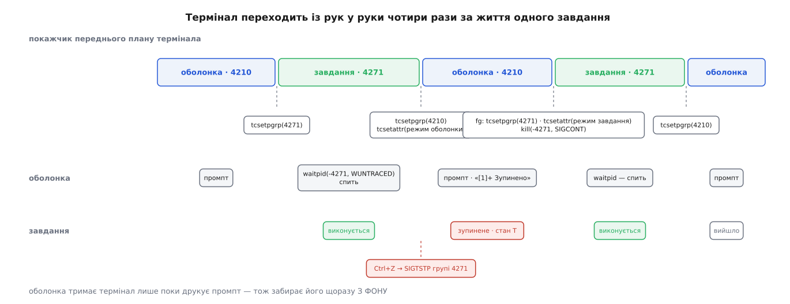

# ⚙️ Мінімальна оболонка, що правильно запускає завдання

Ось повна оболонка на C, яка вміє небагато — запустити конвеєр окремим завданням, віддати йому термінал, пережити `Ctrl+Z` і повернути зупинене завдання через `fg` чи `bg`, — зате робить це точно так, як `bash`. Керування завданнями зводиться до чотирьох викликів, і майже всі поломки саморобних оболонок — це кілька дрібниць, забутих біля цих чотирьох.

## Умова

Програма зветься `mysh`, читає рядок, розділяє його по `|` і запускає ланки одним завданням:

```
mysh$ find / -name core | grep -v proc | less
```

Вимоги — рівно ті, за якими впізнають робочу оболонку:

- `Ctrl+C` убиває завдання, а не оболонку; `Ctrl+Z` зупиняє завдання й повертає промпт;
- `fg` продовжує зупинене завдання разом із терміналом, `bg` — без термінала;
- `less` після `fg` малює екран так, наче його не чіпали, — отже, режим термінала теж повертається;
- запущені програми не перероблено: працюють справжні `/usr/bin/find` і `/usr/bin/less`, які про наше завдання нічого не знають.

Двох речей тут навмисно немає. Розбір рядка примітивний — ані лапок, ані підставлянь ([розкриття й лапки в оболонці](root:sys-unix/expansion-and-quoting)); і бухгалтерія `close` у конвеєрі не переказується, вона розібрана окремо ([конвеєр власними руками](root:sys-unix/pipe-and-fifo/proj-pipeline-by-hand.md)). Тут цікаве інше.

## Ідея: одна операція, за яку карають

Термінал зберігає одне число — номер групи переднього плану. Усе керування завданнями — це питання, хто й коли це число переставляє. За життя одного завдання оболонка переставляє його чотири рази: віддала при запуску, забрала на `Ctrl+Z`, віддала знову на `fg`, забрала, коли завдання вийшло.



*Оболонка тримає термінал лише поки друкує промпт: половину часу вона фонова, і саме з фону мусить забирати термінал назад.*

Складність не в передаваннях, а в охороні. Процес фонової групи, який чіпає **налаштування** термінала — `tcsetattr`, `tcsetpgrp`, — дістає `SIGTTOU`, і типова дія цього сигналу — зупинення. А оболонка забирає термінал саме тоді, коли вона фонова: доки завдання працює, покажчик переднього плану вказує на нього, а не на неї.

Звідси спокуслива й хибна думка: «отже, боронитися треба лише на поверненні». Коли оболонка **віддає** термінал, вона ще передня, і `tcsetpgrp` проходить безкарно — але щойно цей виклик повернувся, вона вже фонова, і наступний рядок тієї самої функції, `tcsetattr` із режимом термінала для завдання, уже карається. Тому `SIGTTOU` блокують на все передавання, в обидва боки.

Блокування тут не хитрість. POSIX описує його як передбачену поведінку: якщо той, хто викликає, блокує або нехтує `SIGTTOU`, операція просто виконується й жодного сигналу не надсилають — так сказано і про `tcsetpgrp`, і про `tcsetattr` ([диспозиція сигналу](root:sys-unix/signal-disposition) — три можливі долі сигналу: типова дія, нехтування, власний обробник).

> 🔧 **Навіщо це.** Оболонка, що забирає термінал наївно, не падає й не друкує помилки — вона тихо переходить у стан `T` і завмирає з порожнім екраном. Клавіатура при цьому теж мертва: покажчик переднього плану вказує на групу, у якій уже нікого немає, тож `Ctrl+C` нікому не адресовано. Симптом «термінал завис і не їсть процесора» майже завжди означає саме це, і перевіряється він одним поглядом на стовпчик `STAT` у `ps` із сусіднього вікна.

## Код

Стан оболонки — це збережений режим термінала й одне завдання. Списку завдань тут немає свідомо: другий і третій запис нічого не додають до механіки.

:::code proj-shell-job-launch/c/kod.c

Обидва передавання термінала — окремі функції, і кожна починається з блокування `SIGTTOU`:

:::code proj-shell-job-launch/c/kod-2.c

Запуск самої оболонки складається з двох частин, і порядок між ними важить:

:::code proj-shell-job-launch/c/kod-3.c

Дитина між `fork` і `exec` робить три речі, і жодну з них не можна перекласти на батька:

:::code proj-shell-job-launch/c/kod-4.c

Чекання винесене окремо, бо вся його суть — в одному прапорці:

:::code proj-shell-job-launch/c/kod-5.c

Запуск завдання. Групу створюють двічі — і в дитині, і в батькові:

:::code proj-shell-job-launch/c/kod-6.c

Відновлення — дві короткі функції, у яких видно всю різницю між `fg` і `bg`:

:::code proj-shell-job-launch/c/kod-7.c

Головний цикл нецікавий рівно настільки, наскільки цікаве все попереднє:

:::code proj-shell-job-launch/c/kod-8.c

## Перевірка

```
$ cc -O2 -Wall -o mysh mysh.c
$ ./mysh
mysh$ find / -name core | grep -v proc | less
```

Натисніть `Ctrl+Z` — і подивіться з сусіднього вікна, що саме вийшло:

```
mysh$ 
[1]+ Зупинено   find / -name core | grep -v proc | less
mysh$
```

```
$ ps -o pid,pgid,tpgid,stat,cmd -t pts/5
  PID  PGID TPGID STAT CMD
 4210  4210  4210 S+   ./mysh
 4271  4271  4210 T    find / -name core
 4272  4271  4210 T    grep -v proc
 4273  4271  4210 T    less
```

Читається це так. Три ланки — одна група 4271, і всі три в стані `T`: `Ctrl+Z` дістав усіх, хоча оболонка назвала терміналові лише один номер — 4271. Сигналу вона при цьому не надсилала зовсім: `SIGTSTP` розіслала лінійна дисципліна, і розіслала за тим самим номером. `TPGID` знову 4210, тобто термінал повернувся до оболонки, і плюс у стовпчику `STAT` тепер у неї. `fg` поверне картинку `less` цілою, `bg` — випустить конвеєр працювати далі без клавіатури.

## Складність і пастки

**Забутий `SIGTTOU` зупиняє оболонку.** Приберіть `sigprocmask` із `take_terminal` — і після першого ж завершеного завдання оболонка сама себе зупинить на `tcsetpgrp`. Промпт не повернеться, `Ctrl+C` теж не допоможе: покажчик переднього плану вказує на групу, у якій уже нікого немає. Оживити можна лише ззовні — `kill -CONT` із сусіднього термінала, — і на наступному завданні все повториться.

**Забутий `WUNTRACED` робить зупинене завдання невидимим.** Без цього прапорця `waitpid` повідомляє лише про смерть, а зупинення для нього — не подія. Оболонка спатиме, завдання стоятиме в стані `T` і триматиме термінал, а виглядатиме це як «програма зависла». Прапорця тут вимагає сама конструкція: для того, хто керує завданнями, зупинення — така сама подія, як завершення ([завершення, wait і зомбі](root:sys-unix/exit-wait-zombies) — статус дитини живе в ядрі, доки батько його не забере; `WCONTINUED` — дзеркальний прапорець про продовження).

**Щілина між `fork` і `exec` закривається лише подвоєнням.** Обидва виклики `setpgid` потрібні, і помилку батьківського треба ігнорувати: `EACCES` означає, що дитина вже зробила `exec` (отже, групу вона поставила собі сама), `ESRCH` — що вона встигла вийти. Обидва — нормальний перебіг, а не збій. І `give_terminal` можна кликати лише після того, як батьківський `setpgid` повернувся: інакше групи з таким номером ще не існує, і `tcsetpgrp` відповість `EPERM`.

**Нехтування переживає `exec`.** Якщо в `child_prepare` не скинути диспозиції, знехтувані сигнали оболонки переїдуть у запущену програму, і жодна команда, запущена з вашої оболонки, не відреагує на `Ctrl+C` та `Ctrl+Z`. Симптом упізнаваний: у `bash` те саме працює, у вашій оболонці — ні. Маска сигналів переїжджає так само, тому в дитині її знімають окремим рядком ([exec: заміна образу](root:sys-unix/exec-semantics) — що саме переживає заміну коду).

**Режим термінала належить завданню, а не оболонці.** Не збережете `tmodes` у мить зупинення — `less` після `fg` прокинеться в канонічному режимі з відлунням: сама програма вважає, що термінал сирий, а він уже ні. Не повернете `shell_tmodes` собі — промпт лишиться без відлуння й без редагування рядка ([TTY і послідовний порт: модель termios](root:sys-unix/tty-and-termios) — набір прапорців, які визначають, чи перетворює драйвер натискання на сигнали і чи віддає рядок по символу).

**Про фонові завдання ця оболонка не дізнається сама.** Вона не чекає на них, тож вони лишаються зомбі, а їхні зупинення й смерті проходять повз неї. Справжня оболонка ловить `SIGCHLD`, збирає статуси через `waitpid(-1, …, WNOHANG | WUNTRACED)` і друкує сповіщення не в обробнику, а перед наступним промптом — бо `printf` в обробнику робити не можна ([що взагалі можна робити в обробнику сигналу](root:sys-unix/async-signal-safety) — перелік викликів, безпечних усередині асинхронного обробника). Звідти ж і звичка `bash` показувати «Завершено» із запізненням на один рядок.

І наостанок дрібниця, яка добре показує, що механізм працює рівно так, як описано: `Ctrl+Z` на промпті `mysh` не робить нічого. `SIGTSTP` іде групі переднього плану — а це наша оболонка, яка цей сигнал нехтує. Зупинити її з `bash` не вийде взагалі; справжні оболонки тримають для цього окрему вбудовану команду `suspend`, яка надсилає `SIGSTOP` самій собі — сигнал, якого не можна ані знехтувати, ані перехопити ([керування завданнями й термінальні сигнали](root:sys-unix/job-control) — домовленості, за якими оболонка розкладає команди по завданнях).
