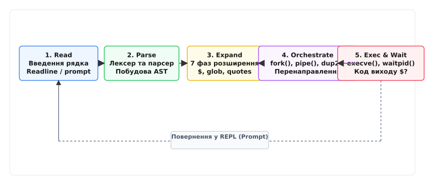
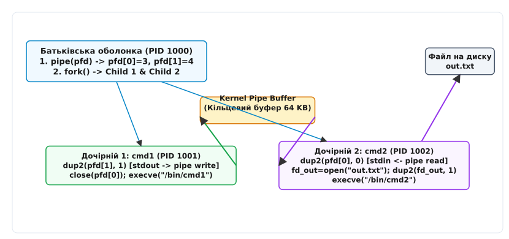

# Оболонка: що вона робить насправді

<preknowlist>
- [Концепції ядра Linux](root:sys-unix/kernel-and-userspace) — системні виклики, простір користувача та межа привілеїв.
- [Три потоки: stdin, stdout, stderr](root:sys-unix/standard-streams) — файлові дескриптори, таблиця відкритих файлів ядра та стандартні потоки.
- [Сесії та групи процесів](root:sys-unix/sessions-and-process-groups) — ієрархія PID, PGID, SID та керування терміналом.
</preknowlist>

Коли користувач вводить у терміналі команду `ls -l | grep txt > result.txt`, ядро Linux не розуміє жодного з цих слів. Операційна система на фундаментальному рівні оперує числовими ідентифікаторами процесів (PID), файловими дескрипторами, сторінками оперативної пам'яті та таблицями сторінок. Перетворення текстового рядка користувача на структурований граф процесів, з'єднаних каналами передачі даних, виконує окрема програма простору користувача — командна оболонка (англ. *shell* — мушля, захисна оболонка навколо ядра).

Оболонка є не просто командним інтерпретатором чи текстовим інтерфейсом. Вона виступає системним оркестратором процесів і компілятором потоків даних, який транслює людські наміри у послідовність системних викликів ядра.

## 1. Першопричина: чому ядру Linux потрібен користувацький оркестратор

У класичній архітектурі Unix ядро операційної системи ізольоване у привілейованому режимі роботи процесора (Ring 0 / Supervisor Mode). Головне завдання ядра — забезпечити безпечний розподіл апаратних ресурсів (процесорного часу, оперативної пам'яті, пристроїв введення-виведення) між неуповноваженими програмами простору користувача (Ring 3 / User Mode) за допомогою системних викликів (англ. *system calls*, `syscall`).

Ядро відповідає за підтримку низькорівневих таблиць сторінок пам'яті (Page Tables), перемикання контексту процесів (Context Switch), обробку апаратних переривань та підтримку віртуальної файлової системи (VFS). Воно функціонує як суворий менеджер ресурсів, але не володіє жодною логікою щодо того, *навіщо* і *в якій послідовності* користувач бажає ці ресурси комбінувати. Ядро не знає поняття «рядковий синтаксис сценарію» — воно оперує структурованими бінарними структурами та системними викликами `sys_clone`, `sys_execve` та `sys_pipe2`.

Якби ядро Linux містило в собі вбудований синтаксичний аналізатор команд та текстовий промпт, це призвело б до трьох системних катастроф:

1. **Порушення принципу найменших привілеїв:** Будь-яка синтаксична помилка, переповнення буфера або зависання у коді розбору тексту відбувалися б у режимі ядра, спричиняючи негайний крах всієї операційної системи (kernel panic).
2. **Неможливість еволюції інтерфейсу:** Зміна порядку підстановки змінних, додавання нових операторів або налаштування гарячих клавіш вимагали б перекомпіляції та перезавантаження всієї операційної системи.
3. **Жорстка прив'язка до політик:** Ядро Linux відповідає за *механізми* (як створити процес, як відкрити файл), але не за *політики* (які утиліти заповнюють конвеєр і в якому порядку).

З цих причин архітектура Unix із самого початку відокремила інтерпретатор команд від ядра. Оболонка (`/bin/sh`, `/bin/bash`, `/bin/zsh`, `/bin/dash`) є звичайною програмою простору користувача. Вона не має жодних особливих привілеїв ядра і взаємодіє з операційною системою через той самий стандартний POSIX API, що й будь-який утилітарний софт. Більш детально про еволюцію та передумови цього рішення розказано в [Історії відокремлення оболонки від ядра](root:sys-unix/shell-role/hist-unix-shell-decoupling.md).

```
┌─────────────────────────────────────────────────────────────────────────┐
│                       ПРОСТІР КОРИСТУВАЧА (USER SPACE)                   │
│                                                                         │
│  ┌──────────────────┐    Текст    ┌──────────────────────────────────┐  │
│  │ Термінал / PTY   │────────────►│ Командна оболонка (/bin/bash)    │  │
│  └──────────────────┘             └──────────────────────────────────┘  │
│                                                     │                   │
│                                     fork(), execve(), pipe(), dup2()    │
│                                                     │                   │
└─────────────────────────────────────────────────────┼───────────────────┘
                                                      │ Syscall Boundary
┌─────────────────────────────────────────────────────▼───────────────────┐
│                           ЯДРО LINUX (KERNEL SPACE)                     │
│                                                                         │
│  ┌──────────────────┐    ┌──────────────────┐    ┌───────────────────┐  │
│  │ Планувальник     │    │ Таблиця VFS / FD │    │ Буфери каналів    │  │
│  │ процесів (PID)   │    │ (Open Files)     │    │ (Pipe Buffers)    │  │
│  └──────────────────┘    └──────────────────┘    └───────────────────┘  │
└─────────────────────────────────────────────────────────────────────────┘
```

## 2. Оболонка як посередник: концепція REPL та мова склеювання

Діяльність оболонки розгортається у двох фундаментальних ролях: інтерактивного інтерфейсу користувача та мови зв'язування компонентів.

### Цикл REPL та взаємодія з терміналом
В інтерактивному режимі оболонка працює як нескінченний цикл REPL (англ. *Read-Eval-Print Loop* — читання, обчислення, друк, повторення):

1. **Read (Читання):** Оболонка виводить запрошення командного рядка (prompt) і очікує на введення користувача. На цьому етапі вона взаємодіє з драйвером термінала (псевдотерміналом `/dev/pts/X`) та бібліотеками редагування рядка (`readline` або ZLE).
   - За замовчуванням драйвер термінала перебуває в **канонічному режимі (canonical mode)**: байти введення буферизуються драйвером всередині ядра і передаються оболонці лише після натискання клавіші `Enter`.
   - Для забезпечення автодоповнення по клавіші `Tab`, переміщення курсора стрілками чи інкрементного пошуку по історії `Ctrl+R` бібліотека `readline` перемикає термінал у **неканонічний режим (raw mode)** через системний виклик `tcsetattr()`. У цьому режимі кожен байт із клавіатури негайно передається процесу оболонки. Після завершення збору рядка оболонка повертає канонічний режим для запуску зовнішніх утиліт.
2. **Eval (Оцінка / Обчислення):** Зчитаний сирий текстовий рядок піддається лексичному розбору, розбивається на токени, перевіряється на відповідність граматиці, проходить 7 фаз розширення та транслюється у граф системних викликів.
3. **Print (Друк):** Оболонка отримує код виходу завершеного завдання через системні виклики сімейства `wait`, зберігає його у спеціальній змінній `$?` і за потреби виводить статус.
4. **Loop (Повторення):** Цикл повертається до початку, виводячи новий prompt для наступної команди.


*Цикл REPL: послідовна обробка команди від введення рядка до збору коду виходу.*

### Механіка програмованого автодоповнення (Programmable Completion)
Під час фази читання рядка користувач натискає клавішу `Tab` (ASCII `0x09`). Бібліотека `readline`, перебуваючи в неканонічному режимі, перехоплює цей байт і звертається до зареєстрованої функції зворотного виклику `rl_attempted_completion_function`.

У сучасних оболонках (`bash`, `zsh`) реалізовано підсистему програмованого автодоповнення (англ. *Programmable Completion*). Замість примітивного пошуку файлів у поточному каталозі оболонка виконує контекстний розбір введеного фрагмента команди та викликає спеціалізовані скрипти обробки.

#### Контракт середовища автодоповнення
Перед передачею керування функції автодоповнення інтерпретатор ініціалізує набір службових змінних:

- `COMP_LINE` — повний нерозібраний рядок команди, що наразі введений у буфері термінала.
- `COMP_POINT` — цілочисельний байтовий зсув поточної позиції курсора відносно початку `COMP_LINE`.
- `COMP_WORDBREAKS` — рядок символів-роздільників слів (за замовчуванням ` \t\n"'><=;|&(:`), які використовуються лексером `readline` для розбиття рядка на токени.
- `COMP_WORDS` — індексований масив слів, отриманих після розбиття `COMP_LINE` за символами `COMP_WORDBREAKS`.
- `COMP_CWORD` — числовий індекс у масиві `COMP_WORDS`, що вказує на слово, у якому безпосередньо розташований курсор (`COMP_POINT`).
- `COMP_KEY` — ASCII-код клавіші, яка ініціювала виклик автодоповнення (зазвичай `9` для клавіші `Tab`).
- `COMP_TYPE` — числовий режим автодоповнення (`9` для стандартного відображення, `63` для виведення списку варіантів `?`, `33` для циклічного перебору).
- `COMPREPLY` — вихідний масив результатів, який заповнює функція автодоповнення. `readline` зчитує цей масив і підставляє єдиний варіант або виводить список підказок.

#### Механізм утиліти `compgen` та реєстрації `complete`
Вбудована команда `complete` зв'язує ім'я цільової утиліти з обробником:

```bash
# Синтаксис реєстрації:
# -F _func_name: вказує функцію оболонки, що генерує варіанти
# -o default: дозволяє fallback на стандартне автодоповнення файлів при порожньому COMPREPLY
# -o nospace: запобігає автоматичній вставці пробілу після підстановки (корисно для шляхів та опцій з '=')
complete -F _docker_complete -o default -o nospace docker
```

Вбудована команда `compgen` виконує лексичну фільтрацію кандидатів проти поточного слова `$cur`:

- `compgen -W "start stop restart status" -- "$cur"` — генерує збіги зі списку слів.
- `compgen -f -- "$cur"` — повертає імена файлів.
- `compgen -d -- "$cur"` — повертає виключно імена каталогів.
- `compgen -u -- "$cur"` — повертає системних користувачів із `/etc/passwd`.
- `compgen -c -- "$cur"` — повертає всі доступні виконувані команди, функції, аліаси та вбудовані утиліти.
- `compgen -A variable -- "$cur"` — повертає імена змінних середовища.

#### Приклад контекстно-залежної функції автодоповнення
Розглянемо практичну реалізацію автодоповнення для системної утиліти керування службами:

:::code shell-role-d/sh/service-ctl-completion.bash

#### Архітектура динамічного завантаження (Dynamic Completion Loading)
У сучасних дистрибутивах Linux одночасне завантаження тисяч скриптів автодоповнення під час запуску інтерактивної оболонки суттєво уповільнило б старт процесу і витратило мегабайти оперативної пам'яті. Тому пакунок `bash-completion` використовує ліниве завантаження (англ. *lazy-loading*).

Оболонка встановлює глобальну функцію-пастку `_completion_loader`. Коли користувач уперше натискає `Tab` після введення команди (наприклад, `git`), `_completion_loader` шукає відповідний файл у системному каталозі `/usr/share/bash-completion/completions/git`. Знайдений скрипт виконується (`source`), реєструє справжній обробник `complete -F _git git` і негайно перезапускає цикл генерації `COMPREPLY`.

### Філософія мови склеювання (Glue Language)
Оболонка суттєво відрізняється від мов загального призначення (C, C++, Rust, Python). Її головна мета — не числові обчислення чи маніпуляція структурами даних у пам'яті, а координація виконання незалежних бінарних програм.

Оболонка реалізує фундаментальний принцип філософії Unix: створення малих монофункціональних програм, які не знають одна про одну, але можуть бути об'єднані через стандартизований інтерфейс байтових потоків. Оболонка виступає «клеєм» (англ. *glue*), що з'єднує вихід одного процесу із входом іншого без необхідності змінювати сирцевий код самих утиліт чи зберігати проміжні файли на диск.

```bash
# Приклад композиції: пошук 5 найбільш ресурсомістких процесів
# Кожна утиліта робить одну річ, оболонка склеює їхні потоки
ps aux | awk '{print $3, $11}' | sort -rn | head -n 5
```

## 3. 7-етапний конвеєр синтаксичного розбору рядка в POSIX Shell

Коли рядок зчитано, оболонка не викликає системні програми негайно. Вона пропускає текст крізь суворо стандартизований конвеєр синтаксичного аналізу та підстановок, визначений специфікацією POSIX.1-2017. Порядок виконання цих етапів є незмінним.

```
[ Сирий рядок користувача ]
            │
            ▼
┌────────────────────────────────────────┐
│ 1. Токенізація (Tokenization)          │ ──► Розбиття на слова та метасимволи
└────────────────────────────────────────┘
            │
            ▼
┌────────────────────────────────────────┐
│ 2. Синтаксичний розбір граматики (AST) │ ──► Дерево команд, пайпів та списків
└────────────────────────────────────────┘
            │
            ▼
┌────────────────────────────────────────┐
│ 3. Розкриття (Expansions)              │ ──► ~, $VAR, $(cmd), $((a+b))
└────────────────────────────────────────┘
            │
            ▼
┌────────────────────────────────────────┐
│ 4. Розщеплення слів (Word Splitting)   │ ──► Розбиття по $IFS (лише без лапок)
└────────────────────────────────────────┘
            │
            ▼
┌────────────────────────────────────────┐
│ 5. Генерація імен файлів (Globbing)    │ ──► Розгортання *, ?, [...] у VFS
└────────────────────────────────────────┘
            │
            ▼
┌────────────────────────────────────────┐
│ 6. Видалення лапок (Quote Removal)     │ ──► Зняття захисних ' та "
└────────────────────────────────────────┘
            │
            ▼
┌────────────────────────────────────────┐
│ 7. Перенаправлення (Redirection Setup) │ ──► Налаштування дескрипторів <, >, >>
└────────────────────────────────────────┘
            │
            ▼
[ Готовий масив argv для execve() ]
```

### Етап 1: Токенізація та розбиття на слова (Tokenization)
Лексичний аналізатор (лексер) переглядає вхідний потік байтів символ за символом. Його завдання — виділити неподільні синтаксичні одиниці (токени, від англ. *token* — знак, жетон).

Роздільниками між токенами слугують **метасимволи** POSIX: `space`, `tab`, `newline`, а також операторні символи:
- Вертикальна риска `|`
- Амперсанд `&`
- Крапка з комою `;`
- Дужки `(` та `)`
- Знаки перенаправлення `<` та `>`

Якщо символ не є метасимволом і не екранований, він накопичується у буфері поточного токена-слова. Зворотний слеш `\` та лапки тимчасово вимикають спеціальне значення метасимволів під час лексичного аналізу.

### Етап 2: Синтаксичний розбір граматики (Parsing)
Парсер перетворює лінійний потік токенів на абстрактне синтаксичне дерево (AST, англ. *Abstract Syntax Tree*). На цьому рівні розпізнаються граматичні структури:
- **Прості команди (Simple Commands):** послідовність слів та перенаправлень.
- **Конвеєри (Pipelines):** команди, з'єднані оператором `|`.
- **Списки (Lists):** команди, з'єднані логічними операторами `&&` (AND), `||` (OR), крапкою з комою `;` або фоновим амперсандом `&`.
- **Блоки групування:** круглі дужки `( list )`, що позначають виконання списку у під-оболонці (subshell), та фігурні дужки `{ list; }`, що групують команди в поточному процесі.

Детальні правила граматики описані в [Довіднику граматики та послідовності підстановок POSIX shell](root:sys-unix/shell-role/api-posix-shell-grammar.md).

### Етап 3: Розкриття та підстановки (Expansions)
На цьому етапі оболонка обчислює динамічні значення всередині токенів. Підстановки виконуються у такому порядку:

1. **Brace Expansion (Розширення фігурних дужок):** Породжує множинні текстові комбінації до початку аналізу змінних (наприклад, `file_{A,B}.c` перетворюється на два слова `file_A.c` та `file_B.c`). Це розширення є стандартом для `bash`/`zsh`/`ksh`.
2. **Tilde Expansion (Розширення тильди):** Замінює `~` на вміст змінної `$HOME`, а `~username` — на домашній каталог відповідного користувача з бази даних облікових записів (`/etc/passwd`).
3. **Parameter Expansion (Підстановка параметрів):** Замінює вирази `$VAR` або `${VAR:-default}` на відповідні значення змінних середовища чи локальних змінних.
4. **Command Substitution (Підстановка результатів команд):** Вирази вигляду `$(command)` або застарілі `` `command` `` змушують оболонку створити під-оболонку, спрямувати її стандартний вивід у канал, зчитати всі згенеровані байти, видалити кінцеві символи переходу на новий рядок `\n` і вставити отриманий текст на місце виклику.
5. **Arithmetic Expansion (Арифметичні підстановки):** Вирази `$(( 5 * 10 + 2 ))` обчислюються як цілочисельні математичні вирази.

### Етап 4: Розщеплення слів (Word Splitting)
Результати підстановки параметрів, команд та арифметики, якщо вони **не були взяті у подвійні лапки**, піддаються процедурі розщеплення на окремі слова.

Розділювачами виступають символи, визначені у спеціальній змінній середовища `IFS` (англ. *Internal Field Separator*). За замовчуванням `IFS` містить пробіл, знак табуляції та символ нового рядка (`<space><tab><newline>`).

> ⚠️ **Пастка Word Splitting:** Якщо змінна містить пробіли (`DOC="annual report.pdf"`), невжиття лапок у виклику `rm $DOC` призведе до того, що на фазі розщеплення команда `rm` отримає **два окремих аргументи**: `annual` та `report.pdf`. У результаті буде видалено помилкові файли. Подвійні лапки `"$DOC"` повністю вимикають фазу Word Splitting, гарантуючи передачу рядка як єдиного аргументу.

### Етап 5: Генерація імен файлів (Filename Globbing / Pathname Expansion)
Якщо після розщеплення токен містить не екрановані метасимволи `*`, `?` або `[...]`, оболонка розглядає його як шаблон шляху до файлів:
- `*` відповідає будь-якій послідовності символів (окрім крапки на початку імені файла, якщо вона не вказана явно).
- `?` відповідає рівно одному довільному символу.
- `[a-z]` відповідає будь-якому символу із зазначеного діапазону.

Оболонка викликає системні функції сканування каталогів VFS (`opendir()`, `readdir()`, `closedir()`), порівнює записи з шаблоном за допомогою алгоритму `fnmatch()` і сортує знайдені імена у лексикографічному порядку відповідно до поточної локалі `LC_COLLATE`. Якщо збігів не знайдено, стандарт POSIX наказує залишити сам рядок шаблону без змін.

### Етап 6: Видалення лапок (Quote Removal)
Після завершення всіх підстановок, розщеплень та генерації шляхів оболонка видаляє службові лапки `'...'` та `"..."`, а також символи екранування `\`, які не були самі екрановані. Вони виконали свою роль захисту тексту на попередніх етапах і не повинні передаватися у масив аргументів програми.

### Етап 7: Налаштування перенаправлень (Redirection Setup)
Оболонка вилучає зі списку аргументів оператори перенаправлення (`<`, `>`, `>>`, `2>&1`, `<<EOF`, `<<<`) та пов'язані з ними імена файлів або номери дескрипторів. Вона готує конфігурацію файлових дескрипторів для дочірнього процесу перед викликом `execve()`.

Порядок перенаправлення дескрипторів обчислюється суворо зліва направо:

```bash
# Демонстрація важливості порядку перенаправлення дескрипторів:
# Варіант 1: обидва потоки записуються у log.txt
# 1 спрямовується у log.txt, після чого 2 копіює дескриптор 1
cmd > log.txt 2>&1

# Варіант 2: stderr залишається на терміналі, stdout іде у log.txt
# 2 дублює поточний 1 (термінал), а потім 1 перемикається на файл
cmd 2>&1 > log.txt
```

### Механіка вбудованого вводу: Here-Documents (<<) та Here-Strings (<<<)
Для передачі багаторядкового тексту або рядкових змінних безпосередньо у стандартний ввід команд без створення постійних файлів на диску оболонка надає спеціалізовані оператори вбудованого перенаправлення:

1. **Here-Documents (`<<DELIMITER`):**
   Оболонка переходить у режим випереджувального читання рядків із вхідного потоку сценарію доти, доки не зустріне рядок, що містить виключно слово-обмежувач `DELIMITER`.
   - **Незалапкований обмежувач (`<<EOF`):** Всередині тіла документа оболонка виконує підстановку параметрів (`$VAR`), арифметики (`$((1 + 1))`) та підстановку результатів команд (`$(date)`). Символ зворотного слеша `\` зберігає функцію екранування для символів `$`, `` ` ``, `\` та переходу на новий рядок.
   - **Залапкований обмежувач (`<<'EOF'`, `<<"EOF"`, `<<\EOF`):** Якщо бодай один символ обмежувача взято в лапки або екрановано, усі підстановки всередині тіла документа **повністю вимикаються**. Текст передається процесу дослівно як сирий байтовий потік (verbatim).
   - **Відсікання табуляцій (`<<-EOF`):** Модифікатор дефіса наказує оболонці автоматично видаляти всі початкові символи горизонтальної табуляції (ASCII `0x09` / `\t`) з кожного рядка корисного навантаження, а також із самого рядка обмежувача `EOF`. Це дозволяє вирівнювати тіло документа за відступами функцій у сирцевому коді сценарію, не вносячи зайвих пробілів чи табуляцій у вхідні дані програми.

2. **Низькорівнева реалізація Here-Document у просторі ядра:**
   Щоб передати тіло Here-Document у стандартний ввід (FD 0) нащадка, оболонка повинна надати системі дійсний файловий дескриптор:
   - **Класичний механізм через анонімний unlinked-файл:** Оболонка створює тимчасовий файл у каталозі `/tmp` за допомогою системного виклику `mkstemp()` або прапорця `open(O_TMPFILE | O_RDWR)`. Оболонка записує підготовлене тіло документа у файл і **негайно викликає `unlink()`**. Файл вилучається з простору імен каталогів VFS, але його індексний вузол (inode) та дискові блоки залишаються зарезервованими ядром, доки відкритий дескриптор утримується процесом. Оболонка викликає `lseek(fd, 0, SEEK_SET)` для перемотування позиції читання на початок і дублює дескриптор через `dup2(fd, STDIN_FILENO)` у дочірньому процесі. Після завершення нащадка ядро автоматично вивільняє зайняті блоки.
   - **Сучасний механізм через `memfd_create`:** У сучасних версіях Linux оболонка може виділити анонімний файловий дескриптор у оперативній пам'яті через `memfd_create("sh-heredoc", MFD_CLOEXEC)`. Текст завантажується у сторінковий кеш RAM без будь-яких звернень до фізичного диска.

3. **Here-Strings (`<<< "$STRING"`):**
   Синтаксичний цукор (розширення `bash`/`zsh`/`ksh`), який підставляє значення виразу `$STRING`, додає до нього символ переходу на новий рядок `\n` і спрямовує отриманий результат у стандартний ввід команди. Оболонка реалізує Here-Strings через неіменований канал ядра (`pipe()`) або невеликий буфер пам'яті: дані записуються у канал перед запуском дочірнього процесу, а кінець читання дублюється у FD 0.

## 4. Системні виклики та низькорівнева механіка життєвого циклу процесів

Після синтаксичного розбору та очищення аргументів оболонка переходить до безпосередньої оркестрації процесів через ядро операційної системи.

### Анатомія виконання конвеєра: `cmd1 | cmd2 > out.txt`
Розглянемо крок за кроком взаємодію оболонки з системними викликами ядра Linux під час виконання ланцюга з двох команд:

```
Батьківська оболонка (PID 1000)
  │
  ├─ 1. pipe2(pfd, O_CLOEXEC) ───► Створює кільцевий буфер ядра (64 KB)
  │                                pfd[0] = 3 (read), pfd[1] = 4 (write)
  │
  ├─ 2. fork() ──────────────────► Створює Child 1 (PID 1001)
  │     │                            ├─ setpgid(0, 1001) [Лідер групи]
  │     │                            ├─ dup2(pfd[1], 1)  [stdout -> pipe write]
  │     │                            ├─ close(pfd[0]), close(pfd[1])
  │     │                            └─ execve("/bin/cmd1", ["cmd1"], envp)
  │     │
  ├─ 3. fork() ──────────────────► Створює Child 2 (PID 1002)
  │                                  ├─ setpgid(0, 1001) [Вступає в групу 1001]
  │                                  ├─ dup2(pfd[0], 0)  [stdin <- pipe read]
  │                                  ├─ fd = open("out.txt", O_WRONLY|O_CREAT|O_TRUNC, 0644)
  │                                  ├─ dup2(fd, 1)      [stdout -> out.txt]
  │                                  ├─ close(fd), close(pfd[0]), close(pfd[1])
  │                                  └─ execve("/bin/cmd2", ["cmd2"], envp)
  │
  ├─ 4. close(pfd[0]), close(pfd[1]) [Критичний крок у батька!]
  │
  └─ 5. waitpid(1001), waitpid(1002) ──► Збирає статуси виходу WEXITSTATUS
```


*Перенаправлення та комутація файлових дескрипторів через системні виклики pipe(), dup2() та fork().*

1. **Створення каналу (`pipe` / `pipe2`):**
   Оболонка викликає `pipe2(pfd, O_CLOEXEC)`. Ядро виділяє в оперативній пам'яті кільцевий буфер (за замовчуванням у Linux — 64 КБ, що складається з 16 сторінок пам'яті `struct pipe_buffer`) і повертає оболонці два нових файлових дескриптори: `pfd[0]` (для читання) та `pfd[1]` (для запису).
2. **Спаун першого процесу (`fork` / `clone`):**
   Оболонка створює копію свого адресного простору за допомогою механізму Copy-On-Write (COW). У дочірньому процесі (Child 1):
   - Викликається `setpgid(0, getpid())` — процес стає лідером нової групи процесів.
   - Викликається `dup2(pfd[1], STDOUT_FILENO)` — дескриптор запису каналу атомарно підміняє стандартний вивід (FD 1).
   - Закриваються службові дескриптори `pfd[0]` та `pfd[1]`.
   - Викликається `execve()`, який завантажує виконуваний ELF-образ `cmd1`.
3. **Спаун другого процесу:**
   Оболонка викликає другий `fork()`. У дочірньому процесі (Child 2):
   - Викликається `setpgid(0, pid1)` — другий процес приєднується до групи першого нащадка.
   - Викликається `dup2(pfd[0], STDIN_FILENO)` — дескриптор читання каналу займає місце стандартного вводу (FD 0).
   - Викликається `open("out.txt", O_WRONLY | O_CREAT | O_TRUNC, 0644)`.
   - Викликається `dup2(fd_out, STDOUT_FILENO)`, підміняючи FD 1 файлом на диску.
   - Закриваються зайві відкриті дескриптори.
   - Викликається `execve()` для завантаження `cmd2`.
4. **Критичне закриття дескрипторів у батьківській оболонці:**
   Батьківський процес оболонки **зобов'язаний закрити** свої копії `pfd[0]` та `pfd[1]`. Якщо оболонка забуде закрити дескриптор запису `pfd[1]`, лічильник посилань ядра на записуючий кінець каналу ніколи не досягне нуля навіть після завершення `cmd1`. Як наслідок, `cmd2` ніколи не отримає сигнал кінця файлу (EOF, отримання 0 байтів при `read()`) і зависне у безкінечному очікуванні.
5. **Очікування та синхронізація (`waitpid`):**
   Оболонка призупиняє виконання та збирає статус нащадків за допомогою системного виклику `waitpid()`, перевіряючи статус макросами `WIFEXITED(status)` та `WEXITSTATUS(status)`.

### Оптимізації швидкісних конвеєрів: vfork(2), clone(2) та атомарний pipe2(2)

Класична пара викликів `fork()` та `execve()` накладає помітні накладні витрати на високопродуктивні конвеєри та системи складання програм (такі як `make -j` або `ninja`), що породжують тисячі дрібних процесів за секунду.

#### Накладні витрати стандартного `fork(2)`
Незважаючи на використання сторінкового оптимізатора Copy-On-Write (COW), системний виклик `fork()` змушений повністю скопіювати 4-рівневу таблицю сторінок пам'яті (Page Table Entries — PGD, P4D, PUD, PMD, PTE в архітектурі x86-64) батьківського процесу. Якщо оболонка чи керівний процес займає сотні мегабайтів у RAM, копіювання тисяч структур сторінок і подальше маркування кожної сторінки прапорцем `read-only` призводить до відчутної затримки та інвалідації кешів TLB (Translation Lookaside Buffer).

#### Семантика `vfork(2)` проти `fork(2)`
Системний виклик `vfork()` (введений в BSD Unix) був створений для сценаріїв, де дочірній процес викликає `execve()` негайно після створення:

1. `vfork()` **не копіює** таблиці сторінок пам'яті. Дочірній процес повністю поділяє адресний простір пам'яті батька (той самий `struct mm_struct` у ядрі).
2. Виконання батьківського процесу **призупиняється** ядром у стані `TASK_UNINTERRUPTIBLE` доти, доки дочірній процес не викличе `execve()` або `_exit()`.

> ⚠️ **Небезпека `vfork(2)`:** Оскільки дочірній процес виконується на тому самому стеку та в тій самій пам'яті, що й батько, будь-яка модифікація глобальних змінних чи локального стека, повернення з функції, що викликала `vfork()`, або виклик звичайного `exit()` (який скине буфери `stdio` батька та викличе деструктори `atexit`) спричинить незворотне пошкодження пам'яті батьківського процесу (Undefined Behavior).

#### Внутрішній механізм `clone(2)` з прапорцями `CLONE_VM` та `CLONE_VFORK`
В ядрі Linux системний виклик `vfork()` реалізовано поверх універсального системного виклику `clone()` з комбінацією прапорців:

```text
clone(CLONE_VM | CLONE_VFORK | SIGCHLD, 0)
```

- `CLONE_VM` наказує ядру призначити дескриптор пам'яті батька новоствореному процесу (`current->mm = parent->mm`) без виділення нових сторінкових таблиць.
- `CLONE_VFORK` змушує ядро ініціалізувати структуру завершення `completion` у батьківському `task_struct`. Батько блокується у черзі очікування `wait_for_vfork_done()`. Коли нащадок викликає `execve()` або завершується через `do_exit()`, функція ядра `mm_release()` сигналізує батькові про безпечне відновлення виконання.

#### Стандартизований інтерфейс `posix_spawn(3)`
Щоб уникнути ризиків ручного використання `vfork()` і зберегти високу швидкість створення процесів, стандарт POSIX визначає API `posix_spawn()` / `posix_spawnp()`.

У сучасній бібліотеці `glibc` на Linux виклик `posix_spawn()` виділяє окремий тимчасовий стек для нащадка і викликає `clone(CLONE_VM | CLONE_VFORK)`. Усі налаштування файлових дескрипторів та сигналів виконуються за заздалегідь підготовленими структурами дій без ризику пошкодити стек батька:

:::tabs
:::code shell-role-d/c/spawn_stage.c
:::code shell-role-d/cpp/spawn.cpp
:::

#### Атомарність `pipe2(2)` та запобігання витоку дескрипторів із `O_CLOEXEC`
У багатопотокових оболонках або під час асинхронного запуску під-оболонок виникає стан гонки (race condition) дескрипторів:

1. Потік **A** викликає `pipe(pfd)`.
2. Потік **A** планує виставити прапорець закриття при виконанні: `fcntl(pfd[0], F_SETFD, FD_CLOEXEC)`.
3. Проте між викликами `pipe()` та `fcntl()` планувальник перемикає процесор на Потік **B**, який викликає `fork()` та `execve()` для запуску незалежної фонової програми.
4. Новостворена програма випадково **успадковує відкритий дескриптор запису каналу** `pfd[1]`.
5. Коли первинний конвеєр завершує роботу, дескриптор `pfd[1]` залишається відкритим у сторонньому процесі Потоку B. Читач каналу ніколи не отримає EOF (0 байтів) і зависне у нескінченному очікуванні (Deadlock).

Системний виклик `pipe2(pfd, O_CLOEXEC)` усуває це вікно гонки: ядро Linux виставляє біт `FD_CLOEXEC` безпосередньо у момент створення структур дескрипторів у VFS до того, як вони стануть доступними у просторі користувача.

### Підстановка процесів (Process Substitution) проти лінійних конвеєрів
Класичний конвеєр `cmd1 | cmd2` зв'язує процеси строго лінійно за схемою «один до одного»: стандартний вивід першої команди з'єднується зі стандартним вводом другої. Проте утиліти на кшталт `diff`, `comm`, `cmp` або `join` потребують передачі двох або більше незалежних потоків одночасно у вигляді позиційних аргументів-шляхів до файлів (`diff file1 file2`).

Механізм **підстановки процесів (Process Substitution)** розв'язує цю задачу, емулюючи файлові шляхи для динамічних потоків даних:

- `<(command)` — вхідна підстановка: оболонка запускає `command` асинхронно, підключає її `stdout` до каналу і підставляє у командний рядок шлях до псевдофайла, з якого головна програма може читати згенерований потік.
- `>(command)` — вихідна підстановка: оболонка запускає `command` асинхронно, підключає її `stdin` до каналу і підставляє шлях до псевдофайла, у який головна програма може записувати вивід.

```bash
# Порівняння відсортованих списків без запису проміжних файлів на диск:
diff -u <(sort list_a.txt) <(sort list_b.txt)

# Одночасне дублювання виводу у стиснутий архів та віддалений лог-сервер:
tar -cf - /var/log | tee >(gzip > logs.tar.gz) >(nc -q 1 logserver.lan 5000) > /dev/null
```

#### Взаємодія з VFS та псевдофайли /dev/fd/N
Під час обробки виразу `<(command)` оболонка виконує таку послідовність кроків:

1. Викликає системний виклик `pipe2(pfd, O_CLOEXEC)`.
2. Створює дочірній процес через `fork()`. У дочірньому процесі дескриптор запису `pfd[1]` дублюється на місце `STDOUT_FILENO` via `dup2()`, дескриптор `pfd[0]` закривається, і викликається `execve()` для запуску `command`.
3. У батьківському процесі рядок `<(command)` у масиві аргументів замінюється на шлях до псевдофайла: `/dev/fd/<pfd[0]>` (наприклад, `/dev/fd/63`).
4. На операційних системах без підтримки файлової системи `/dev/fd` (або за відсутності змонтованої `fdescfs`) оболонка створює іменований канал (FIFO) у тимчасовому каталозі via `mkfifo("/tmp/sh-np-XXXXXX", 0600)` і підставляє його шлях.
5. Головна програма (наприклад, `diff`) викликає стандартний системний виклик `open("/dev/fd/63", O_RDONLY)`. Ядро Linux через віртуальну файлову систему `procfs` (де `/dev/fd` є символічним посиланням на `/proc/self/fd`) дублює відкритий дескриптор каналу ядра у таблицю дескрипторів викликаючого процесу.

#### Системні відмінності та інженерні обмеження підстановки процесів
Хоча синтаксично підстановка процесів схожа на передачу звичайного файла, на рівні ядра вона володіє принциповими обмеженнями:

- **Неможливість довільного позиціювання (Non-seekable Streams):** Дескриптор `/dev/fd/N` вказує на кільцевий буфер каналу ядра, а не на регулярний блоковий файл файлової системи. Будь-яка спроба програми виконати системний виклик довільного зміщення `lseek(fd, offset, SEEK_SET)` негайно повертає помилку ядра `-1` з кодом `errno = ESPIPE` (*Illegal seek*). Програми, що вимагають обов'язкового випадкового доступу (наприклад, СКБД SQLite, архіватори з читанням центрального каталогу в кінці файла або лінкери), зазнають краху при передачі їм `<(command)`.
- **Асинхронний життєвий цикл та втрата кодів виходу:** У звичайному конвеєрі `cmd1 | cmd2` оболонка очікує завершення обох процесів via `waitpid()` і може зберегти їхні коди виходу. При використанні `cmd <(subcmd)` процес `subcmd` функціонує як незалежний фоновий процес. Батьківська оболонка синхронізується через `waitpid()` виключно з `cmd`. Якщо `subcmd` аварійно впаде з помилкою, її код виходу не потрапить у системну змінну `$?`. Якщо ж `cmd` завершиться раніше, ніж `subcmd` згенерує всі дані, ядро надішле процесу `subcmd` сигнал `SIGPIPE` при наступній спробі системного виклику `write()`.

Практичну реалізацію цього механізму можна дослідити у проєкті [Мінімальний оркестратор процесів мовами C та C++](root:sys-unix/shell-role/proj-mini-shell.md).

## 5. Вбудовані команди (Builtins) проти зовнішніх бінарників

Не кожне слово, введене на початку рядка, перетворюється на новий процес. Оболонка здійснює пошук команди за чіткою ієрархією.

### Чому `cd` не може бути окремим бінарником
Кожен процес у Linux має власну структуру даних у просторі ядра — дескриптор процесу `task_struct`. Всередині цієї структури поле `fs->pwd` вказує на поточний робочий каталог (CWD, англ. *Current Working Directory*) процесу.

Системний виклик `chdir()` змінює значення `fs->pwd` **виключно для того процесу, який цей виклик здійснив**. 

Якщо дочірній процес створюється через `fork()`, він отримує копію стану батька. Зміна каталогу всередині дочірнього процесу оновить його локальний `task_struct->fs->pwd`. Коли дочірній процес завершить роботу через `exit()`, його пам'ять і структури будуть знищені. Батьківська оболонка залишиться у своєму початковому каталозі.

Саме тому команди маніпуляції станом процесу обов'язково реалізуються як **вбудовані команди (builtins)** і виконуються безпосередньо в основному процесі оболонки.

```
Спроба виконати "cd" як зовнішній бінарник:
┌────────────────────────────────────────────────────────┐
│ Батьківська оболонка (PID 1000, CWD = /home/user)      │
│   │                                                    │
│   ├─ fork() ──► Дочірній процес /bin/cd (PID 1001)     │
│   │               ├─ chdir("/tmp") [Змінив свій CWD]   │
│   │               └─ exit(0)       [Знищено ядром]     │
│   │                                                    │
│   └─ waitpid() ──► CWD батька залишається /home/user!  │
└────────────────────────────────────────────────────────┘
```

### Класифікація вбудованих команд
POSIX поділяє всі команди оболонки на кілька рівнів:

| Категорія | Приклади команд | Механізм виконання | Призначення |
| :--- | :--- | :--- | :--- |
| **Special Builtins** | `exec`, `eval`, `export`, `readonly`, `set`, `shift`, `trap`, `unset`, `.` (source) | Виконуються в поточному процесі оболонки. Помилка виконання перериває неінтерактивний скрипт. | Маніпуляція станом середовища, опціями та заміщенням образу процесу. |
| **Regular Builtins** | `cd`, `pwd`, `read`, `echo`, `kill`, `test` (`[`), `wait`, `umask` | Виконуються в поточному процесі оболонки. Помилка повертає ненульовий статус `$?`, але не перериває скрипт. | Базові операції навігації, читання та оптимізація продуктивності. |
| **Shell Functions** | Функції, оголошені користувачем `my_func() { ... }` | Виконуються в контексті поточної оболонки. | Модульність та повторне використання коду. |
| **External PATH Binaries** | `/usr/bin/ls`, `/usr/bin/grep`, `/usr/bin/find` | Створюють новий процес через `fork()` + `execve()`. | Самостійні скомпільовані бінарні програми та утиліти. |

### Призначення ключових спеціальних команд
- `export`: додає змінну до списку експортованих змінних, які копіюються в глобальний масив `char **environ` для всіх майбутніх дочірніх процесів під час виклику `execve()`.
- `exec`: заміщує поточний образ пам'яті оболонки новою бінарною програмою через системний виклик `execve()` без створення нового дочірнього процесу через `fork()`. PID процесу залишається незмінним.
- `trap`: реєструє дії у відповідь на отримання сигналів операційної системи (`SIGINT`, `SIGTERM`, `EXIT`).
- `eval`: змушує оболонку повторно прогнати аргументи крізь усі 7 фаз розширення та парсингу перед виконанням.
- `read`: зчитує рядок із дескриптора стандартного вводу безпосередньо у внутрішні змінні поточної оболонки.
- `pwd`: вбудована версія `pwd` повертає кешоване значення з внутрішньої змінної `$PWD`, уникаючи тривалого обходу дерева VFS функцією `getcwd()`.

## 6. Обробка сигналів та керування завданнями (Job Control)

Керування завданнями (англ. *Job Control*) — це підсистема оболонки, яка дозволяє користувачеві керувати одночасним виконанням декількох конвеєрів з одного термінала.

### Ієрархія ідентифікаторів: PID, PGID та SID
Для координації процесів операційна система Linux організовує їх у трирівневу структуру:

1. **PID (Process ID):** Унікальний числовий ідентифікатор конкретного процесу.
2. **PGID (Process Group ID):** Ідентифікатор групи процесів. Усі процеси одного конвеєра (наприклад, `cat file | grep text | wc -l`) об'єднуються в одну спільну групу процесів. Лідером групи (Process Group Leader) стає перший процес конвеєра, і його PID стає значенням `PGID` для всієї групи.
3. **SID (Session ID):** Ідентифікатор сесії. Сесія об'єднує всі групи процесів, запущені в межах одного логіну користувача або одного вікна емулятора термінала. Процес інтерактивної оболонки стає лідером сесії (Session Leader).

```
┌─────────────────────────────────────────────────────────────────────────┐
│                        СЕСІЯ ТЕРМІНАЛА (SID 500)                        │
│                     Керівний термінал: /dev/pts/2                       │
│                                                                         │
│  ┌───────────────────────────────────────────────────────────────────┐  │
│  │ ФОНОВА ГРУПА ПРОЦЕСІВ (PGID 501, &)                               │  │
│  │ ┌───────────────────────────┐     ┌────────────────────────────┐ │  │
│  │ │ Process 1 (PID 501)       │──|──│ Process 2 (PID 502)        │ │  │
│  │ └───────────────────────────┘     └────────────────────────────┘ │  │
│  └───────────────────────────────────────────────────────────────────┘  │
│                                                                         │
│  ┌───────────────────────────────────────────────────────────────────┐  │
│  │ ПРІОРИТЕТНА ГРУПА (FOREGROUND PGID 600, має доступ до /dev/pts/2) │  │
│  │ ┌───────────────────────────┐     ┌────────────────────────────┐ │  │
│  │ │ grep (PID 600)            │──|──│ awk (PID 601)              │ │  │
│  │ └───────────────────────────┘     └────────────────────────────┘ │  │
│  └───────────────────────────────────────────────────────────────────┘  │
└─────────────────────────────────────────────────────────────────────────┘
```

### Структура термінальної групи процесів (PGRP) та керівний термінал
Сесія зв'язується з **керівним терміналом (Controlling Terminal)** — структурою `struct tty_struct` у просторі ядра. Внутрішній покажчик `tty->pgrp` містить посилання на дескриптор `struct pid` тієї групи процесів, яка наразі володіє терміналом (Foreground Process Group).

Дисципліна лінії термінала (`n_tty`) всередині ядра спрямовує байти введення з клавіатури виключно процесам з `pgrp == tty->pgrp`. У кожен момент часу термінал може мати лише **одну** пріоритетну групу процесів.

### Системний виклик `tcsetpgrp(3)` та стан гонки при створенні завдань
Оболонка передає керування терміналом за допомогою системного виклику `tcsetpgrp(tty_fd, pgid)` (який є обгорткою над низькорівневим ioctl `TIOCSPGRP` із сигнатурою `int tcsetpgrp(int fd, pid_t pgrp)`):

#### Запобігання стану гонки (Race Conditions) між батьком та нащадком
Коли інтерактивна оболонка створює новий процес для конвеєра:

1. Якщо лише **дочірній процес** викличе `setpgid(0, pgid)`, то батьківська оболонка може виконати `tcsetpgrp(tty_fd, child_pid)` або `waitpid(child_pid, ...)` **до** того, як нащадок встигне запуститися. Ядро поверне помилку `EPERM`, оскільки вказаного `pgid` ще не існуватиме.
2. Якщо лише **батьківська оболонка** викличе `setpgid(child_pid, pgid)`, то дочірній процес може встигнути викликати `execve()` до завершення системного виклику батька. Після `execve()` системний виклик `setpgid()` над дочірнім процесом забороняється стандартом POSIX і повертає `EACCES`.

Щоб ліквідувати цей стан гонки, **і батьківська оболонка, і дочірній процес викликають `setpgid(child_pid, pgid)` паралельно**:

:::tabs
:::code shell-role-d/c/launch.c
:::code shell-role-d/cpp/pipeline.cpp
:::

### Сигнали керування завданнями: SIGTSTP, SIGCONT, SIGTTIN, SIGTTOU

Взаємодія між терміналом, оболонкою та групами процесів реалізується через чотири спеціалізованих сигнали:

```
                            [ ПРОЦЕС ВИКОНУЄТЬСЯ (TASK_RUNNING) ]
                                    │               ▲
          Ctrl+Z (SIGTSTP)          │               │
     або SIGSTOP / SIGTTIN / SIGTTOU│               │ fg / bg (SIGCONT)
                                    ▼               │
                            [ ПРОЦЕС ПРИЗУПИНЕНО (TASK_STOPPED) ]
```

#### 1. Сигнали зупинки та відновлення: `SIGTSTP` та `SIGCONT`
- **`SIGTSTP` (Signal Terminal Stop):** Коли користувач натискає `Ctrl+Z`, дисципліна лінії термінала генерує сигнал `SIGTSTP` і надсилає його всім процесам поточної пріоритетної групи `tty->pgrp`. Процеси переходять у стан ядра `TASK_STOPPED` (відображається як статус `T` у виводі `ps`).
- **`SIGCONT` (Signal Continue):** Коли користувач вводить команду `fg %1` або `bg %1`, оболонка надсилає групі процесів сигнал `SIGCONT`. Ядро переводить завдання у чергу виконання `TASK_RUNNING`. При доставці сигналу `SIGCONT` ядро автоматично очищає будь-які незавершені сигнали зупинки (`SIGSTOP`, `SIGTSTP`, `SIGTTIN`, `SIGTTOU`) у черзі процесу, і навпаки.

#### 2. Захист вводу з термінала: `SIGTTIN`
Якщо процес, що виконується у фоновій групі процесів (Background PGRP), намагається прочитати дані з керівного термінала (`read(0, ...)`), функція ядра `n_tty_read()` перевіряє умову `current->signal->pgrp != tty->pgrp`.

Якщо умова істинна, ядро надсилає сигнал `SIGTTIN` усій фоновій групі процесів. За замовчуванням дія сигналу `SIGTTIN` переводить фоновий процес у стан `TASK_STOPPED`. Це захищає користувача від того, щоб фоновий процес не перехоплював клавіатурне введення, призначене активній програмі. Оболонка дізнається про зупинку через `SIGCHLD` та сповіщає користувача.

#### 3. Захист виводу та налаштувань термінала: `SIGTTOU`
Сигнал `SIGTTOU` надсилається фоновому процесу у двох випадках:

- **Вивід на термінал при увімкненому `TOSTOP`:** Якщо в атрибутах термінала увімкнено прапорець `TOSTOP` (`stty tostop`), будь-яка спроба фонового процесу виконати системний виклик `write()` у дескриптор термінала призводить до надсилання йому сигналу `SIGTTOU` та призупинення виконання.
- **Спроба зміни атрибутів термінала (`tcsetattr`, `tcsetpgrp`):** Якщо фоновий процес викликає `tcsetattr()`, `tcsetpgrp()`, `tcsendbreak()`, `tcdrain()`, `tcflush()` або `tcflow()`, ядро негайно надсилає сигнал `SIGTTOU`.

> ⚠️ **Критичне правило ініціалізації інтерактивної оболонки:** Перед тим як викликати `tcsetpgrp()`, інтерактивна оболонка **зобов'язана тимчасово проігнорувати** сигнали `SIGTTOU`, `SIGTTIN` та `SIGTSTP` (`signal(SIGTTOU, SIG_IGN)`). Якщо оболонка сама була запущена у фоні іншою оболонкою, виклик `tcsetpgrp()` без ігнорування `SIGTTOU` призвів би до негайного зависання самої оболонки.

### Сиротілі групи процесів (Orphaned Process Groups)

Група процесів називається **сиротілою (orphaned)**, якщо жоден із процесів цієї групи не має батьківського процесу, який перебуває в тій самій сесії, але в **іншій** групі процесів. Тобто, у цій сесії більше немає батьківської оболонки, яка контролює дану групу.

Якщо процеси сиротілої фонової групи будуть призупинені сигналами `SIGTTIN` або `SIGTTOU`, їх ніхто і ніколи не зможе відновити (оскільки оболонка, що керувала завданнями, завершила роботу або втратила зв'язок). Для розв'язання цієї проблеми стандарт POSIX визначає суворі правила:

1. Якщо група стає сиротілою внаслідок завершення батьківського процесу і містить хоча б один призупинений процес (`TASK_STOPPED`), ядро надсилає всім процесам нової сиротілої групи сигнал `SIGHUP`, за яким негайно слідує сигнал `SIGCONT`.
2. Якщо процес сиротілої фонової групи намагається виконати читання `read()` з термінала, ядро **не надсилає** `SIGTTIN`. Натомість системний виклик `read()` негайно завершується з помилкою `-1`, встановлюючи `errno = EIO` (Input/output error).
3. Якщо увімкнено `TOSTOP`, системний виклик `write()` фонового сиротілого процесу також повертає `-1` з `errno = EIO` замість надсилання `SIGTTOU`.

### Команди `jobs`, `fg`, `bg` та обробка `SIGCHLD`
- `jobs`: виводить список активних та зупинених завдань сесії.
- `bg %1`: надсилає сигнал відновлення `SIGCONT` призупиненій групі процесів, залишаючи її у фоні.
- `fg %1`: передає контроль над терміналом групі процесу via `tcsetpgrp()`, надсилає `SIGCONT` і переходить у режим очікування `waitpid()`.
- **Обробка `SIGCHLD`:** Щоразу, коли будь-який дочірній процес завершує роботу, зупиняється чи відновлюється, ядро надсилає оболонці сигнал `SIGCHLD`. Інтерактивна оболонка встановлює обробник цього сигналу і викликає неблокуючий цикл збору кодів виходу:

:::tabs
:::code shell-role-d/c/jobs.c
:::code shell-role-d/cpp/jobs.cpp
:::

## 7. Простеження роботи оболонки: інструменти та спостереження

Роботу синтаксичного аналізатора та взаємодію оболонки з ядром можна безпосередньо спостерігати через системні утиліти Linux.

### Трасування системних викликів через strace
Запустимо трасування виконання конвеєра:

```bash
strace -f -e trace=process,pipe,dup2,openat bash -c "ls | grep txt > out.txt"
```

У лозі відображається точна хронологія низькорівневих подій:

```text
[pid 15000] pipe2([3, 4], 0)            = 0
[pid 15000] clone(child_stack=NULL, flags=CLONE_CHILD_CLEARTID|...) = 15001
[pid 15001] dup2(4, 1)                  = 1
[pid 15001] close(3)                    = 0
[pid 15001] close(4)                    = 0
[pid 15001] execve("/usr/bin/ls", ["ls"], envp) = 0
[pid 15000] clone(child_stack=NULL, flags=CLONE_CHILD_CLEARTID|...) = 15002
[pid 15002] dup2(3, 0)                  = 0
[pid 15002] openat(AT_FDCWD, "out.txt", O_WRONLY|O_CREAT|O_TRUNC, 0666) = 4
[pid 15002] dup2(4, 1)                  = 1
[pid 15002] close(3)                    = 0
[pid 15002] close(4)                    = 0
[pid 15002] execve("/usr/bin/grep", ["grep", "txt"], envp) = 0
[pid 15000] close(3)                    = 0
[pid 15000] close(4)                    = 0
[pid 15000] wait4(15001, [{WIFEXITED(s) && WEXITSTATUS(s) == 0}], 0, NULL) = 15001
[pid 15000] wait4(15002, [{WIFEXITED(s) && WEXITSTATUS(s) == 0}], 0, NULL) = 15002
```

### Інспектування дескрипторів та груп у /proc
Під час виконання тривалого конвеєра можна перевірити стан дескрипторів дочірніх процесів:

```bash
ls -l /proc/<PID>/fd
```

Вивід демонструє, що FD 0 вказує на об'єкт каналу ядра:
```text
lr-x------ 1 user user 64 Aug 29 12:00 0 -> pipe:[984125]
l--w------ 1 user user 64 Aug 29 12:00 1 -> /tmp/out.txt
lrwx------ 1 user user 64 Aug 29 12:00 2 -> /dev/pts/1
```

Файл `/proc/<PID>/stat` відображає поля `pid`, `comm`, `state`, `ppid`, `pgrp`, `session`, `tty_nr`, `tpgid`, де `tpgid` показує, яка саме група наразі володіє терміналом.

### Режими відладки всередині оболонки
- `set -x` (xtrace): виводить кожну команду у `stderr` перед її виконанням, але **після завершення всіх 7 фаз розширення**. Це дозволяє побачити, які саме аргументи отримала програма після розгортання змінних та globbing.
- `set -v` (verbose): виводить рядки введення так, як вони були зчитані, до будь-яких підстановок.

## 8. Крайові випадки, під-оболонки (Subshells) та ціна абстракції

Оркестрація через оболонку надає гнучкість, але вимагає врахування архітектурних обмежень.

### Під-оболонки (Subshells) та ізоляція стану
Коли оболонка зустрічає команди в круглих дужках `(cd /tmp && make)` або підстановку команд `VAR=$(date)`, вона створює **під-оболонку (subshell)** за допомогою виклику `fork()`.

Під-оболонка успадковує копію змінних, функцій та дескрипторів батька, але будь-які зміни стану (присвоєння `COUNT=5`, системний виклик `chdir()`) відбуваються у копії сторінок пам'яті дочірнього процесу і **не потрапляють назад у батьківську оболонку**.

```bash
# Пастка конвеєра у bash:
COUNT=0
cat /etc/passwd | while read -r line; do
    COUNT=$((COUNT + 1))
done

# У bash цикл while виконується у дочірньому fork під-оболонки!
# Результат виведе 0, тому що батьківський процес не бачить змін у нащадку:
echo "Всього рядків: $COUNT" # Надрукує 0!
```

Щоб обійти цю пастку у `bash`, використовують перенаправлення процесів `while read ... done < <(cat /etc/passwd)` або опцію `shopt -s lastpipe`. У `zsh` останній елемент конвеєра за замовчуванням виконується в поточному процесі оболонки.

### Опції безпеки та правила обробки помилок у системних сценаріях
За замовчуванням командна оболонка функціонує в режимі толерантності до збоїв: якщо будь-яка утиліта завершується з ненульовим кодом повернення, інтерпретатор не зупиняється, а продовжує виконання наступного рядка. У системному програмуванні це призводить до каскадних аварій:

```bash
# Класичний приклад небезпечного сценарію за замовчуванням:
cd /var/cache/app/build_artifacts
# Якщо каталог не існує або доступ заборонено, cd повертає помилку,
# але оболонка продовжує виконання і очищає ПОТОЧНИЙ каталог!
rm -rf *
```

Для запобігання прихованим збоям системні сценарії використовують набір суворих прапорців безпеки та обробників винятків:

#### 1. Прапорець `set -e` (`errexit`) та його підводні камені
Опція `set -e` наказує оболонці негайно припинити виконання сценарію, якщо будь-яка проста команда повертає ненульовий статус завершення (`$? != 0`). Проте стандарт POSIX визначає фундаментальні винятки, де дія `errexit` **примусово вимикається**:

- **Придушення в умовних виразах:** Перевірка `errexit` вимикається для команд, що виконуються як умова операторів `if`, `while`, `until`, а також для команд у лівій частині логічних операторів `&&` та `||`.
- **Пастка вкладених функцій:** Якщо користувацьку функцію викликано як частину умови (`if check_prerequisites; then ...`), прапорець `set -e` **повністю пригнічується всередині всього тіла функції `check_prerequisites` та всіх її дочірніх викликів**. Будь-яка критична команда всередині цієї функції, що зазнає краху, не призведе до завершення скрипта.
- **Сліпа зона конвеєрів:** За замовчуванням статус виконання конвеєра `cmd1 | cmd2` визначається **виключно останньою командою** `cmd2`. Якщо `cmd1` зазнає краху (наприклад, переповнення пам'яті OOM або критична помилка введення-виведення), але `cmd2` (наприклад, `grep` або `cat`) повертає код `0`, уся конструкція вважається успішною, і `set -e` не зупиняє сценарій.

#### 2. Прапорець `set -o pipefail`
Опція `set -o pipefail` (підтримується `bash`, `zsh`, `ksh`) змінює алгоритм обчислення статусу завершення конвеєра. Конвеєр повертає код виходу останньої (найправішої) команди, яка завершилася з ненульовим статусом, або `0`, якщо всі команди відпрацювали без помилок. У поєднанні з `set -e` це гарантує негайне переривання скрипта при збої будь-якої проміжної ланки конвеєра.

#### 3. Прапорець `set -u` (`nounset`)
Опція `set -u` змушує оболонку розцінювати будь-яку спробу читання неініціалізованої або незаданої змінної як фатальну синтаксичну помилку підстановки, негайно припиняючи роботу скрипта з виведенням діагностики у `stderr`.

```bash
# Якщо змінну TARGET_DIR не було задано в оточенні:
# Без set -u: вираз розгортається у "rm -rf /*" (катастрофа!)
# З увімкненим set -u: оболонка викидає "TARGET_DIR: unbound variable" і зупиняється
rm -rf "${TARGET_DIR}/*"

# Якщо порожнє значення є допустимим, використовують явне значення за замовчуванням:
rm -rf "${TARGET_DIR:-/tmp/fallback}/*"
```

#### 4. Обробник `trap '...' ERR` та прапорець `set -E` (`errtrace`)
Псевдо-сигнал `ERR` генерується оболонкою щоразу, коли команда завершується з ненульовим кодом повернення. Це дозволяє організувати централізоване логування аварійних ситуацій.

За замовчуванням у `bash` обробники `trap ... ERR` **не успадковуються** функціями оболонки, блоками підстановки команд `$(...)` та під-оболонками. Щоб поширити дію обробника на всю ієрархію функцій, необхідно увімкнути опцію `set -E` (`set -o errtrace`).

```bash
#!/usr/bin/env bash
# Еталонний шаблон суворого режиму виконання (Bash Strict Mode):
set -euo pipefail
set -E
IFS=$'\n\t'

# Реєстрація обробника аварійного завершення:
trap 'echo "ПОМИЛКА: команда \"$BASH_COMMAND\" зазнала збою на рядку $LINENO (код виходу: $?)" >&2' ERR
```

Вилучення символу пробілу зі змінної `IFS` (`IFS=$'\n\t'`) на початку сценарію вимикає розбиття рядків за пробілами на фазі Word Splitting, усуваючи ризик фрагментації імен файлів із пробілами під час ітерацій.

#### Дефензивне програмування без `set -e`
У складних багатотисячних сценаріях інфраструктурної автоматизації (згідно з настановами Google Shell Style Guide) часто радять уникати надмірного покладання на `set -e` через нелінійність правил придушення `errexit`. Натомість використовують явну перевірку статусу повернення критичних операцій:

```bash
# Явна та детермінована обробка помилок:
cd /var/cache/app/build_artifacts || {
    echo "Критична помилка: неможливо перейти у робочий каталог" >&2
    exit 1
}
```

### Ціна частих системних викликів `fork()`
Створення процесу у Linux оптимізоване завдяки COW, проте запуск зовнішніх утиліт всередині великих циклів створює значні накладні витрати:

```bash
# Повільно: 10 000 викликів fork() та execve() для утиліти cut
while read -r line; do
    echo "$line" | cut -d: -f1
done < big_file.txt

# Швидко: один процес awk обробляє весь потік без жодного повторного fork()
awk -F: '{print $1}' big_file.txt
```

> 🔧 **Навіщо це в реальній розробці.**
> Розуміння ролі оболонки як оркестратора розв'язує критичні інженерні завдання:
> 1. **Діагностика зависань у CI/CD:** Зависання кроків компіляції або тестів найчастіше спричинене тим, що запущений скриптом фоновий процес залишив відкритим дескриптор `stdout` або `stderr`. Система CI/CD чекає на закриття каналу (EOF) і зупиняється по таймауту. Використання `pipe2(..., O_CLOEXEC)` та закриття невикористовуваних дескрипторів запобігає цій проблемі.
> 2. **Контейнеризація та PID 1 у Docker:** Якщо в контейнері запустити `ENTRYPOINT ./start.sh`, оболонка стає процесом PID 1. За замовчуванням оболонка не пересилає сигнал `SIGTERM` своїм дочірнім процесам. При зупинці контейнера застосунок не встигає скинути стан на диск і вбивається примусово через 10 секунд сигналом `SIGKILL`. Використання `exec ./binary` у кінці скрипта заміщує процес оболонки цільовим сервером.
> 3. **Безпека (Command Injection):** Розуміння 7 фаз розширення дозволяє уникати впровадження довільного коду через неочищені параметри користувача, завжди захищаючи змінні подвійними лапками `"$VAR"`.

## Висновок

Командна оболонка Unix — це не частина ядра, а повноцінний інтерпретатор і системний оркестратор простору користувача. Вона транслює текст користувача у послідовність системних викликів `fork()`, `execve()`, `pipe2()` та `dup2()`, ізолюючи ядро від складності користувацького інтерфейсу. Розуміння внутрішнього конвеєра синтаксичного розбору, програмованого автодоповнення, механізмів Job Control та оптимізацій життєвого циклу процесів дозволяє будувати надійні, високопродуктивні та безпечні системні рішення.
