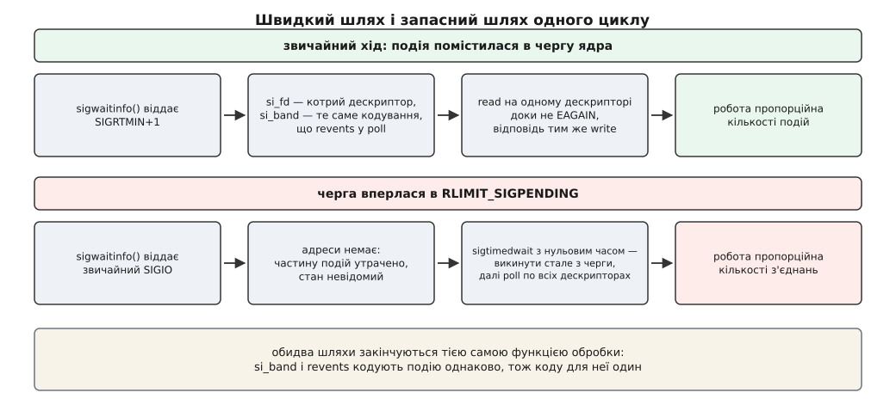

# ⚙️ Сервер-відлуння на реальночасових сигналах

Ось служба, що справді працює на сповіщеннях за сигналом: приймає з'єднання, відлунює байти й не має жодного обробника сигналу. Зібрати її цілком варто не заради самої схеми, а заради двох речей, яких не видно в описі механізму: скільки переходів межі ядра насправді припадає на одну подію, коли порахувати не тільки сповіщення, і що фізично робиться зі службою в мить, коли черга сигналів упирається в свою межу.

## Що будуємо

Задача навмисно бідна, щоб уся складність лишилася там, де вона нас цікавить. Один потік, один слухаючий сокет, до кількох тисяч з'єднань TCP, і все, що прийшло, летить назад тому самому клієнтові. Корисної роботи в такій службі майже немає — отже, майже вся вартість, яку ми виміряємо, це вартість дізнатися, що робити.

Три рішення визначають вигляд коду.

Обробника не буде зовсім: сигнал блокуємо в масці й забираємо з черги викликом `sigwaitinfo`. Це знімає ціле питання про те, що дозволено виконувати посеред довільної точки програми, і замість переривання ходу дає звичайний послідовний цикл.

Дескриптор адресуємо не процесові, а потокові — `F_SETOWN_EX` з типом `F_OWNER_TID`. У однопотоковій програмі це нічого не міняє, але саме так пишуть служби з пулом робітників, і різниця вилізе рівно там, де ми на неї дивитимемось. [Потік у Linux](root:sys-unix/threads-as-tasks) — окрема задача зі своїм ідентифікатором, тож ядро вміє покласти подію просто в чергу потрібного робітника.

І головне: пишемо **обидва** шляхи очікування. Швидкий, за адресними [реальночасовими сигналами](root:sys-unix/realtime-signals), і повільний, з повним обходом усіх дескрипторів через `poll`. Другий існує не для краси — без нього служба під піком мовчки загубить частину з'єднань.

## Озброїти дескриптор, і в правильному порядку

:::code proj-signal-driven-echo/c/ozbroity-deskryptor-i-v.c

Три виклики стоять саме в цьому порядку, і жоден не можна пересунути. `O_ASYNC` останній, бо він відмикає кран: доки прапорця немає, події не породжують сигналів, а щойно він з'явився — усе решта вже має бути на місці. Постав його першим, і подія, що трапиться до `F_SETSIG`, приїде звичайним `SIGIO` без `si_fd`, тобто без адреси.

Гонка є й друга, менш очевидна, і саме вона з'їдає найбільше часу на налагодженні. Між `accept4` і `arm` минає якась мить, і клієнт устигає надіслати перший запит. Байти лягають у буфер сокета, поки `O_ASYNC` іще не стоїть; переходу з погляду ядра не сталося, сигналу не буде ніколи, а з'єднання завмирає на першому ж запиті. Ліки одні: одразу після озброєння один раз обробити дескриптор так, ніби подія вже прийшла.

## Один обробник на два шляхи

Тут ховається найприємніша риса механізму. Поле `si_band`, яке приносить реальночасовий сигнал, закодовано **тими самими бітами**, що й `revents` у [poll](root:sys-unix/select-poll-epoll): `POLLIN`, `POLLHUP`, `POLLERR`. Отже, функція, що розбирає подію, однакова для швидкого й запасного шляхів — писати вдвічі доводиться цикл очікування, а не обробку.

:::code proj-signal-driven-echo/c/odyn-obrobnyk-na-dva.c

Цикл `read` до `EAGAIN` — не оптимізація, а умова коректности: сигнал народжується на переході, і байти, які ми не забрали зараз, не покличуть нас удруге.

## Цикл: чекати сигнал і не мати обробника

:::code proj-signal-driven-echo/c/tsykl-chekaty-syhnal-i-ne.c

Вичерпати чергу перед обходом — не дрібниця. `poll` дивиться на **стан**, а не на переходи, тож після обходу всі накопичені сигнали вже нічого не додають; лишивши їх, служба витратить наступні тисячі пробуджень на події, які щойно обробила. `sigtimedwait` із нульовим часом якраз і працює як опитування черги: віддає те, що є, і повертає `EAGAIN`, коли черга порожня.

Сам обхід — звичайний `poll` по всьому, що живе:

:::code proj-signal-driven-echo/c/tsykl-chekaty-syhnal-i-ne-2.c



*Два входи в ту саму функцію обробки: різниця лише в тому, звідки взявся набір подій — з черги ядра чи з обходу.*

## Скільки коштує подія

Тепер вимірювання, заради якого все й писалося. Порахувати [переходи межі ядра](root:sys-unix/syscall-mechanics) можна просто: `strace -c -f ./echo` під фіксованим навантаженням дає таблицю викликів, і те саме для служби на `epoll`. Але арифметика видно й з коду.

**Умова: 2000 з'єднань, разом 200 000 повідомлень за секунду; масив для `epoll_wait` — на 128 записів.**

```
сигнальна схема, на секунду:
  sigwaitinfo          200000
  read з даними        200000
  read → EAGAIN        200000
  write (відлуння)     200000
  ─────────────────────────────
  разом                800000   →  4.00 переходи на подію

epoll за рівнем, на секунду:
  epoll_wait   200000 / 128 ≈ 1563
  read з даними        200000
  write (відлуння)     200000
  ─────────────────────────────
  разом              ≈ 401563   →  2.01 переходи на подію
```

Число варте того, щоб на ньому спинитися. На самому сповіщенні сигнальна схема справді програє приблизно в 128 разів — і саме це число зазвичай цитують. Але сповіщення не буває саме собою: за ним іде читання й відповідь, а вони в обох схемах однакові. На **подію в цілому** різниця виходить приблизно вдвічі. Не втішно, але й не катастрофа — і зовсім не той порядок, який очікуєш після «у сто разів дорожче».

Друге читання тієї самої таблиці цікавіше. Зайвий `read`, що повертає `EAGAIN`, — це не властивість сигналів, це ціна семантики переходу; `epoll` за рівнем його не платить, `epoll` за переходом платить точно так само. Його майже можна прибрати: якщо `read` повернув менше, ніж уміщає буфер, буфер сокета порожній, і пробувати ще раз нема сенсу. Тоді виходить 3.00 переходи на подію. «Майже» тут важливе — це здогад про поведінку стеку, а не контракт, і помилка в ньому виглядає як з'єднання, що замовкло назавжди.

## Коли черга впирається в межу

Кількість сигналів у черзі обмежено — це `RLIMIT_SIGPENDING`, [межа ресурсів](root:sys-unix/resource-limits), яка з'явилася в Linux 2.6.8. Її поточне значення видно двома способами:

```
$ ulimit -i
15738
$ grep -i sigpending /proc/self/limits
Max pending signals     15738     15738     signals
```

Коли служба встигає забирати події швидше, ніж вони надходять, черга тримається біля нуля й межі не видно взагалі. Небезпечна тільки різниця темпів: якщо надходить λ подій за секунду, а забираємо μ, то запас вичерпується за

```
t = ліміт / (λ − μ)

λ = 200000, μ = 195000, ліміт = 15738:
t = 15738 / 5000 ≈ 3.1 с
```

Три секунди. Стільки живе запас черги, коли служба відстає лише на два з половиною відсотки. Затримка сторінкової помилки, повільний запис у журнал, сусід, що на мить забрав процесор, — і схема перемикається в інший режим роботи. Це той самий пік, заради якого будували швидкий шлях.

Що саме станеться, документує `fcntl(2)` прямо: коли ліміт досягнуто, ядро перестає чергувати й доставляє `SIGIO`, причому процесові в цілому, а не окремому потокові. Наша служба це переживе — `SIGIO` заблоковано, `sigwaitinfo` віддасть його як звичайну подію, лічильник `ev_rescan` смикнеться, обхід перебере всі дві тисячі дескрипторів. Далі темпи вирівняються, і вона повернеться на швидкий шлях.

Але зверніть увагу, чим вона стала в цю мить. `SIGIO` — звичайний сигнал, він не чергується: скільки б разів ядро не спробувало покласти подію й не змогло, очікування лишається одним бітом. Тобто під сталим переповненням служба виконує рівно один обхід на одне пробудження — тобто перетворюється на найзвичайніший цикл `poll`, тільки з зайвим сигналом замість таймауту. Вся точність адресування, весь `F_OWNER_TID`, уся вигода від `si_fd` зникають саме тоді, коли навантаження найбільше.

## Пастки

**Недочитаний буфер губить з'єднання назавжди.** Вийшли з `handle`, не діставши `EAGAIN`, — і байти, що лишилися, більше нікого не покличуть. Виглядає це не як помилка, а як окремі клієнти, що «зависли»; решта служби працює бездоганно.

**Незаблокований `SIGIO` вбиває процес.** Типова дія — завершити, а не проігнорувати. Підступність у тому, що на розробницькій машині `SIGIO` не приходить ніколи: він з'являється лише при переповненні черги. Блокувати треба в кожному потоці й до того, як потоки створено, — успадкована маска надійніша за обіцянку не забути.

**`si_fd` — це номер, записаний під час `F_SETSIG`.** Той самий `fcntl(2)` описує наслідок: якщо дескриптор продублювати через `dup` і закрити оригінал, події й далі надходитимуть, а в `si_fd` лежатиме номер уже закритого. Свій різновид того самого дає й наш код: після `drop(fd)` у черзі можуть лишатися сигнали про цей дескриптор, а номер тим часом уже видано новому з'єднанню. Рятує тільки те, що `handle` не має пам'яті: перевірка `live[fd]`, стійкість до `EBADF` — і зайве читання, що нічого не зіпсує.

**Скидання привілеїв робить це тихо.** `F_SETOWN` знімає зліпок облікових даних у мить виклику, і перевірка прав на надсилання йде саме за ними. Служба, що озброїла дескриптори, а потім [скинула привілеї](root:sys-unix/setuid-and-privilege), працює далі — старі зліпки лишилися. Ламається наступний крок: дескриптори, озброєні вже після скидання й адресовані іншому процесові, можуть тихо перестати доставляти. Стан виходить змішаний, половина з'єднань жива, і причина не проглядається ні звідки.

**Ліміт черги — на користувача, не на процес.** `RLIMIT_SIGPENDING` рахує сигнали для реального ідентифікатора користувача, отже, весь запас спільний з усіма іншими процесами того самого користувача. Стороння програма, запущена від того самого імені, здатна вигнати службу на запасний шлях, ніяк її не торкнувшись. Для служби це вагомий аргумент за окремий обліковий запис — і незручний факт, що межа продуктивности лежить поза її власним кодом.
