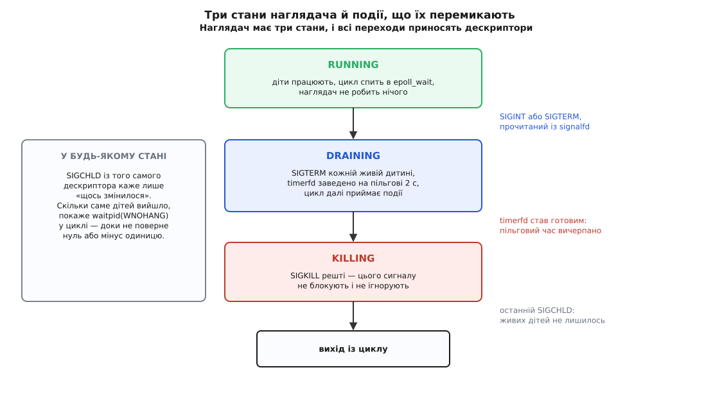

# ⚙️ Маленький наглядач: signalfd, timerfd і згортання без жодного обробника

Тут зібрано повний код служби на C, яка тримає кілька дитячих процесів і вміє акуратно скластися на Ctrl-C: приймає сигнали як звичайні події `epoll`, прибирає зомбі, дає дітям пільговий час і добиває тих, хто його прогуляв. Дві сотні рядків — і жодної функції-обробника, жодного прапорця `volatile sig_atomic_t`, жодної гонки між перевіркою й засинанням.

## Умова

Наглядач мусить уміти рівно чотири речі, і кожна з них у класичному вигляді породжує окрему халепу:

- **запустити N дітей** — і не залишити їм у спадок власних дивацтв;
- **дізнатися про смерть дитини** тоді, коли вона сталася, і забрати код виходу, щоб у таблиці процесів не збиралися зомбі;
- **прийняти Ctrl-C або `SIGTERM`** у своїй точці, а не посеред довільної інструкції;
- **згорнутися зі стелею за часом**: чемним дати попрощатися, впертих убити.

Остання вимога — та, заради якої в цьому прикладі є другий дескриптор. «Дати дві секунди» без таймера означає `sleep(2)` посеред циклу, тобто дві секунди глухоти до всього іншого: смерть дитини за цей час помічена не буде, повторний Ctrl-C — теж. Тому пільговий час теж стає подією.

## Порядок, який не можна переставити

Уся конструкція складається з трьох кроків, і переставляти їх немає як.

**Спершу маска.** `SIGINT`, `SIGTERM` і `SIGCHLD` блокуються найпершою дією `main`, ще до створення дескрипторів і — якби вони були — до створення потоків, бо кожен новий потік дістає копію маски того, хто його створив. Поки маска стоїть, ці три сигнали нікуди не діваються: їхні біти лягають у набір очікуваних і чекають, доки їх заберуть явно.

**Потім дескриптори.** `signalfd` показує саме те, що назбиралося під маскою; `timerfd_create` дає другий дескриптор, поки не заведений. Обидва з прапорцями `CLOEXEC` (щоб не потекли в дитину через `exec`) і `NONBLOCK` (щоб порожнє читання поверталося `EAGAIN`, а не блокувало цикл).

**Аж тоді діти.** І в кожній дитині — один обов'язковий рядок між `fork` і `exec`, про який ітиметься окремо.

Далі наглядач — це проста машина з трьох станів, і всі переходи в ній приносять дескриптори, а не обробники.



*Обидва переходи згортання починаються з `read()` — з одного дескриптора або з другого. Прибирання зомбі йде впоперек станів: `SIGCHLD` осмислений у будь-якому з них.*

> 🔧 **Навіщо це.** Стан наглядача змінюється лише в одній точці програми — там, де цикл розібрав подію. Тому `state`, масив `kids[]` і лічильник `alive` є звичайними змінними без жодного `volatile` й без атомарних операцій: до них ніхто не має доступу «зсередини» довільної інструкції. Саме це й купується маскою.

## Код

:::code proj-signalfd-supervisor/c/sup.c

Дитина тут — той самий виконуваний файл, запущений з `argv[1] == "worker"`: так приклад лишається одним файлом, а поведінка дітей повністю під нашим контролем. Двоє «чемних» ставлять обробник `SIGTERM` і виходять, побачивши прапорець; один «упертий» ставить `SIG_IGN` і не має наміру помирати добровільно.

Чемна дитина написана навмисне по-старому — обробник плюс `volatile sig_atomic_t`, — щоб різниця між двома підходами була видна поруч. Щілина в ній нікуди не поділася: сигнал, що прийшов між перевіркою `!stop_now` і входом у `nanosleep`, коштує зайвих 200 мілісекунд сну. Для робітника, який усе одно прокидається п'ять разів на секунду, це ціна нікчемна, тому городити тут другий `signalfd` не варто. Але саме ця затримка й перетворюється на справжню помилку, щойно замість `nanosleep` стане `epoll_wait` без таймауту: тоді «зайвий сон» триває вічно.

## Збірка й запуск

```sh
cc -std=gnu11 -D_GNU_SOURCE -Wall -Wextra -O2 -o sup sup.c
./sup
```

Далі — Ctrl-C у терміналі. Ось що видно:

```
supervisor pid=8231: 3 дітей запущено; Ctrl-C або kill -TERM 8231
  worker[polite] pid=8232: почав
  worker[polite] pid=8233: почав
  worker[stubborn] pid=8234: почав
^Csupervisor: SIGINT від pid=0 — починаю згортання
supervisor: SIGTERM усім, 2 с на прибирання
  worker[polite] pid=8232: прибрав за собою й виходжу
  worker[polite] pid=8233: прибрав за собою й виходжу
supervisor: pid=8232 вийшов сам, код 0 (лишилось 2)
supervisor: pid=8233 вийшов сам, код 0 (лишилось 1)
supervisor: пільговий час вичерпано
supervisor: pid=8234 не встиг — SIGKILL
supervisor: pid=8234 убитий сигналом 9 (лишилось 0)
supervisor: дітей не лишилось, виходжу
```

`pid=0` у першому рядку — не помилка друку. Ctrl-C народжує термінальний драйвер, а не якийсь процес, тож поля відправника лишаються нульовими. Надішліть той самий сигнал руками (`kill -TERM 8231` з іншого термінала) — і в цьому рядку побачите справжній номер оболонки, яка виконала `kill`.

## Пастки

**Рівнева готовність і читання до `EAGAIN`.** `epoll` тут рівневий: поки в наборі очікуваних лишається бодай один сигнал, `epoll_wait` повертатиметься негайно ([select, poll, epoll](root:sys-unix/select-poll-epoll) — рівнева готовність повідомляє про стан, а за фронтом — лише про зміну стану). Прочитати одну структуру за пробудження й вийти теж «працює», але цикл марно оббігає ще раз. А от у режимі за фронтом (`EPOLLET`) недочитаний залишок означає, що наступного повідомлення не буде ніколи: стан не змінювався, змінювати його нікому. Тому в `drain_signalfd` стоїть `for (;;)` до `EAGAIN` — і саме тому дескриптор створено з `SFD_NONBLOCK`. Ці дві речі — одне рішення, розірване на два місця коду: без прапорця останній `read` у цьому циклі просто заблокував би службу назавжди.

**Чому `read` віддає рівно 128 байтів.** Стільки займає `struct signalfd_siginfo`: реальних полів у ній менше, решта — навмисне доповнення, залишене на майбутні поля, щоб додавання нового не зламало вже зібрані програми. Наслідок практичний: буфер, менший за 128 байтів, дає `EINVAL` — не коротке читання, а помилку. Більший буфер дає кілька структур за один виклик, тому кількість подій рахують діленням: `n / sizeof si[0]`.

**Забути маску.** Найдорожча помилка й водночас найтихіша, бо ламається двома різними способами одразу. `SIGINT` і `SIGTERM` підуть звичайним шляхом, і типова дія вб'є наглядача просто в циклі; діти лишаться сиротами й перейдуть до `init` ([сироти й перепідпорядкування](root:sys-unix/orphan-reparenting) — коли батько вмирає раніше за дитину, її всиновлює процес-збирач). А `SIGCHLD` не вб'є нікого: його типова дія — «ігнорувати», тож сигнал спокійно дійде до кінця шляху й там зникне, у дескрипторі не з'явившись жодного разу. Зовні це має вигляд «signalfd не бачить смерті дітей», а насправді дескриптор порожній тому, що забирати з нього нічого: сигнал уже опрацьовано.

**Забути скинути маску дитині.** Диспозиції під час `exec` скидаються на типові, дескриптори з `CLOEXEC` закриваються, а маска переходить у новий образ як є ([exec: заміна образу](root:sys-unix/exec-semantics) — заміняється вміст пам'яті, але не властивості процесу, які до пам'яті не належать). Приберіть у `spawn` рядок із `sigprocmask` — і вивід зміниться так:

```
supervisor: SIGTERM усім, 2 с на прибирання
supervisor: пільговий час вичерпано
supervisor: pid=8232 не встиг — SIGKILL
supervisor: pid=8233 не встиг — SIGKILL
supervisor: pid=8234 не встиг — SIGKILL
```

Чемні діти зникли з виводу разом із упертою. Їхній код бездоганний: обробник поставлено, прапорець перевіряється — але `SIGTERM` заблокований успадкованою маскою, тож обробник не виконається ніколи, і біт просто лежить в очікуваних до самої смерті від `SIGKILL`. Шукати причину будуть у дитині, а лежить вона в батькові, за два виклики звідти.

**`SIGCHLD` не рахує, скільки разів надійшов.** Звичайні сигнали не стають у чергу: поки біт стоїть, наступний такий самий зливається з ним. Троє дітей, що вийшли в ту саму мілісекунду, цілком можуть дати одну структуру в `read` — і якби `reap()` робив один `waitpid`, двоє з трьох лишилися б зомбі назавжди ([завершення, wait і зомбі](root:sys-unix/exit-wait-zombies) — запис про мертву дитину живе в таблиці, доки батько не забере код виходу). Тому `waitpid(-1, …, WNOHANG)` крутиться в циклі, доки не поверне нуль (живі є, новин нема) або `-1` (дітей не лишилось). Це не перестраховка, а єдиний правильний спосіб: із самого сигналу кількість подій дістати неможливо.

**`waitpid(-1, …)` забирає будь-яку дитину, не лише вашу.** У наглядачі це саме те, що треба, але щойно в тій самій програмі з'явиться `system()`, `popen()` чи бібліотека, яка нишком запускає допоміжний процес, — гонка неминуча. Той, хто прокинувся першим, забере чужий код виходу, а справжній власник дістане `-1` з `ECHILD` і побачить, що його дитина ніби ніколи не існувала. Тому в наглядачі або зовсім немає інших способів породжувати процеси, або замість `-1` передають конкретний номер і ловлять `ECHILD` як «уже прибрано». Дешевого способу примирити збирача «за всіма» з чужими викликами `system()` немає — це вибір архітектури, а не деталь коду.

**У програмі з потоками змінюється рівно один рядок — і додається одне правило.** Замість `sigprocmask` пишуть `pthread_sigmask` (у багатопотоковій програмі поведінка першого стандартом не визначена), а виклик має відбутися до створення першого потоку: маска копіюється з творця, тож так її дістануть усі. Правило ж таке: читати з `signalfd` має один потік. Формально дескриптор можна додати в кілька циклів подій, але сигнал, прочитаний одним читачем, зникає для решти, і хто саме його дістане — не визначено. Наглядач, у якого `SIGCHLD` іноді потрапляє не в той потік, налагоджується довго й неприємно.

**Таймер теж треба вичитувати.** `timerfd` віддає 8 байтів — беззнакове ціле з кількістю спрацювань від попереднього читання ([таймери процесу](root:sys-unix/process-timers) — той самий годинник, поданий як дескриптор). Не прочитати його означає лишити дескриптор готовим, і рівневий `epoll` укрутить цикл у стовідсоткове завантаження процесорного ядра. З тієї ж причини в `finish_shutdown` таймер роззброюють нульовим `it_value`: свою справу він зробив, а прокидатися вдруге ні до чого.

**Наглядач лишається смертним, і це навмисно.** `SIGKILL` заблокувати не можна, тож у дескрипторі він не з'явиться ніколи — жодною маскою служба не зробить себе незнищенною. Ціна за всю конструкцію мала: два дескриптори незалежно від кількості дітей, одне пробудження на подію та один прохід по масиву дітей на кожен щабель згортання.
