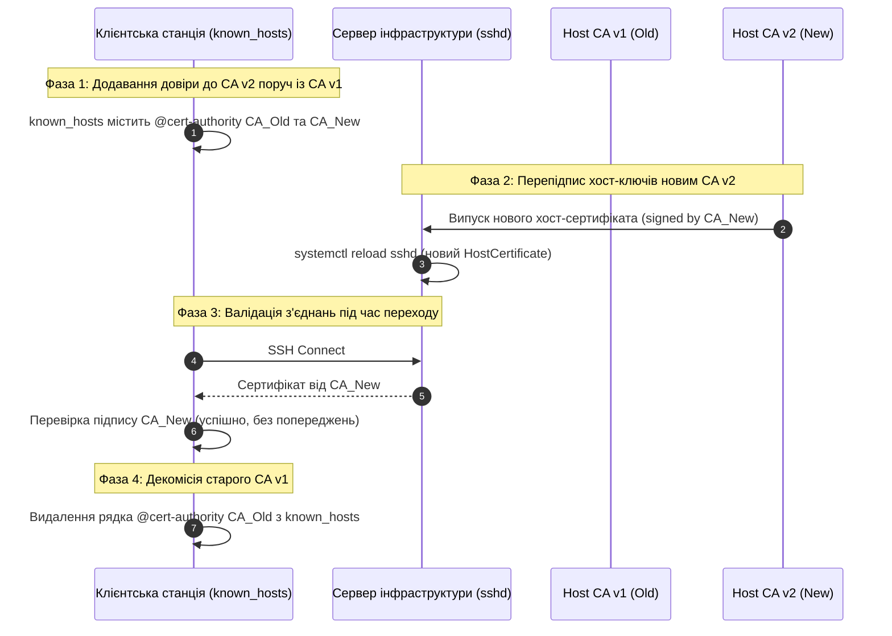

# ⚙️ Автоматизація інфраструктури SSH Certificate Authority

У великих інфраструктурах традиційне керування доступом через статичні файли `~/.ssh/authorized_keys` на серверах та бази довірених хостів `~/.ssh/known_hosts` на робочих станціях неминуче стикається з проблемою масштабування `O(N * M)`, де `N` — кількість інженерів, а `M` — кількість серверів. Додавання, ротація або екстрене відкликання ключів вимагає виконання синхронізаційних конвеєрів (Ansible, Puppet, Chef) по всьому парку машин. Якщо хоча б один вузол перебував офлайн під час відкликання, скомпрометований ключ залишається активним. На клієнтському боці динамічне перестворення віртуальних машин у хмарах або запуск нових нод автоскейлінгу генерує постійні попередження TOFU (Trust On First Use), привчаючи інженерів механічно підтверджувати відбитки серверів без реальної перевірки, що нівелює захист від атак Man-in-the-Middle (MITM).

Архітектура SSH Certificate Authority (SSH CA) замінює децентралізовані статичні списки публічних ключів моделлю централізованої криптографічної довіри на базі сертифікатів відкритого формату OpenSSH (`PROTOCOL.certkeys`). Замість розкладання тисяч ключів по серверах адміністратор налаштовує довіру до єдиного публічного ключа Центру Сертифікації (`TrustedUserCAKeys`), а сервери отримують хост-сертифікати, завірені `Host CA`. Інженери отримують короткоживучі сертифікати з жорстко обмеженим часом життя (TTL) та переліком дозволених облікових записів (`principals`), що унеможливлює несанкціонований доступ після закінчення робочої зміни.

Нижче наведено повний інженерний конвеєр побудови дворівневої інфраструктури SSH CA (Host CA та User CA), протоколи безшовної ротації коренів довіри, механізми відкликання через двійкові списки KRL (Key Revocation List) та директиву `RevokedKeys`, а також системну утиліту низькорівневого аналізу двійкового wire-формату SSH-сертифікатів на мовах C та C++.

---

## 1. Архітектурні засади та створення ключів Центрів Сертифікації

В інфраструктурі SSH CA діє суворе правило розділення зон відповідальності: Центр сертифікації хостів (Host CA) та Центр сертифікації користувачів (User CA) функціонують як два повністю незалежні криптографічні корені довіри.

### Чому необхідне фізичне та логічне розділення CA

1. **Ізоляція радіуса ураження (Blast Radius):** Сервіс генерації користувацьких сертифікатів інтегрується з корпоративним каталогом ідентичності (SSO, IdP, OAuth2/OIDC, HashiCorp Vault SSH secrets engine) і працює в режимі online, обробляючи сотні запитів на день. Якщо сервер автентифікації користувачів зазнає компрометації, зловмисник отримує доступ лише до цільових облікових записів інженерів у межах поточного вікна життя сертифікатів, але не може випустити підроблені хост-сертифікати для перехоплення та розшифрування SSH-трафіку між іншими серверами та клієнтами.
2. **Різні життєві цикли та моделі зберігання:** Кореневий ключ Host CA використовується рідко — виключно під час введення нових серверів в експлуатацію або планової зміни хост-ключів (раз на 1–3 роки). Цей закритий ключ зберігається в режимі offline cold storage у захищеному сховищі, на апаратному модулі безпеки (HSM / YubiKey PKCS#11) або на ізольованій машині з суворим регламентом доступу. На противагу, ключ User CA зберігається у зашифрованій пам'яті автоматизованого демона підпису або керується сервісом Vault через апаратні токени.
3. **Розподіл векторів довіри:** Відкритий ключ `ssh_host_ca.pub` дистрибутується на всі клієнтські робочі станції у файл `known_hosts` із маркером `@cert-authority`, тоді як відкритий ключ `ssh_user_ca.pub` розміщується на всіх цільових серверах інфраструктури у файлі `/etc/ssh/ssh_user_ca.pub` і підключається директивою `TrustedUserCAKeys`.

:::code proj-ssh-ca-authority/sh/1-arkhitekturni-zasady-ta.sh

### Розбір інженерних рішень у скрипті генерації

- `set -euo pipefail`: Забезпечує аварійне завершення скрипта у разі виникнення помилок у будь-якій команді конвеєра, запобігаючи створенню неповної або незахищеної конфігурації.
- `mkdir -p "${CA_DIR}" && chmod 700 "${CA_DIR}"`: Каталог зберігання ключів CA захищається правами `0700` (`rwx------`) з власником `root:root`. Це блокує читання каталогів іншими непривілейованими процесами операційної системи.
- `ssh-keygen -t ed25519 -a 100`: Для кореневих ключів використовується алгоритм Ed25519 (еліптична крива Curve25519). На відміну від RSA (де безпека вимагає ключів від 3072–4096 бітів) та ECDSA (вразливого до якості генератора випадкових чисел `k` та атак за часом виконання), Ed25519 гарантує детерміністичний цифровий підпис (`r = SHA-512(seed || m)`), повні закони додавання точок без розгалужень (constant-time execution проти side-channel витоків) та компактний розмір відкритого ключа (32 байти) і підпису (64 байти).
- Прапорець `-a 100`: Встановлює 100 раундів KDF bcrypt для захисту закритого ключа у форматі OpenSSH. Це сповільнює підбір парольної фрази у разі витоку файлу ключа на порядки величин.
- Права доступу до файлів: Закриті ключі (`ssh_host_ca`, `ssh_user_ca`) отримують права `0600` (`rw-------`), а публічні ключі (`*.pub`) — права `0644` (`rw-r--r--`). Для запобігання випадковому видаленню чи модифікації відкритих якорів довіри на них доцільно встановити прапорець незмінності: `chattr +i ${CA_DIR}/*.pub`.

---

## 2. Підпис хост-ключів серверів (Host CA) та усунення TOFU

Коли новий сервер розгортається в інфраструктурі, його локальний хост-ключ (`/etc/ssh/ssh_host_ed25519_key.pub`) надсилається на підпис до Host CA. Закритий хост-ключ ніколи не залишає файлову систему цільового сервера.

:::code proj-ssh-ca-authority/sh/2-pidpys-khost-kliuchiv.sh

### Анатомія команди підпису хост-сертифіката

Команда `ssh-keygen -s` формує двійковий сертифікат на базі наданого публічного ключа:

- `-s "${CA_KEY}"`: Вказує шлях до закритого ключа Host CA, яким накладається криптографічний підпис. Якщо ключ розміщено на апаратному токені, шлях замінюється на виклик PKCS#11 бібліотеки через прапорець `-D`.
- `-I "${HOST_ID}"`: Задає ідентифікатор ключа (Key ID), що записується у тіло сертифіката. Він виводиться у системних журналах аудиту під час встановлення з'єднання.
- `-h`: Критичний прапорець, що перемикає тип сертифіката на `SSH2_CERT_TYPE_HOST` (двійкове значення `2` у полі `cert_type`). Без прапорця `-h` сертифікат створюється як користувацький (`SSH2_CERT_TYPE_USER`, значення `1`), і клієнт SSH відхилить його при спробі автентифікувати сервер.
- `-n "${PRINCIPALS}"`: Список дозволених імен (principals) через кому. Для хостів сюди вносяться коротке ім'я машини (`srv-db-prod-01`), повне доменне ім'я FQDN (`srv-db-prod-01.infra.company.com`) та внутрішня статична IP-адреса (`10.20.0.15`). Клієнт SSH звіряє ім'я, вказане у команді підключення, із цим списком. Якщо інженер підключається як `ssh srv-db-prod-01.infra.company.com`, а сертифікат сервера містить лише `srv-db-01`, з'єднання буде розірвано через невідповідність principal.
- `-V "+365d"`: Інтервал валідності сертифіката. Для хостів встановлюється термін від 90 днів до 1–2 років.

### Налаштування цільового сервера (`/etc/ssh/sshd_config`)

Сервер надає свій сертифікат клієнту на етапі узгодження алгоритмів і ключів сеансу (KEX):

```text
# Власний приватний хост-ключ сервера
HostKey /etc/ssh/ssh_host_ed25519_key

# Публічний хост-сертифікат, завірений Host CA
HostCertificate /etc/ssh/ssh_host_ed25519_key-cert.pub
```

Демон `sshd` під час старту або перечитування конфігурації (`systemctl reload sshd`) перевіряє, що відкритий ключ усередині `HostCertificate` суворо відповідає закритому ключу, вказаному у директиві `HostKey`. Якщо файли не збігаються, демон повертає помилку `Certificate does not match private key` і відмовляється обслуговувати з'єднання.

### Налаштування клієнтів у `known_hosts`

На клієнтських комп'ютерах (у персональному `~/.ssh/known_hosts` або загальносистемному `/etc/ssh/ssh_known_hosts`) налаштовується довіра до Host CA за допомогою маркера `@cert-authority`:

```text
@cert-authority *.infra.company.com,10.20.0.*,srv-db-prod-01 ssh-ed25519 AAAAC3NzaC1lZDI1NTE5AAAAI... (вміст ssh_host_ca.pub)
```

Ланцюжок верифікації на стороні клієнта:
1. Клієнт ініціює підключення до `srv-db-prod-01.infra.company.com`.
2. Сервер повертає свій хост-сертифікат `ssh_host_ed25519_key-cert.pub`.
3. Клієнт знаходить у базі `known_hosts` рядок `@cert-authority`, шаблон якого збігається з запитаним хостом `*.infra.company.com`.
4. Клієнт перевіряє криптографічний підпис сертифіката відкритим ключем `ssh_host_ca.pub`.
5. Клієнт перевіряє, що ім'я `srv-db-prod-01.infra.company.com` присутнє у полі `principals` сертифіката, а системний час перебуває у межах діапазону `valid_after` ... `valid_before`.

Якщо всі перевірки успішні, підключення відбувається миттєво без діалогового вікна TOFU. Якщо зловмисник намагається перехопити DNS чи підмінити IP-адресу, клієнт не знайде валідного підпису Host CA або виявить невідповідність principals, заблокувавши MITM-атаку з кодом завершення 255.

### Протокол безперервної ротації Host CA без простою (Zero-Downtime Migration)

Коли термін дії кореневого ключа Host CA добігає кінця або виникає потреба планової зміни криптографічного алгоритму, пряма заміна ключа на серверах або клієнтах призведе до масового збою `Host key verification failed`. Для гарантування безперервної роботи застосовується чотирифазний протокол міграції з перехідним періодом подвійної довіри.



#### Фаза 1: Попередня дистрибуція подвійної довіри на клієнтах

У файл `/etc/ssh/ssh_known_hosts` (або `~/.ssh/known_hosts`) додається другий паралельний запис `@cert-authority` з публічним ключем нового `ssh_host_ca_v2.pub` на ті самі доменні маски поруч із наявним `ssh_host_ca_v1.pub`:

```text
# Старий діючий Host CA v1
@cert-authority *.infra.company.com,10.20.0.* ssh-ed25519 AAAAC3NzaC1lZDI1NTE5AAAAI_OLD_HOST_CA...

# Новий Host CA v2 (підготовлений до міграції)
@cert-authority *.infra.company.com,10.20.0.* ssh-ed25519 AAAAC3NzaC1lZDI1NTE5AAAAI_NEW_HOST_CA...
```

**Механіка обробки декількох CA клієнтом OpenSSH:**
Клієнт OpenSSH перебирає всі відповідні рядки `@cert-authority` послідовно згори донизу. Якщо публічний ключ першого CA не збігається з ключем, яким підписано наданий сервером сертифікат, клієнт не перериває сесію, а переходить до перевірки наступного запису `@cert-authority`. З'єднання відхиляється лише тоді, коли жоден із довірених CA не підтвердив підпис сертифіката.

#### Фаза 2: Підпис та поступове розгортання нових сертифікатів на серверах

1. Новий ключ Host CA v2 підписує локальні публічні ключі серверів:
   ```bash
   ssh-keygen -s /etc/ssh/ca/ssh_host_ca_v2 -I "srv-db-prod-01" -h \
       -n "srv-db-prod-01,srv-db-prod-01.infra.company.com,10.20.0.15" \
       -V "+365d" /etc/ssh/ssh_host_ed25519_key.pub
   ```
2. Оновлений файл `ssh_host_ed25519_key-cert.pub` розгортається на цільовий сервер конвеєром автоматизації.
3. Виконується м'яке перечитування конфігурації демона:
   ```bash
   systemctl reload sshd
   ```
   Сигнал `SIGHUP` змушує `sshd` перечитати файл сертифіката з диска для нових з'єднань, не розриваючи наявні активні SSH-сесії інженерів.

Оскільки всі клієнти на Фазі 1 вже отримали відкритий ключ Host CA v2, вони прозоро валідують оновлені сервери. Водночас сервери, які ще не встигли отримати оновлений сертифікат, продовжують обслуговувати клієнтів завдяки збереженню запису Host CA v1 у клієнтських базах.

#### Фаза 3: Аудит та моніторинг переходу

Адміністратори відстежують логи та конфігурацію парку машин, переконуючись, що 100% серверів успішно переведено на сертифікати від Host CA v2.

#### Фаза 4: Декомісія старого Host CA

1. З файлів `known_hosts` на робочих станціях видаляється запис зі старим ключем Host CA v1.
2. Приватний ключ Host CA v1 вилучається з активного сховища та переноситься в архів або надійно знищується згідно з регламентом безпеки.

---

## 3. Генерація короткоживучих сертифікатів для користувачів та контроль авторизації

У моделі User CA інженери більше не передають свої публічні ключі адміністраторам для додавання у `~/.ssh/authorized_keys`. Кожен розробник або системний адміністратор щоденно отримує короткоживучий сертифікат після проходження багатофакторної автентифікації на корпоративному шлюзі.

:::code proj-ssh-ca-authority/sh/3-heneratsiia.sh

### Деталізація параметрів випуску сертифіката користувача

- `-I "${KEY_ID}"`: Аудиторський ідентифікатор користувача (наприклад, корпоративна пошта `bohdan.felenko@company.com`). Цей рядок незмінно записується у системний журнал `sshd` кожного сервера, до якого звертається інженер:
  ```text
  Accepted publickey for ubuntu from 10.20.0.5 port 51234 ssh2: ED25519-CERT ID bohdan.felenko@company.com (serial 10492) CA ED25519 SHA256:4k...
  ```
  Це дозволяє службі безпеки точно знати, яка саме фізична особа зайшла під спільним системним обліковим записом `ubuntu` або `deploy`.
- `-z "${SERIAL}"`: Монотонно зростаючий 64-бітний серійний номер сертифіката. Серійні номери реєструються в базі видачі для відстеження та точкового відкликання.
- `-n "${PRINCIPALS}"`: Список облікових записів ОС (`bohdan,ubuntu,deploy`), під якими користувач має право авторизуватися на серверах. Сервер відхилить спробу входу під обліковим записом `root`, якщо `root` відсутній у списку principals цього сертифіката.
- `-V "${VALIDITY}"`: Часове вікно дійсності сертифіката. Значення `+8h` обмежує термін дії стандартним 8-годинним робочим днем. Після закінчення 8 годин сертифікат автоматично стає недійсним без потреби надсилання запитів до сервера.
- **Критичні опції (`critical-options`) проти розширень (`extensions`):**
  Формат OpenSSH чітко розмежовує поведінку демона щодо опцій: якщо `sshd` зустрічає невідому йому критичну опцію (`critical-option`), він **зобов'язаний** відхилити сертифікат і заблокувати автентифікацію. Невідомі розширення (`extensions`) сервер безпечно ігнорує.
  - `-O no-agent-forwarding`: Забороняє прокидання сокета `ssh-agent` на віддалену машину, запобігаючи використанню ключів клієнта третіми особами на скомпрометованому проміжному сервері.
  - `-O no-x11-forwarding`: Забороняє тунелювання графічного середовища X11.
  - `-O no-port-forwarding`: Блокує створення локальних, віддалених та динамічних SOCKS тунелів.
  - `-O no-pty`: Забороняє виділення псевдотермінала (застосовується для сертифікатів автоматизованих систем CI/CD та rsync).
  - `-O force-command="/usr/local/bin/backup-only.sh"`: Примусово обмежує користувача виконанням єдиного визначеного бінарника.
  - `-O source-address="10.20.0.0/16,192.168.1.0/24"`: Обмежує діапазон IP-адрес клієнта. Якщо пакет надходить поза вказаними підмережами, демон `sshd` відхиляє сертифікат до перевірки прав облікового запису.
  - Опція `-O clear`: Очищає всі стандартні дозволи OpenSSH (PTY, тунелі, агент), забезпечуючи формування мінімального безпечного сертифіката за принципом найменших привілеїв.

### Налаштування сервера для довіри до User CA

У файлі `/etc/ssh/sshd_config` сервера достатньо вказати публічний ключ Центру сертифікації користувачів:

```text
# Довіра до сертифікатів користувачів, завірених User CA
TrustedUserCAKeys /etc/ssh/ssh_user_ca.pub

# Вимкнення потреби в локальних authorized_keys (за потреби повної ізоляції)
AuthorizedKeysFile none
```

Файл `/etc/ssh/ssh_user_ca.pub` може містити декілька відкритих ключів CA (по одному на рядок). Під час планової ротації User CA адміністратору достатньо додати новий публічний ключ другим рядком у цей файл, що дозволяє серверам одночасно приймати сертифікати як від старого, так і від нового User CA до завершення перехідного періоду.

### Рольове зіставлення: AuthorizedPrincipalsFile та AuthorizedPrincipalsCommand

Якщо на сервері потрібно розділити рівні доступу (наприклад, дозволити вхід під `ubuntu` лише інженерам групи `devops-core`, а під `readonly` — групі `qa-team`), використовується директива:

```text
AuthorizedPrincipalsFile /etc/ssh/auth_principals/%u
```

Директива підтримує шаблонізацію: `%u` замінюється на ім'я цільового користувача ОС, `%h` — на домашній каталог, `%k` — на відкритий ключ CA.

У каталозі `/etc/ssh/auth_principals/` для кожного системного користувача розміщується файл із переліком дозволених ролей (principals). Наприклад, у файлі `/etc/ssh/auth_principals/ubuntu`:

```text
devops-core
infra-lead
```

Якщо сертифікат інженера містить principal `devops-core`, сервер дозволяє вхід під користувачем `ubuntu`, навіть якщо рядок `ubuntu` прямо не записаний у сертифікаті.

Для динамічної перевірки ролей без розкладання статичних файлів OpenSSH підтримує команду генерації principals у реальному часі:

```text
AuthorizedPrincipalsCommand /usr/local/bin/ldap-principals-lookup %u %i %k
AuthorizedPrincipalsCommandUser nobody
```

Демон `sshd` викликає зазначену утиліту від імені непривілейованого користувача `nobody`, передаючи ім'я користувача (`%u`), Key ID сертифіката (`%i`) та публічний ключ CA (`%k`). Скрипт звертається до IAM/LDAP каталогу й повертає список дозволених ролей у стандартний вивід.

### Синхронізація часу та компенсація розсинхронізації (Clock Skew)

SSH-сертифікати містять абсолютні часові мітки `valid_after` та `valid_before` у форматі 64-бітних секунд Unix (UTC). Якщо системні годинники сервера та клієнта мають навіть мінімальне розходження (наприклад, годинник CA поспішає на 30 секунд), щойно згенерований сертифікат буде відхилено сервером із помилкою:

```text
Certificate invalid: not yet valid
```

**Інженерні правила запобігання проблемам із часом:**
1. На всіх серверах та робочих станціях обов'язково активується служба синхронізації часу `chrony` або `systemd-timesyncd` з пулом NTP-серверів компанії.
2. Під час генерації сертифіката завжди задається невеликий запас часу в минуле за допомогою зміщення діапазону:
   ```bash
   ssh-keygen -s /etc/ssh/ca/ssh_user_ca -I "alice@company.com" \
       -n "ubuntu" -V "-5m:+8h" ~/.ssh/id_ed25519.pub
   ```
   Зсув `-5m` (5 хвилин назад) гарантує, що сертифікат вважатиметься валідним навіть за наявності допустимого мережевого розсинхрону годинників.

---

## 4. Відкликання сертифікатів через Key Revocation List (KRL)

Короткий час життя сертифіката (8 годин) забезпечує автоматичне знешкодження більшості ризиків. Проте у разі фізичної втрати робочої станції інженера або виявлення витоку закритого ключа сертифікат необхідно відкликати негайно, не чекаючи завершення часового вікна.

Для цього OpenSSH використовує спеціалізований двійковий механізм Key Revocation List (KRL).

### Двійкова структура та специфікація формату KRL (`PROTOCOL.krl`)

Формат KRL в OpenSSH розроблено як компактний двійковий контейнер, що забезпечує перевірку статусу ключа в пам'яті демона `sshd` за константний час `O(1)` з мінімальним споживанням RAM.

Файл KRL складається з відкритого заголовка та набору типізованих секцій:

| Поле / Секція | Тип | Опис |
| :--- | :--- | :--- |
| **`krl_magic`** | `raw bytes[8]` | Магічний заголовок `SSHKRL\0\0` |
| **`krl_version`** | `uint32` | Версія формату (поточна версія `1`) |
| **`krl_generation`** | `uint64` | Монотонно зростаючий лічильник версії KRL для аудиту свіжості списку |
| **`generated_time`** | `uint64` | Часова мітка генерації KRL (Unix Epoch UTC) |
| **`flags` / `reserved`** | `uint64` / `string` | Прапорці та резервні байти для майбутніх розширень протоколу |
| **`sections`** | `blob stream` | Послідовність секцій відкликання конкретних ключів та сертифікатів |

#### Внутрішня будова секцій відкликання сертифікатів (`KRL_SECTION_CERTIFICATES`)

Кожна секція відкликання сертифікатів прив'язується до публічного ключа відповідного CA (`ca_key`) і містить оптимізовані підсекції:

1. **Підсекція бітової карти (`KRL_SUBSECTION_BITMAP`):**
   Використовується для компактного відкликання послідовних або згрупованих серійних номерів. Містить базовий номер `base_serial` (`uint64`) та двійковий бітовий масив. Встановлений біт `1` за зміщенням `k` позначає відкликання сертифіката з номером `base_serial + k`. Це дозволяє закодувати відкликання 8192 сертифікатів усього в 1 КіБ пам'яті.
2. **Підсекція числових діапазонів (`KRL_SUBSECTION_RANGE`):**
   Зберігає пари 64-бітних чисел `[min_serial, max_serial]`, позначаючи відкликання всіх сертифікатів у цьому проміжку.
3. **Підсекція ідентифікаторів (`KRL_SUBSECTION_KEY_ID`):**
   Зберігає список хешів SHA-256 від текстових рядків Key ID (`alice@company.com`). Це дозволяє заблокувати **всі** діючі сертифікати скомпрометованого користувача чи робота одним записом без з'ясування їхніх серійних номерів.
4. **Секція підпису KRL (`KRL_SECTION_SIGNATURE`):**
   Необов'язковий криптографічний підпис усього тіла KRL закритим ключем адміністратора безпеки, що дозволяє серверам верифікувати автентичність списку при транспортуванні відкритими каналами.

:::code proj-ssh-ca-authority/sh/4-vidklykannia.sh

### Методи та сценарії генерації KRL через `ssh-keygen -k`

1. **Створення базового KRL та додавання відкликаних файлів ключів чи сертифікатів:**
   ```bash
   ssh-keygen -k -f /etc/ssh/revoked_keys.krl compromised-user-cert.pub old-host.pub
   ```
2. **Інкрементальне оновлення наявного файлу KRL (`-u`):**
   ```bash
   ssh-keygen -k -u -f /etc/ssh/revoked_keys.krl new-compromised-cert.pub
   ```
   Прапорець `-u` (update) автоматично інкрементує поле `krl_generation` та додає нові записи без перезапису наявних.
3. **Точкове відкликання за серійним номером та ключем CA:**
   ```bash
   ssh-keygen -k -u -f /etc/ssh/revoked_keys.krl -s /etc/ssh/ca/ssh_user_ca.pub -z 10492
   ```
4. **Відкликання неперервного діапазону серійних номерів:**
   ```bash
   ssh-keygen -k -u -f /etc/ssh/revoked_keys.krl -s /etc/ssh/ca/ssh_user_ca.pub -z 10000-10500
   ```
5. **Відкликання за ідентифікатором Key ID:**
   ```bash
   ssh-keygen -k -u -f /etc/ssh/revoked_keys.krl -s /etc/ssh/ca/ssh_user_ca.pub -I "alice.smith@company.com"
   ```
6. **Масове відкликання через текстовий файл специфікації (KRL Specification File):**
   Для автоматизованих конвеєрів `ssh-keygen` дозволяє передавати текстовий маніфест відкликань:
   ```text
   # Файл специфікації /tmp/revocations.txt
   serial: 10492
   serial: 20000-20500
   id: compromised-deployer@company.com
   id: contractor-ext@external.org
   key: ssh-ed25519 AAAAC3NzaC1lZDI1NTE5AAAAIEx4...
   ```
   Застосування маніфесту до KRL:
   ```bash
   ssh-keygen -k -u -f /etc/ssh/revoked_keys.krl -s /etc/ssh/ca/ssh_user_ca.pub /tmp/revocations.txt
   ```

### Інспекція, аудит та програмна валідація KRL

#### Текстовий дамп вмісту KRL (`-L`)

Команда `ssh-keygen -L -f <krl-file>` розшифровує двійковий файл KRL і виводить структурований звіт:

```bash
$ ssh-keygen -L -f /etc/ssh/revoked_keys.krl
```

Приклад діагностичного виводу:
```text
krl file: /etc/ssh/revoked_keys.krl
KRL version: 1
Generated: 2026-08-29T14:20:15
Generation: 42
Revoked keys by CA:
  CA key: ED25519 SHA256:4kM91x... (ssh_user_ca)
  Revoked serials: 10492, 10000-10500
  Revoked key IDs: alice.smith@company.com
Revoked direct keys:
  ED25519 SHA256:9xL2p...
```

#### Програмна перевірка сертифіката чи ключа у KRL (`-Q` та `-l`)

Утиліта `ssh-keygen -Q` перевіряє статус наданого ключа або сертифіката відносно бази KRL:

```bash
$ ssh-keygen -Q -l -f /etc/ssh/revoked_keys.krl id_ed25519-cert.pub
id_ed25519-cert.pub (ED25519-CERT): REVOKED
```

Коди повернення команди `ssh-keygen -Q` для скриптів автоматизації:
- `0`: Сертифікат або ключ знайдено у списку відкликання (`REVOKED`).
- `1`: Сертифікат або ключ відсутній у списку відкликання (`NOT REVOKED`).
- `255`: Фатальна помилка (файл KRL пошкоджено, неправильні права або файл не існує).

### Активація на серверах та атомарна дистрибуція KRL

У файлі `/etc/ssh/sshd_config` підключається шлях до двійкового KRL:

```text
RevokedKeys /etc/ssh/revoked_keys.krl
```

Під час кожного запиту на автентифікацію демон `sshd` зчитує KRL і перевіряє публічний ключ клієнта, а також комбінацію CA, серійного номера та Key ID. Якщо сертифікат відкликано, `sshd` блокує вхід до перевірки паролів чи виконання PAM-модулів.

**Правило атомарної заміни KRL:**
Прямий запис у робочий файл KRL через перенаправлення потоку (`cat new.krl > /etc/ssh/revoked_keys.krl`) створює стан гонитви (race condition): якщо клієнт підключається у момент неповного запису, демон прочитає пошкоджені байти і тимчасово відхилить легітимні з'єднання. Оновлення файлу KRL завжди виконується через тимчасовий файл з атомарним системним викликом `rename()`:

```bash
# Атомарне оновлення файлу KRL
install -m 0644 -o root -g root /tmp/revoked_keys.krl.tmp /etc/ssh/revoked_keys.krl
```

### Чому KRL в OpenSSH швидший і надійніший за X.509 CRL / OCSP

| Характеристика | OpenSSH Key Revocation List (KRL) | X.509 CRL / OCSP (TLS) |
| :--- | :--- | :--- |
| **Формат даних** | Компактний двійковий біт-вектор та інтервальні структури | Громіздкий ASN.1/DER список або HTTP-протокол |
| **Мережеві запити** | Відсутні (файл KRL локально читається `sshd`) | Синхронний запит до OCSP Responder на кожне з'єднання |
| **Швидкість перевірки** | Частки мікросекунди (`O(1)` бітова операція в RAM) | Десятки або сотні мілісекунд (мережевий RTT) |
| **Поведінка при відмові** | Детерміністична (локальний захист) | Soft-fail (ігнорування перевірки) або Hard-fail (блокування) |
| **Розмір на диску** | 1 КіБ на ~8000 відкликаних сертифікатів | Десятки мегабайтів списків відкликання X.509 |

---

## 5. Програмний розбір двійкової структури SSH-сертифіката

Формат двійкового кодування сертифікатів OpenSSH стандартизовано у документі `PROTOCOL.certkeys`. Сертифікат не використовує вкладених структур ASN.1/DER, а складається з послідовності полів у канонічному форматі SSH wire format.

### Структура двійкового блоку сертифіката OpenSSH

| Порядок | Поле | Тип у wire format | Опис |
| :--- | :--- | :--- | :--- |
| 1 | `cert_type_string` | `string` | Ідентифікатор алгоритму (`ssh-ed25519-cert-v01@openssh.com`) |
| 2 | `nonce` | `string` | 32 байти випадкового числа, згенерованого під час підпису |
| 3 | `public_key` | `string` | Публічний ключ суб'єкта (32 байти для Ed25519) |
| 4 | `serial` | `uint64` | Серійний номер сертифіката (Big-Endian) |
| 5 | `type` | `uint32` | `1` = `SSH2_CERT_TYPE_USER`, `2` = `SSH2_CERT_TYPE_HOST` |
| 6 | `key_id` | `string` | Текстовий ідентифікатор суб'єкта (Key ID) |
| 7 | `principals` | `string` | Вкладений серіалізований контейнер рядків дозволених імен |
| 8 | `valid_after` | `uint64` | Час початку дії (секунди Unix Epoch, Big-Endian) |
| 9 | `valid_before` | `uint64` | Час закінчення дії (секунди Unix Epoch, Big-Endian) |
| 10 | `critical_options` | `string` | Вкладений список пар `name=value` критичних обмежень |
| 11 | `extensions` | `string` | Вкладений список пар `name=value` розширень |
| 12 | `reserved` | `string` | Зарезервовано для майбутніх версій протоколу (порожній рядок) |
| 13 | `signature_key` | `string` | Відкритий ключ CA, що наклав підпис |
| 14 | `signature` | `string` | Блок підпису: тип алгоритму підпису та криптографічний хеш-підпис |

Усі рядки формату `string` кодуються як 4-байтне беззнакове ціле число довжини (`uint32` Big-Endian), після якого йдуть байти самого рядка.

### Реалізація інспектора сертифікатів на C та C++

Реалізація на мові C демонструє роботу структури `BufferReader` з ручним контролем покажчиків і захистом від виходу за межі пам'яті (buffer over-read), а версія на C++20 використовує безпечні абстракції нульової вартості `std::span`, `std::string_view` та монадичний тип `std::expected` для обробки помилок.

:::tabs
@tab C
:::code proj-ssh-ca-authority/c/main.c
@tab C++
:::code proj-ssh-ca-authority/cpp/main.cpp
:::

### Архітектурні деталі реалізацій

1. **Безпека меж буфера:** Обидві програми перевіряють залишок незчитаних байтів перед кожною операцією десеріалізації. Якщо довжина рядка перевищує розмір буфера, читання негайно припиняється з повідомленням про помилку, що виключає вразливості типу Heartbleed.
2. **Перетворення порядку байтів (Endianness):** Поля `uint32` та `uint64` передаються у мережевому порядку байтів (Big-Endian). У коді C використовується функція `ntohl()`, а 64-бітні числа формуються об'єднанням старшого та молодшого 32-бітних слів через побітовий зсув `((uint64_t)high << 32) | low`.
3. **Розбір вкладеного блоку `principals`:** Поле `principals` містить окремий вкладений серіалізований буфер. Парсер ініціалізує вторинний `BufferReader` (або `WireReader`) над цим підбуфером і послідовно вичитує всі рядки `[uint32_len][bytes]`, доки внутрішній зміщення не досягне довжини контейнера.
4. **Форматування часу:** Числа `valid_after` та `valid_before` приводяться до типу `time_t` і конвертуються у людиночитаний рядок формату UTC за допомогою `gmtime()` та `strftime()`.

### Компіляція та запуск утиліти

Для перевірки роботи програми необхідно декодувати текстовий рядок Base64 із файлу сертифіката у двійковий вигляд. Друге поле файлу `id_ed25519-cert.pub` містить сертифікат у кодуванні Base64:

```bash
# 1. Витягуємо другий стовпчик та декодуємо у двійковий файл
$ awk '{print $2}' id_ed25519-cert.pub | base64 -d > cert.bin

# 2. Компіляція парсера на C
$ gcc -O2 -Wall -Wextra proj-ssh-ca-authority/c/main.c -o cert_parser_c

# 3. Компіляція парсера на C++20
$ g++ -std=c++20 -O2 -Wall -Wextra proj-ssh-ca-authority/cpp/main.cpp -o cert_parser_cpp
```

Приклад виводу утиліти після передачі двійкового буфера:

```text
Тип сертифіката: ssh-ed25519-cert-v01@openssh.com
Серійний номер: 10492
Призначення: USER CERTIFICATE (1)
Key ID: bohdan.felenko@company.com
Principals (дозволені облікові записи):
  - bohdan
  - ubuntu
  - deploy
Діє з: 2026-08-29 08:00:00 UTC (ts=1787990400)
Діє до: 2026-08-29 16:00:00 UTC (ts=1788019200)
```

Цей вивід повністю збігається з діагностичним звітом стандартної утиліти `ssh-keygen -L -f id_ed25519-cert.pub`.

---

## 6. Простеження та діагностика в живому середовищі

Під час експлуатації інфраструктури SSH CA системний інженер діагностує з'єднання за допомогою клієнтських і серверних журналів трасування.

### Клієнтське трасування: `ssh -vvv`

Запуск клієнта з максимальним рівнем деталізації показує процес знаходження та надсилання сертифіката:

```bash
$ ssh -vvv ubuntu@srv-db-prod-01.infra.company.com
```

Ключові діагностичні маркери у виводі клієнта:
- `debug1: Host 'srv-db-prod-01.infra.company.com' is known and matches the CERTIFICATE authority.` — Клієнт перевірив хост-сертифікат сервера за допомогою `@cert-authority` у `known_hosts`.
- `debug1: Will attempt key: /home/bohdan/.ssh/id_ed25519-cert.pub ED25519-CERT` — Клієнт автоматично виявив сертифікат користувача поруч із приватним ключем.
- `debug2: userauth_pubkey: explicit keyprv /home/bohdan/.ssh/id_ed25519` — Клієнт підписує challenge сеансу локальним приватним ключем.
- `debug1: Authentication succeeded (publickey).` — Сервер успішно підтвердив підпис CA та допустимість principal `ubuntu`.

### Серверний аудит у системному журналі (`journalctl`)

На боці сервера всі події фіксуються демоном `sshd`:

```bash
$ journalctl -u ssh -f
```

Типові повідомлення та причини збоїв:

1. **Успішна автентифікація:**
   ```text
   sshd[12450]: Accepted publickey for ubuntu from 10.20.0.5 port 53412 ssh2: ED25519-CERT ID bohdan.felenko@company.com (serial 10492) CA ED25519 SHA256:7mN...
   ```
2. **Невідповідність principal:**
   ```text
   sshd[12455]: Certificate invalid: name is not a permitted principal
   sshd[12455]: Failed publickey for root from 10.20.0.5 port 53414 ssh2: ED25519-CERT ID bohdan.felenko@company.com
   ```
   *Причина:* Сертифікат не містить облікового запису `root` у списку `-n`.
3. **Закінчення терміну дії (TTL Expired):**
   ```text
   sshd[12460]: Certificate invalid: expired
   ```
   *Причина:* Поточний час сервера перевищує часову мітку `valid_before`. Інженеру необхідно оновити сертифікат через IdP.
4. **Спроба входу за відкликаним сертифікатом:**
   ```text
   sshd[12465]: Key is revoked in KRL
   sshd[12465]: Failed publickey for ubuntu from 10.20.0.5 port 53418 ssh2
   ```
   *Причина:* Сертифікат, його серійний номер або Key ID занесено до `/etc/ssh/revoked_keys.krl`.
5. **Розсинхронізація системного часу (Not Yet Valid):**
   ```text
   sshd[12470]: Certificate invalid: not yet valid
   ```
   *Причина:* Час на машині підпису CA випереджає час цільового сервера. Вирішується налаштуванням служби `chrony` та вказанням зсуву `-5m` під час випуску сертифіката (`-V "-5m:+8h"`).
