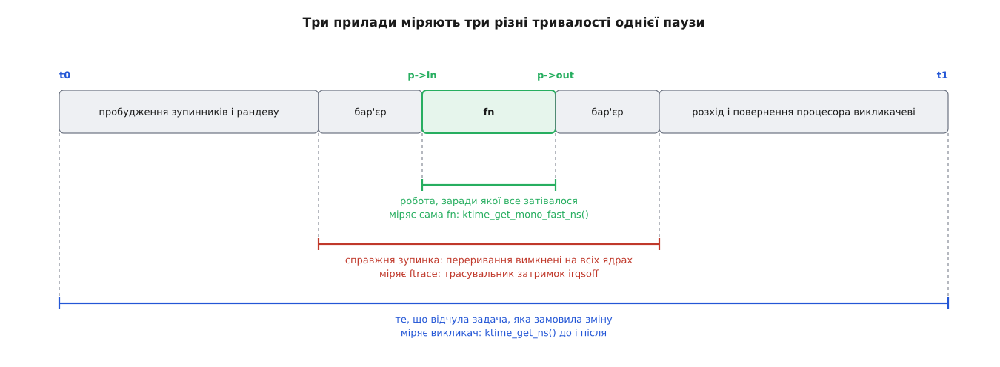

# ⚙️ Стенд: скільки триває зупинка світу саме на цій машині

Модуль ядра на C, який один раз просить машину завмерти й повідомляє, скільки та тиша тривала — зміряна трьома незалежними приладами. А потім, вимикаючи ядра процесора одне за одним і повторюючи вимір, показує головне: пауза росте **лінійно** з кількістю ядер процесора, а марно спалений процесорний час — **квадратично**.

## Прилад мусить стояти всередині

Річ, яку треба зміряти, влаштована незручно: під час цієї паузи в системі не виконується нічого. Будь-який вимірювач — це код, а коду в мить тиші немає. Дивитися ззовні теж не вийде: спостерігач стоїть разом з усіма, і його годинник ніхто не питає.

Вихід один, і він же єдиний виняток із правила. Функція, яку зупинка виконує всередині вікна, **і є** тим єдиним кодом, що в цю мить біжить у всій машині. Хай вона сама й знімає час: перший відлік на вході, другий на виході. Різниця — тривалість роботи.

Зовнішню межу знімає той, хто зупинку замовив: годинник перед викликом і одразу після повернення. Ця пара накриває все — пробудження зупинників, збирання, обидва бар'єри, розхід і ще той час, поки планувальник повертав викликачеві процесор.

Між цими двома лежить третя тривалість, якої не бачить жоден із двох приладів: скільки насправді були вимкнені переривання. Її знімає трасувальник ядра — збоку, не потребуючи від нас жодного рядка коду.



*Найкоротший відрізок — єдиний корисний. Усе інше — плата за те, щоб його стало можливо виконати.*

## Модуль

Уся робота відбувається в момент завантаження: модуль міряє, друкує й лишається порожньою оболонкою, яку одразу можна вивантажити. Про те, як [модулі ядра](root:sys-unix/kernel-modules) збираються поза деревом ядра й що для цього потрібно в системі, є окрема розмова; тут вистачить пакета заголовків до вашого поточного ядра.

:::code proj-freeze-cost/c/freeze_cost.c

Два вибори в цьому коді варті пояснення.

Усередині вікна час знімає `ktime_get_mono_fast_ns()`, а не звичніший `ktime_get_ns()`. Обидва повертають той самий монотонний годинник, але звичайний читач заходить у послідовний замок, яким захищено дані про час: якщо в цю мить хтось їх оновлює, читач крутиться й перечитує. З вимкненими перериваннями крутитися в очікуванні чужої дії — поганий задум навіть там, де він доказово безпечний. Швидкому читачеві застрягти ніде: його побудували так, щоб він працював навіть у немаскованому перериванні. Про самі [годинники ядра та їхні джерела](root:sys-unix/kernel-timekeeping) — окремо; тут потрібна рівно ця одна властивість.

Друге — статистика з мінімуму, медіани й максимуму, а не з середнього. Перший виклик майже завжди найдовший: зупинники давно не бігали, їхні структури вихололи з кешів, а самі ядра процесора можуть дрімати в глибокому стані сну. Середнє змішує цей одноразовий сплеск із рештою й бреше в обидва боки; медіана каже про звичайний випадок, максимум — про той, заради якого все й міряється.

Складання й запуск:

```makefile
# Makefile
obj-m := freeze_cost.o
KDIR  ?= /lib/modules/$(shell uname -r)/build

all:
	$(MAKE) -C $(KDIR) M=$(CURDIR) modules
clean:
	$(MAKE) -C $(KDIR) M=$(CURDIR) clean
```

```sh
$ make
$ sudo insmod freeze_cost.ko reps=25 && sudo rmmod freeze_cost
$ sudo dmesg | tail -5
freeze_cost: ядер онлайн 8, повторів 25, fn виконувало ядро 0
freeze_cost: зібратися:     min 14832, med 21406, max 58971, avg 24118 (нс)
freeze_cost: робота fn:     min 118, med 146, max 402, avg 163 (нс)
freeze_cost: розійтися:     min 6104, med 9277, max 26518, avg 11045 (нс)
freeze_cost: усього, ззовні: min 22190, med 31088, max 91344, avg 35402 (нс)
```

Числа — з однієї конкретної восьмиядерної машини; ваші будуть інші, і саме тому стенд є. Незмінне тут інше: корисної роботи сто сорок наносекунд, а пауза — тридцять одна мікросекунда. Плата перевищила саму роботу разів у двісті, і це ще на маленькій машині.

## Ту саму паузу видно ззовні

Своєму вимірювачеві завжди варто знайти незалежного свідка. Перший — трасувальник ядра: серед його трасувальників затримки є `irqsoff`, який стежить рівно за тим, скільки на ядрі процесора були вимкнені переривання, і запам'ятовує найдовший випадок разом із трасою навколо нього ([ftrace і трасувальні точки](root:sys-unix/ftrace-kernel-tracing) — про сам механізм).

:::code proj-freeze-cost/sh/main.sh

Число в мікросекундах, і воно більше за наше: трасувальник сам коштує часу, тож на час точного виміру його вимикають. Але значення тут не в числі, а в рядку `task:` — переривання вимикав потік `migration/3`, тобто **зупинник на третьому ядрі**, а не наш модуль. Ми зміряли своє ядро процесора; трасувальник показав, що те саме сталося на чужому.

Другий свідок дивиться з простору користувача. `cyclictest` із набору `rt-tests` будить реальночасовий потік за таймером і рахує, на скільки той запізнився ([як влаштований такий вимірювач і що псує його числа](root:sys-unix/kernel-preemption/proj-measure-latency.md) — окремий стенд). Прив'яжімо його до ядра процесора, яке [відгороджене від решти задач](root:sys-unix/cpu-affinity) в ізольований розділ керувальних груп, і подивімося, що з ізоляцією зробить одна зупинка:

```sh
$ sudo cyclictest --mlockall --priority=99 --interval=200 --affinity=3 -q -D 120
# в іншому терміналі, десь на шістдесятій секунді:
$ sudo insmod freeze_cost.ko reps=1 && sudo rmmod freeze_cost

T: 0 ( 4213) P:99 I:200 C: 599981 Min:      2 Act:    3 Avg:    3 Max:      39
```

Шістсот тисяч обертів по дві-три мікросекунди — і рівно один на тридцять дев'ять. Ізольоване ядро процесора, найвищий реальночасовий пріоритет, жодного стороннього навантаження: не допомогло нічого, бо [клас `stop` стоїть вище за будь-який реальночасовий пріоритет](root:sys-unix/priority-nice-realtime) — інакше механізм зупинки просто не працював би.

## Головний дослід: та сама пауза на різній кількості ядер

Тепер те, заради чого стенд і будувався. [Ядра процесора вимикаються на ходу](root:sys-unix/cpu-hotplug) записом у `sysfs`, і після вимикання вони зникають із маски онлайнових — а отже, у наступній зупинці бере участь менше зупинників. Лишається повторити вимір на різній кількості:

```sh
# лишити перші N ядер процесора, решту вимкнути
$ keep() { for c in $(seq $1 $(($(nproc --all) - 1))); do
             echo 0 | sudo tee /sys/devices/system/cpu/cpu$c/online >/dev/null; done; }

$ keep 2 && sudo insmod freeze_cost.ko && sudo rmmod freeze_cost
```

```
ядер   зібратися, мкс   усього, мкс
   2              6.1           9.4
   4             11.5          17.0
   6             16.4          24.2
   8             21.4          31.1

нахил ≈ 3.6 мкс на кожне додане ядро процесора
```

Пряма — і не випадково. Кожен перехід між станами зупинки коштує повного кола лічильника підтверджень, а лічильник цей один на всю машину: скільки ядер процесора, стільки разів рядок кеша з ним мандрує від власника до власника. Дві третини цієї прямої — навіть не сама зупинка, а пробудження зупинників: планувальник має по черзі поставити задачу на кожне ядро процесора.

А тепер помножмо тривалість на кількість тих, хто ту тривалість простояв:

```
марно спалений процесорний час = пауза · кількість ядер процесора

  2 ядра:    9.4 мкс ·  2 =  18.8 мкс
  8 ядер:   31.1 мкс ·  8 = 248.8 мкс
 64 ядра: ≈ 235   мкс · 64 ≈ 15.0 мс     (за тим самим нахилом)
```

Останній рядок — груба екстраполяція: на великій машині інша топологія зв'язку між ядрами процесора, і нахил там свій. Порядок вона вгадує, точного числа не дає — його ви дістанете, запустивши цей самий модуль на тій самій машині.

Важливе не в числах. Тривалість росте лінійно, кількість тих, хто ту тривалість простояв, — теж, тож їхній добуток росте як **квадрат кількості ядер процесора**. Учетверо більша машина платить за ту саму зміну приблизно вшістнадцятеро дорожче.

> 🔧 **Навіщо це.** Саме через квадрат механізм, писаний для машин на два-чотири ядра процесора, на сучасному сервері поводиться геть інакше — і саме тому кожного великого користувача зупинки по черзі виводили з-під неї. Стенд перетворює це «геть інакше» на число, яке можна показати в обґрунтуванні.

## Пастки

**Усередині функції не можна спати.** Переривання вимкнені, решта машини стоїть; будь-який мьютекс, будь-яке виділення пам'яті з очікуванням, будь-яка затримка зі сном — це або миттєве зависання, або гучне попередження в журналі. Дозволено читати годинник і писати в наперед виділену пам'ять. Ця межа — окремий випадок загального правила про те, [де в ядрі можна заснути, а де лишається лише крутитися](root:sys-unix/kernel-locking).

**Друкувати теж не варто.** Спокуса поставити `pr_info()` всередину функції велика, а ціна прихована: це форматування рядка, запис у кільце журналу, а на деяких налаштуваннях — ще й виведення в консоль. Кожен із цих кроків додає до вікна тиші сотні наносекунд або й мікросекунди, тобто псує саме те, що ми міряємо. Тому модуль складає числа в структуру, а друкує вже після повернення.

**Зупинку не можна вкладати в зупинку.** Виклик із функції, яку виконує інша зупинка, — це надійне зависання всієї машини: зовнішня чекає завершення, внутрішня — рандеву, на яке нікому прийти. З тієї ж причини зупинку не кличуть із обробника переривання чи з-під спін-замка: сама вона засинає, чекаючи на зупинників.

**Один вимір ≠ ціна для системи.** Модуль друкує тривалість, яку бачило одне ядро процесора. Ціна ж — це тривалість, помножена на кількість ядер, які її простояли. Плутати ці два числа — найпоширеніша помилка в обґрунтуваннях виду «та то ж усього тридцять мікросекунд».

**Машина мусить бути в тому стані, у якому її міряють.** На простоюючій системі ядра процесора дрімають у глибоких [станах сну](root:sys-unix/cpuidle-and-cstates), і пробудження кожного з них додає до збирання свої мікросекунди — числа на холодній машині виходять помітно гіршими, ніж на завантаженій. Вимір із фоновим навантаженням і без нього дає дві різні відповіді, й обидві правдиві для своїх умов.

**Із маскою замість `NULL` проба мусить бути своя на кожному.** Якщо передати `cpu_online_mask`, функція виконається на кожному ядрі процесора — і всі вони писатимуть в одну структуру. Слоти в такому разі беруть [окремі на кожне ядро процесора](root:sys-unix/per-cpu-data), інакше вимір міряє гонку, а не паузу.

**Найяскравіше все це видно на `PREEMPT_RT`.** На звичайному ядрі пауза в тридцять мікросекунд губиться серед довгих ділянок із вимкненими перериваннями, яких там і без неї чимало. [Реальночасовий режим](root:sys-unix/kernel-preemption) ті ділянки методично викорінював роками — і на такому ядрі підлога затримок опускається до одиниць мікросекунд, а зупинка світу лишається стирчати над рівним полем самотнім піком. Прибрати її звідти нічим: це не недогляд, який ще не полагодили, а спосіб, у який ядро міняє те, про що з апаратурою домовитися не можна.
