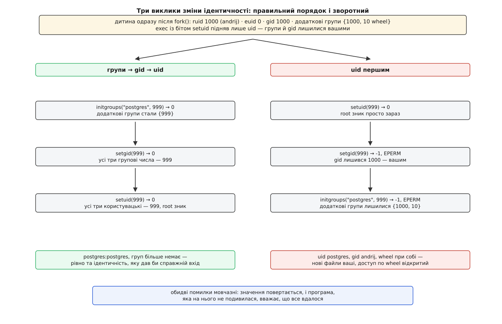

# ⚙️ Робоча su на C: сто рядків, де немає жодного зайвого

Програма, що робить те саме, що `su - postgres`, вміщується в один файл — і прочитати її варто цілком, бо тільки в коді видно те, чого не видно в описі: «перемкнутися на іншого користувача» складається з дюжини окремих прохань до системи, і майже кожне вміє мовчки не спрацювати.

## Задача

Написати `minisu [-] <користувач>`: спитати пароль **цілі** й, якщо він правильний, запустити оболонку цілі з її ідентичністю. Файл ставиться з бітом setuid і власником root — інакше чужі числа поставити ніхто не дасть.

Мову тут обирати нема з чого. Ідентичність процесу міняється системними викликами, а пароль перевіряє бібліотека PAM, чий інтерфейс написаний на C і виконується просто в процесі, що її покликав. Та сама програма будь-якою іншою мовою — це та сама дюжина викликів під обгорткою, яка лише ховає місця, де все ламається.

## Ідея

Робота ділиться надвоє, і межа проходить рівно по `fork()`.

**До** розгалуження робиться все, що стосується **дозволу** й потребує прав root: знайти ціль у [базі облікових записів](root:sys-unix/user-database-nss), прогнати [стек PAM](root:sys-unix/pam-stack), відкрити сеанс. **Після** розгалуження, у дитині, робиться все, що стосується **ідентичності**: узяти чужі числа, скласти оточення, [замінити образ](root:sys-unix/exec-semantics) на оболонку.

Батько при цьому нікуди не дівається й більше нічого не робить, крім чекання. Причина одна й неусувна: сеанс PAM, відкритий з правами root, комусь треба закрити — а дитина цих прав уже не має. Тож привілейована рамка тримається зовні, а всередині неї живе процес без привілею.

Усередині дитини порядок так само не вибирають. `setuid` — це двері, що зачиняються за собою: після нього процес уже не root, і будь-яке наступне прохання про чужі групи чи чужий `gid` дістане відмову. Тому спершу додаткові групи, потім `gid`, і лише останнім `uid`.

## Код

:::code proj-minimal-su/c/minisu.c

## Чотири прохання до PAM, а не одне

Перед ними варто затриматися на рядку, який виглядає зайвим: копіюванні полів `struct passwd`. `getpwnam` повертає вказівник на статичну область усередині libc, і наступний запит до бази цю область перепише — а модулі PAM ходять у неї постійно. Хто не скопіював, той після `pam_authenticate` має під тим самим вказівником уже чужі домівку й оболонку, і жодного попередження про це не буде.

Сама ж перевірка складається з чотирьох викликів, і рівно один із них про пароль. `pam_acct_mgmt` питає про сам обліковий запис: чи не заблокований, чи не вийшов строк пароля, чи взагалі дозволено заходити цій людині зараз; окремою відповіддю `PAM_NEW_AUTHTOK_REQD` він каже «пароль прострочений» — і чесна реакція тут не відмова, а можливість його змінити. Два останні виклики не перевіряють нічого: `pam_setcred` просить модулі **видати** те, чим ціль користуватиметься далі — квиток Kerberos, ключ у [кільці ядра](root:sys-unix/kernel-keyrings), додаткові членства, — а `pam_open_session` просить їх щось **зробити**. Обидва — дії, і саме тому за ними потрібне прибирання.

## Оточення складають, а не успадковують

Числа в обох режимах виходять однакові; різниця вся в тому, скільки вашого переживе перехід. Без тире міняються рівно чотири змінні: `HOME` і `SHELL` завжди, `USER` і `LOGNAME` — лише коли ціль не root. Виняток для root не випадковий: у бік підвищення ім'я лишають вашим навмисно, щоб запрошення й журнали показували, хто за цим сидить.

З тире оточення витирається цілком — звідси й окремий клопіт із `TERM` у коді: не зберегти його означає віддати оболонці цілі термінал, про який вона нічого не знає, після чого не запуститься жоден повноекранний редактор. Далі змінні ставлять з нуля, і `PATH` серед них найважливіший, бо саме він визначає, чиї програми виконуватимуться від нового імені.

Останнім лягає те, що віддав `pam_getenvlist`: готовий масив рядків, у який `pam_env` склав загальносистемні змінні, `pam_krb5` — шлях до кешу квитків, `pam_systemd` — `XDG_RUNTIME_DIR`. Це відповідь стеку на питання «у якому оточенні має жити цей сеанс», тож вона й має накриватися останньою.

І вже перед самим `exec` складають нульовий аргумент — `-bash` замість `bash`. Прапорця «будь вхідною» в оболонок ніколи не було: вона дивиться на власне ім'я й читає профілі, якщо те починається з дефіса.

## Порядок, який не можна переставити



*Ідентичність — не одне число, а набір; правий стовпець показує, що виходить, коли з цього набору встигає змінитися лише перший елемент.*

Зворотний порядок — найчастіша поломка саморобних аналогів, і виглядає вона невинно: спершу ж головне число, а дрібниці потім. Але `setuid` знімає з процесу право міняти будь-що з ідентичності, тож «дрібниці» після нього просто не міняються. Виходить кентавр: `uid` цільовий, груповий — запускачів, а в переліку додаткових груп так і лишилася `wheel`. Ядро судить за цим набором цілком, тож новий процес дістає доступ до всього, що відкрите вашим групам, а кожен створений ним файл лягає з групою `andrij`. Про решту наслідків такої напівзміни — [модель uid і gid](root:sys-unix/uid-gid-identity-model).

## Помилка `setuid`, на яку не подивилися

Виклик, що знімає привілей, — не формальність, і сторінка `setuid(2)` каже про це прямо: пропустити перевірку повернутого значення — тяжка помилка безпеки, бо `setuid` уміє не спрацювати навіть у root. Програма, яка після невдачі поїхала далі, запускає оболонку не від імені `postgres`, а від імені root — і людині, що знала пароль бази даних, віддає всю машину.

Найгостріше це виглядало на [ліміті `RLIMIT_NPROC`](root:sys-unix/resource-limits): межа успадковується через `exec`, тобто ставите її **ви**, перед запуском, а ціль на кшталт `postgres` тримає десятки процесів постійно — отже `setuid` мав повернути `EAGAIN` рівно тоді, коли вам це вигідно. Цей клас помилок виявився таким поширеним, що поступитися врешті довелося **ядру**. У `kernel/sys.c` про це сказано без дипломатії: завелика частина погано написаних програм не дивиться на код повернення `set*uid()`, вважаючи, що в root він не падає, — тому Linux перестав валити тут `setuid`, а натомість виставляє на процесі прапорець і завалює наступний `execve`, де проігнорувати відмову вже нешкідливо.

```sh
$ ulimit -u 20              # межа переходить у minisu через exec
$ ./minisu - postgres       # setuid(999) → 0, зате execv → -1, EAGAIN
```

Ця латка закриває один випадок, а не проблему: `setuid` і далі повертає `EAGAIN`, коли ядру бракує пам'яті на свої структури, і `EPERM`, коли в цьому просторі імен користувачів такого числа просто немає. Заразом видно, чому `die()` після `execv` — не окраса: тепер саме туди перенесено відмову. Що вся ця сім'я викликів систематично вживається неправильно, розібрано в праці «Setuid Demystified» (Hao Chen, David Wagner, Drew Dean, USENIX Security Symposium, 2002): там її поведінку в різних ядрах описали формально й на випадках з життя показали, як із порядку викликів і непрочитаних кодів повернення виростають діри. Звідси й рядок із `setuid(0)` одразу після зниження: він не вірить жодному коду, а перевіряє результат — спроба повернути root **мусить** не вдатися.

## Сеанс, який ніхто не закрив

Спокуса прибрати `fork()` сильна: навіщо тримати зайвий процес, якщо можна просто замінити свій образ на оболонку? Відповідь — у тому, що `pam_open_session()` не є перевіркою. Це прохання до модулів **зробити** щось, що потім треба скасувати: `pam_systemd` реєструє сеанс у logind, `pam_mount` монтує домівку, `pam_krb5` кладе на диск файл із квитком, `pam_lastlog` пише запис. `pam_close_session()` — єдине, що це розбирає, і воно потребує тих самих прав root.

Програма, яка зробила `exec` замість `fork`, не закриє сеанс ніколи: процесу, який його відкривав, більше немає, а той, що є, вже не привілейований. Наслідок видно не одразу — просто в системі накопичуються сеанси, які ніколи не закінчуються, змонтовані домівки й покинуті кеші квитків.

З того самого міркування випливає й заборона для дитини: після `fork` вона має **копію** `pamh`, і кожен виклик `pam_end` чи `pam_close_session` там — це друге прибирання по тих самих модулях. Дитина не торкається дескриптора PAM зовсім; батько ж [дочікується її](root:sys-unix/exit-wait-zombies), прибирає й віддає її код виходу далі.

## Термінал і дескриптори, які перейшли у спадок

Дитина отримує ті самі дескриптори `0`, `1`, `2` і той самий керуючий термінал, у якому сидите ви. Саме це робить таку програму зручною й водночас непридатною для походів **униз**, до менш довіреного запису: процес, що тримає ваш термінал відкритим, історично міг через `ioctl(TIOCSTI)` вкинути символи прямо в чергу вводу — і після виходу з `minisu` їх виконає вже ваша оболонка з вашими правами (CVE-2016-2779). Наша сотня рядків не робить із цим нічого, тож чесно годиться лише в бік підвищення. Найчистіша латка — те, що в справжній `su` зветься ключем `--pty`: цілі видають свіжий [псевдотермінал](root:sys-unix/pseudo-terminal) замість вашого, а разом із ним і власний [сеанс](root:sys-unix/sessions-and-process-groups).

Так само переходить усе, що ви лишили відкритим вище двійки: кожен такий [дескриптор](root:sys-unix/file-descriptor) — це готовий доступ, який дитина нізвідки не брала.

## Скільки це коштує

Складність тут не алгоритмічна: вартість роботи — один `fork`, один `exec` і одна перевірка пароля. Уся ціна — у кількості місць, де щось повертає значення: півтора десятка викликів, і кожен має власну гілку помилки, бо жодна з них, залишена без нагляду, не дає збою — вона дає тихо неправильну ідентичність.

Справжня `su` в `util-linux` — це близько тисячі рядків, і різниця з нашою сотнею майже цілком лежить у тому, що ми не робили: псевдотермінал, керування завданнями (`Ctrl-Z` у нашій версії зупинить дитину, а батько цього не помітить), запис у `utmp`, білий список змінних оточення, окремі стеки для вхідного й невхідного режимів, `setsid()` під `-c`. Ідентичність міняється трьома викликами, дозвіл на неї — ще чотирма; усе інше в тій тисячі рядків написано про сеанс, змінити який нічим.
