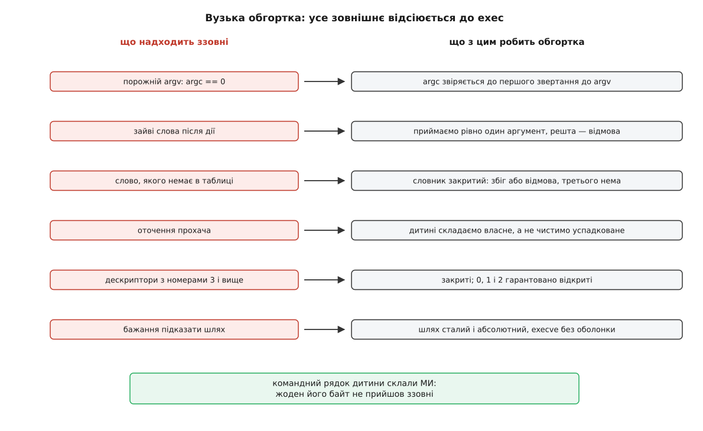

# ⚙️ Обгортка замість чужої програми: сто рядків на C, які й є дозволом

Правило в `sudoers` уміє сказати «оцю програму — від імені root», а сказати хочеться «оцю дію», і закрити цей проміжок можна тільки кодом. Нижче — робоча програма мовою C, яка знає рівно три дозволені дії й не вміє нічого понад них, правило sudoers для неї — і чотири місця, де такі обгортки ламаються попри найкращі наміри.

## Задача

Оператор Іван мусить уміти перезапустити, зупинити й побачити стан одного вебсервера. Більше на цій машині йому не належить нічого.

Спокуса — записати це майже дослівно: `ivan ALL = NOPASSWD: /usr/bin/systemctl restart nginx`. Але звузити правилом чужу програму не виходить принципово, а не через недогляд у синтаксисі. `systemctl` розуміє понад сотню підкоманд, читає власні змінні оточення й за потреби кличе сторінковий переглядач; правило ж — це фільтр над **нескінченним** простором командних рядків, причому алфавіт цього простору вибирали не ви. Кожен фільтр над нескінченністю має дірки, і питання лише в тому, хто знайде їх першим.

## Ідея

Перевернути напрям: не звужувати чужий алфавіт, а завести свій — маленький і скінченний.

Програма приймає **одне слово — ім'я дії** — і сама будує командний рядок, якого прохач ніколи не бачив і не міг підказати. Перевірка тоді перестає бути порівнянням тексту зі зразком і стає пошуком у таблиці: слово в ній або є, або немає, третього стану нема. Дірку в такій перевірці не знайти — і не тому, що перевірку старанно зробили, а тому, що ховатися ніде: множина дозволеного скінченна й уся видима на екрані.

Друга обставина не менш важлива. Обгортка **не мусить бути setuid** — права їй дає правило в sudoers, тож файл лишається звичайним `root:root 0755`, і в системі не додається ще однієї програми з бітом. Але звідси ж випливає обмеження. Захисту динамічного завантажувача, який для setuid-програм [викидає LD_PRELOAD і сусідів](root:sys-unix/library-search-order), тут немає: з погляду ядра це звичайний запуск. Тож якщо `env_reset` десь послаблено, змінна на кшталт `LD_PRELOAD` дійде аж до обгортки, і полагодити це вже пізно — завантажувач відпрацював до `main`. Лишається одне правило, і воно залізне: **обгортка не ухвалює жодного рішення на підставі оточення**. Те, чим вона справді розпоряджається, — оточення своєї дитини.



*Кожен рядок ліворуч — [те, що дитина успадковує від того, хто її запускає](root:sys-unix/argv-and-environment); праворуч — місце, де це успадкування обривають.*

## Код

Уся програма тримається на одній таблиці й одному `execve`. Оточення дитини не «чиститься», а складається з нуля: у списку, зібраному вручну, не може лишитися того, про що ви не подумали, — а в очищеному може.

:::code proj-sudo-wrapper/c/svcctl.c

Перевірка `argc` стоїть найпершою не для симетрії. Ядро довго дозволяло запустити програму взагалі без нульового аргументу: `execve` з порожнім масивом давав `argc == 0`, і тоді `argv[0]` — це вже не ім'я програми, а `NULL`, а `argv[1]` показує за межу масиву — в область змінних оточення. Саме на цьому в січні 2022 року Qualys побудували `PwnKit` (CVE-2021-4034): `pkexec` із [полкіта](root:sys-unix/polkit) читав `argv[1]`, не глянувши на `argc`, — читав за межею, а згодом туди ж і писав. Ядро цю можливість прибрало: від правки Kees Cook (мейнлайн 5.18, з бекпортами в стабільні гілки аж до 5.4) порожній `argv` мовчки перетворюється на один порожній рядок. Але покладатися на версію ядра тут нема потреби — звірка `argc` перед першим звертанням до масиву коштує нічого й закриває весь клас разом.

Тут немає `system()` і `popen()`, і це не питання смаку. Обидві функції запускають `/bin/sh -c` — тобто повертають у гру весь алфавіт оболонки: лапки, `;`, `$(…)`, підстановки. Один-єдиний `execve` з готовим масивом віддає ядру рівно ті рядки, які ви написали, і жодного розбору по дорозі не відбувається.

## Правило sudoers для неї

```
# Слова, а не рядки: перелік скінченний, і кожен його елемент
# програма й так перевіряє сама.
Cmnd_Alias WEB_READ  = /usr/local/sbin/svcctl web-status
Cmnd_Alias WEB_WRITE = /usr/local/sbin/svcctl web-restart, \
                       /usr/local/sbin/svcctl web-stop

ivan     ALL = (root) NOPASSWD: WEB_READ, WEB_WRITE
%onduty  ALL = (root) NOPASSWD: WEB_READ
```

Два шари роблять тут різну роботу, і в цьому весь сенс поділу. Програма визначає **алфавіт** — які слова взагалі існують. Політика ділить цей алфавіт **між людьми**: черговий бачить стан, Іван ще й перемикає. Перерахування аргументів у правилі безпечне рівно тому, що множина скінченна, а програма однаково звіряє кожне слово сама: збіг із текстом уже нічого не вирішує.

Одна умова, без якої все марно: файл `/usr/local/sbin/svcctl` **і кожен каталог на шляху до нього** мусять належати root і бути недоступними операторові на запис. Інакше правило вказує на файл, який прохач замінить своїм, — і ви особисто дозволили йому запускати те, що він сам туди покладе.

> 🔧 **Навіщо це.** Цінність такої програми — у тому, чого вона **не** робить, а перевіряють зазвичай протилежне: запустили `svcctl web-restart`, побачили, що служба піднялася, і на цьому спинилися. Корисний набір перевірок увесь складається з відмов: виклик без аргументів, із двома, з незнайомим словом, із закритим виводом (`sudo svcctl web-status 1>&-`), із набитим оточенням (`LD_PRELOAD=/tmp/x.so PATH=/tmp sudo svcctl web-status`). Кожен із цих запусків мусить закінчитися або відмовою, або звичайною роботою — і жоден несподіванкою. Останній перевіряє заразом і політику: якщо змінна дійшла до дитини, `env_reset` десь послаблений, і винна вже не програма.

## Пастки

**Код виходу говорить двома голосами.** `sudo` віддає код виходу запущеної програми, але коли відмовляє сам — через політику, невдалу автентифікацію або неможливість запустити команду — виходить із кодом 1. Тому одиниця нічого не розрізняє: за нею стоїть і «не дозволено», і «команда впала». Свої коди варто тримати осторонь від неї — тому вище стоять 2 і 127, — а виклик обгортки в чужому сценарії не можна зводити до «нуль добре, решта погано»: `systemctl status` на зупиненій службі повертає 3, і це відповідь, а не помилка — [код виходу взагалі не ділиться надвоє на «добре» і «погано»](root:sys-unix/exit-status).

**Гонка між перевіркою шляху й користуванням ним.** Спокуслива обережність — перед запуском переконатися, що ціль належить root: `stat(p, &st)`, звірити `st.st_uid`, тоді `execve(p, …)`. Це два різні звертання до **імені**, а не до об'єкта, і між ними є проміжок. Якщо бодай один каталог на шляху записний прохачеві, він устигає перевісити [символьне посилання](root:sys-unix/hard-and-symbolic-links) на інший файл — перевірили одне, запустили друге. Лікується це не швидшою перевіркою, а звертанням до одного об'єкта: `fd = open(p, O_PATH | O_NOFOLLOW)`, далі `fstat(fd, …)` і `fexecve(fd, …)` — [дескриптор замість імені](root:sys-unix/at-family-syscalls) не можна підмінити на ходу. У коді вище цієї пастки немає лише тому, що шлях сталий і в жоден його складник ніхто, крім root, не пише; вона з'явиться тієї миті, коли обгортка візьме від прохача бодай ім'я файлу. Клас загалом відомий як [гонка між перевіркою й використанням](root:sf-security/toctou-race).

**Дескриптори просочуються далі.** Усе, що обгортка відкрила до `execve`, лишається відкритим у дитині: [дескриптор переживає заміну образу](root:sys-unix/file-descriptor), якщо на ньому не стоїть позначка «закрити при exec». Привілейована обгортка, яка відкрила власний журнал на дозапис без `O_CLOEXEC`, віддає дитині право писати у файл, що належить root, — і жодної перевірки прав на цьому дескрипторі вже не буде, бо перевірка відбулася в мить `open`. Звідси три звички разом: `O_CLOEXEC` на всьому, що відкриваєте самі; `close_range` на старті — проти чужого спадку; і `closelog()` перед `execve`, бо сокет журналу відкрився вже **після** прибирання. Зворотний бік того самого — прогалини на місцях 0, 1 і 2, які закриває `fix_std_fds`.

**Шаблон в аргументах правила не рятує.** Здається, що замість переліку можна написати `/usr/local/sbin/svcctl web-*` — «будь-яка дія родини web». Насправді sudoers звіряє аргументи як **один склеєний рядок**, тож `*` вільно переходить межі слів; у цій частині правила скісна риска теж збігається з шаблоном (на відміну від частини зі шляхом, де `/` шаблоном не покривається), а до канонічного вигляду шляхи ніхто не зводить, тому `..` доживає до кінця. Виклик `sudo svcctl web-status --config /tmp/mine` дає склеєний рядок `web-status --config /tmp/mine`, і зразок `web-*` збігається з ним цілком — разом із пробілом і скісною рискою. Якби програма приймала зайві аргументи, правило їх не спинило б. Ось чому `argc != 2` у коді не педантизм: це єдина справжня межа, а рядок у політиці — лише вибір слова з уже обмеженого набору.

## Чого це коштує

Кожна нова дія — правка таблиці, перезбірка й викладання нової програми на машини; для десятка служб це відчутно. Перелік можна винести у файл, доступний на читання лише root, і тоді перезбірка зникає — але розбір цього файлу стає привілейованим кодом, і вся сувора обережність переїжджає в нього разом із помилками, які там оселяться. Обмін чесний і його варто робити свідомо: у скомпільованій таблиці дозволене видно очима й воно проходить рецензію коду, а у файлі воно стає даними, які хтось колись відредагує вночі.

Той самий підхід зі скінченним словником дій, тільки без власного бінарника, дає [полкіт](root:sys-unix/polkit): дозволяють там не командний рядок, а іменовану дію. Ціна дзеркальна — писати доводиться не C, а правила й службу, яка ці дії виконує.
