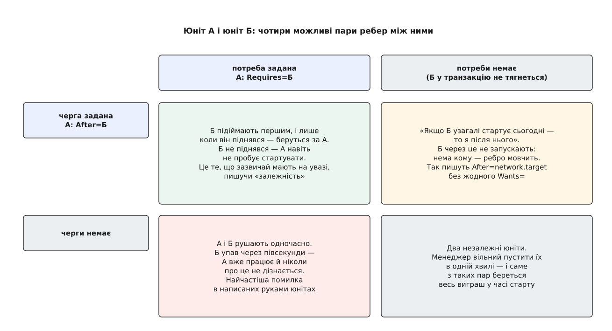
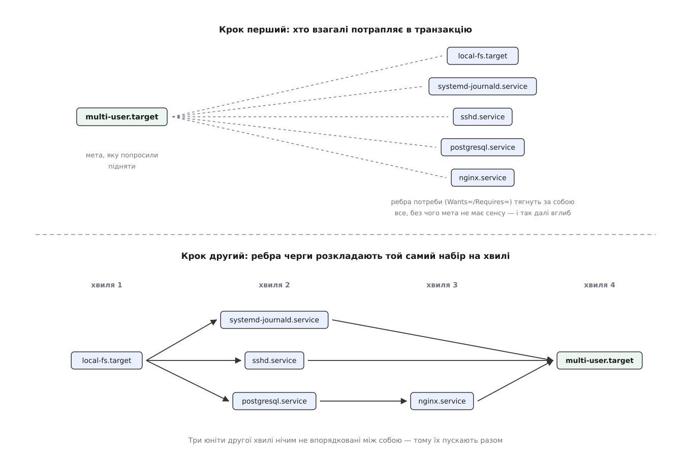
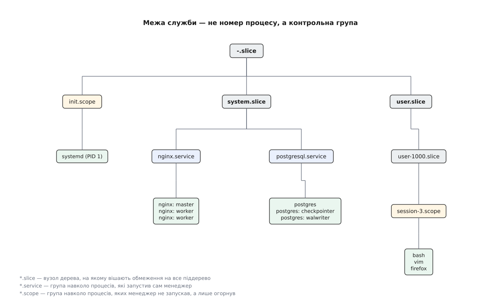

# systemd: юніти, стани, транзакції, D-Bus, cgroups

<preknowlist>
- [Роль init і особливість PID 1](root:sys-unix/init-and-pid1) — перший процес запускають усі інші, він же приймає сиріт і не має права завершитися.
- [Процес: що це насправді](root:sys-unix/process-model) — процес є набором ресурсів ядра з номером-ідентифікатором, а не «програмою, що біжить».
- [fork: розмноження процесу](root:sys-unix/fork-semantics) — новий процес постає копією наявного, і між копіюванням та підміною коду є проміжок.
- [Демонізація: відхід у фон](root:sys-unix/daemonize) — стара домовленість, за якою служба двічі відгалужується й тим свідомо рве зв'язок із тим, хто її запустив.
- [cgroups: облік і обмеження ресурсів](root:sys-unix/cgroups-resource-model) — ядро вміє групувати процеси в іменоване дерево, рахувати спожите й ставити межі на групу.
- [D-Bus: шина повідомлень простору користувача](root:sys-unix/dbus) — програми звертаються одна до одної за іменем на спільній шині, а не за номером процесу.
- [Монтування й дерево монтувань](root:sys-unix/mount-model) — файлові системи приєднують у точки дерева, і цей стан машина тримає в собі як список.
- [Топологічне сортування](root:sf-algorithms/topological-sort) — з орієнтованого графа без циклів можна дістати порядок, у якому кожен вузол іде після всіх, від кого залежить.
</preknowlist>

На звичайній системній машині між миттю, коли ядро передало керування першій програмі простору користувача (PID 1), і появою запрошення до входу мусить піднятися півтори-дві сотні окремих служб: журнал ядра, годинник реального часу, мережеві інтерфейси, точки монтування, підсистема аутентифікації, звук, бази даних, вебсервери та графічна оболонка. Кожна з них є окремим процесом або групою процесів, і майже кожна чогось потребує від інших: вебсервер безглуздий без бази даних, база не запишеться на накопичувач до монтування файлової системи, а файлова система не з'явиться доти, доки драйвер контролера не розпізнає дисковий пристрій.

Класична відповідь традиційного Unix — система SysV init — записувала цей запуск як набір імперативних сценаріїв оболонки `/bin/sh` у каталогах `/etc/rc[0-6].d/`, пронумерованих префіксами черги `S01...`, `S10...`, `S20...`. Скрипти виконувалися строго послідовно один за одним. На початку 2000-х років ця схема вперлася в три непереборні кризи, зумовлені не помилками коду, а самою моделлю:

1. **Блокуюча синхронність виконання.** Однопотокова черга змушувала систему чекати завершення кожного сценарію. Якщо служба виконувала довгі операції введення-виведення (очікування відповіді DHCP-сервера, перевірка дисків `fsck` чи затримка на ініціалізацію модема), усе завантаження зупинялося, а багатоядерні процесори та паралельні шини накопичувачів простоювали.
2. **Оверхед інтерпретатора.** Кожен shell-сценарій для найпростіших перевірок породжував десятки підпроцесів: `awk`, `sed`, `grep`, `cat`, `cut`, `sleep`. Запуск системи перетворювався на десятки тисяч важких викликів `fork()` та `execve()`, що витрачали процесорний час на розбір тексту та перемикання контексту.
3. **Криза відстеження процесів через подвійний `fork()`.** Традиційні демони відходили у фон шляхом демонізації: процес робив перший `fork()`, батько виходив, нащадок викликав `setsid()` для відриву від керівного терміналу, після чого робив другий `fork()`, а проміжний процес знову виходив. Онук ставав сиротою, яку перевсиновлював PID 1. Зв'язок між init-скриптом і процесом повністю рвався. Демон записував свій числовий PID у файл `/var/run/<служба>.pid`. Якщо демон раптово падав (через сигнал чи нестачу пам'яті OOM-killer), PID-файл лишався застарілим. Оскільки лічильник PID у ядрі циклічний (типово до 32768), після переповнення номер міг отримати зовсім інший процес, і наступна спроба зупинити службу командою `kill $(cat /var/run/<служба>.pid)` вбивала сторонню невинну програму. Дочірні ж процеси-робітники, відгалужені демоном, у разі його аварії взагалі губилися в системі некерованими сиротами, блокуючи порти й файли.

30 квітня 2010 року Леннарт Пьоттерінг (Lennart Poettering) та Кей Зіверс (Kay Sievers) опублікували маніфест «Rethinking PID 1», де сформулювали інший підхід. Замість виконання імперативних сценаріїв черги система будує **декларативний граф станів і залежностей**, де порядок обчислюється автоматично; процеси жорстко утримуються в межах контрольних груп ядра (cgroups); штучні точки очікування усуваються завдяки сокетній активації; а стан компонентів оркеструється через системну шину D-Bus.

## 11 типів юнітів: вузли єдиного графа

Опис кожної сутності, якою керує systemd, звуть **юнітом** (англ. unit — одиниця). Слово навмисно ширше за «службу» чи «програму». Речі, що залежать одна від одної, процесами не вичерпуються: розділ диска — не процес, мережевий порт — не процес, але вони мають стан (активний, неактивний, у збої) і беруть участь у графі.

Усі сутності зведено до 11 типів юнітів, кожен із яких інкапсулює поведінку конкретної підсистеми операційної системи й позначається відповідним суфіксом у назві:

1. **`.service`** — системна служба (демон, одноразова команда або фоновий обчислювач). Керує життєвим циклом виконуваного файлу: запуск (`ExecStart=`), зупинка (`ExecStop=`), перезавантаження конфігурації (`ExecReload=`) та політика відновлення після збоїв (`Restart=`).
2. **`.socket`** — точка входу міжпроцесної або мережевої комунікації (UNIX domain socket, порт TCP/UDP, черга FIFO або Netlink-сокет). Створюється й слухається менеджером PID 1 для сокетної активації, інкапсулюючи дескриптор до запуску відповідної служби.
3. **`.target`** — логічна точка групування та синхронізації. Не містить власного процесу й не виконує коду; служить іменованим станом графа (композитною заміною рівнів виконання runlevels).
4. **`.device`** — апаратний пристрій ядра, експортований через підсистему `/sys`. Менеджер `systemd-udevd` автоматично створює такі юніти для пристроїв із правилом `TAG+="systemd"`, дозволяючи іншим службам ставити залежності на появу фізичного обладнання (накопичувачів, мережевих карт).
5. **`.mount`** — точка монтування файлової системи в загальне дерево. Створюється вручну або генерується автоматично з рядків `/etc/fstab` утилітою `systemd-fstab-generator`. Назва юніта жорстко відповідає шляху монтування з заміною слешів на дефіси: шлях `/var/log` описується файлом `var-log.mount`.
6. **`.automount`** — точка відкладеного автоматичного монтування. Створює фіктивну точку монтування через ядрову підсистему `autofs`. Під час першої спроби будь-якого процесу звернутися до каталогу (`open()`, `stat()`), ядро призупиняє процес, systemd монтує справжній `.mount`-юніт і прозоро розблоковує операцію процесу.
7. **`.swap`** — розділ або файл підкачки оперативної пам'яті (`swapon`). Ініціалізується менеджером і також автоматично транслюється з `/etc/fstab`.
8. **`.timer`** — таймер або планувальник запуску подій за розкладом. Підтримує як монотонні таймери відносно подій (`OnBootSec=`, `OnUnitActiveSec=`), так і календарні вирази реального часу (`OnCalendar=`). Замінює класичні демони `cron` та `at`, використовуючи системний виклик `timerfd_create` ядра Linux замість постійного опитування в циклі.
9. **`.path`** — монітор файлової системи на основі ядра `inotify`. Стежить за наявністю (`PathExists=`), зміною (`PathChanged=`) або наповненням каталогів (`DirectoryNotEmpty=`) і запускає однойменний чи вказаний `.service`.
10. **`.slice`** — вузол дерева контрольних груп (cgroups v2) для ієрархічного розподілу ресурсів (`system.slice`, `user.slice`, `machine.slice`). Сам по собі не виконує команд, але задає ліміти процесора, пам'яті та вводу-виводу для всіх вкладених юнітів.
11. **`.scope`** — група процесів, створених зовнішніми програмами (сеанс користувача від `systemd-logind` чи контейнер від runtime середовища), а не запущених systemd безпосередньо. Служить для накладання меж і обліку ресурсів на вже наявні процеси.

Граф юнітів не є суто статичним: файли `.service` та `.target` пише людина або пакувальник, але `.device` з'являються від ядра через udev, а `.mount` генеруються з поточної таблиці монтування ядра.

## Ієрархія оверлеїв конфігурації, Drop-in каталоги та маскування

Декларативна модель systemd будується на принципі розділення базового образу операційної системи, тимчасового рантайм-стану та локальних налаштувань адміністратора. Щоб оновлення системи пакетами ніколи не перезаписували правок системного інженера, а тимчасові експерименти не лишали сміття на диску, завантажувач юнітів спирається на сувору тришарову ієрархію каталогів пошуку (Unit Search Path Hierarchy).

### Трирівнева ієрархія каталогів пошуку

Коли транзакційному рушію потрібен файл юніта (наприклад, `nginx.service`), менеджер PID 1 опитує каталоги файлової системи у фіксованому порядку спадання пріоритету:

1. **`/etc/systemd/system/` — Шар системного адміністратора (найвищий статичний пріоритет).**
   Тут розміщуються конфігурації, створені людиною вручну, файли з локальних систем керування конфігураціями (Ansible, Puppet) та символьні посилання ввімкнення (`.wants/`, `.requires/`). Файли в `/etc` є персистентними: жоден пакунковий менеджер (`apt`, `dnf`, `pacman`) не має права перезаписувати або видаляти файли в цьому каталозі під час оновлення дистрибутива.
2. **`/run/systemd/system/` — Шар середовища виконання та ефемерних юнітів (рантайм-пріоритет).**
   Змонтований у пам'яті (`tmpfs`). Сюди записують тимчасові юніти утиліти динамічного запуску (`systemd-run`), генератори ранніх етапів та сервіси контейнеризації. Вміст каталогу повністю зникає під час перезавантаження комп'ютера. Оверлей у `/run` дозволяє модифікувати конфігурацію служби виключно на поточний сеанс роботи машини без ризику пошкодити постійне сховище.
3. **`/usr/lib/systemd/system/` (або `/lib/systemd/system/`) — Шар постачальника операційної системи (vendor layer, базовий пріоритет).**
   Сюди пакунковий менеджер установлює еталонні файли юнітів з дистрибутивних пакетів. Цей каталог вважається незмінним надбанням дистрибутива (read-only для адміністратора). При оновленні пакунка файли в `/usr/lib/` безумовно замінюються новими версіями.

Крім основних шляхів, архітектура підтримує спеціалізовані префікси:
- `/etc/systemd/system.control/` та `/run/systemd/system.control/` — зберігають динамічні зміни властивостей юнітів (наприклад, оновлені ліміти оперативної пам'яті чи CPU), накладені командою `systemctl set-property` через шину D-Bus;
- `/run/systemd/transient/` — вміщує транзитні одноразові юніти, створені викликами API;
- `/run/systemd/generator.early/`, `/run/systemd/generator/` та `/run/systemd/generator.late/` — три фази генерації юнітів з зовнішніх описів.

Для сеансового менеджера користувача (`systemd --user`) діє симетрична ієрархія з урахуванням специфікації XDG: `~/.config/systemd/user/` (користувач) → `/etc/systemd/user/` (адміністратор для всіх користувачів) → `/run/systemd/user/` (рантайм користувача) → `/usr/lib/systemd/user/` (пакунки).

```
Пріоритет завантаження юніта (зверху вниз):
┌────────────────────────────────────────────────────────┐
│  /etc/systemd/system.control/                          │ ◄── systemctl set-property
├────────────────────────────────────────────────────────┤
│  /run/systemd/system.control/                          │ ◄── рантайм-властивості D-Bus
├────────────────────────────────────────────────────────┤
│  /run/systemd/transient/                               │ ◄── systemd-run --transient
├────────────────────────────────────────────────────────┤
│  /run/systemd/generator.early/                         │ ◄── ранні генератори
├────────────────────────────────────────────────────────┤
│  /etc/systemd/system/          (АДМІНІСТРАТОР)         │ ◄── постійні ручні налаштування
├────────────────────────────────────────────────────────┤
│  /run/systemd/system/          (РАНТАЙМ / TMPFS)       │ ◄── ефемерні налаштування сеансу
├────────────────────────────────────────────────────────┤
│  /run/systemd/generator/                               │ ◄── стандартні генератори (fstab)
├────────────────────────────────────────────────────────┤
│  /usr/local/lib/systemd/system/                        │ ◄── локально скомпільований софт
├────────────────────────────────────────────────────────┤
│  /usr/lib/systemd/system/      (ВЕНДОР / ДИСТРИБУТИВ)  │ ◄── пакунки apt/dnf/pacman
├────────────────────────────────────────────────────────┤
│  /run/systemd/generator.late/                          │ ◄── генератори останнього шансу
└────────────────────────────────────────────────────────┘
```

### Повне затінення проти часткових правок

Якщо файл з ідентичним іменем існує в кількох шарах, PID 1 завантажує **лише перший знайдений файл** за спаданням пріоритету. Файл `/etc/systemd/system/nginx.service` повністю приховує (shadows) однойменний файл у `/usr/lib/systemd/system/nginx.service`.

Повне копіювання файлу з `/usr/lib/` до `/etc/` заради зміни одного параметра (наприклад, збільшення `LimitNOFILE=`) є грубим антипатерном: створена копія назавжди «заморожує» стан конфігурації. Коли наступне оновлення пакунка принесе виправлення безпеки в директивах `ProtectSystem=` або оновить шляхи бінарників у `ExecStart=`, система продовжуватиме виконувати застарілий файл із `/etc/`, ігноруючи покращення від мейнтейнерів.

### Механізм Drop-in (доважки): накладання модифікаторів

Для внесення точкових змін systemd використовує каталог доважок (drop-in directory). Менеджер шукає каталоги, чия назва збігається з повним іменем юніта з додаванням суфікса `.d` (наприклад, `nginx.service.d/`), і зчитує всі файли з розширенням `*.conf` усередині них.

Доважки діють на п'яти рівнях гранулярності:
1. **Конкретний юніт:** `/etc/systemd/system/nginx.service.d/*.conf` — модифікує виключно службу `nginx.service`.
2. **Шаблонні юніти:** `/etc/systemd/system/worker@.service.d/*.conf` — поширює конфігурацію на абсолютно всі екземпляри шаблону `worker@`.
3. **Окремий екземпляр шаблону:** `/etc/systemd/system/worker@gpu0.service.d/*.conf` — перекриває налаштування лише для екземпляра `gpu0`.
4. **Префіксні ієрархії зрізів:** `/etc/systemd/system/user-.slice.d/*.conf` — накладає правила на всі вкладені зрізи користувачів (`user-1000.slice`, `user-1001.slice`).
5. **Загальносистемні для типу:** `/etc/systemd/system/service.d/*.conf` — модифікує поведінку **всіх** `.service`-юнітів операційної системи (наприклад, для глобального аудиту або встановлення лімітів пам'яті).

#### Алгоритм злиття конфігурацій (Merge Algorithm)

Збирання фінального стану юніта виконується за чітким математичним алгоритмом:
1. Завантажується основний файл юніта найвищого пріоритету.
2. Менеджер сканує всі каталоги пошуку юнітів і формує список усіх знайдених файлів `*.conf` у відповідних `.d/` каталогах.
3. **Файли з різними іменами** зливаються в строгому лексикографічному порядку їхніх імен за кодами ASCII (незалежно від каталогу, де вони лежать). Тому файли прийнято іменувати з числовими префіксами: `10-resources.conf`, `50-network.conf`, `99-overrides.conf`.
4. **Файли з однаковими іменами** у різних шарах ієрархії змагаються за пріоритетом каталогів: файл `/etc/systemd/system/nginx.service.d/50-limits.conf` повністю витісняє `/usr/lib/systemd/system/nginx.service.d/50-limits.conf`.

#### Семантика обробки директив: скаляри проти списків

Під час послідовного накладання доважок директиви обробляються за двома різними правилами:

- **Скалярні директиви** (`Type=`, `User=`, `Group=`, `Restart=`, `TimeoutStartSec=`): кожне наступне присвоєння безумовно перезаписує старе значення новим.
- **Директиви-списки** (`ExecStart=`, `ExecStop=`, `Environment=`, `Wants=`, `ReadWritePaths=`): кожне наступне присвоєння додає новий елемент у кінець списку.

```ini
# /usr/lib/systemd/system/app.service (пакунок)
[Service]
Type=simple
ExecStart=/usr/bin/app --default-mode

# /etc/systemd/system/app.service.d/10-custom.conf (доважка адміністратора)
[Service]
# ПОМИЛКА: додасть другу команду запуску, що заборонено для Type=simple!
# ExecStart=/usr/local/bin/app --custom-mode

# ПРАВИЛЬНО: порожнє значення очищає список перед новим записом
ExecStart=
ExecStart=/usr/local/bin/app --custom-mode
```

Порожнє присвоєння `ExecStart=` скидає внутрішній масив команд запуску до нуля. Без цього рядка менеджер розцінить спробу додати другий `ExecStart` у службі з типом `Type=simple` як критичну синтаксичну помилку й відхилить завантаження юніта.

Команда `systemctl edit nginx.service` автоматично створює каталог `/etc/systemd/system/nginx.service.d/` і відкриває файл `override.conf` у текстовому редакторі, а після збереження самостійно ініціює перезавантаження графа в пам'яті.

### Маскування юнітів (Unit Masking): абсолютне блокування

У системному адмініструванні часто виникає потреба назавжди вимкнути небажану службу (наприклад, `cups.service`, `apt-daily.service` чи `bluetooth.service`). Звичайна команда `systemctl disable` лише видаляє символьні посилання з каталогів автозапуску `.wants/` та `.requires/`. Це не захищає службу від запуску:
- будь-який користувач із правами root може викликати `systemctl start cups.service`;
- якщо інша активована служба містить `Requires=cups.service` або `Wants=cups.service`, служба `cups` запуститься транзакційним рушієм автоматично;
- поява D-Bus запиту на шині активує службу через D-Bus activation;
- udev-подія або сокет-активація розбудять юніт.

Щоб повністю унеможливити запуск юніта за будь-яких обставин, застосовується **маскування** (masking):

```sh
# Персистентне маскування в /etc (живе постійно)
systemctl mask apt-daily.service

# Тимчасове маскування в /run (діє лише до перезавантаження)
systemctl mask --runtime apt-daily.service
```

#### Низькорівневий механізм маскування

Під час виконання `systemctl mask` менеджер створює в каталозі `/etc/systemd/system/` (або `/run/systemd/system/`) символьне посилання з назвою юніта, яке вказує на псевдопристрій ядра `/dev/null`:

```sh
/etc/systemd/system/apt-daily.service -> /dev/null
```

Оскільки каталог `/etc/systemd/system/` має вищий пріоритет за системний `/usr/lib/systemd/system/`, посилання на `/dev/null` затінює справжній файл служби від дистрибутива.

Коли парсер PID 1 зустрічає в шляху пошуку символьне посилання, що веде на `/dev/null`, завантажувач переводить об'єкт у спеціальний стан `UnitLoadState = UNIT_MASKED`. Наслідки такого стану є абсолютними:
1. Юніт неможливо запустити вручну: виклик `systemctl start apt-daily.service` негайно повертає помилку `Unit apt-daily.service is masked`.
2. Транзакційний менеджер ігнорує вимоги `Requires=` та `Wants=` від інших служб або оголошує помилку неможливості побудови транзакції.
3. Генератори не можуть перезаписати юніт, оскільки маска в `/etc` перекриває рантайм-генератори.
4. Жоден пакунковий менеджер під час оновлення чи перевстановлення пакетів не зможе запустити замасковану службу.

Зняття маски виконується командою `systemctl unmask apt-daily.service`, яка фізично видаляє символьне посилання на `/dev/null` із каталогу конфігурації.

Інспекцію накладених оверлеїв здійснюють за допомогою двох утиліт:
- **`systemd-delta`** — сканує всю ієрархію дисків і виводить повний звіт про перекриті (`[OVERRIDDEN]`), розширені доважками (`[EXTENDED]`) та замасковані (`[MASKED]`) юніти;
- **`systemctl cat <юніт>`** — друкує на екран вміст основного файлу юніта та всі застосовані до нього доважки в порядку їхнього злиття.

## Шаблони, екземпляри та підстановка специфікаторів

Типова операційна система вимагає запуску багатьох однотипних ізольованих компонентів: консолей віртуальних терміналів на портах `tty1..tty6`, клієнтських тунелів OpenVPN або WireGuard для різних датацентрів, екземплярів СУБД для окремих баз чи ізольованих контейнерів `systemd-nspawn`. Створювати окремий статичний `.service`-файл для кожного підключення — це дублювання коду та прямий шлях до помилок адміністрування.

systemd вирішує цю проблему через архітектуру **шаблонів юнітів** (Template Units) та підстановку специфікаторів на етапі синтаксичного розбору.

### Анатомія шаблону та інстанціювання

Файл шаблону позначається знаком `@` безпосередньо перед суфіксом типу юніта:

```
/usr/lib/systemd/system/container@.service
/usr/lib/systemd/system/serial-getty@.service
/usr/lib/systemd/system/openvpn-client@.service
```

Сам по собі шаблонний файл `container@.service` запустити неможливо. Він служить декларативним кресленням. Коли користувач або скрипт ініціює запуск конкретного екземпляра (Instance), рядок між символом `@` та крапкою розширення визначає ідентифікатор екземпляра:

```sh
# Запуск екземпляра з параметром "production"
systemctl start container@production.service

# Увімкнення екземпляра для послідовного порту ttyUSB0
systemctl enable --now serial-getty@ttyUSB0.service
```

Під час отримання такого запиту PID 1 виконує наступну послідовність:
1. Перевіряє наявність спеціалізованого файлу `container@production.service` в ієрархії каталогів пошуку. Якщо адміністратор створив персональний файл для цього екземпляра, завантажується саме він.
2. Якщо індивідуального файлу немає, завантажується базовий шаблон `container@.service`.
3. Менеджер динамічно створює в оперативній пам'яті новий об'єкт юніта з повним ім'ям `container@production.service`, присвоює йому параметри `instance = "production"` та `prefix = "container"` і запускає процедуру підстановки специфікаторів.

### Двигун підстановки специфікаторів (Specifier Expansion)

Під час парсингу кожної директиви в секціях `[Unit]`, `[Service]`, `[Socket]`, `[Mount]` або `[Install]` синтаксичний аналізатор сканує текст на наявність форматованих специфікаторів, що починаються з символу `%`:

| Специфікатор | Що підставляється менеджером | Приклад для `openvpn@client\x2dlon.service` |
| --- | --- | --- |
| `%i` | Рядок екземпляра в сирому вигляді (raw instance) | `client\x2dlon` |
| `%I` | Рядок екземпляра зі знятим екрануванням (unescaped instance) | `client-lon` |
| `%n` | Повне ім'я юніта разом із суфіксом типу | `openvpn@client\x2dlon.service` |
| `%N` | Повне ім'я юніта без суфікса сорту | `openvpn@client\x2dlon` |
| `%p` | Префікс імені юніта до символу `@` | `openvpn` |
| `%P` | Префікс юніта зі знятим екрануванням | `openvpn` |
| `%j` | Остання частина префікса після дефіса | `openvpn` (або суфікс гілки зрізів) |
| `%J` | Остання частина префікса зі знятим екрануванням | `openvpn` |
| `%f` | Розкодований рядок екземпляра або префікса з початковим слешем `/` | `/client-lon` |
| `%h` | Домашній каталог користувача, під яким виконується процес | `/home/deploy` або `/root` |
| `%t` | Корінь каталогу рантайм-даних (`/run` для системи, `/run/user/<UID>` для користувача) | `/run` |
| `%S` | Корінь сховища стану (`/var/lib` для системи, `~/.local/state` для користувача) | `/var/lib` |
| `%L` | Корінь каталогів журналів (`/var/log` або `~/.local/state/log`) | `/var/log` |
| `%E` | Корінь файлів конфігурації (`/etc` або `~/.config`) | `/etc` |
| `%C` | Корінь дискового кешу (`/var/cache` або `~/.cache`) | `/var/cache` |
| `%u` / `%U` | Текстове ім'я користувача процесу та його числовий UID | `root` / `0` |
| `%g` / `%G` | Текстова назва групи процесу та її числовий GID | `root` / `0` |
| `%H` / `%m` | Ім'я мережевого хоста (`hostname`) та 128-бітний `machine-id` | `srv-node-01` / `b8a...` |
| `%%` | Символ відсотка (екранування знака `%`) | `%` |

Усі корені каталогів (`%S`, `%L`, `%E`, `%C`, `%t`) автоматично транслюються відповідно до контексту виконання: для системного PID 1 вони розкриваються в класичні шляхи FHS під `/var` та `/etc`, а для менеджера користувача (`systemd --user`) — у стандартні змінні оточення XDG Base Directory. Це дозволяє писати повністю переносні юніти, що однаково працюють у системному та користувацькому режимах.

### Алгоритм екранування шляхів: `systemd-escape`

Оскільки назви юнітів транслюються у шляхи об'єктів D-Bus (`/org/freedesktop/systemd1/unit/...`) та імена каталогів cgroups v2 (`/sys/fs/cgroup/system.slice/...`), ім'я юніта не може містити прямих слешів `/`, пробілів чи керівних символів.

Коли параметром екземпляра є шлях у файловій системі (наприклад, дисковий пристрій `/dev/sda1` або точка монтування `/mnt/backup`), застосовується алгоритм екранування `systemd-escape`:

1. Початковий і кінцевий слеші відкидаються.
2. Кожен внутрішній символ слеша `/` замінюється на одинарний дефіс `-` (сам корінь `/` кодується як одинокий дефіс `-`).
3. Символи дефіса `-`, крапка на початку рядка, пробіли та всі байти поза множиною `[a-zA-Z0-9_:]` замінюються на їхні ASCII шістнадцяткові коди у форматі `\xNN`.

```sh
# Екранування шляху дискового розділу:
$ systemd-escape --path "/dev/disk/by-uuid/550e8400-e29b-41d4-a716"
dev-disk-by\x2duuid-550e8400\x2de29b\x2d41d4\x2da716

# Зворотне розгортання:
$ systemd-escape -u --path "dev-disk-by\x2duuid-550e8400\x2de29b\x2d41d4\x2da716"
/dev/disk/by-uuid/550e8400-e29b-41d4-a716
```

Саме тому існує фундаментальна різниця між специфікаторами `%i` та `%I`:
- `%i` дає рядок у закодованому для systemd вигляді (`dev-disk-by\x2duuid-...`), що підходить для формування імен допоміжних юнітів або cgroups;
- `%I` повністю розкодовує шлях (`/dev/disk/by-uuid/...`), що є обов'язковим для передачі як аргумент командного рядка в `ExecStart=`.

### Практичний приклад: повнофункціональний шаблон ізольованої служби

Нижче наведено виробничий шаблон контейнеризованої служби, що демонструє спільну роботу специфікаторів, автоматичного виділення каталогів та ізоляції:

```ini
# /etc/systemd/system/app-worker@.service
[Unit]
Description=Ізольований обробник черги [%I]
Documentation=https://internal.docs/worker
After=network-online.target
Wants=network-online.target
PartOf=app-workers.target

[Service]
Type=notify
User=appworker
Group=appworker

# Динамічне розгортання шляхів бінарника та конфігурації
ExecStart=/usr/local/bin/worker-engine \
    --instance-name=%I \
    --config=%E/%p/%i.conf \
    --socket-path=%t/%p/%i.sock \
    --data-dir=%S/%p/%i \
    --log-dir=%L/%p/%i

# Менеджер автоматично створює зазначені каталоги з правами користувача User=
RuntimeDirectory=%p/%i
StateDirectory=%p/%i
LogsDirectory=%p/%i
ConfigurationDirectory=%p

Restart=on-failure
RestartSec=5s

[Install]
WantedBy=multi-user.target
DefaultInstance=default
```

При активації команди `systemctl start app-worker@shard1.service`:
- `%p` розкривається у `app-worker`;
- `%i` та `%I` отримують значення `shard1`;
- `RuntimeDirectory=app-worker/shard1` автоматично створює безпечний каталог `/run/app-worker/shard1/` з власником `appworker:appworker`;
- `StateDirectory=app-worker/shard1` виділяє постійне сховище `/var/lib/app-worker/shard1/`;
- `ConfigurationDirectory=app-worker` прив'язує доступ до `/etc/app-worker/`;
- `DefaultInstance=default` у секції `[Install]` гарантує, що виклик `systemctl enable app-worker@.service` без явного суфікса створить автозапуск для екземпляра `app-worker@default.service`.

Повний синтаксис директив, секцій і правил перекриття описано в [окремій довідці за директивами юнітів](root:sys-unix/systemd-model/api-unit-directives.md).

## Динамічний синтез графа: генератори юнітів

Перший процес операційної системи не повинен містити складних або нестабільних парсерів сторонніх форматів. Якби логіку розбору текстової таблиці `/etc/fstab`, парсингу розмітки дискових розділів GPT чи обробки застарілих shell-сценаріїв SysV init зашили безпосередньо в код бінарника PID 1, будь-яка синтаксична помилка чи збійний покажчик у парсері спричинили б паніку ядра (`kernel panic`) і падіння всієї машини. Крім того, додавання нових форматів конфігурації вимагало б зміни та перекомпіляції самого ініціалізатора.

systemd вирішує це через архітектуру **генераторів юнітів** (systemd generators). Генератор — це компактна автономна виконувана програма (скомпільований C-бінарник або скрипт), що розміщується у визначених системних каталогах:
- `/etc/systemd/system-generators/` — локальні генератори системного адміністратора;
- `/usr/local/lib/systemd/system-generators/` — генератори локально встановлених сторонніх пакунків;
- `/lib/systemd/system-generators/` (або `/usr/lib/systemd/system-generators/`) — системні генератори ядра дистрибутива (аналогічно існують каталоги `user-generators` для менеджера користувача).

### Протокол виклику та три цільові каталоги

PID 1 запускає всі знайдені генератори синхронно на найранішому етапі ініціалізації — ще до того, як транзакційний менеджер починає зчитувати файли юнітів і будувати граф у пам'яті. Генератори також повторно виконуються під час кожного виклику `systemctl daemon-reload`.

Менеджер викликає кожен генератор, передаючи йому рівно три позиційні аргументи — шляхи до каталогів у тимчасовій пам'яті (`tmpfs` під `/run`):
1. `$1` (`normal-dir` — `/run/systemd/generator/`): стандартний пріоритет. Згенеровані тут файли юнітів перекривають конфігурації пакунків у `/usr/lib/systemd/system/`, але поступаються ручним файлам адміністратора в `/etc/systemd/system/`.
2. `$2` (`early-dir` — `/run/systemd/generator.early/`): найвищий пріоритет. Юніти звідси перекривають навіть статичні конфігурації адміністратора в `/etc`.
3. `$3` (`late-dir` — `/run/systemd/generator.late/`): резервний найнижчий пріоритет. Використовується як останній шанс, якщо юніт не визначено в жодному іншому каталозі системи.

Генератор зчитує зовнішню конфігурацію, синтезує нативні файли юнітів, доважки (`drop-in` конфігурації в каталогах `*.d/*.conf`) та символьні посилання залежностей (`.wants/`, `.requires/`), записує їх у надані каталоги й завершує роботу.

```
/etc/fstab, GPT, cmdline
         │
         ▼
┌──────────────────────────────────────────────┐
│  system-generators (виконуються синхронно)  │
│  systemd-fstab-generator, gpt-auto-generator │
└──────────────────────┬───────────────────────┘
                       │ генерують юніти у tmpfs
                       ▼
         /run/systemd/generator/
         ├── home.mount
         ├── var-log.mount
         └── local-fs.target.requires/
                       │
                       ▼
┌──────────────────────────────────────────────┐
│  PID 1: завантаження юнітів у граф DAG       │
└──────────────────────────────────────────────┘
```

### Генератори в ядрі системи

Серед штатних генераторів ключову роль у формуванні початкового стану відіграють:

- **`systemd-fstab-generator`** — зчитує `/etc/fstab` та параметри командного рядка ядра (`root=`, `rootfstype=`, `rootflags=`, `fstab=`). Для кожного рядка монтування утиліта:
  * Екранує шлях монтування в ім'я юніта за правилами `systemd-escape --path`: точка `/var/log` стає файлом `var-log.mount`, корінь `/` — `-.mount`.
  * Заповнює секцію `[Mount]` директивами `What=`, `Where=`, `Type=`, `Options=`.
  * Створює ребра черги `Before=local-fs.target` та `After=local-fs-pre.target` (для локальних дисків) або `Before=remote-fs.target` та `After=remote-fs-pre.target` (якщо в опціях присутній прапорець `_netdev`).
  * Додає ребра `RequiresMountsFor=` для батьківських шляхів, гарантуючи коректну ієрархію монтування вкладених каталогів.
  * Генерує `.swap`-юніти для розділів і файлів підкачки з прив'язкою до `swap.target`.
  * Транслює специфічні прапорці монтування: опція `x-systemd.automount` автоматично породжує однойменний `.automount`-юніт; `x-systemd.device-timeout=` задає час очікування появи пристрою в udev; прапорець `nofail` створює посилання в `local-fs.target.wants/` замість жорсткого `local-fs.target.requires/`.
- **`systemd-gpt-auto-generator`** — втілює специфікацію відкритих розділів (Discoverable Partitions Specification — DPS). На комп'ютерах з архітектурою UEFI генератор інспектує таблицю GPT завантажувального накопичувача. За стандартизованими GUID типів розділів генератор самостійно ідентифікує кореневу файлову систему, розділи `/home`, `/srv`, `/var`, `/var/tmp` та swap, автоматично піднімаючи точки монтування без потреби тримати записи в `/etc/fstab`.
- **`systemd-sysv-generator`** — зчитує заголовки Linux Standard Base (`### BEGIN INIT INFO`, `Required-Start:`, `Default-Start:`) зі старих shell-скриптів у `/etc/init.d/` і створює тимчасові юніти-обгортки `.service` з відповідними ребрами `Requires=` та `After=`.

Усі згенеровані юніти є ефемерними й живуть виключно в оперативній пам'яті. Коли адміністратор редагує `/etc/fstab` і виконує `systemctl daemon-reload`, PID 1 повністю очищає вміст `/run/systemd/generator*`, наново викликає генератори й без перезавантаження ОС перебудовує граф монтувань.

## Двовимірна матриця залежностей: просторові проти часових

Зв'язки між юнітами в systemd розділені на дві строго незалежні осі, змішування яких є найчастішим джерелом помилок системного адміністрування:

- **Просторова вісь (потреба):** відповідає на питання «*чи повинен цей юніт увійти до складу транзакції*» і «*що робити, якщо стан сусіда змінився*».
- **Часова вісь (черга / порядок):** відповідає на питання «*в якій послідовності виконувати переходи станів, якщо обидва юніти вже потрапили в роботу*».

Директиви потреби **не визначають порядку запуску**. Оголошення `Requires=foo.service` повідомляє менеджеру лише те, що службу `foo` слід додати в транзакцію, але нічого не каже про те, чи треба чекати на її старт. Без директив порядку обидві служби стартують абсолютно одночасно.



*Найнебезпечніша клітинка — ліва нижня: потребу оголосили, чергу забули, і збій потрібного юніта проходить непоміченим.*

Повний набір директив просторової осі розрізняється силою зв'язку та поведінкою на збої:

- **`Wants=`** — слабка потреба (рекомендований вибір за замовчуванням). Замовляє включення названого юніта в транзакцію. Якщо названий юніт не зміг запуститися або зазнав аварії, це ніяк не блокує старт нашого юніта.
- **`Requires=`** — сильна потреба. Додає юніт у транзакцію. Якщо потрібний юніт зазнає невдачі на старті (і на нього встановлено `After=`), наш юніт скасовується. Якщо потрібний юніт пізніше явно зупиняють (`systemctl stop`), наш юніт зупиняється автоматично.
- **`Requisite=`** — строга перевірка передумови. Не додає названий юніт у транзакцію, а лише перевіряє його поточний стан: якщо він не активний у цю саму мить, наш юніт негайно зазнає відмови.
- **`BindsTo=`** — надсильна прив'язка до життєвого циклу. На додачу до поведінки `Requires=`, відстежує раптову загибель процесу чи зникнення пристрою (hot-unplug): якщо прив'язаний юніт раптово переходить у неактивний стан або видаляється з ядра, наш юніт негайно примусово зупиняється.
- **`PartOf=`** — одностороння агрегація зупинки та перезапуску. Не запускає названий юніт, але якщо названий юніт зупиняють чи перезапускають, дія ретранслюється на наш юніт.
- **`Upholds=`** — активний наглядач (введено в systemd 249). Якщо цільовий юніт стає неактивним або падає з помилкою, systemd негайно перезапускає його знову, і так триває доти, доки активний юніт-наглядач.
- **`Conflicts=`** — негативна потреба (взаємне виключення). Запуск одного юніта генерує завдання зупинки для іншого.

Часова вісь задається двома симетричними директивами:
- **`After=B`** — якщо юніти A і B запускаються в одній транзакції, роботу над A починають лише після того, як юніт B повністю перейшов у стан готовності. При вимкненні черга автоматично інвертується: юніт A зупиняється *до* початку зупинки юніта B.
- **`Before=B`** — юніт A мусить завершити запуск *до* початку запуску юніта B (при зупинці — A зупиняється *після* B).

Комбінація `Requires=` без `After=` створює класичний стан гонитви (race condition): залежний сервіс стартує паралельно з базою даних, намагається підключитися до ще не створеного сокета й падає з помилкою, хоча формально залежність була прописана.

## Ціль — це ім'я для стану

Юніт типу `.target` не виконує бінарних файлів і не відкриває портів. Це чистий вузол агрегації графа, що служить для синхронізації та композиції станів системи.

Цілі замінили однознакові рівні виконання (runlevels 0..6) системи SysV init. Замість єдиного глобального числа systemd оперує деревом цілей, які можуть активуватися одночасно й доповнювати одна одну:
- `sysinit.target` — базова ініціалізація ядра, монтування ранніх псевдофайлових систем (`/dev`, `/proc`, `/sys`), криптографічних розділів та увімкнення swap.
- `basic.target` — готовність базових сокетів, таймерів і системних шляхів.
- `multi-user.target` — повнофункціональний багатокористувацький консольний режим із мережевими службами.
- `graphical.target` — багатокористувацький режим із піднятою графічною підсистемою Display Manager (X11 / Wayland).

```
sysinit.target
  └── basic.target
        └── multi-user.target (колишній runlevel 3)
              └── graphical.target (колишній runlevel 5)
```

Цілі також служать точками синхронізації: будь-яка служба, якій потрібні змонтовані розділи, пише `After=local-fs.target`, не перелічуючи конкретних дисків.

З цим пов'язаний механізм увімкнення служб (`systemctl enable`). Юніт у секції `[Install]` містить директиву `WantedBy=multi-user.target`. Під час виконання `enable` менеджер не змінює тіло файлу юніта чи файлу цілі — він лише створює символьне посилання:

```sh
# Символьне посилання додає ребро Wants= ззовні
/etc/systemd/system/multi-user.target.wants/nginx.service -> /usr/lib/systemd/system/nginx.service
```

Це розділяє конфігурацію постачальника пакунка (`/usr/lib/systemd/system/`) і рішення системного адміністратора (`/etc/systemd/system/`).

Як рівні виконання еволюціонували до графа цілей — розібрано в [історичному нарисі](root:sys-unix/systemd-model/hist-from-runlevels-to-units.md).

## Транзакційний менеджер завдань та граф DAG

Коли користувач або подія викликає зміну стану системи (наприклад, `systemctl start graphical.target`), запит перетворюється на об'єкти **робіт** (Jobs). Робота — це атомарний намір змінити стан юніта: `start`, `stop`, `restart`, `reload` або `try-restart`.

Менеджер транзакцій (Job Transaction Engine) виконує послідовність кроків:

1. **Побудова замикання транзакції.** Від початкового юніта менеджер обходить усі ребра просторової потреби (`Requires=`, `Wants=`, `BindsTo=`, `Conflicts=`) і будує орієнтований граф робіт.
2. **Розв'язання конфліктів.** Якщо одне ребро вимагає `start`, а інше через `Conflicts=` вимагає `stop` для того самого юніта, рушій перевіряє походження робіт. Роботи, привнесені слабкими залежностями `Wants=`, автоматично відсікаються (pruning). Якщо ж конфліктують дві жорсткі роботи, привнесені явними запитами чи `Requires=`, транзакція вважається нерозв'язною і відхиляється атомарно: жодна зміна не застосовується, а виклик повертає помилку `Transaction contains conflicting jobs`.



*Ребра потреби відповідають на «кого підіймати», ребра черги — на «в якій послідовності». Один набір, два різні обходи.*

3. **Розкладка на паралельні хвилі (топологічне сортування).** На наборі відібраних робіт менеджер аналізує ребра `After=` та `Before=`, формуючи спрямований ациклічний граф (DAG — Directed Acyclic Graph). Роботи, що не мають активних попередників, запускаються одночасно у першій паралельній хвилі. Після успішного переходу стану їхніх юнітів розблоковується наступна хвиля.
4. **Усунення петель залежностей (Ordering Cycle Breaking).** Якщо ребра `After=`/`Before=` утворюють замкнене кільце (наприклад, `A → B → C → A`), топологічне сортування неможливе. Менеджер знаходить петлю за алгоритмом пошуку компонент сильної зв'язності (Tarjan's algorithm), обирає ребро з найнижчим пріоритетом і примусово видаляє роботу з транзакції, записуючи аварійне повідомлення в системний журнал:

```
systemd[1]: Found ordering cycle on app.service/start
systemd[1]: Breaking ordering cycle by deleting job late-dep.service/start
```

Видалена робота не обов'язково є причиною помилки: менеджер вибирає її за критеріями зв'язності графа, тому наявність циклу завжди вказує на логічну помилку в конфігурації юнітів.

> 🔧 **Навіщо це.** Практичний розбір транзакцій, аналіз часу завантаження через `systemd-analyze critical-chain` та експерименти з навмисним створенням петель черги наведено в [практичному проєкті](root:sys-unix/systemd-model/proj-see-the-transaction.md).

## Активація за сокетом: розрив штучних блокувань

Головна причина повільного завантаження систем полягала не в нестачі обчислювальної потужності, а в штучному очікуванні готовності серверів клієнтами: вебсервер чекає сокета бази даних, клієнт логів чекає демона журналу, клієнт D-Bus чекає шини.

systemd запозичив і розвинув ідею сокетної активації з проєкту Apple launchd. Сокет є контрактом комунікації і не належить самому процесу служби. Менеджер PID 1 створює всі необхідні сокети під час ініціалізації:

```
1. PID 1 створює сокет: socket() -> bind() -> listen()
2. Клієнт підключається: connect() -> успіх від ядра (пакет у черзі backlog)
3. PID 1 запускає демон: fork() -> передає fd 3 -> execve()
4. Демон обробляє з'єднання: accept(3, ...)
```

Коли клієнт звертається до сокета ще не запущеної служби через `connect()`, ядро Linux миттєво повертає успіх і буферизує вхідні з'єднання в черзі `backlog` сокета. Клієнт не отримує помилки `ECONNREFUSED` і може продовжувати роботу чи чекати на відповідь.

Демон запускається паралельно або пробуджується за подією `POLLIN` через `epoll`.

### Протокол передачі дескрипторів

systemd передає відкриті дескриптори у процес через стандартний інтерфейс POSIX:
- Дескриптори `0` (stdin), `1` (stdout) і `2` (stderr) залишаються під стандартні потоки.
- Перший переданий файловий дескриптор завжди має номер `3` (`SD_LISTEN_FDS_START = 3`). Якщо передано кілька сокетів, вони отримують номери `3`, `4`, `5` послідовно.
- Менеджер експортує дві змінні середовища:
  * `LISTEN_FDS` — кількість переданих дескрипторів (наприклад, `"1"`).
  * `LISTEN_PID` — числовий PID запущеного процесу (для захисту від успадкування дескрипторів випадковими дочірніми процесами після fork).

Демон перевіряє ці змінні за допомогою бібліотеки `libsystemd` або нативного коду:

:::tabs
:::code systemd-model-d/c/listen_fds.c
:::code systemd-model-d/cpp/src/listen_socket.cpp
:::

Завдяки цьому клієнт і сервер позбавляються залежностей порядку запуску `After=`: їх можна піднімати одночасно в першій хвилі. Якщо сервер падає і перезапускається, сокет залишається відкритим у PID 1, тому жодне клієнтське з'єднання не втрачається.

Детальніше про механізм — у статті [Активація за сокетом](root:sys-unix/socket-activation).

## Що означає «служба піднялася»: критерії готовності

Ребро `After=foo.service` означає, що наступний юніт чекає переходу служби `foo` у стан повної готовності. Директива `Type=` у секції `[Service]` визначає, яку саме подію менеджер вважає доказом готовності:

| Значення `Type=` | Момент переходу в активний стан (`active`) | Надійність контракту |
| --- | --- | --- |
| `simple` | Одразу після виклику `fork()`, ще до виконання `execve()`. | Слабкий: менеджер не знає, чи існує бінарник і чи готовий він приймати роботу. |
| `exec` | Одразу після успішного системного виклику `execve()`. | Середній: гарантує, що бінарний файл завантажено в пам'ять і процес пішов на виконання. |
| `forking` | Коли початковий батьківський процес завершується, лишивши відгалуженого нащадка. | Залежить від демона: надійно лише якщо демон відгалужується після завершення власної ініціалізації. |
| `oneshot` | Після повного завершення процесу з нульовим кодом повернення. | Для одноразових завдань і скриптів налаштування. |
| `dbus` | Коли процес успішно реєструє власне ім'я `BusName=` на шині D-Bus. | Високий: шина гарантує наявність зареєстрованого сервісу. |
| `notify` | Коли служба надсилає повідомлення `READY=1` у сокет `$NOTIFY_SOCKET` через `sd_notify()`. | Найвищий: служба сама оголошує свою готовність після завершення всіх внутрішніх ініціалізацій. |
| `notify-reload` | Розширення `notify`: підтримує повідомлення `RELOADING=1` і `READY=1` під час перечитування конфігурацій. | Найвищий для служб з динамічним перезавантаженням. |

Перехід на `Type=notify` усуває штучні таймаути очікування й унеможливлює передчасний запуск залежних сервісів.

## Нагляд за процесами: збої, перезапуски та межі відновлення

Коли процес у Linux завершується, ядро надсилає його батьківському процесу сигнал `SIGCHLD`. Оскільки PID 1 є предком або усиновлювачем для всіх процесів простору користувача, він асинхронно приймає ці сигнали через механізм `signalfd` у головному циклі подій `epoll`.

Отримавши сигнал, менеджер виконує системний виклик `waitid(P_ALL, 0, &siginfo, WEXITED | WNOHANG | WNOWAIT)` і зчитує причину завершення з полів структури `siginfo_t`:
- `CLD_EXITED` — процес добровільно завершився через `exit()` або `return`; числовий код повернення передається в `si_status`.
- `CLD_KILLED` — процес аварійно завершено неперехопленим сигналом ядра (наприклад, `SIGSEGV` при некоректному доступі до пам'яті, `SIGKILL` від підсистеми OOM-killer чи `SIGABRT` через падіння твердження `assert`). Номер сигналу зберігається в `si_status`.
- `CLD_DUMPED` — процес загинув від сигналу зі збереженням образу пам'яті (core dump).

Завдяки дереву контрольних груп cgroups v2 менеджер точно знає, чи загинув основний процес служби (`MainPID`), чи дочірній процес-робітник.

### Матриця політик відновлення `Restart=`

Поведінка менеджера після смерті процесу регулюється директивою `Restart=` у секції `[Service]`:

| Значення `Restart=` | Чистий вихід (код 0) | Ненульовий код помилки | Загибель від сигналу | Таймаут запуску/зупинки | Спрацювання Watchdog |
| --- | --- | --- | --- | --- | --- |
| `no` (типово) | ні | ні | ні | ні | ні |
| `always` | так | так | так | так | так |
| `on-success` | так | ні | ні | ні | ні |
| `on-failure` | ні | так | так | так | так |
| `on-abnormal` | ні | ні | так | так | так |
| `on-abort` | ні | ні | так (лише фатальні) | ні | ні |
| `on-watchdog` | ні | ні | ні | ні | так |

*У таблиці «чистий вихід» охоплює як код повернення 0, так і сигнали, явно оголошені безпечними в директиві `SuccessExitStatus=`. Для політики `on-failure` штатні сигнали зупинки `SIGHUP`, `SIGINT`, `SIGTERM`, `SIGPIPE` не вважаються збоями й перезапуску не викликають.*

Директива `RestartSec=` визначає інтервал затримки перед наступною спробою старту (наприклад, `RestartSec=2s`), захищаючи систему від миттєвого зациклення.

### Захист від шторму перезапусків (Restart Burst Limiting)

Якщо служба падає миттєво під час кожного старту (через синтаксичну помилку в конфігурації чи відсутність мережевого порту), безумовний `Restart=always` спричинив би безперервний цикл `fork()`/`execve()`, що спалює 100% ядер процесора й забиває дисковий журнал повідомленнями про падіння.

systemd запобігає цьому через механізм обмеження частоти перезапусків за ковзним вікном:
- **`StartLimitIntervalSec=`** (типово `10s` або `5min` залежно від контексту) — часове вікно спостереження;
- **`StartLimitBurst=`** (типово `5`) — максимальна дозволена кількість спроб старту всередині вікна.

Якщо служба перезапускається частіше ніж `StartLimitBurst` разів за інтервал `StartLimitIntervalSec`, транзакційний рушій припиняє подальші спроби перезапуску, остаточно переводить юніт у стан `failed` із фіксацією `start-limit-hit` і робить запис у журнал:

```
systemd[1]: app.service: Start request repeated too quickly.
systemd[1]: app.service: Failed with result 'start-limit-hit'.
```

Директива `StartLimitAction=` визначає реакцію всієї системи на досягнення ліміту: для звичайних служб це `none` (залишити юніт у стані збою), а для критичних компонентів керування живленням чи безпеки можна вказати `reboot`, `reboot-force` або `poweroff`.

### Реакція на фатальні відмови: `OnFailure=` та `OnSuccess=`

Коли всі спроби перезапуску вичерпано і юніт переходить у термінальний стан збою `failed`, секція `[Unit]` дозволяє виконати автоматичний запуск обробників через директиву `OnFailure=`:

```ini
[Unit]
Description=Платіжний шлюз
After=network-online.target
OnFailure=service-alert@%n.service

[Service]
Type=notify
ExecStart=/usr/bin/payment-gateway
Restart=on-failure
RestartSec=3s
```

Специфікатор `%n` передає екземпляру `service-alert@.service` точне ім'я юніта, що впав. Обробник отримує змогу витягнути діагностичний контекст із журналу (`journalctl -u %i -n 30`), надіслати аварійне сповіщення черговому інженеру або автоматично перемкнути трафік на резервний вузол.

Директива `OnSuccess=` працює симетрично: вона активує зазначені юніти тоді, коли поточний юніт чисто завершує роботу й переходить у стан `inactive` (що застосовується для побудови конвеєрів одноразових завдань обробки даних без shell-скриптів).

При кожному перезапуску systemd гарантує повне очищення попереднього стану: всі залишкові процеси старої ітерації примусово знищуються через `cgroup.kill` або `SIGKILL`, завдяки чому новий процес служби ніколи не стикається із «завислими» нащадками минулого запуску.

## Дворівневий сторожовий таймер: апаратний Watchdog ядра та нагляд за службами

У високонадійних системах відмови процесів поділяються на дві принципово різні категорії:
1. **Аварійне падіння (Crash failure).** Процес гине від фатального сигналу ядра (`SIGSEGV`, `SIGABRT`) або добровільно завершується з кодом помилки через `exit()`. Цю подію операційна система фіксує миттєво через системний виклик `waitid()` та обробник сигналу `SIGCHLD`, після чого запускаються правила перезапуску `Restart=on-failure`.
2. **Зависання або взаємне блокування (Hang / Deadlock / Livelock failure).** Процес залишається формально живим у списку процесів ядра (`ps`), його PID існує, дескриптори відкриті, але головний цикл обробки подій (event loop) намертво заблокований на мертвому м'ютексі, у нескінченному обчислювальному циклі чи завислому системному виклику введення-виведення. Процес не обслуговує запити, але ядро не надсилає `SIGCHLD`, тому стандартні механізми нагляду за процесами безсилі.

systemd вирішує проблему прихованих підвисань через **дворівневу архітектуру сторожових таймерів** (Two-Tier Watchdog Architecture): апаратний нагляд за працездатністю самого ініціалізатора PID 1 з боку ядра та програмний нагляд PID 1 за кожною окремою службою.

### Шар 1: Системний апаратний Watchdog (PID 1 ↔ Драйвер ядра `/dev/watchdog` ↔ Залізо)

На рівні комп'ютера або сервера захист від повного зависання операційної системи забезпечує апаратний сторожовий таймер (Hardware Watchdog Timer — WDT), інтегрований у материнську плату чи кристали процесорів (Intel TCO, AMD SP5100, ARM SBSA Generic Watchdog, BCM2835 WDT).

Драйвер ядра Linux надає доступ до таймера через символьний пристрій `/dev/watchdog` (або `/dev/watchdog0`) за стандартним протоколом інтерфейсу ioctl (`<linux/watchdog.h>`):

```
┌────────────────────────────────────────────────────────┐
│  PID 1 (systemd event loop)                            │
│  кожні T/2 надсилає пінг: ioctl(WDIOC_KEEPALIVE)       │
└───────────────────────────┬────────────────────────────┘
                            │ /dev/watchdog
                            ▼
┌────────────────────────────────────────────────────────┐
│  Драйвер ядра Linux (drivers/watchdog/)               │
└───────────────────────────┬────────────────────────────┘
                            │ періодичний скид лічильника
                            ▼
┌────────────────────────────────────────────────────────┐
│  Апаратний таймер WDT (SoC / Super I/O chip)          │
│  Якщо лічильник дійде до 0 ──► апаратний сигнал RESET  │
└────────────────────────────────────────────────────────┘
```

#### Налаштування в `/etc/systemd/system.conf`

Поведінка апаратного таймера задається директивами в глобальній конфігурації менеджера:

- **`RuntimeWatchdogSec=`** (наприклад, `RuntimeWatchdogSec=20s`) — інтервал апаратного таймера під час штатної роботи операційної системи. При старті PID 1 відкриває дескриптор `/dev/watchdog`, встановлює апаратний таймаут через `ioctl(fd, WDIOC_SETTIMEOUT, &t)` і реєструє періодичний таймер у своєму внутрішньому циклі `sd_event`. PID 1 надсилає пінг драйверу кожні `T / 2` (у нашому випадку кожні 10 секунд). Якщо процес PID 1 зависає, потрапляє у нескінченний deadlock або ядро зазнає невідновного збою в просторі переривань, скидання таймера припиняється. Через 20 секунд апаратний чіп вичерпує лічильник і генерує фізичний апаратний сигнал скидання процесора (`cold reset`).
- **`ShutdownWatchdogSec=`** (типово `10min`) — інтервал сторожа на час зупинки або перезавантаження машини. Під час виконання `systemctl reboot` або `poweroff`, перед розмонтуванням кореневої файлової системи PID 1 перемикає таймаут WDT на 10 хвилин. Якщо процес вимкнення намертво зависає на розмонтуванні віддалених дисків NFS чи через помилку драйвера дискового контролера, машина не зависне назавжди у віддаленому центрі обробки даних — апаратний сторож перезавантажить її після вичерпання таймауту.
- **`KExecWatchdogSec=`** — часове вікно безпеки для передачі керування новому ядру через механізм `kexec`.
- **`WatchdogDevice=`** — явний шлях до символьного пристрою (типово `/dev/watchdog`).

#### Механізм безпечного закриття (Magic Close)

Драйвер ядра `/dev/watchdog` має захист від випадкового падіння керівного процесу. Якщо програма просто закриває файловий дескриптор через `close(fd)` або аварійно гине, драйвер ядра не вимикає апаратний таймер — машина перезавантажиться. Щоб навмисно вимкнути сторожовий таймер без апаратного перезавантаження, керівний процес мусить записати в дескриптор спеціальний магічний символ `'V'` (ASCII 86) перед закриттям: `write(fd, "V", 1); close(fd);`.

### Шар 2: Програмний Watchdog служб (PID 1 ↔ Процес служби)

Для захисту від зависання окремих програм systemd реалізує протокол примусового підтвердження працездатності (keep-alive heartbeat) через директиву **`WatchdogSec=`** у секції `[Service]`.

```ini
[Service]
Type=notify
ExecStart=/usr/bin/payment-processor
WatchdogSec=30s
Restart=on-watchdog
WatchdogSignal=SIGABRT
```

#### Протокол ін'єкції середовища

Коли для юніта встановлено директиву `WatchdogSec=`, PID 1 під час виконання `execve()` автоматично експортує у середовище процесу три змінні:
- **`NOTIFY_SOCKET`** — шлях до локального UNIX domain сокета дейтаграм (наприклад, `/run/systemd/notify`);
- **`WATCHDOG_USEC`** — налаштований інтервал сторожового таймера в мікросекундах (для `WatchdogSec=30s` значенням буде `"30000000"`);
- **`WATCHDOG_PID`** — числовий PID головного процесу, від якого очікуються повідомлення.

#### Взаємодія служби з менеджером

1. Під час запуску служба перевіряє наявність сторожового нагляду через бібліотечну функцію `sd_watchdog_enabled(0, &usec)`.
2. Служба налаштовує таймер у власному циклі подій із періодом, що дорівнює **половині** отриманого значення (`T_ping = T_watchdog / 2`, тобто кожні 15 секунд для 30-секундного ліміту). Запас удвічі необхідний для компенсації можливих затримок планувальника процесора під високим навантаженням.
3. Після повної внутрішньої ініціалізації служба надсилає в сокет сповіщення про готовність: `sd_notify(0, "READY=1")`.
4. У кожній ітерації таймера служба виконує внутрішню самодіагностику (перевірка черг, доступність потоків-робітників) і надсилає повідомлення скидання сторожа: `sd_notify(0, "WATCHDOG=1")`.

Низькорівнево функція `sd_notify` створює неблокуючий сокет `AF_UNIX` типу `SOCK_DGRAM` і надсилає рядок `"WATCHDOG=1\n"` за адресою з `$NOTIFY_SOCKET`.

#### Обробка та реакція на стороні PID 1

PID 1 тримає сокет `/run/systemd/notify` у своєму головному мультиплексорі `epoll`. Отримавши дейтаграму `"WATCHDOG=1"`, менеджер перевіряє автентичність відправника за структурою облікових даних `ucred` (через системний виклик `getsockopt` з опцією `SO_PEERCRED` або контрольне повідомлення `SCM_CREDENTIALS`), щоб переконатися, що пінг надійшов саме від процесу з контрольної групи цієї служби.

Після успішної перевірки PID 1 перезапускає свій монотонічний таймер очікування для цього юніта на повний інтервал `WatchdogSec=`.

#### Сценарій зависання та відновлення

Якщо служба зависає у мертвому блокуванні (deadlock) або її головний потік заблокований, відправка дейтаграм `"WATCHDOG=1"` припиняється. Щойно таймер `WatchdogSec=` у PID 1 добігає кінця:

1. Менеджер фіксує аварійний стан і записує подію в системний журнал:
   ```
   systemd[1]: payment-processor.service: Watchdog timeout (limit 30s)!
   systemd[1]: payment-processor.service: Killing process 12345 (payment-processor) with signal SIGABRT.
   ```
2. Юніт переводиться у стан збою `failed` із кодом результату `result = watchdog`.
3. Менеджер надсилає процесу сигнал, визначений директивою `WatchdogSignal=` (за замовчуванням **`SIGABRT`**). Завдяки `SIGABRT` підсистема `systemd-coredump` миттєво генерує повний зліпок пам'яті (core dump), фіксуючи точний стан усіх стеків викликів і блокувань м'ютексів на момент зависання для подальшого аналізу в налагоджувачі `gdb`.
4. Якщо процес не завершується після сигналу, через інтервал `TimeoutStopSec=` його знищують неперехоплюваним сигналом `SIGKILL` по всьому дереву cgroups v2.
5. Транзакційний менеджер ініціює перезапуск відповідно до політики `Restart=on-watchdog` або `Restart=on-failure`.
6. Якщо задано директиву `WatchdogAction=`, менеджер може виконати додаткову дію на рівні всієї машини (наприклад, `WatchdogAction=reboot` для критичних вбудованих контролерів).

### Робочий приклад інтеграції Watchdog у службі

Нижче наведено головний модуль демона на мовах C та C++ з використанням бібліотеки `libsystemd` (`sd-daemon.h`): цикл подій на `epoll`, коректна обробка сигналів завершення та періодичне відправлення підтверджень працездатності. Пульс надсилається лише після самодіагностики — інакше `WATCHDOG=1` означав би «мій таймер цокає», а не «я обслуговую роботу»:

:::tabs
:::code systemd-model-d/c/worker.c
:::code systemd-model-d/cpp/src/worker.cpp
:::

## Події за часом: календар, монотонічність і таймери

Традиційний Unix-планувальник `cron` працював як зовнішній демон, що щохвилини прокидався за системним таймером (`sleep(60)`), сканував текстові файли crontab і запускав команди через `fork()` та `execve()`. Процеси з cron виконувалися без жодних обмежень за ресурсами ядра, скидали вивід у локальну поштову чергу `sendmail`, не мали структурованого журналу й не вміли враховувати залежності від стану мережі чи наявності дисків.

У systemd планування часу реалізовано як повноцінний тип юнітів — **`.timer`**. Кожен таймер керує активацією відповідної служби (за замовчуванням однойменного `.service` або вказаного директивою `Unit=`). Завдяки цьому регламентна фонова робота автоматично отримує всі можливості архітектури: ліміти пам'яті й процесора в cgroups v2, логування в journald, ізоляцію просторів імен та залежності `After=`.

### Два фізичні виміри: монотонічні проти календарних таймерів

Відлік часу в системі розпадається на дві різні інженерні задачі: вимірювання інтервалів, що минули від системної події, та прив'язку до абсолютних астрономічних дат на годиннику.

1. **Монотонічні таймери (`CLOCK_MONOTONIC` та `CLOCK_BOOTTIME` ядра Linux):**
   Вимірюють проміжки часу від стабільних контрольних точок:
   - `OnBootSec=` — інтервал від моменту старту ядра Linux;
   - `OnStartupSec=` — інтервал від запуску процесу PID 1;
   - `OnActiveSec=` — інтервал від моменту активації самого `.timer`-юніта;
   - `OnUnitActiveSec=` — інтервал від попереднього моменту переходу керованої служби в активний стан;
   - `OnUnitInactiveSec=` — інтервал від моменту, коли керована служба востаннє зупинилася.

   Монотонічні таймери не залежать від корекцій системного часу, роботи демонів NTP, високосних секунд та змін часових поясів, забезпечуючи сувору періодичність повторення робіт.

2. **Календарні таймери реального часу (`CLOCK_REALTIME`):**
   Задаються директивою `OnCalendar=` і оперують датами настінного годинника. Формат виразу:
   `ДеньТижня Рік-Місяць-День Година:Хвилина:Секунда`

   Парсер підтримує скорочення (`daily`, `weekly`, `hourly`), діапазони (`Mon..Fri 09..18:00:00`), кроки (`*-*-* *:00/15:00` — кожні 15 хвилин) та перевіряється командою `systemd-analyze calendar "..."`.

### Ядровий механізм: `timerfd_create` та відсутність зайвого опитування

systemd не опитує стан годинника щосекунди. Менеджер визначає найближчу часову мітку спрацювання серед усіх зареєстрованих у системі таймерів, налаштовує дескриптор таймера ядра через виклики `timerfd_create(CLOCK_BOOTTIME, TFD_NONBLOCK | TFD_CLOEXEC)` та `timerfd_settime()`, після чого додає цей файловий дескриптор до головного циклу `epoll`.

Ядра процесора залишаються в глибоких енергозберігаючих станах (C-states), а пробудження відбувається строго в розраховану мить.

### Енергоефективність і збивання таймерів у пачки: `AccuracySec=`

На мобільних пристроях, ноутбуках та у високонавантажених хмарних гіпервізорах часті мікропробудження процесора для виконання дрібних щохвилинних завдань розряджають акумулятор і збивають кеші CPU.

Директива **`AccuracySec=`** (типово **1 хвилина**) задає допустиме вікно розкиду моменту запуску. Менеджер використовує це вікно для групування таймерів (timer coalescing): якщо кілька різних таймерів мають спрацювати приблизно в один час, systemd об'єднує їх в один часовий квант і пробуджує процесор один раз для всієї пачки. Для завдань реального часу точність підвищують до `AccuracySec=1us` або `1ms`.

### Захист від лавинних запитів: `RandomizedDelaySec=`

Якщо в кластері з 10 000 серверів налаштовано щоденне оновлення о півночі (`OnCalendar=daily`), у першу ж секунду доби всі машини одночасно надішлють запити до сховищ пакунків чи серверів баз даних. Це спричиняє класичний колапс перевантаження (thundering herd problem).

Директива **`RandomizedDelaySec=`** (наприклад, `RandomizedDelaySec=30m`) додає до розрахованого моменту запуску псевдовипадкове зміщення в діапазоні `[0, RandomizedDelaySec]`. Зсув вираховується індивідуально для кожної машини й утримується незмінним упродовж доби, рівномірно розподіляючи пікове навантаження по всьому інтервалу.

### Збереження пропущених подій: `Persistent=yes` та штампи `/var/lib/systemd/timers/`

Якщо комп'ютер був вимкнений або перебував у режимі сну в момент, коли мав спрацювати нічний бекап о `03:00`, звичайний `cron` пропустить запуск до наступної доби.

За наявності директиви `Persistent=true` systemd фіксує часову мітку кожного виконання служби у файлі-штампі на накопичувачі:

```
/var/lib/systemd/timers/stamp-<ім'я-юніта>.timer
```

Під час наступного ввімкнення машини PID 1 порівнює поточний час із часом модифікації файлу-штампа. Якщо плановий дедлайн уже настав, а штамп показує старий час, менеджер негайно додає роботу запуску керованої служби в початкову транзакцію завантаження.

## Чим службу тримають: cgroups v2

Після запуску процесу постає задача: як гарантовано відстежувати всі його дочірні процеси, обмежувати ресурси й без залишку зупиняти службу?

Традиційне відстеження за номером PID принципово ненадійне. systemd використовує контрольні групи ядра Linux (cgroups v2). Менеджер монтує єдину уніфіковану ієрархію в `/sys/fs/cgroup/` і створює для кожного юніта власну контрольну групу.



*Служба, зріз і обсяг — це три ролі одного механізму: група навколо запущеного менеджером, вузол для обмежень і група навколо чужих процесів.*

Ієрархія будується через вкладені зрізи (`.slice`):
- `-.slice` — корінь дерева.
- `system.slice` — усі системні служби (`nginx.service`, `postgresql.service`).
- `user.slice` — сеанси користувачів (`user-1000.slice` → `user@1000.service`).
- `machine.slice` — віртуальні машини та системні контейнери.

### Неможливість утечі процесу

Коли служба виконує `fork()`, ядро автоматично додає новонароджений процес у ту саму cgroup, де перебував батько. Скільки б разів процес не відгалужувався і які б виклики `setsid()` не робив, він не може самостійно покинути свою cgroup (для запису в `/sys/fs/cgroup/.../cgroup.procs` потрібні права root у батьківському просторі імен). Список процесів служби в будь-який момент часу точно дорівнює вмісту файлу `cgroup.procs`.

### Гарантоване знищення процесів

Зупинка юніта виконується за алгоритмом `KillMode=control-group`:
1. systemd надсилає сигнал `SIGTERM` усім процесам, що входять до cgroup юніта.
2. Менеджер запускає таймер `TimeoutStopSec=` (типово 90 секунд).
3. Якщо після завершення таймера в групі залишається хоча б один живий процес, менеджер надсилає неперехоплюваний сигнал `SIGKILL`.
4. У сучасних ядрах Linux (починаючи з версії 5.14) systemd використовує файл `cgroup.kill`: запис `"1"` у цей псевдофайл атомарно вбиває всі процеси всередині групи безпосередньо в ядрі, виключаючи будь-які стани гонитви зі створенням нових форків у момент зупинки.

### Контроль ресурсів

Через секцію `[Service]` або `[Slice]` юніт налаштовує контролери cgroups v2:
- `CPUWeight=100` та `CPUQuota=200%` — вага розподілу процесорного часу та жорстке обмеження (2 ядра).
- `MemoryMax=2G` та `MemoryHigh=1.8G` — жорсткий ліміт пам'яті (виклик OOM-killer при перевищенні) та м'який ліміт (примусовий скид кешу сторінок ядром).
- `IOReadBandwidthMax=/dev/sda 50M` — обмеження швидкості читання з блокового пристрою.
- `TasksMax=512` — захист від fork-бомб (обмеження загальної кількості процесів і потоків у групі).

Докладніше про роботу контролерів ядра — у темі [cgroups: облік і обмеження ресурсів](root:sys-unix/cgroups-resource-model), а про переходи між станами — у статті [Життєвий цикл служби](root:sys-unix/service-lifecycle).

## Шина D-Bus і системний інтерфейс `sd-bus`

Центральним нервом керування systemd є протокол міжпроцесної взаємодії D-Bus. Замість передачі неструктурованого тексту через пайпи чи надсилання сигналів UNIX, PID 1 надає типізований RPC-інтерфейс на системній шині:

- **Адреса сервісу:** `org.freedesktop.systemd1`
- **Шлях до об'єкта менеджера:** `/org/freedesktop/systemd1`
- **Головний інтерфейс:** `org.freedesktop.systemd1.Manager`

Команда `systemctl` не виконує прямого керування демонами — вона є клієнтом D-Bus, який викликає віддалені методи менеджера (`StartUnit`, `StopUnit`, `RestartUnit`, `ReloadUnit`) і підписується на зворотні сигнали подій.

Кожен завантажений юніт експортується як окремий D-Bus об'єкт із власним шляхом (наприклад, `/org/freedesktop/systemd1/unit/nginx_2eservice`), де кожна властивість (`ActiveState`, `SubState`, `MainPID`, `MemoryCurrent`) доступна для читання та динамічної інтроспекції через стандартний інтерфейс `org.freedesktop.DBus.Properties`.

Для роботи з шиною всередині компонентів системи використовується вбудована бібліотека `sd-bus` з комплекту `libsystemd` — швидка, безблокуюча C-реалізація клієнта D-Bus:

:::tabs
:::code systemd-model-d/c/unitctl.c
:::code systemd-model-d/cpp/src/unitctl.cpp
:::

Через підписку на D-Bus сигнали `JobRemoved` та `UnitFilesChanged` зовнішні інструменти моніторингу миттєво дізнаються про будь-які зміни стану юнітів без циклічного опитування ядра.

## Архітектурні наслідки: єдина модель завантаження, подій та вимкнення

Об'єднання всіх ресурсів в єдиний граф станів знімає межу між фазою завантаження операційної системи та її звичайною роботою.

У системі більше немає окремої процедури «завантаження». Старт комп'ютера — це просто **перша транзакція**, що прагне активувати ціль `default.target`. Якщо користувач вставляє USB-накопичувач, ядро генерує udev-подію, яка додає в граф `.device`-юніт; це активує `.automount`, що породжує нову локальну транзакцію.

Вимкнення або перезавантаження машини виконується тим самим транзакційним рушієм: запит `systemctl poweroff` будує транзакцію активації `poweroff.target` та зупинки решти юнітів. Ребра черги `After=` і `Before=` автоматично інвертуються, гарантуючи, що високорівневі програми припиняють роботу до зупинки баз даних, а бази даних — до розмонтування файлових систем. Завдяки цьому завершення роботи стає детермінованим і позбавляється зависань, притаманних неструктурованим shell-сценаріям.
