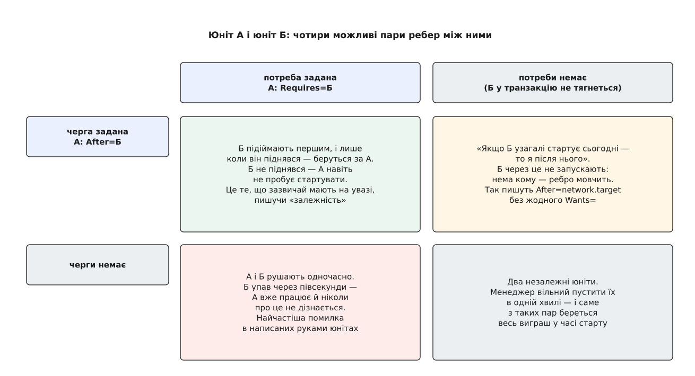
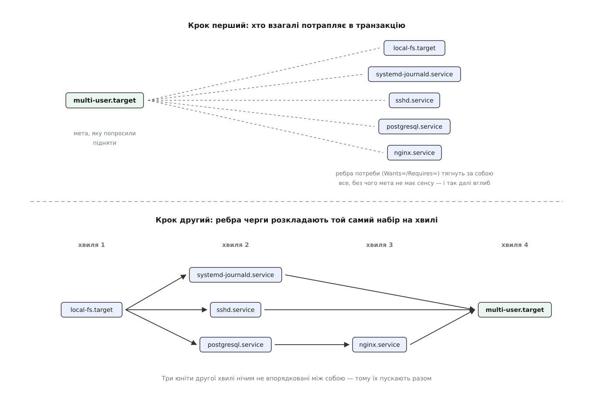
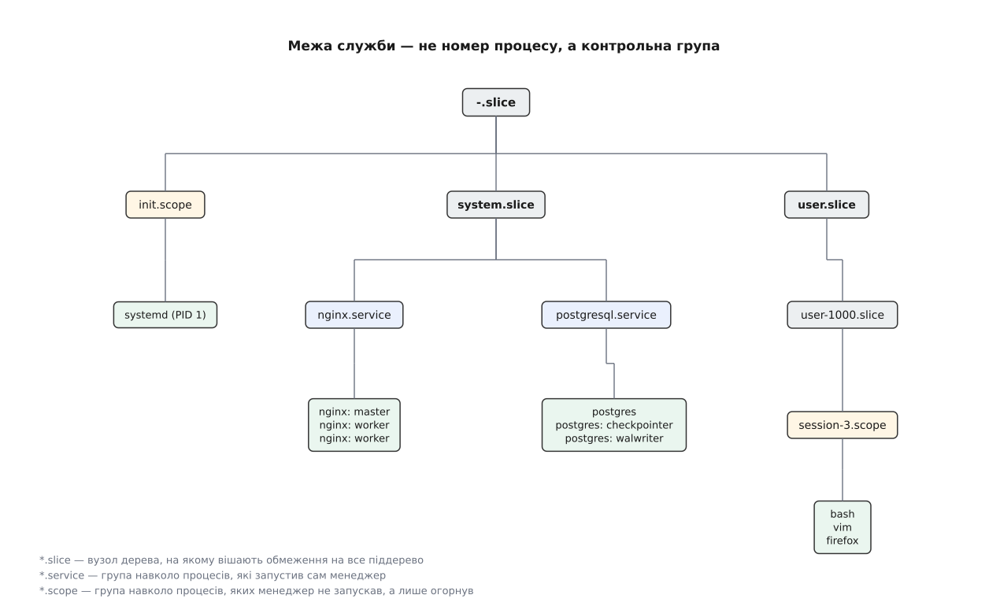

# systemd: архітектурна модель, юніти, стани та cgroups

<preknowlist>
- [Роль init і особливість PID 1](root:sys-unix/init-and-pid1) — перший процес простору користувача запускає решту служб, перевсиновлює осиротілі процеси й не має права завершитися.
- [Процес: що це насправді](root:sys-unix/process-model) — набір ресурсів ядра з унікальним числовим ідентифікатором PID.
- [cgroups: облік і обмеження ресурсів](root:sys-unix/cgroups-resource-model) — механізм ядра для ієрархічного групування процесів та накладання лімітів.
- [D-Bus: шина повідомлень простору користувача](root:sys-unix/dbus) — протокол міжпроцесної взаємодії через типізовані виклики методів і сигналів.
- [Топологічне сортування](root:sf-algorithms/topological-sort) — алгоритм визначення лінійного порядку виконання завдань у спрямованому ациклічному графі.
</preknowlist>

Під час старту операційної системи між передачею керування від ядра першому процесу простору користувача (PID 1) та появою робочого середовища необхідно ініціалізувати сотні компонентів: змонтувати файлові системи, підняти мережеві інтерфейси, запустити демони журналювання, бази даних та сервіси аутентифікації. Більшість із них мають взаємні залежності: вебсервер потребує бази даних, база даних вимагає наявності змонтованого диска, а файлова система не з'явиться без ініціалізації блокового накопичувача ядром.

Традиційна система ініціалізації SysV init розв'язувала цю задачу імперативно — послідовним виконанням shell-сценаріїв за чергою номерів (`/etc/rc.d/S01...`, `S10...`). Така модель містила три фундаментальні вади:
1. **Синхронне блокування.** Однопотокова черга чекала завершення кожного сценарію. Якщо служба виконувала довгі дискові чи мережеві операції (перевірка `fsck`, очікування DHCP-відповіді), завантаження зупинялося, а ресурси багатоядерних процесорів простоювали.
2. **Накладні витрати інтерпретатора.** Кожен shell-скрипт породжував сотні викликів `fork()` та `execve()` для виклику утиліт `grep`, `sed`, `awk`, витрачаючи час на розбір тексту замість реальної роботи.
3. **Втрата контролю над нащадками.** Класичні демони відходили у фон подвійним викликом `fork()` із виходом проміжних процесів та викликом `setsid()`, свідомо обриваючи зв'язок із батьком. Init-система була змушена відстежувати процеси за числовими записами у файлах `/var/run/<демон>.pid`. При раптовій аварії демона PID-файл ставав застарілим; після переповнення циклічного лічильника PID у ядрі команда зупинки ризикувала вбити випадковий сторонній процес, а дочірні процеси-робітники губилися в системі некерованими сиротами.

systemd замінює імперативні сценарії **декларативним графом станів і залежностей** (DAG), керує паралельним запуском через сокетну активацію, утримує процеси в межах контрольних груп cgroups v2 та надає єдиний протокол керування на базі шини D-Bus.

Історію переходу від числових рівнів виконання SysV до графової моделі викладено в [історичному нарисі](root:sys-unix/systemd-model/hist-from-runlevels-to-units.md).

## Юніти як вузли графа: типи системних сутностей

Кожен керований об'єкт у systemd зветься **юнітом** (англ. unit — одиниця). Поняття юніта навмисно ширше за «службу» чи «програму»: точка монтування, мережевий сокет або апаратний пристрій не є демонами, проте вони мають стани (активний, неактивний, стан збою) і є повноправними вузлами в загальному графі залежностей.

Тип юніта визначається суфіксом у назві файлу конфігурації:

- **`.service`** — системна служба або фоновий процес. Визначає команди запуску (`ExecStart=`), зупинки (`ExecStop=`), умови перезапуску після збоїв (`Restart=`) та спосіб повідомлення про готовність (`Type=`).
- **`.socket`** — точка входу міжпроцесної або мережевої комунікації (UNIX domain socket, TCP/UDP порт, черга FIFO). Створюється й утримується відкритим безпосередньо менеджером PID 1 для сокетної активації.
- **`.target`** — логічна точка синхронізації та групування без власного виконуваного процесу. Замінює старі рівні виконання (runlevels): `multi-user.target` відповідає консольному багатокористувацькому режиму, `graphical.target` — графічній оболонці.
- **`.mount`** та **`.automount`** — точки монтування файлових систем. `.mount` описує постійне монтування (здебільшого генерується автоматично з `/etc/fstab`), а `.automount` створює відкладену точку: реальне монтування виконується ядром прозоро в момент першого звернення будь-якої програми до каталогу.
- **`.timer`** — планувальник подій за часом на базі ядрового механізму `timerfd`. Підтримує як монотонічні інтервали від системних подій (`OnBootSec=`, `OnUnitActiveSec=`), так і календарні вирази реального часу (`OnCalendar=`), замінюючи класичний демон `cron`.
- **`.slice`** — вузол в ієрархії контрольних груп ядра (cgroups v2). Служить для розподілу часток процесора, лімітів пам'яті та вводу-виводу між системними службами (`system.slice`) та сеансами користувачів (`user.slice`).
- **`.path`**, **`.device`**, **`.swap`**, **`.scope`** — моніторинг файлових подій через `inotify`, реєстрація апаратних пристроїв від `systemd-udevd`, підключення розділів підкачки та нагляд за процесами, створеними сторонніми програмами.

Повний синтаксис секцій і параметрів конфігурації систематизовано в [довідці за директивами юнітів](root:sys-unix/systemd-model/api-unit-directives.md).

## Дві осі залежностей: потреба проти черги

Зв'язки між юнітами в конфігураціях розділені на дві строго незалежні осі: просторову та часову.

*Просторова вісь визначає включення юнітів у транзакцію, а часова — порядок їхнього переходу між станами.*

1. **Просторова вісь (потреба):** відповідає на питання, *чи слід включати суміжний юніт у поточну транзакцію*, та визначає реакцію на зміну його стану:
   - `Wants=` — слабка потреба: запуск поточного юніта замовляє запуск вказаного, але збій чи відсутність сусіда не заважає роботі нашого юніта.
   - `Requires=` — сильна потреба: збій під час запуску вказаного юніта скасовує активацію нашого юніта; подальша зупинка сусіда автоматично зупиняє наш юніт.
   - `BindsTo=` — жорстка прив'язка життєвого циклу: на додачу до правил `Requires=`, раптове зникнення або аварія сусіда (наприклад, виймання флеш-накопичувача) негайно зупиняє наш юніт.
   - `Conflicts=` — негативна залежність: активація одного юніта генерує команду зупинки для іншого (взаємне виключення).

2. **Часова вісь (черга запуску / порядок):** відповідає на питання, *в якій послідовності змінювати стани, якщо обидва юніти вже перебувають у роботі*:
   - `After=B` — якщо юніти A та B запускаються одночасно, юніт A чекає завершення активації юніта B. При зупинці системи порядок автоматично інвертується: A зупиняється раніше за B.
   - `Before=B` — юніт A завершує свій старт до того, як почнеться ініціалізація юніта B.

Оголошення потреби не задає черги запуску. Якщо у файлі служби написано `Requires=db.service`, але пропущено `After=db.service`, менеджер PID 1 запустить обидві служби одночасно в одну мить. Клієнтська служба спробує підключитися до бази даних, яка ще не встигла створити мережевий сокет, і впаде через стан гонитви.

## Транзакційний менеджер робіт і паралельний запуск

Коли надходить запит на зміну стану (наприклад, користувач викликає `systemctl start graphical.target`), менеджер транслює його у набір атомарних **робіт** (Jobs: `start`, `stop`, `restart`).

*Ребра потреби формують замикання транзакції, а ребра черги розкладають роботи на паралельні хвилі через топологічне сортування DAG.*

Транзакційний рушій виконує послідовну обробку:
1. **Побудова замикання.** Рушій рекурсивно обходить граф за ребрами просторової потреби (`Requires=`, `Wants=`, `BindsTo=`) і збирає повний перелік необхідних робіт.
2. **Розв'язання конфліктів.** Якщо транзакція містить взаємовиключні роботи (`start` та `stop` для одного юніта через `Conflicts=`), роботи від слабких зв'язків `Wants=` автоматично видаляються. Якщо конфліктують дві жорсткі вимоги `Requires=`, транзакція скасовується цілком без зміни стану системи.
3. **Топологічне сортування.** На відібраному наборі робіт аналізуються ребра `After=`/`Before=`. Усі роботи, що не мають незавершених попередників, стартують паралельно в першій хвилі. Щойно юніти підтверджують свою готовність, розблоковується наступна хвиля графа.

Практичний розбір транзакцій та аналіз ланцюгів завантаження наведено в [практичному проєкті](root:sys-unix/systemd-model/proj-see-the-transaction.md).

### Активація за сокетом: усунення залежностей черги

Щоб мінімізувати час завантаження, systemd усуває штучні точки очікування за допомогою сокетної активації (socket activation).

У класичній моделі клієнт змушений чекати, доки сервер завантажить конфігурацію, виділить пам'ять і викличе `listen()`. У моделі systemd сокет створює сам менеджер PID 1 на найранішому етапі. Коли клієнт звертається до сокета через виклик `connect()`, ядро Linux повертає успіх і буферизує вхідні пакети в черзі сокета (`backlog`). Клієнт не отримує помилки `ECONNREFUSED` і може продовжувати роботу.

Сам сервер запускається паралельно або пробуджується ядром за подією появи перших даних. Під час запуску PID 1 передає готовий відкритий файловий дескриптор безпосередньо у процес служби (дескриптор номер 3, константа `SD_LISTEN_FDS_START`), експортуючи змінну середовища `LISTEN_FDS=1`. Завдяки цьому клієнт і сервер позбавляються залежності `After=`: їх можна запускати одночасно в одній хвилі, а перезапуск сервера не призводить до втрати відкритих клієнтських з'єднань.

Докладніше механізм розібрано в статті [Активація за сокетом](root:sys-unix/socket-activation).

## Контроль процесів через cgroups v2 та нагляд за станом

Для надійного відстеження процесів systemd спирається на єдину ієрархію контрольних груп ядра (cgroups v2), змонтовану в `/sys/fs/cgroup/`.

*Контрольні групи cgroups v2 групують усі процеси кожної служби під відповідними зрізами.*

Кожен юніт отримує власний каталог у дереві cgroups (наприклад, `/sys/fs/cgroup/system.slice/nginx.service`). Ця схема розв'язує ключові задачі адміністрування:

1. **Неможливість утечі процесів.** Коли служба відгалужує нащадків через `fork()`, ядро автоматично поміщає новий процес у ту саму cgroup, де знаходиться батько. Будь-які маніпуляції з подвійним `fork()` чи викликами `setsid()` не дозволяють процесу вийти з групи без привілеїв суперкористувача.
2. **Гарантована зупинка.** Під час виконання команди `systemctl stop` менеджер надсилає сигнал `SIGTERM` усім процесам у cgroup юніта. Якщо процеси не завершуються до вичерпання таймауту `TimeoutStopSec=`, ядро знищує їх сигналом `SIGKILL` або записом у псевдофайл `cgroup.kill`. Ситуація, коли після зупинки демона в пам'яті лишаються некеровані процеси-сироти, стає фізично неможливою.
3. **Облік та обмеження ресурсів.** Безпосередньо у файлі `.service` налаштовуються ліміти ядра: `MemoryMax=` (жорсткий поріг оперативної пам'яті), `CPUQuota=` (максимальна частка процесорного часу) та `TasksMax=` (захист від неконтрольованого розмноження процесів / fork-бомб).
4. **Сторожовий таймер (Watchdog).** Для виявлення завислих процесів із заблокованим головним циклом systemd реалізує програмний протокол Watchdog: служба періодично надсилає дейтаграму `WATCHDOG=1` у сокет `$NOTIFY_SOCKET`. Якщо повідомлення не надходить упродовж інтервалу `WatchdogSec=`, менеджер фіксує збій, надсилає процесу сигнал `SIGABRT` для створення діагностичного зліпка пам'яті (core dump) та виконує перезапуск згідно з політикою `Restart=on-watchdog`.

Детальний опис роботи контролерів наведено в статті [cgroups: облік і обмеження ресурсів](root:sys-unix/cgroups-resource-model), а переходи між внутрішніми станами служби — у статті [Життєвий цикл служби](root:sys-unix/service-lifecycle).

## Керування через D-Bus та уніфікований життєвий цикл

Керування системою та моніторинг юнітів організовано через системну шину D-Bus. Процес PID 1 експортує типізований об'єктний інтерфейс за адресою `org.freedesktop.systemd1`. Утиліта `systemctl` не маніпулює процесами безпосередньо — вона є клієнтом D-Bus, який надсилає запити на виклик методів менеджера (`StartUnit`, `StopUnit`, `ReloadUnit`) та зчитує властивості об'єктів.

Декларативна графова модель ліквідує штучну межу між фазою завантаження операційної системи, її поточною експлуатацією та завершенням роботи:
- **Завантаження** — це початкова транзакція, що прагне досягти стану `default.target`.
- **Події рантайму** — підключення нового обладнання породжує подію ядра udev, яка створює динамічний `.device`-юніт і запускає локальну підтранзакцію монтування чи активації мережі.
- **Вимкнення** — це транзакція переходу до стану `poweroff.target` або `reboot.target`. Менеджер інвертує всі ребра черги `After=`/`Before=`, зупиняючи програми до зупинки баз даних, а бази даних — до розмонтування дисків.

Завдяки цьому операційна система функціонує як детермінований автомат станів, де кожна зміна конфігурації обчислюється через єдиний транзакційний рушій.
