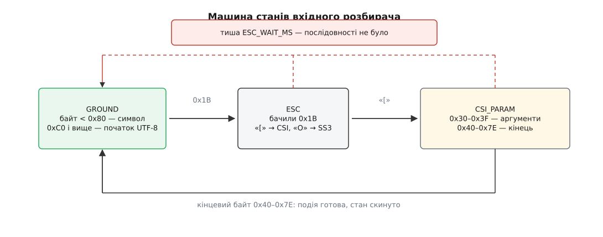

# ⚙️ Розбирач вхідного потоку термінала: клавіші, паузи й відповіді в одному дескрипторі

Робоча програма мовою C, яка читає дескриптор 0 у сирому режимі й віддає нагору впорядкований потік подій — символ, спеціальна клавіша, відповідь термінала на запит. Усе це приходить одним потоком байтів, і розділяє його прикладна сторона: ядро цю суміш не розбирає, воно лише передає байти.

## Що треба зробити

У сирому режимі `read(0, …)` віддає рівно те, що надійшло від термінала, без жодної обробки ([TTY і termios](root:sys-unix/tty-and-termios) — лінійна дисципліна між пристроєм і читачем; у сирому режимі вимкнено складання рядка, відлуння й перетворення `0x03` на сигнал, тож байти доходять такими, якими прийшли). Літера «ж» — це два байти. Стрілка вгору — три: `1B 5B 41`. Клавіша F5 — шість. Відповідь на запит `ESC[6n` — ще одна послідовність, яка приходить упереміш із натисненнями. А клавіша Esc — один байт `1B`, той самий, з якого починаються всі попередні.

Кожна вимога до читача має причину, і жодна з них не косметична.

Віддавати цілі одиниці: символ UTF-8 не розрізаний навпіл, послідовність не порізана на «Esc, дужка, літера». Одне натиснення легко приїжджає двома викликами `read` — між байтами стоїть мережа, планувальник і буфер драйвера, — тож припущення «один `read` = одна клавіша» хибне з першого дня.

Не зависати. Термінал, який запиту не знає, не відповість **нічого**: ні помилки, ні відмови. Програма, що чекає на відповідь звичайним `read`, зупиниться назавжди.

Не губити натиснень, поки триває запит: людина не перестає друкувати на час, поки програма з'ясовує позицію курсора.

Дочитувати незнайомі послідовності до кінця, а не вивалювати їхні хвости на екран.

І повернути термінал у застаний стан на **кожному** шляху виходу, зокрема аварійному.

## Ідея: діапазони байтів, а не перелік команд

Спокуса — тримати таблицю відомих послідовностей і звіряти з нею вхід. Такий розбирач ламається на першій же незнайомій команді: він не знає, де вона закінчується, тож решта її байтів піде далі як текст, а на екрані з'явиться сміття.

Опертися треба на інше: межі послідовності задано **діапазонами кодів**. Після `ESC [` можуть іти лише байти `0x30`–`0x3F`, а завершує перший же байт із `0x40`–`0x7E`. Кінець знаходить арифметика, а не словник — тож незнайома команда буде зібрана цілком і віддана нагору як «невідома клавіша з таким кінцевим байтом». Звідси й будова: машина станів, де кожен перехід — перевірка діапазону, а весь стан між байтами вміщається у кілька полів ([розбір потоку](root:com-protocol/stream-parser) — читач, що працює байт за байтом і тримає власний стан, не залежить від того, як потік порізали на порції).

*Пунктиром — єдиний перехід, який спрацьовує не від байта, а від його відсутності.*

Лишається те, чого діапазонами не розв'язати. Самотній `1B` — це або клавіша Esc, або початок стрілки, і в самому потоці різниці немає. Ознака одна: час. Байти однієї послідовності приходять упритул, між двома натисненнями людини є пауза. Тому чекання розділене надвоє. У стані `GROUND` розбирач чекає без ліміту — поспішати нема куди. Щойно він увійшов у `ESC` чи `CSI`, ліміт стає `ESC_WAIT_MS`, і тиша означає, що послідовності не було: накопичене віддається як Esc плюс окремі символи. Сорок мілісекунд — не магія, а верхня оцінка часу, за який три байти долають дріт.

Таймер при цьому потрібен власний. Той, що вбудований у драйвер, не годиться: `VTIME` у `termios` міряє десятими частками секунди, тож найкоротша пауза, яку ним можна задати, — 100 мс, і вона відчутна на дотик. Тому чекання віддано `poll` ([select, poll і epoll](root:sys-unix/select-poll-epoll) — виклики, які сплять, доки дескриптор не стане готовим, і вміють прокинутися за таймером із точністю до мілісекунди).

## Програма

:::code proj-input-parser/c/tinput.c

## Ціна

Один прохід по байту, жодного повернення назад, жодного виділення пам'яті. Уся пам'ять розбирача — три сталі: `MAXPARAM`, `MAXRAW` і `QCAP`; на кожен байт припадає кілька порівнянь. Єдина відчутна ціна — затримка `ESC_WAIT_MS` на клавіші Esc, і вона неусувна: іншої ознаки, крім паузи, у потоці немає.

## Де такий розбирач звичайно спотикається

**Чекання, яке продовжують сигнали.** `poll` перерваний сигналом завжди повертає `EINTR` — і це не залежить від `SA_RESTART`, бо виклики-мультиплексори ядро не перезапускає ніколи ([EINTR і перезапуск викликів](root:sys-unix/eintr-and-restart) — перерваний повільний виклик або віддає помилку, або мовчки починається наново, і для `poll` вибір зроблено за вас). Наївне `continue` з тим самим `left` починає відлік наново: під частими сигналами пауза після Esc розтягується, і клавіша не спрацьовує зовсім. Тому час, що лишився, перераховують від монотонного годинника ([час у ядрі](root:sys-unix/kernel-timekeeping) — `CLOCK_MONOTONIC` не стрибає від переводу системного часу, тому тільки він годиться для вимірювання проміжків).

**Аргументи, яким довіряють.** `param[i] = param[i] * 10 + d` без стелі — це переповнення знакового цілого від рядка `ESC[99999999999m`, тобто невизначена поведінка від чужих байтів. А чужі байти сюди справді доходять: рядок із журналу, ім'я файлу, вміст двійкового файла, вивернутого в термінал. Обмежувати треба обидва боки — і кількість аргументів, і значення кожного; послідовність, що не влізла, чесніше віддати як «невідома», ніж як напівпрочитана.

**Термінал, що лишився сирим.** Найпомітніша поломка. Програма падає — і оболонка далі без відлуння, без Enter, без `Ctrl+C`. Тому відновлення прив'язують одразу до трьох шляхів: `atexit` на звичайний вихід, прапорець із обробника `SIGTERM`/`SIGHUP` на зупинку ззовні, і обробник `SIGSEGV`/`SIGABRT`, який відновлює стан і повторює сигнал уже з типовою дією — щоб і термінал ожив, і дамп пам'яті лишився. Викликати `tcsetattr` з обробника законно: POSIX тримає його в переліку функцій, безпечних у обробнику сигналу ([безпечність у обробнику](root:sys-unix/async-signal-safety) — обробник виконується посеред будь-якого рядка головної програми, тож має право чіпати лише те, що витримає таку перерву).

**Відповідь, яку неможливо відрізнити від клавіші.** Найпідступніше. Відповідь на `ESC[6n` має форму `ESC [ рядок ; стовпець R`, а модифіковані функційні клавіші в тому самому `xterm` шлють `CSI 1 ; 5 R` для Ctrl+F3 і `CSI 1 ; 2 R` для Shift+F3 — та сама CSI з тим самим кінцевим байтом. Документація `xterm` цю колізію визнає прямо. Розрізнити їх у потоці нема як; єдиний захист — часове вікно: за відповідь вважати лише те, що прийшло невдовзі після власного запиту, а поза вікном `R` тлумачити як клавішу. У коді вище це вікно — 200 мс аргументом `query_cursor`.

**Сорок мілісекунд, яких не вистачило.** `ESC_WAIT_MS` — не властивість програми, а припущення про лінію. Локально байти однієї послідовності приходять з інтервалом у мікросекунди, і сорок мілісекунд — величезний запас. Крізь `ssh` на інший континент та сама послідовність легко приїжджає двома пакетами з розривом у сотню мілісекунд: `poll` устигає вичерпати час на середині, `on_pause` вирішує, що послідовності не було, і стрілка перетворюється на три події — Esc, «[», «A». Симптом характерний: у редакторі стрілки «друкують букви», причому лише на віддаленій машині й лише коли мережа гикає. Ліки — не одне «правильне» число, а вибір, який доведеться зробити свідомо: більший ліміт робить Esc млявішою, менший робить стрілки ненадійними, і саме тому обидва кінці цієї шкали винесено в налаштування редакторів і мультиплексорів.

**Черга, яку переповнює вставка.** Довгий текст, вкинутий у термінал мишею, приїжджає тисячами байтів за один `read`. Черга на 64 події переповнюється мовчки, а мовчазна втрата вводу — найгірший різновид помилки. У справжній програмі чергу роблять кільцевою й читають її в тому самому циклі, або взагалі не буферизують: віддають подію обробникові одразу з `feed`.
