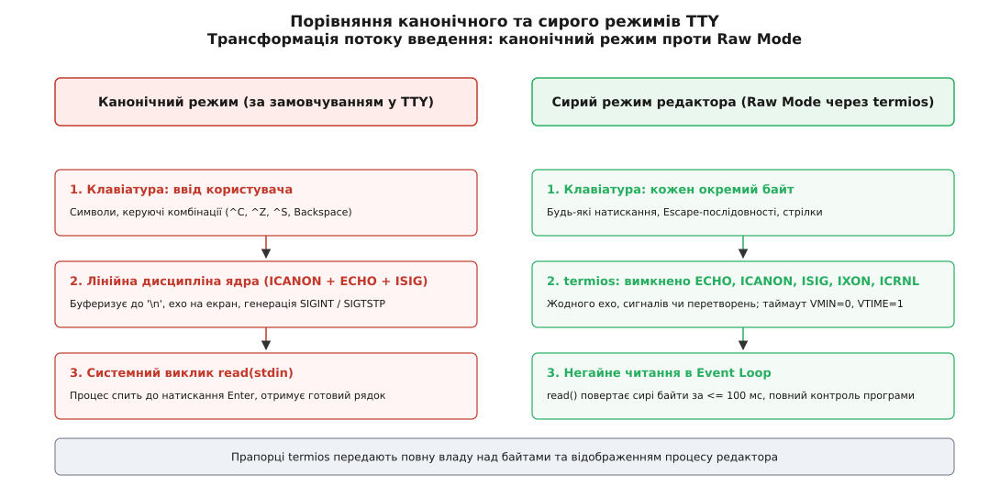
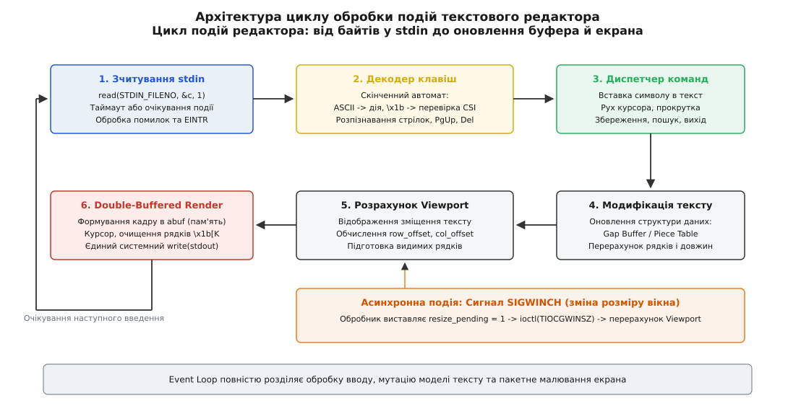
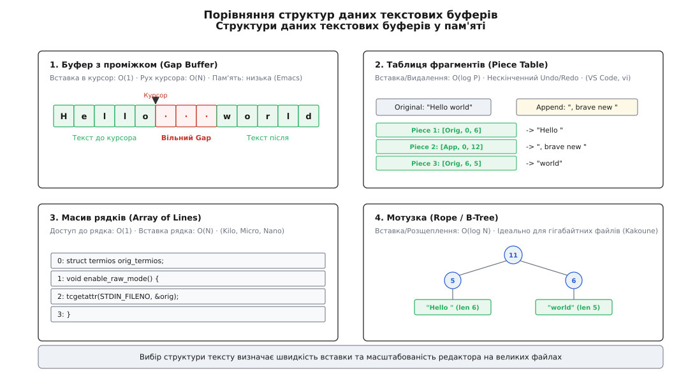
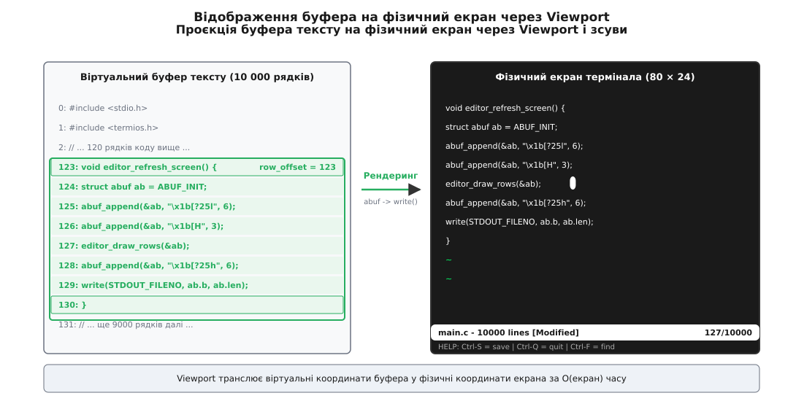

# Редактор у терміналі

<preknowlist>
- [TTY і termios](root:sys-unix/tty-and-termios) — лінійна дисципліна ядра, канонічний і небуферизований режими, прапорці введення й виведення.
- [Керуючі послідовності термінала](root:sys-unix/terminal-escape-sequences) — протокол керування дисплеєм: ESC [, позиціонування курсора, стирання рядків, кольори.
- [Ширина символу в комірках](root:sys-unix/wcwidth-and-cell-width) — відмінність між байтами, кодовими точками та шириною знака на сітці моноширинного термінала.
- [Стандартні потоки](root:sys-unix/standard-streams) — дескриптори `STDIN_FILENO` та `STDOUT_FILENO`, небуферизований ввід-вивід.
- [Сигнали](root:sys-unix/signal-model) — асинхронні повідомлення ядра, перехоплення `SIGWINCH` при зміні геометрії вікна.
- [ncurses](root:sys-unix/ncurses) — концепція віртуального екрана та порівняння буферів для мінімізації трафіку.
</preknowlist>

Коли стандартна консольна утиліта на кшталт `cat` або `grep` читає дані зі стандартного вводу, ядро операційної системи бере на себе всю попередню обробку: воно накопичує байти в буфері до натискання Enter, локально малює кожен введений символ назад на екран (echo), обробляє Backspace для стирання помилок і надсилає процесу сигнал `SIGINT` при натисканні комбінації Ctrl+C. Для утиліти командного рядка така поведінка зручна, але для повноекранного текстового редактора — такого як `vi`, `vim`, `nano`, `micro` чи мінімалістичного `kilo` — вона фатальна.

Повноекранному редактору потрібен безпосередній контроль над кожним натисканням клавіші в ту саму мить, коли палець торкається клавіатури. Якщо користувач натискає стрілку вправо або комбінацію Ctrl+S для збереження файлу, програма не може чекати на символ нового рядка, не повинна дозволяти ядру вбивати процес сигналом переривання і зобов'язана самостійно вирішувати, які саме пікселі чи символи мають змінитися на склі термінала.

Історичний шлях від простих рядкових інструментів до сучасних екранних редакторів показує еволюцію взаємодії людини з терміналом ([від ed до Vim](root:sys-unix/terminal-text-editor/hist-line-to-screen-editors.md) — народження модального режиму в `vi`, розробка Emacs та поява відкритих клонів).

*Канонічний режим TTY приховує потік введення за буфером ядра, тоді як сирий режим передає кожен байт безпосередньо в Event Loop редактора.*

## Анатомія сирого режиму: маніпуляція термінальною лінією

За замовчуванням псевдотермінал або послідовна лінія функціонують у так званому **канонічному режимі** (Canonical Mode). Усередині ядра Linux цим керує драйвер лінійної дисципліни `N_TTY`. У ньому діють три базові правила: введення віддається процесу лише після надходження символу переведення рядка (`\n`), кожен введений символ негайно відсилається назад у вихідний потік термінала (локальне відлуння), а керуючі символи перехоплюються для генерації сигналів або редагування поточного рядка.

Щоб текстовий редактор міг працювати, термінальну лінію необхідно перевести в **сирий режим** (Raw Mode). Це здійснюється модифікацією структури `struct termios` через системні виклики `tcgetattr` та `tcsetattr`.

Повний перелік прапорців та їхніх бітових масок описано в довіднику інтерфейсу ([протокол керуючих послідовностей та прапорців termios](root:sys-unix/terminal-text-editor/api-editor-terminal-sequences.md) — системні структури `termios`, коди клавіш та інструкції ANSI).

Переведення вимагає скидання конкретних бітових масок у чотирьох полях конфігурації:

1. **Локальні прапорці (`c_lflag`):**
   - `ECHO` — вимикає локальне відлуння. Без цього кожне натискання клавіші одразу друкувалося б на екрані там, де стоїть фізичний курсор, руйнуючи інтерфейс редактора.
   - `ICANON` — вимикає канонічний режим. Виклик `read()` перестає чекати на Enter і повертає байти негайно, по мірі їх надходження від клавіатури.
   - `ISIG` — вимикає генерацію сигналів `SIGINT` (Ctrl+C), `SIGTSTP` (Ctrl+Z) та `SIGQUIT` (`Ctrl+\`). Тепер ці комбінації надходять у процес як звичайні числові байти (`0x03`, `0x1A`, `0x1C`), дозволяючи призначити їх на команди редактора (наприклад, скасування операції або вихід).
   - `IEXTEN` — вимикає розширену обробку вводу, зокрема спеціальну поведінку Ctrl+V (літеральне введення наступного символу) та Ctrl+O.

2. **Вхідні прапорці (`c_iflag`):**
   - `IXON` — вимикає програмне керування потоком даних XON/XOFF. За замовчуванням комбінація Ctrl+S призупиняє передачу даних на термінал до натискання Ctrl+Q. Вимкнення цього прапорця звільняє Ctrl+S для класичної операції збереження документа.
   - `ICRNL` — вимикає автоматичну трансляцію символу повернення каретки `\r` (ASCII 13) у новий рядок `\n` (ASCII 10). Після цього редактор отримує чистий байт `13` при натисканні Enter.
   - `BRKINT`, `INPCK`, `ISTRIP` — вимикають надсилання сигналу при розриві зв'язку (Break), апаратну перевірку парності та скидання восьмого біта байта. Скидання `ISTRIP` критично важливе для збереження всіх 8 бітів у кодуваннях UTF-8.

3. **Вихідні прапорці (`c_oflag`):**
   - `OPOST` — вимикає постобробку виведення. У канонічному режимі ядро автоматично додає повернення каретки `\r` до кожного байта `\n`. Після вимкнення `OPOST` передача `\n` переміщує курсор лише на один рядок вниз, залишаючи його в тій самій колонці. Редактор бере керування курсором на себе і для переходу на початок нового рядка зобов'язаний явно надсилати `\r\n`.

4. **Керуючі символи та таймаути (`c_cc`):**
   Масив `c_cc` містить два вирішальні параметри для регулювання поведінки блокування у виклику `read()`: `VMIN` та `VTIME`.
   - `c_cc[VMIN] = 0; c_cc[VTIME] = 1;` — налаштовує неблокуюче читання з таймаутом у 100 мілісекунд (1/10 секунди). Якщо протягом цього інтервалу користувач не натиснув жодної клавіші, `read()` повертає `0`. Це дозволяє циклу подій редактора періодично перевіряти фонові зміни або оновлювати статусний рядок без мертвого блокування процесу.

:::tabs
:::code terminal-text-editor-d/c/anatomiia-syroho-rezhymu.c
:::code terminal-text-editor-d/cpp/anatomiia-syroho-rezhymu.cpp
:::

> 🔧 **Навіщо це.** Якщо програма впаде або завершиться без відновлення початкового стану `termios`, термінал залишиться в сирому режимі: введені користувачем команди шелу не відображатимуться на екрані, а натискання Enter не переводитиме рядок. Команда відновлення наосліп `stty sane` або `reset` скидає параметри термінальної лінії назад у робочий канонічний стан.

*Архітектура циклу подій редактора: байтовий потік перетворюється на команди, мутує стан тексту та візуалізується через подвійну буферизацію.*

## Цикл обробки подій та парсер Escape-послідовностей

Серцем будь-якого редактора є **цикл обробки подій** (Event Loop). Його структура складається з трьох послідовних кроків:
1. Очікування та зчитування чергового байта або послідовності з дескриптора `STDIN_FILENO`.
2. Тлумачення коду клавіші, розпізнавання керуючих послідовностей та передача керування диспетчеру дій.
3. Модифікація внутрішнього буфера документа та повне або диференційне перемальовування видимого вікна.

### Проблема клавіші Escape

У терміналі звичайні ASCII-символи з кодами від `32` до `126` представляють самі себе. Керуючі комбінації з модифікатором `Ctrl` відображаються на перші 26 кодів таблиці ASCII: натискання `Ctrl+A` надсилає байт `1` (`'a' & 0x1f`), `Ctrl+B` — байт `2`, і так далі.

Головна складність виникає з навігаційними та функціональними клавішами (стрілки, PageUp, PageDown, Home, End, Delete, F1–F12). Термінал не має для них окремих апаратних кодів у таблиці ASCII. Натомість він передає їх як багатобайтові послідовності, що починаються з байта `ESC` (`0x1B` або 27 у десятковій системі), за яким слідує префікс CSI (Control Sequence Introducer, зазвичай символ `[`):
- Стрілка вгору: `\x1b[A` (три байти: `0x1B`, `0x5B`, `0x41`)
- Стрілка вниз: `\x1b[B`
- Стрілка вправо: `\x1b[C`
- Стрілка вліво: `\x1b[D`
- Page Up: `\x1b[5~` (чотири байти: `0x1B`, `0x5B`, `0x35`, `0x7E`)
- Delete: `\x1b[3~`

Звідси виникає неоднозначність: коли системний виклик `read()` повертає байт `\x1b`, програма не знає наперед, чи користувач натиснув одиночну клавішу `Escape` (наприклад, щоб вийти з режиму вставки у `vi`), чи це перший байт трибайтової послідовності натискання стрілки.

Розв'язання полягає в таймаутному дочитуванні наступних байтів. Якщо після отримання `\x1b` наступні виклики `read()` із коротким інтервалом очікування не повертають нових даних, вважається, що було натиснуто окрему клавішу `Escape`. Якщо ж у буфері негайно з'являється `[` або `O`, запускається скінченний автомат розбору CSI-послідовності.

:::tabs
:::code terminal-text-editor-d/c/problema-klavishi-escape.c
:::code terminal-text-editor-d/cpp/problema-klavishi-escape.cpp
:::

*Порівняння чотирьох фундаментальних моделей організації тексту: від простого масиву рядків до Gap Buffer, Piece Table та збалансованого дерева Rope.*

## Структури даних для зберігання та редагування тексту

Спосіб представлення тексту в оперативній пам'яті визначає продуктивність вставки символів, споживання пам'яті, швидкість прокрутки та простоту реалізації операцій скасування змін (Undo/Redo).

### 1. Простий масив рядків (Array of Lines)

Найбільш прямолінійна модель: документ зберігається як динамічний масив покажчиків на рядки (наприклад, `std::vector<std::string>` або `char**`).
- **Переваги:** доступ до довільного рядка за номером коштує `O(1)`, відображення на екран тривіальне.
- **Недоліки:** вставка символу всередину довгого рядка вимагає зсуву пам'яті та `realloc` за час `O(L)`, де `L` — довжина рядка. Вставка нового рядка посеред файлу вимагає зсуву масиву покажчиків за час `O(N)`, де `N` — кількість рядків у документі.
- **Застосування:** навчальні та компактні редактори (Kilo, Micro, Nano).

### 2. Буфер з проміжком (Gap Buffer)

Текст зберігається в одному суцільному блоці пам'яті, всередині якого розміщено штучний вільний простір («проміжок», Gap). Початок проміжку завжди синхронізований із поточною позицією курсора редагування.
- **Вставка символу:** символ просто записується в першу позицію проміжку, початок проміжку зсувається на 1 праворуч, а його розмір зменшується. Це операція `O(1)`.
- **Видалення символу (Backspace):** розмір проміжку збільшується на 1 ліворуч — також `O(1)`.
- **Переміщення курсора:** якщо курсор рухається в інше місце документа, текст між старою і новою позиціями копіюється через проміжок за допомогою `memmove` (`O(K)`, де `K` — дистанція переміщення). Оскільки користувач зазвичай друкує багато символів підряд в одному місці, накладні витрати на переміщення проміжку амортизуються.
- **Переповнення:** коли розмір проміжку досягає нуля, виділяється новий більший буфер і проміжок розширюється.
- **Застосування:** Emacs.

:::tabs
:::code terminal-text-editor-d/c/2-bufer-z-promizhkom-gap.c
:::code terminal-text-editor-d/cpp/2-bufer-z-promizhkom-gap.cpp
:::

### 3. Таблиця фрагментів (Piece Table)

Текст розділяється на два незмінних (immutable) буфери:
- **Original Buffer:** файл, завантажений з диска (часто через `mmap` у режимі read-only). Цей буфер ніколи не змінюється.
- **Append Buffer:** буфер, куди послідовно дописуються всі нові символи, введені користувачем.

Сам документ представляє собою список або дерево дескрипторів (Pieces). Кожен дескриптор містить три поля: посилання на буфер (Original або Append), початкове зміщення в цьому буфері та довжину фрагмента. Вставка тексту розбиває один дескриптор на два і вставляє між ними новий фрагмент, що вказує на щойно додані байти в Append Buffer.
- **Головна перевага:** миттєве завантаження файлів будь-якого розміру без копіювання, мінімальні витрати пам'яті при редагуванні та природна підтримка нескінченної історії скасувань (Undo/Redo): стан документа — це просто знімок списку дескрипторів.
- **Застосування:** AbiWord, Visual Studio Code, сучасні рушії редагування.

### 4. Мотузка (Rope)

Збалансоване двійкове дерево (на основі AVL або B-дерева), листками якого є короткі незмінні рядки тексту. Кожен внутрішній вузол зберігає вагу — сумарну довжину символів у його лівому піддереві.
- **Операції:** вставка та видалення зводяться до розщеплення (split) та злиття (concat) дерев за час `O(log N)`. Ідеально підходить для паралельної обробки великих файлів (гігабайти тексту) та асинхронного синтаксичного аналізу.
- **Застосування:** Kakoune, Xi-editor, Helix.

### Порівняння складності операцій

| Структура даних | Вставка в курсор | Видалення | Довільний доступ | Масштабування на 1 ГБ | Реалізація Undo/Redo |
|---|---|---|---|---|---|
| **Масив рядків** | `O(L)` (зсув рядка) | `O(L)` | `O(1)` за номером рядка | Погане (копіювання масиву) | Повна копія рядка/буфера |
| **Gap Buffer** | `O(1)` (амортизовано) | `O(1)` | `O(1)` з поправкою на Gap | Середнє (єдиний буфер) | Збереження дельт змін |
| **Piece Table** | `O(log P)` (P — фрагменти) | `O(log P)` | `O(log P)` | Ідеальне (`mmap` без копіювання) | Тривіальне (знімок списку Piece) |
| **Rope (Дерево)** | `O(log N)` | `O(log N)` | `O(log N)` | Відмінне | Знімки кореневих вузлів дерева |

*Проєкція буфера тексту на фізичний екран: зміщення рядків і стовпчиків формують видимий зріз документа за один системний виклик write().*

## Оптимізований рендеринг: подвійна буферизація та синхронізація

Найбільш поширена помилка при самостійній розробці екранних програм — пряме надсилання кожного символу або керуючої команди у вихідний потік термінала через окремі виклики `printf()` або `write()`.

Такий підхід породжує дві критичні проблеми:
1. **Мерехтіння екрана (Flicker):** емулятор термінала встигає відмалювати проміжний стан екрана (наприклад, порожнє поле після команди очищення `\x1b[2J`), перш ніж програма надішле оновлений текст. Око сприймає це як неприємне стробоскопічне блимання.
2. **Накладні витрати на системні виклики:** кожен окремий виклик `write()` вимагає перемикання контексту між простором користувача та ядром (User Space ↔ Kernel Space). Виведення кадру з 2000 комірок поодинці сповільнює рендеринг у сотні разів.

### Подвійна буферизація в пам'яті

Щоб рендеринг був миттєвим і плавним, редактор застосовує подвійну буферизацію: весь кадр екрана разом із керуючими послідовностями збирається в оперативній пам'яті в єдиний динамічний акумулюючий буфер (Append Buffer / `abuf`). Коли кадр повністю сформовано, він надсилається в термінал **рівно одним системним викликом `write(STDOUT_FILENO, buf, len)`**.

Схема формування кадру включає п'ять обов'язкових кроків:
1. **Приховати курсор (`\x1b[?25l`):** поки малюються рядки, курсор не повинен хаотично стрибати по екрану.
2. **Перемістити курсор у початок (`\x1b[H`):** замість повільного і мерехтливого очищення всього екрана `\x1b[2J`, редактор просто повертає курсор у позицію `(1, 1)` і переписує наявний текст новим.
3. **Відобразити видимі рядки з очищенням залишків (`\x1b[K`):** після виведення кожного рядка тексту надсилається команда `\x1b[K` (*Erase in Line*), яка стирає старі символи від кінця нового рядка до правого краю вікна. Це усуває сміття від попереднього кадру без очищення всього екрана.
4. **Позиціонувати курсор (`\x1b[row;colH`):** обчислити екранні координати курсора з урахуванням прокрутки (Viewport) і встановити його у відповідну клітинку.
5. **Показати курсор (`\x1b[?25h`):** відновити видимість курсора після завершення збирання кадру.

Практичну роботу цієї моделі можна перевірити на компактному прикладі повного циклу редактора ([реалізація мінімального рушія термінального редактора](root:sys-unix/terminal-text-editor/proj-terminal-raw-editor.md) — робочий код на C та C++ з альтернативним екраном і подвійною буферизацією).

### Робота з альтернативним екраном (Alternate Screen Buffer)

Професійний редактор не повинен затирати історію команд шелу, з якого його запустили. Термінали стандарту ANSI/xterm підтримують два окремих екранних буфери: основний та альтернативний.
- Вхід у редактор: надсилання послідовності `\x1b[?1049h` перемикає термінал на чистий альтернативний буфер.
- Вихід із редактора: надсилання послідовності `\x1b[?1049l` повертає користувача в основний буфер, миттєво відновлюючи попередній вигляд командного рядка зі збереженням усієї історії прокрутки.

## Обробка системних подій і динамічна перебудова (SIGWINCH)

Геометрія термінала не є статичною: користувач може будь-якої миті змінити розмір вікна емулятора мишею або розбити екран у мультиплексорі `tmux`.

Коли розмір вікна змінюється, ядро операційної системи надсилає процесу, що володіє терміналом, асинхронний сигнал **`SIGWINCH`** (*Window Change*).

### Отримання актуального розміру через ioctl

Для отримання поточної кількості рядків і колонок використовується системний виклик `ioctl` із командою `TIOCGWINSZ` (Terminal I/O Control Get Window Size):

:::tabs
:::code terminal-text-editor-d/c/otrymannia-aktualnoho.c
:::code terminal-text-editor-d/cpp/otrymannia-aktualnoho.cpp
:::

### Запасний спосіб через Cursor Position Report

На рідкісних або вбудованих термінальних лініях виклик `ioctl(TIOCGWINSZ)` може повернути помилку або нульовий розмір. У такому випадку редактор застосовує обхідний маневр:
1. Переміщує курсор у крайній правий нижній кут завідомо великими координатами: `\x1b[999C\x1b[999B` (999 позицій вправо і 999 позицій вниз). Термінал затисне координати на своєму реальному максимумі.
2. Надсилає запит звіту про позицію курсора: `\x1b[6n` (*Device Status Report / CPR*).
3. Зчитує з дескриптора `STDIN_FILENO` відповідь термінала у форматі `\x1b[<rows>;<cols>R` і парсить фактичні розміри вікна за допомогою `sscanf`.

### Безпечна модель обробки сигналів

Обробник сигналу `SIGWINCH` виконується асинхронно в контексті переривання, тому всередині нього заборонено викликати небезпечні функції (`malloc`, `printf`, важкий рендеринг). Правильний патерн проектування полягає у виставленні атомарного прапорця:

:::tabs
:::code terminal-text-editor-d/c/bezpechna-model-obrobky.c
:::code terminal-text-editor-d/cpp/bezpechna-model-obrobky.cpp
:::

Коли в основному циклі виявляється піднятий прапорець `resize_pending`, редактор оновлює розміри в'юпорту, коригує діапазон прокрутки (`row_offset`, `col_offset`) під новий розмір матриці та виконує повне перемальовування екрана. Текстовий редактор плавно адаптується до нових меж вікна без втрати курсора та пошкодження буферів.
