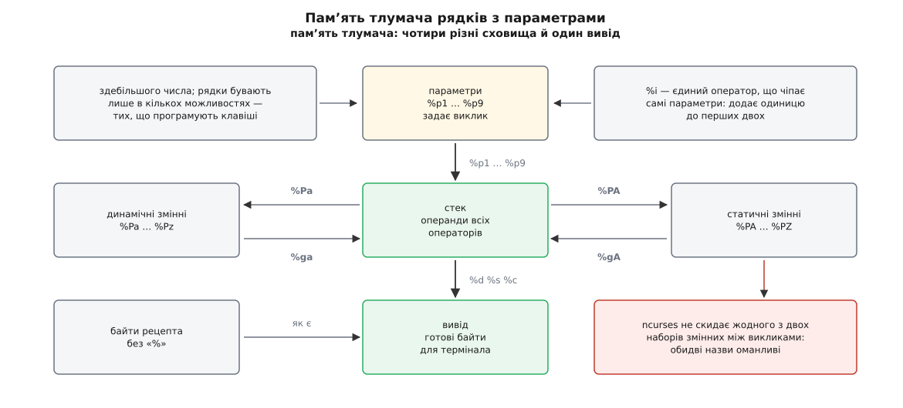
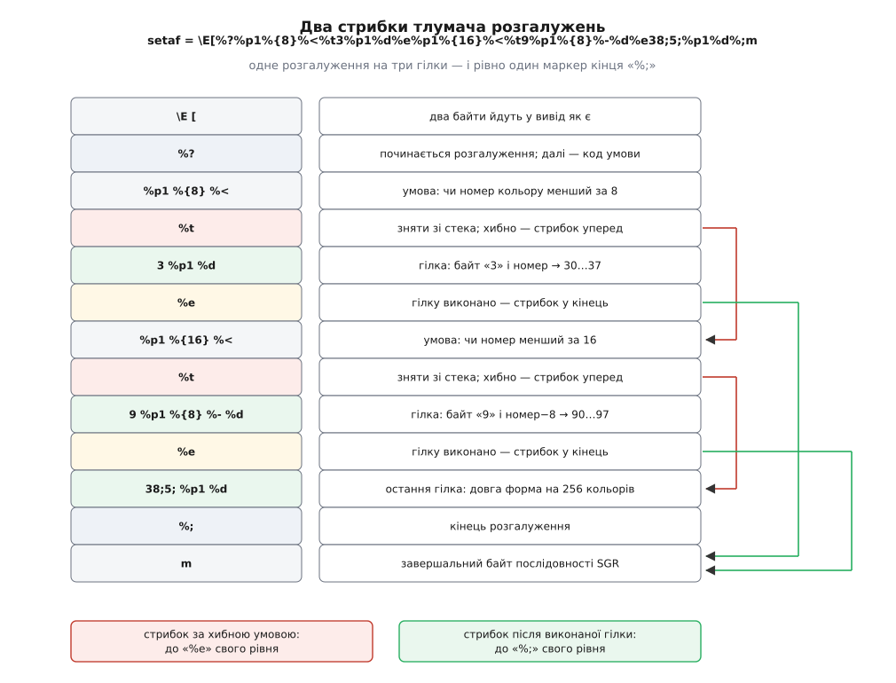

# ⚙️ Тлумач рядків з параметрами: стекова машина на сто рядків C

Дано рецепт із бази — скажімо, `\E[%i%p1%d;%p2%dH` — і до девʼяти параметрів. Треба віддати точну низку байтів, яку впізнає термінал. Напишімо цей тлумач цілком: він короткий, а кожна його частина відповідає на питання «чому не можна простіше».

## Чому підстановки не досить

Спокуса очевидна: віддати рецепт функції `printf`, замінивши `%p1%d` на звичайне `%d`. Ламається вона в чотирьох різних місцях, і жодне з них не екзотика.

Оператор `%i` додає одиницю до перших двох параметрів **перед** тим, як їх надрукують. `printf` своїх аргументів не змінює ніколи — а тут зміна є, і стосується вона саме параметрів, а не виводу.

Порядок теж не сталий. Рецепт вільно бере `%p2` раніше за `%p1`, вживає той самий параметр двічі або не вживає зовсім. `printf` іде списком аргументів підряд і назад не вертається.

Далі — арифметика. Далеко не кожен термінал друкує координату десятковими цифрами: чимало старих чекали на один байт, у якому до координати додано код пробілу, тобто `%p1%{32}%+%c`. Ні додавати, ні ділити `printf` не вміє, а вбудувати таку здатність у формат — це вже й є вигадування нової мови.

І головне — вибір. Рецепт `setaf` для `xterm-256color` залежно від номера кольору друкує три різні **літеральні** тексти: `3`, `9` або `38;5;`. Шаблон із дірками вибирати не вміє; вибирати вміє лише програма.

Тож значення рядкової можливості — це код, а `tparm()` — його тлумач. Машина під ним найпростіша з можливих: [стекова](root:sf-lang/bytecode-vm), без регістрів і без переходів назад. Циклів у мові немає взагалі, тому тлумач гарантовано зупиняється — довжина рецепта і є межа його роботи.

## Що тлумач памʼятає



*Оператори говорять зі стеком; параметрів торкається лише `%i`, і лише перших двох.*

Три дрібниці визначають форму коду.

Перша: комірка стека не завжди число. Кілька можливостей — ті, що програмують функційні клавіші, — беруть рядковий параметр, і `%s` мусить його надрукувати. Тому комірка — пара «число **або** вказівник на рядок», а кожен арифметичний оператор мусить чесно відмовитися, коли на верхівці лежить рядок.

Друга: у двомісних операторів є правильний бік. Довідник terminfo задає це прикладом: щоб дістати `x−5`, пишуть `%gx%{5}%-`. Тобто **перший знятий зі стека — правий операнд**, а не лівий. Переплутайте — і `%p1%{8}%-` для дев'ятки дасть не `1`, а `−1`, після чого рецепт `setaf 9` виплюне `ESC [ 9 -1 m`: послідовність із мінусом посеред числа, яку термінал відкине мовчки. Тому в коді нижче кожен двомісний оператор знімає `x`, потім `y` і рахує `y ⊙ x`.

Третя: статичні змінні `%PA`…`%PZ` не належать викликові. Документація [ncurses](root:sys-unix/ncurses) — бібліотеки, у якій `tparm` живе на кожній машині з Linux, — каже прямо, що обидві назви оманливі: жоден із двох наборів між викликами не скидається. У нашому коді ця пастка навмисно видима: масив `dyn` лежить усередині структури машини, а `svar` — поза нею, файловою статикою.

## Розгалуження — місце, де ламаються прості тлумачі

`%?` умова `%t` гілка `%e` гілка `%;` виглядає звичайним «якщо — інакше». Але подивіться на справжній `setaf`: після першого `%e` там стоїть **нова умова** і новий `%t`, а закриває всю споруду один-єдиний `%;`. Це форма «інакше-якщо» в дусі Алгола-68 — саме так її й описує довідник terminfo.

Отже, `%e` — не «початок гілки else», а маркер межі. Тлумач мусить уміти два різні стрибки:

- **умова хибна** → пропустити все до найближчого `%e` свого рівня (а якщо його немає — до `%;`) і виконувати далі: там може стояти наступна умова;
- **гілку виконано**, дійшли до `%e` → пропустити все до `%;` свого рівня.

«Свого рівня» — бо розгалуження бувають вкладені, і пропускаючи текст, тлумач рахує глибину: `%?` углиб, `%;` назовні. Обидва стрибки робить та сама функція, різниця між ними — один прапорець.



*Три гілки, два `%e` і один `%;` — тому «пропустити до кінця» й «пропустити до наступної умови» мусять бути різними діями.*

Пропуск — не просто пошук двох байтів. Усередині ділянки, яку ми перестрибуємо, трапляються `%{16}` і `%'x'`, а всередині них може стояти будь-що, зокрема `}` і лапка. Тому функція пропуску знає ті самі дужки, що й головний цикл: інакше рецепт із `%'%'` — сталою «код відсотка» — зіб'є їй лічильник.

## Код

:::code proj-tparm-interpreter/c/tparm-mini.c

## Звірка з базою

Перші два рецепти взяті не з голови — їх видно командою `infocmp -1 xterm-256color`; третій вигаданий, бо справжні `pfx` різняться від термінала до термінала, а нам треба лише перевірити рядкову комірку стека. Очікуваний вивід (`^` замість байта ESC):

```
cup 9 2     1b 5b 31 30 3b 33 48  | ^[10;3H
setaf 1     1b 5b 33 31 6d  | ^[31m
setaf 9     1b 5b 39 31 6d  | ^[91m
setaf 200   1b 5b 33 38 3b 35 3b 32 30 30 6d  | ^[38;5;200m
pfx 3 ls    1b 5a 33 32 3b 6c 73  | ^Z32;ls
```

Ті самі байти дає `tput`, який усередині кличе справжній `tparm`:

```
$ tput -T xterm-256color cup 9 2   | xxd -g1
00000000: 1b 5b 31 30 3b 33 48                             .[10;3H
$ tput -T xterm-256color setaf 200 | xxd -g1
00000000: 1b 5b 33 38 3b 35 3b 32 30 30 6d                 .[38;5;200m
```

Збіг байт-у-байт — і найцінніший тут рядок `setaf 9`: тільки він проходить обидва стрибки одразу (хибна перша умова жене нас до першого `%e`, а виконана друга гілка — від другого `%e` до `%;`) і по дорозі рахує `9−8`. Ті вісім кольорів, які зазвичай пробують першими, не перевіряють у тлумачі майже нічого. Що означають самі отримані байти, розказано в темі про [керуючі послідовності](root:sys-unix/terminal-escape-sequences).

> 🔧 **Навіщо це.** Помилку в пропуску гілок ви не побачите на перших восьми кольорах: там перша умова істинна, і жоден стрибок не робиться. Тлумач, що плутає `%e` з `%;`, роками працюватиме «правильно» й зламається рівно тоді, коли програма вперше попросить `setaf 9`. Тому перевіряти такий код треба з кінця списку, а не з початку.

## Пастки

**Статичні змінні переживають виклик.** Наш `svar` навмисно файловий: рецепт, що написав `%PA`, лишає значення наступному викликові — хоч би й для іншої можливості. У ncurses так само поводяться й «динамічні»; ми їх скидаємо, бо це чесніше щодо назви. Висновок для того, хто пише **записи**: спиратися не можна ні на те, ні на те.

**Рядковий параметр не можна вгадати з `...`.** Функція `tparm` змінноаргументна, і зі списку аргументів ніяк не видно, чи третій із них `int`, чи `char *` — а прочитати не той тип означає взяти чуже сміття за вказівник. Справжній ncurses виводить це з рецепта: `%p2%s` каже, що другий параметр рядковий. Здогадка ця крихка, і саме через неї зʼявився `tiparm_s`, якому кількість параметрів і бітову маску «які з них рядкові» повідомляють явно.

**`%e` може не бути зовсім.** Тоді хибна умова мусить привести до `%;`, а не пробігти рецепт до кінця. Через це прапорець `want_else` **додає** `%e` до цілей пропуску, а не переставляє мішень із `%;` на `%e`.

**Друк багатший, ніж `%d`.** Мова допускає повну форму `%[[:]прапорці][ширина[.точність]][doxXs]` — наприклад `%02x` у записі `initc` консолі Linux. Двокрапка тут не окраса: без неї `%-16s` починалося б із оператора віднімання. Наш тлумач цю форму не знає — доточити її означає зібрати специфікатор і віддати `snprintf`.

**Нуль-байт.** `%c`, що зняв зі стека нуль, надрукує байт `00` — а буфер у нас звичайний C-рядок. Тому `expand` веде `olen`, і брати вивід треба саме по ній. Із того самого кореня росте давня домовленість самої бази: `\0` у джерельному записі компілюється в байт `\200`, який рядка не рве, а термінал із семибітовими даними бачить як нуль.

**Параметрів може прийти менше, ніж рецепт просить.** `memset` на початку `expand` дає нулі, тож `cup` без аргументів тихо розгорнеться в `ESC [ 1 ; 1 H` — цілком коректну послідовність, яка просто робить не те. Помилки тут не буде ніде: ні рецепт, ні база не кажуть, скільки параметрів очікує можливість, — це знання лежить у голові того, хто пише виклик.

**Буфер живе до наступного виклику.** Вивід у нас усередині `Vm`, тому результат чинний рівно до того, як ту саму машину попросять розгорнути щось іще. Через це в `main` кожен `expand` одразу віддається в `show`, а не збирається до масиву: два виклики, складені в один `printf`, показали б двічі те саме. Хочете тримати кілька рядків одночасно — або копіюйте вивід, або заведіть окрему `Vm` на кожен.

**Рецепт — це чужий код.** База знаходиться в тому числі через змінну `TERMINFO` й теку `~/.terminfo`, тобто підсунути свій запис може будь-хто, хто керує оточенням процесу. Тому порожній стек, ділення на нуль і `%p0` тут не «не станеться ніколи», а звичайні вхідні дані: кожен із них у нашому коді веде до `err` і чесного `NULL`, а не до аварії.
