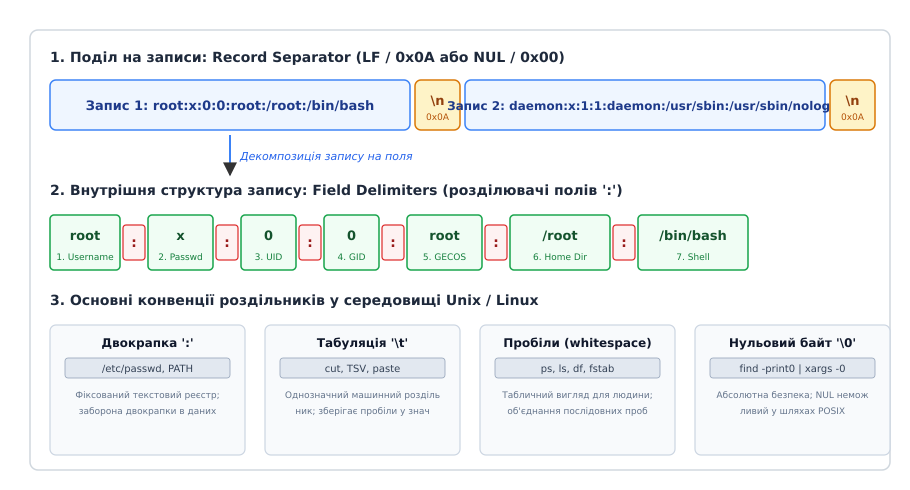
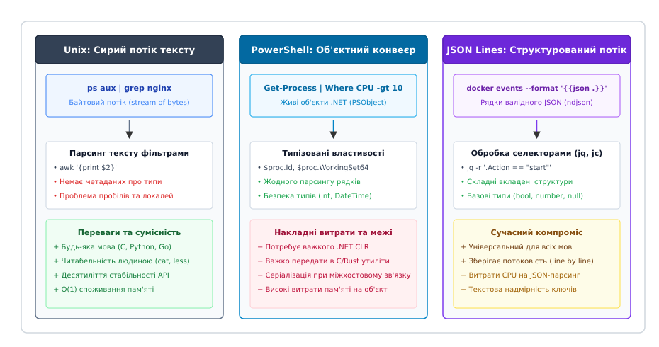

# Текст як універсальний інтерфейс: рядок, роздільник, запис

<preknowlist>
- [Конвеєр: композиція процесів](root:sys-unix/pipeline-composition) — передача потоків даних між стандартними дескрипторами процесів через системні канали.
- [Філософія Unix](root:sys-unix/unix-philosophy) — модульність, мінімалізм інтерфейсів та декомпозиція задач на прості фільтри.
- [Стандартні потоки](root:sys-unix/standard-streams) — призначення дескрипторів stdin (0), stdout (1) та stderr (2).
</preknowlist>

Коли два незалежні процеси в операційній системі мають обмінятися даними через канал зв'язку, найскладнішою інженерною проблемою стає узгодження формату повідомлень. Якщо процес-генератор серіалізує внутрішній стан у двійкову структуру мови C (`struct`), процес-отримувач мусить скомпілюватися з точно таким самим заголовним файлом, використовувати однакове вирівнювання полів у пам'яті (memory padding), однаковий порядок байтів процесора (endianness) та суворо ідентичну версію бібліотеки типів. 

Найменша розбіжність у компіляторах або зміна структури даних призводить до катастрофічних наслідків:
- **Вирівнювання та доповнення структур (Padding & Alignment):** Компілятор під 64-бітну архітектуру x86-64 вирівнює покажчики та 64-бітні цілі числа за 8-байтними межами, додаючи невидимі байти-заповнювачі між полями. Якщо процес-отримувач скомпільований для 32-бітної архітектури або з директивою `#pragma pack(1)`, зсуви полів (field offsets) у пам'яті зміщуються, і програма зчитує сміття замість валідних даних.
- **Порядок байтів (Endianness):** На архітектурах Little-Endian (x86-64, ARM64, RISC-V) молодший байт 32-бітного числа зберігається за меншою адресою, тоді як на архітектурах Big-Endian (SPARC, IBM z/Architecture, мережеві протоколи) — старший. Передача сирого бінарного числа `0x12345678` без конвертації через `ntohl()`/`htonl()` спотворює числове значення.
- **Розкладка бітових полів (Bitfield Layouts):** Стандарт мови ISO C не регламентує порядок розміщення бітових полів у слові пам'яті (зліва направо чи справа наліво), тому бінарна структура стає залежною від конкретної версії компілятора GCC або Clang.
- **Ламкість бінарного інтерфейсу (ABI Fragility):** Додавання одного 4-байтного лічильника всередину C-структури зміщує адреси всіх наступних полів, що вимагає одночасної перекомпіляції всіх програм-споживачів.

Операційна система Unix розв'язала цю проблему за допомогою радикального спрощення: загальним інтерфейсом взаємодії між програмами, системними службами та файлами конфігурації було проголошено звичайний неструктурований текст. Замість складних бінарних схем та методів доступу мейнфреймів операційна система звела весь ввід-вивід до неперервного потоку байтів (stream of bytes), де логічні записи розділяються символом переносу рядка, а поля всередині запису — пробілами, табуляціями або двокрапками.

---

## Першопричини та філософія: Принцип Макілроя та абстракція байтового потоку

У 1978 році дослідник Bell Labs Дуґ Макілрой (Doug McIlroy) сформулював класичний маніфест філософії Unix у випуску *Bell System Technical Journal*:

> «Пишіть програми, які роблять одну річ і роблять її добре. Пишіть програми, які працюють разом. Пишіть програми, які обробляють текстові потоки, бо це універсальний інтерфейс.»

Суть цього принципу полягає у виборі тексту як **спільного знаменника з нульовою зв'язністю схем (Zero Schema Coupling)**.

```
Парадигма мейнфреймів: несумісні бінарні записи вимагають M×N конвертерів
[Програма A (80B)] ──(несумісність)──> [Конвертер] ──(133B)──> [Програма B]

Парадигма Unix: універсальний потік байтів з O(1) узгодженням
[Програма A] ────── потік ASCII/UTF-8 (\n) ──────> [Програма B]
```

Творці Unix — Кен Томпсон (Ken Thompson), Денніс Рітчі (Dennis Ritchie) та Дуґ Макілрой — позбавили ядро операційної системи обов'язку розпізнавати формати записів. У системному виклику `read(fd, buf, count)` ядро повертає лінійний масив байтів без жодної спроби інтерпретувати його вміст. Відповідальність за надання даним структури було повністю перекладено на прикладні програми простору користувача.

Детальний історичний огляд того, як відмова від методів доступу IBM OS/360 відкрила шлях до появи конвеєрів та компонованого програмного забезпечення, наведено у матеріалі [📜 Від перфокарт до байтового потоку: як текст витіснив структуровані записи мейнфреймів](root:sys-unix/text-as-interface/hist-byte-stream-vs-record-managers.md).

### Чому потік байтів став фундаментальною абстракцією

1. **Відсутність узгодження схем на рівні ядра (Schema-Free):** Процес-генератор не публікує схему (IDL або Protobuf-специфікацію) і не узгоджує версію інтерфейсу з процесом-отримувачем. Обидва процеси оперують дескрипторами `0` (stdin) та `1` (stdout).
2. **Споживання на вимогу (Permissive Parsing):** Програма-споживач зчитує лише ті атрибути, які їй потрібні. Наприклад, утиліта `awk '{print $1}'` витягує перший стовпець, повністю ігноруючи зміну форматів у наступних десяти стовпцях або додавання нових полів.
3. **Повна незалежність від мов програмування та середовищ виконання:** Утиліта, написана на C, записує текст у стандартний вивід; фільтр на AWK розбирає його на стовпці; скрипт на Bash фільтрує рядки; а мікросервіс на Go чи Rust зберігає результат у базі даних. Жоден компонент не потребує спільних FFI-прив'язок чи віртуальних машин.
4. **Прозоре налагодження та інспекція (Human Inspection):** Будь-який проміжний етап обробки даних можна перевірити стандартними утилітами `tee`, `cat`, `head`, `less` без потреби у декомпіляторах чи бінарних декодерах.

---

## Анатомія рядкової структури: записи, роздільники полів та конвенції

Оскільки ядро Unix розглядає файл та канал IPC як плоский потік байтів, прикладне програмне забезпечення використовує двовекторну синтаксичну розмітку: **роздільник запису** (Record Separator, RS) та **роздільник поля** (Field Delimiter / Field Separator, FS).


*Структура рядкового потоку: роздільники логічних записів (\n або \0) та внутрішніх полів (двокрапка, табуляція, пробіли).*

### 1. Роздільник записів: символ нового рядка `\n`

Символ нового рядка `\n` (`0x0A`, `Line Feed` або `LF`) позначає межу між логічними сутностями — подіями журналу, обліковими записами або рядками таблиці. 

Використання `\n` замість бінарного лічильника довжини на початку блоку забезпечує фундаментальну властивість систем Unix — **потоковість з фіксованим споживанням пам'яті** (`O(1)` RAM). Фільтр конвеєра (`grep`, `sed`, `awk`) зчитує байти зі стандартного входу доти, доки не зустріне байт `0x0A`. Обробивши поточний рядок і записавши результат у стандартний вивід, програма негайно звільняє буфер і переходить до наступного рядка. Завдяки цьому конвеєр здатен обробляти потоки обсягом у сотні гігабайтів, утримуючи в оперативній пам'яті лише кілька кілобайтів поточного контексту.

#### Стандарт POSIX щодо визначення текстового файлу (POSIX Line Definition)

Згідно зі стандартом POSIX (IEEE Std 1003.1), текстовий файл складається з послідовності рядків, кожен з яких **обов'язково завершується символом `\n`**. Якщо останній рядок файлу не має завершального байта `0x0A`, цей вміст розглядається стандартом як неповний фрагмент (non-terminated line).

Це породжує класичну інженерну пастку в скриптах обробки файлів. Цикл `while read line` у командній оболонці за замовчуванням ігнорує останній рядок файлу, якщо той не містить `\n`, оскільки утиліта `read` повертає статус помилки (exit code 1) при досягненні EOF:

```bash
# Пастка: останній рядок без \n буде пропущено
while IFS= read -r line; do
    echo "Оброблено: $line"
done < input.txt

# Надійне рішення: обробка залишку буфера при EOF
while IFS= read -r line || [ -n "$line" ]; do
    echo "Оброблено: $line"
done < input.txt
```

#### Проблема перенесення рядків Windows (`CRLF` проти `LF`)

У конвенції DOS/Windows роздільником рядка є двобайтова послідовність `CRLF` (`0x0D 0x0A`). Потрапляючи в конвеєр Unix, байт повернення каретки `\r` (`0x0D`) розглядається не як частина роздільника, а як звичайний друкований символ останнього поля рядка.

Це призводить до характерних збоїв:
- **Помилка шебангу:** Якщо скрипт містить перший рядок `#!/bin/bash\r`, ядро Linux шукає інтерпретатор з іменем `/bin/bash\r` і завершує виклик помилкою `No such file or directory` або `\r: command not found`.
- **Затирання виводу в терміналі:** Символ `\r` переміщує курсор у нульову позицію поточного рядка без переходу на наступний. Наступний виведений текст перезаписує попередній, створюючи ілюзію втрати даних.
- **Злам перевірок умов:** Вираз `[ "$var" = "val" ]` повертає `false`, оскільки змінна насправді містить рядок `"val\r"`.

---

### 2. Роздільники полів: двокрапка, табуляція та пробіли

Всередині одного логічного запису окремі атрибути розмежовуються символами-делімітерами. У системному середовищі Linux закріпилися три стандарти делімітації:

```
1. Двокрапка (фіксовані системні реєстри):
   root:x:0:0:root:/root:/bin/bash

2. Табуляція (машино-орієнтовані таблиці TSV):
   1001\tweb-server\tactive\t192.168.1.50

3. Пробіли (людино-орієнтовані таблиці):
   /dev/sda1   /   ext4   defaults,noatime   0   1
```

- **Двокрапка (`:`):** Використовується в системних реєстрах облікових записів (`/etc/passwd`, `/etc/group`, `/etc/shadow`) та системних змінних середовища (`$PATH`, `$LD_LIBRARY_PATH`). Двокрапка обрана тому, що текстові описи користувачів можуть містити пробіли, коми та крапки, але гарантовано не містять символу `:`. Кожна двокрапка задає суворе позиційне значення: якщо поле порожнє, у файлі ставиться дві двокрапки поспіль (`::`).
- **Табуляція (`\t`, `0x09`):** Стандарт формату TSV (Tab-Separated Values). Застосовується в утилітах текстової аналітики `cut`, `paste`, `join`. На відміну від пробілів, знак табуляції однозначно визначає межу стовпця: окремі поля можуть містити внутрішні одинарні пробіли (наприклад, назви міст чи заголовки), не викликаючи зсуву колонок. Кожен символ `\t` позначає рівно один перехід між полями.
- **Пробільні символи (Whitespace):** Використовуються у файлах конфігурації файлових систем (`/etc/fstab`, `/proc/mounts`) та виводі системних команд діагностики (`ps`, `ls -l`, `df`, `free`, `ip`). Будь-яка послідовність з кількох пробілів або знаків табуляції розглядається як єдиний неподільний роздільник, що дозволяє вирівнювати текст у зручні для людського ока вертикальні колонки.

#### Чому Unix відмовився від CSV на користь TSV та фіксованих роздільників

Формат CSV (Comma-Separated Values), поширений в офісному програмному забезпеченні, виявився непридатним для системних конвеєрів Unix. Згідно зі стандартом RFC 4180, поле CSV, що містить кому, береться в подвійні лапки (`"Київ, вул. Хрещатик"`), а поле, що містить перенос рядка, може розтягуватися на кілька фізичних рядків файлу:

```csv
101,"Подія сервера",2026-08-25,"Помилка з'єднання:
перевищено таймаут 30с",CRITICAL
```

Поява символу `\n` всередині значення поля руйнує базовий контракт потокової обробки: утиліта `grep` чи `awk` більше не може розглядати кожен фізичний рядок як незалежний запис. Для розбору такого файлу потрібен синтаксичний автомат з відстеженням стану лапок. На противагу цьому, стандарти Unix суворо вимагають: **один фізичний рядок — це рівно один логічний запис**. Якщо значення повинно містити спецсимвол, застосовується екранування (`\n` або вісімковий код `\040` для пробілу в `/etc/fstab`), але сам фізичний перенос рядка залишається непорушною межею запису.

---

### 3. Внутрішній роздільник оболонки `$IFS` та механізм Word Splitting

У командних оболонках POSIX (sh, dash, bash) розбиття потоку на слова (Word Splitting) та розбір полів у вбудованій команді `read` контролюються спеціальною змінною оточення `IFS` (Internal Field Separator).

За замовчуванням змінна `IFS` містить три пробільні символи: пробіл, табуляцію та перенос рядка:
```bash
IFS=$' \t\n'
```

#### Семантика пробільних та непробільних роздільників

1. **Пробільні роздільники (`IFS whitespace` — пробіл, `\t`, `\n`):**
   - Провідні (leading) та завершальні (trailing) пробільні символи автоматично відкидаються синтаксичним аналізатором.
   - Будь-яка неперервна послідовність з кількох пробільних символів поспіль об'єднується в один неподільний роздільник. Порожні поля між ними не утворюються.
2. **Непробільні роздільники (наприклад, `IFS=":"` або `IFS=","`):**
   - Кожен окремий символ роздільника створює чітку межу поля.
   - Послідовність двох символів роздільника поспіль (`::`) обов'язково породжує порожнє поле нульової довжини (`""`).
   - Роздільники на початку або наприкінці рядка створюють порожні поля на першій та останній позиціях списку.

```bash
# Приклад: надійне читання облікових записів через $IFS
while IFS=: read -r username password uid gid gecos homedir usershell || [ -n "$username" ]; do
    if [ "$uid" -ge 1000 ] && [ "$usershell" != "/usr/sbin/nologin" ]; then
        printf "Користувач: %-15s UID: %-5d Каталог: %s\n" "$username" "$uid" "$homedir"
    fi
done < /etc/passwd
```

---

### 4. Небезпека пробілів у файлових іменах та нульовий термінатор NUL `\0`

Згідно зі стандартом POSIX, ім'я файлу у файловій системі може містити **будь-які довільні байти, крім двох**:
1. Байт `0x00` (`NUL`) — оскільки він слугує термінатором рядка в мові C.
2. Байт `0x2F` (`/`) — оскільки він слугує роздільником каталогів у шляху.

Це означає, що файл може легально містити у своїй назві пробіли, символи табуляції, лапки і навіть символ переносу рядка `\n`. 

#### Чому конвеєр `ls | while read` є антипатерном

Спроба отримати список файлів через `ls | while read file` призводить до фатальних помилок:
- Якщо назва файлу містить символ `\n`, утиліта `ls` виведе її у два окремі рядки. Скрипт сприйме кожну половину як окремий файл і спробує виконати операцію над неіснуючими об'єктами.
- Якщо файл має назву `-rf`, команда `rm $file` сприйме ім'я як набір прапорців командного рядка, а не як цільовий шлях.
- Якщо змінна не взята в лапки, механізм Word Splitting оболонки розіб'є файл `"monthly report.pdf"` на два аргументи: `"monthly"` та `"report.pdf"`.

#### Нульовий байт `\0` як абсолютний контракт безпеки

Єдиним повністю надійним механізмом передачі списків файлів у середовищі Unix є використання нульового байта `\0` (`NUL`, `0x00`) як роздільника записів. Оскільки байт `0x00` фізично не може з'явитися всередині імені файлу на рівні ядра, він утворює непорушну межу між записами довільного вмісту.

```bash
# Абсолютно безпечний конвеєр для файлів з будь-якими спецсимволами
find /var/log -type f -name "*.log" -print0 | xargs -0 rm -f
```

Підтримка нульового роздільника інтегрована в системні утиліти GNU/POSIX:
- `find -print0` — виводить знайдені шляхи, розділені байтом `\0`.
- `xargs -0` — розбирає аргументи виключно за байтом `\0`.
- `sort -z` — сортує записи, розділені `\0`.
- `cut -z` — вибирає поля з потоку, розділеного `\0`.
- `grep -z` — шукає шаблони в записах, розділених `\0`.
- `read -d ''` — зчитує вхідні дані до нульового байта.

#### Використання `\0` ядром Linux у `/proc`

Ядро Linux застосовує байт `0x00` як штатний роздільник параметрів у псевдофайлах процесів:
- **`/proc/[pid]/cmdline`** — повний список аргументів командного рядка процесу (`argv`), розділених байтом `\0`. Це дозволяє однозначно відновити аргументи процесу, навіть якщо самі параметри містять пробіли чи переноси рядків.
- **`/proc/[pid]/environ`** — масив змінних оточення процесу у форматі `KEY=VALUE`, розділених байтом `\0`.

```bash
# Безпечне читання аргументів процесу без пошкодження через пробіли
tr '\0' '\n' < /proc/$$/cmdline
```

Повний синтаксичний опис системних конфігураційних файлів, правил розбору змінної `$IFS` та системних таблиць наведено у матеріалі [📋 Конвенції роздільників та системні формати записів Unix](root:sys-unix/text-as-interface/api-unix-text-formats.md).

---

## Текстові формати ядра Linux: `/proc`, `/sys` та підсистема `seq_file`

Усі внутрішні структури ядра Linux є суворо типізованими бінарними об'єктами мови C (`struct task_struct`, `struct net_device`, `struct mount`, `struct inode`). Проте для експорту стану системи у простір користувача ядро перетворює ці структури на форматований текст через віртуальні файлові системи `procfs` (`/proc`) та `sysfs` (`/sys`).

### 1. Генерація багаторядкових таблиць через підсистема `seq_file`

У ранніх версіях ядра Linux генерація текстових файлів у `/proc` спиралася на одноразові сторінкові буфери розміром 4096 байтів (`PAGE_SIZE`). Якщо системна таблиця (наприклад, список відкритих файлів чи мережевих з'єднань) перевищувала 4 КБ, відбувалося переповнення буфера або обрив даних.

Для усунення цієї проблеми було створено підсистему **`seq_file`**. Вона реалізує ітераторний інтерфейс з чотирьох функцій зворотного виклику:
- `start(struct seq_file *m, loff_t *pos)` — ініціалізує ітерацію та знаходить об'єкт за зміщенням `pos`.
- `next(struct seq_file *m, void *v, loff_t *pos)` — переходить до наступного елемента списку.
- `show(struct seq_file *m, void *v)` — форматує поточний об'єкт у текстовий рядок за допомогою `seq_printf()`.
- `stop(struct seq_file *m, void *v)` — звільняє ресурси або блокування після завершення виводу.

Підсистема `seq_file` автоматично управляє динамічним виділенням сторінок пам'яті ядра, безпечно фрагментує потік при послідовних викликах `read()` і гарантує, що користувацький процес отримує коректний безперервний потік текстових записів, завершених `\n`.

:::tabs
:::code text-as-interface-d/c/heneratsiia-tekstu-v-iadri.c
:::code text-as-interface-d/cpp/heneratsiia-tekstu-v-iadri.cpp
:::

---

### 2. Віртуальна файлова система `sysfs` та правило «один файл — одне значення»

Віртуальна файлова система `/sys` (sysfs), створена для відображення дерева пристроїв, шин та драйверів моделі ядра Linux (Unified Device Model), запровадила суворе інженерне правило:

> **«Один файл — одне значення» (One value per file).** Кожен атрибут у sysfs повинен містити рівно одне текстове скалярне значення (число, рядок чи булевий прапорець) або масив однакових типів фіксованого розміру (наприклад, бітову маску процесорів `cpumask`), що завершується символом `\n`.

#### Інженерне обґрунтування правила `sysfs`:

1. **Абсолютна простота розбору в просторі користувача:** Скриптам та системним утилітам не потрібні парсери чи регулярні вирази. Отримання статусу диска або яскравості екрана зводиться до прямого порівняння чисел:
   ```bash
   # Перевірка типу накопичувача (1 = HDD, 0 = SSD/NVMe)
   if [ "$(cat /sys/block/sda/queue/rotational)" -eq 0 ]; then
       echo "Накопичувач sda є твердотілим (SSD)"
   fi
   ```
2. **Атомарність запису та надійність конфігурації:** Зміна параметра здійснюється записом одного скаляра без ризику пошкодити сусідні поля конфігурації:
   ```bash
   # Атомарне перемикання алгоритму планувальника введення-виведення
   echo "mq-deadline" > /sys/block/sda/queue/scheduler
   ```
3. **Пряме відображення на драйвери (1:1 Attribute Mapping):** Кожен файл атрибута безпосередньо зв'язується зі структурою `struct device_attribute`, яка містить рівно два методи: `show()` для читання та `store()` для запису. Ядру не потрібно розбирати складні багаторядкові структури при записі з простору користувача.
4. **Стабільність ABI при еволюції ядра:** Якщо драйвер пристрою отримує нову функцію або метрику, ядро не змінює формат наявних файлів, а просто створює новий файл-атрибут у відповідному каталозі пристрою. Старі утиліти моніторингу продовжують працювати без модифікації.

---

## Програмний синтаксичний аналіз текстових записів: C, C++ та апаратна оптимізація

У системному програмуванні читання текстових інтерфейсів спирається на порядкову обробку потоків без попереднього завантаження всього файлу в пам'ять.

### Потоковий синтаксичний розбір у C: `getline()` та `strsep()`

У мові C стандартом є використання функції `getline()`, яка динамічно виділяє буфер під довжину поточного рядка, та функції `strsep()`, яка розбиває рядок за заданим роздільником. На відміну від застарілої функції `strtok()`, функція `strsep()` коректно обробляє порожні поля (дві двокрапки поспіль `::`) і є безпечною для багатопотокових середовищ. 

При досягненні кінця буфера `getline()` автоматично подвоює його розмір за допомогою `realloc()`, мінімізуючи системні виклики виділення пам'яті. Функція `strsep()` модифікує вхідний рядок на місці (in-place), замінюючи знайдений символ роздільника на нульовий байт `\0`, що повністю виключає додаткове виділення динамічної пам'яті під кожне поле.

### Безалокаційний синтаксичний розбір у C++: `std::string_view` та `std::from_chars`

У сучасному C++ для запобігання зайвим алокаціям пам'яті на купі застосовується неволодіючий інтерфейс `std::string_view` у поєднанні з функцією безалокаційного парсингу чисел `std::from_chars`. 

`std::string_view` зберігає лише покажчик на початок підрядка у вже завантаженому буфері та його довжину. Функція `std::from_chars` (введена в C++17) не залежить від глобальної системної локалі, не виділяє пам'ять і працює в рази швидше за традиційні `sscanf()` чи `std::stoi`.

:::tabs
:::code text-as-interface-d/c/main.c
:::code text-as-interface-d/cpp/prohramnyi-syntaksychnyi.cpp
:::

---

### Апаратні та компіляторні оптимізації SIMD

Завдяки тому, що текстовий потік зберігається у лінійному масиві пам'яті, сучасні процесорні архітектури досягають екстремальної швидкості обробки тексту:
1. **Передбачуваність для апаратного передзавантаження (Hardware Prefetcher):** Неперервне розташування байтів у пам'яті дозволяє апаратним блокам передзавантаження процесора (L1/L2 Stream Prefetchers) заздалегідь підтягувати наступні кеш-лінії, повністю усуваючи затримки доступу до RAM (Memory Stalls).
2. **Векторизація SIMD (AVX-2, AVX-512, ARM NEON):** Сучасні реалізації бібліотеки `glibc` оптимізують функції сканування роздільників (`memchr`, `strchr`) за допомогою векторних інструкцій. Замість побайтового порівняння векторний регістр шириною 256 або 512 бітів порівнює 32 або 64 байти за один такт процесора за допомогою операцій маскування бітів (`_mm256_cmpeq_epi8` та `_mm256_movemask_epi8`).
3. **Відсутність розіменування покажчиків (Zero Pointer Chasing):** На відміну від об'єктних графів або бінарних дерев, де кожен перехід між полями вимагає читання нового покажчика з пам'яті та провокує кеш-промахи (Cache Misses), плоский текстовий потік обробляється з максимальною пропускною здатністю шини пам'яті — понад 10–20 ГБ/с на одне ядро CPU.

---

## Компонованість (Composability) та конвеєризація: створення аналітичних систем

Головна сила текстового інтерфейсу розкривається через **компонованість (Composability)**: можливість поєднувати малі спеціалізовані утиліти у складні аналітичні ланцюги обробки даних без написання спеціального коду.

### Інструментарій обробки текстових потоків

Кожна класична утиліта Unix реалізує одну конкретну операцію над потоком:
- **`grep`** — фільтрація записів: пропускає лише ті рядки, що відповідають регулярному виразу.
- **`cut`** — позиційна вибірка стовпців за заданим символом-роздільником.
- **`tr`** — посимвольна трансляція, видалення або стиснення послідовностей однакових символів (`tr -s ' '`).
- **`sed`** — потоковий неінтерактивний редактор: виконує регулярні підстановки, видалення або перетворення діапазонів рядків.
- **`awk`** — повноцінна мова обробки текстових таблиць з підтримкою асоціативних масивів, числових операцій та форматованого виводу.
- **`sort`** — сортування записів за алфавітним, числовим (`-n`) чи версійним (`-V`) порядком з підтримкою вибору ключових колонок (`-k`).
- **`uniq`** — дедуплікація суміжних рядків та підрахунок частоти входження (`-c`).
- **`wc`** — підрахунок кількості рядків (`-l`), слів (`-w`) або байтів (`-c`).

---

### Наскрізний приклад: аналіз журналу веб-сервера та виявлення атак

Розглянемо практичну задачу: виявлення IP-адрес зловмисників, які генерують найбільшу кількість помилок 5xx на веб-сервері, з агрегацією за цільовими URL.

```bash
# Комплексний аналітичний конвеєр
cat /var/log/nginx/access.log \
  | grep ' 50[0-9] ' \
  | awk '{print $1, $7}' \
  | sed 's/?.*//' \
  | sort \
  | uniq -c \
  | sort -nr \
  | head -n 10
```

#### Покрокова трансформація даних у конвеєрі:

1. **Вхідний сирий потік (`cat`):**
   ```text
   198.51.100.4 - - [29/Aug/2026:14:01:10] "GET /api/v1/checkout?id=42 HTTP/1.1" 500 240
   203.0.113.19 - - [29/Aug/2026:14:01:11] "GET /index.html HTTP/1.1" 200 4500
   198.51.100.4 - - [29/Aug/2026:14:01:12] "POST /api/v1/checkout?id=99 HTTP/1.1" 502 180
   ```
2. **Фільтрація помилок сервера (`grep ' 50[0-9] '`):** Відсікаються всі успішні запити (200 OK):
   ```text
   198.51.100.4 - - [29/Aug/2026:14:01:10] "GET /api/v1/checkout?id=42 HTTP/1.1" 500 240
   198.51.100.4 - - [29/Aug/2026:14:01:12] "POST /api/v1/checkout?id=99 HTTP/1.1" 502 180
   ```
3. **Витяг цільових полів (`awk '{print $1, $7}'`):** Отримуємо лише IP-адресу та повний запитаний URI:
   ```text
   198.51.100.4 /api/v1/checkout?id=42
   198.51.100.4 /api/v1/checkout?id=99
   ```
4. **Нормалізація шляхів (`sed 's/?.*//'`):** Відкидаються параметри динамічних запитів для коректної агрегації за ендпоінтом:
   ```text
   198.51.100.4 /api/v1/checkout
   198.51.100.4 /api/v1/checkout
   ```
5. **Сортування для агрегації (`sort`):** Суміжні однакові записи групуються разом:
   ```text
   198.51.100.4 /api/v1/checkout
   198.51.100.4 /api/v1/checkout
   ```
6. **Підрахунок частоти (`uniq -c`):** Обчислюється кількість повторень для кожної пари `(IP, Endpoint)`:
   ```text
         2 198.51.100.4 /api/v1/checkout
   ```
7. **Фінальне ранжування (`sort -nr | head -n 10`):** Сортування за спаданням частоти та вибірка топ-10 джерел атаки.

---

### Механіка конвеєра: буферизація, зворотний тиск та коди завершення

Для надійної роботи конвеєрів розробник повинен враховувати низькорівневу поведінку ядра та стандартної бібліотеки мови C (`libc`).

```
Процес A (stdout) ──[ Кільцевий буфер pipe (64 KB) ]──> Процес B (stdin)
         │                                                      │
         └──── Блокується при переповненні (Backpressure) ──────┘
```

#### 1. Буфери ядра Linux та зворотний тиск (Backpressure)

Міжпроцесний канал створюється системним викликом `pipe(2)`. В ядрі Linux канал представляє собою кільцевий буфер сторінок пам'яті (`struct pipe_inode_info`), стандартний розмір якого становить **64 КБ** (16 сторінок по 4 КБ, налаштовується через `fcntl(fd, F_SETPIPE_SZ)`).

Якщо процес-генератор записує дані швидше, ніж процес-споживач встигає їх обробляти, буфер заповнюється. Наступний виклик `write()` у процесі-генераторі **блокується ядром**, призупиняючи виконання процесу доти, доки споживач не звільнить місце викликом `read()`. Цей механізм автоматичного зворотного тиску (Backpressure) запобігає переповненню оперативної пам'яті системи незалежно від швидкості джерела даних.

#### 2. Буферизація вводу-виводу в бібліотеці `libc`

Стандартна бібліотека C реалізує три режими буферизації потоків `FILE*`:
- **Повна блокова буферизація (`_IOFBF`, 4096 або 8192 байти):** Використовується за замовчуванням, коли вивід спрямовано у файл або конвеєр (`pipe`). Бібліотека накопичує байти в пам'яті і скидає їх системним викликом `write()` лише при повному заповненні 4-кілобайтного блоку.
- **Порядкова буферизація (`_IOLBF`):** Використовується, коли стандартний вивід підключено до інтерактивного термінала (`isatty(STDOUT_FILENO) == true`). Буфер скидається при кожному символі `\n`.
- **Без буферизації (`_IONBF`):** Байти передаються в ядро негайно (стандартний потік помилок `stderr`).

#### Пастка зависання конвеєрів реального часу

Коли інженер запускає конвеєр реального часу:
```bash
tail -f /var/log/app.log | grep "ERROR" | awk '{print $3}'
```
Конвеєр виглядає «завислим» і не виводить події негайно. Причина полягає в тому, що утиліти `grep` та `awk`, виявивши, що їхній вивід спрямовано в канал (`pipe`), автоматично перемикаються з порядкової буферизації на блокову (4 КБ). Повідомлення з'являться на екрані лише тоді, коли накопичиться 4096 байтів помилок.

**Рішення проблеми:**
- Використання спеціальних прапорців утиліт: `grep --line-buffered` або виклик `fflush()` всередині `awk`.
- Використання утиліти модифікації буферизації `stdbuf`:
  ```bash
  tail -f /var/log/app.log | stdbuf -oL grep "ERROR" | stdbuf -oL awk '{print $3}'
  ```

#### 3. Сигнал `SIGPIPE` та раннє завершення споживача

Якщо процес-споживач завершує роботу раніше за джерело (наприклад, утиліта `head -n 5` зчитала 5 рядків і закрила свій дескриптор `stdin`), наступна спроба процесу-генератора виконати виклик `write()` у закритий канал призводить до надсилання ядром сигналу **`SIGPIPE`** (сигнал номер 13).

За замовчуванням сигнал `SIGPIPE` негайно аварійно завершує процес-генератор. У командній оболонці код завершення такого процесу дорівнює 128 + 13 = 141. Це штатний механізм Unix, який гарантує, що утиліта-генератор не витрачатиме ресурси процесора на обчислення даних, які більше нікому не потрібні.

#### 4. Обробка помилок у конвеєрах: `pipefail` та `${PIPESTATUS[@]}`

За замовчуванням командна оболонка Bash повертає як код завершення конвеєра код виходу **останньої** команди ланцюга. Якщо попередня команда завершилася критичною аварією, конвеєр все одно поверне `0` (успіх), якщо остання команда відпрацювала коректно:

```bash
# Небезпечна поведінка: cat завершився помилкою, але загальний статус = 0
cat non_existent_file.txt | grep "pattern" | wc -l
echo $? # Виведе: 0
```

Для запобігання тихому ігноруванню аварій у промислових скриптах застосовуються два механізми:
1. **Опція `set -o pipefail`:** Змушує конвеєр повертати код завершення першої правої команди, яка завершилася з ненульовим статусом (або 0, якщо всі команди виконані успішно).
2. **Масив `${PIPESTATUS[@]}` (Bash) / `$pipestatus` (Zsh):** Зберігає точні коди завершення кожного окремого кроку виконаного конвеєра:
   ```bash
   cat non_existent_file.txt | grep "pattern" | wc -l
   # Огляд статусів усіх учасників конвеєра: [1, 1, 0]
   echo "Статуси етапів: ${PIPESTATUS[0]}, ${PIPESTATUS[1]}, ${PIPESTATUS[2]}"
   ```

---

## Гнучкість та довговічність: зворотна сумісність десятиліттями

Найбільш разючою властивістю текстового інтерфейсу Unix є його феноменальна довговічність. Формати таких системних файлів, як `/etc/passwd` або `/etc/fstab`, функціонують понад 50 років без зміни синтаксичної структури і залишаються повністю сумісними з найсучаснішими дистрибутивами Linux 2020-х років.

Ця стабільність забезпечується чотирма фундаментальними інженерними властивостями:

1. **Толерантність до додаткових полів (Permissive Parsing):** Стандартні системні парсери зчитують рівно стільки полів, скільки їм необхідно для роботи. Якщо в майбутній версії операційної системи в кінець рядка додаються нові стовпці, старі компільовані утиліти продовжують коректно зчитувати перші `N` полів і просто ігнорують невідомий залишок рядка.
2. **Універсальний механізм коментарів (`#`):** Додавання метаданих, пояснень та відключення директив здійснюється вставкою одного символу `#`. Бінарні формати вимагають створення спеціальних заголовків, версійних блоків та прапорців увімкнення/вимкнення для кожної структури.
3. **Відсутність бінарних конфліктів компілятора:** Текстовий файл конфігурації, створений на 32-бітній системі Motorola 68000 або x86 у 1985 році, без жодної конвертації відкривається та обробляється 64-бітною системою ARM64 або RISC-V у 2026 році. Відсутність вимог до вирівнювання структур усуває проблему несумісності ABI.
4. **Легкість інспекції людиною:** Будь-який проміжний стан конвеєра можна перевірити стандартними утилітами `tee`, `cat`, `head`, `less` без потреби у декомпіляторах чи спеціальних налагоджувачах.

```
Еволюція запису /etc/passwd без зламу старих парсерів:
1970-ті:  root:password:0:0:root:/root:/bin/sh
1990-ті:  root:x:0:0:root:/root:/bin/bash           (хеш пароля винесено в /etc/shadow)
2020-ті:  root:x:0:0:root:/root:/usr/bin/zsh        (зміна оболонки без зміни схеми)
```

---

## Сучасні виклики та структурований текст: JSON, YAML та об'єктні конвеєри

Попри всі архітектурні переваги, неструктурований текст має фундаментальні обмеження, які стають відчутними у складних розподілених системах, хмарних середовищах та мікросервісних архітектурах.


*Архітектурні парадигми: сирий потік тексту Unix, об'єктний конвеєр PowerShell та структурований потік JSON Lines.*

### 1. Обмеження класичного неструктурованого тексту

- **Втрата інформації про типи даних:** Усі значення у потоці є послідовностями символів. Число `42`, IP-адреса `192.168.1.1`, шлях `/tmp` та рядок `"42"` виглядають однаково. Програма-отримувач змушена щоразу виконувати зворотну конвертацію рядків у числа (`strtol`, `sscanf`), що створює накладні витрати процесора та потенційні помилки розбору провідних нулів (наприклад, плутанина між десятковим та вісімковим представленням `0123`).
- **Складність представлення ієрархічних та вкладених структур:** Класичний табличний текст ідеально підходить для пласких списків, але стає вкрай громіздким при спробі представити деревоподібні об'єкти (наприклад, конфігурацію контейнера з вкладеними томами, портами, змінними середовища та політиками перезапуску).
- **Залежність від системних локалей (`LC_ALL`):** Утиліти типу `sort` за замовчуванням сортують рядки відповідно до поточної мовної локалі (`en_US.UTF-8`), що може порушити вимоги бінарного порівняння ASCII утиліт типу `join`. Для детермінізму в конвеєрах завжди доводиться примусово встановлювати `export LC_ALL=C`.

---

### 2. Структурований текст: JSON Lines (`ndjson` / `jsonl`) та інструменти `jq`, `yq`

Сучасним компромісом у хмарній інфраструктурі та контейнерних платформах (Kubernetes, Docker, systemd) став формат **JSON Lines (`ndjson`)** та процесори структурованого тексту.

У форматі JSON Lines кожен фізичний рядок є окремим валідним JSON-документом, завершеним `\n`. Це дозволяє поєднати переваги обох світів:
1. **Збереження потоковості Unix (`O(1)` пам'яті):** Фільтри зчитують потік порядково, парсячи один JSON-об'єкт за раз.
2. **Багата типізація та вкладеність:** Кожен запис зберігає точні типи полів (рядки, числа, булеві прапорці, масиви) та складні вкладені об'єкти без втрати структури.

```bash
# Фільтрація структурованих подій Docker за допомогою утиліти jq
docker events --format '{{json .}}' \
  | jq -r 'select(.status == "destroy") | "\(.time) \(.Actor.Attributes.name)"'
```

Сучасні системні інструменти Linux за замовчуванням надають прапорець виводу в JSON для машинного розбору:
- `ip -j route` — мережеві маршрути у форматі JSON.
- `lsblk --json` — топологія блокових пристроїв.
- `journalctl -o json` — системні журнали `systemd`.

Для перетворення виводу класичних утиліт (`ps`, `df`, `dig`) у валідний JSON застосовується спеціалізована утиліта `jc`:
```bash
# Безпечний розбір залишку місця на дисках через JSON
df -h | jc --df | jq '.[0].available'
```

---

### 3. Об'єктний конвеєр PowerShell проти сирого тексту

В операційній системі Windows платформа PowerShell реалізувала об'єктну модель міжпроцесної взаємодії. Замість передачі потоку символів команди передають посилання на типізовані об'єкти середовища .NET CLR (`PSObject`):

```powershell
# Отримання та фільтрація процесів у PowerShell за числовим полем
Get-Process | Where-Object { $_.WorkingSet64 -gt 500MB } | Stop-Process
```

Командлет `Where-Object` звертається безпосередньо до числової властивості `.WorkingSet64`, яка є 64-бітним цілим числом `Int64`. Жоден рядок тексту не парситься, а вирівнювання колонок не впливає на обчислення.

Проте за цю типобезпеку доводиться платити високу ціну:
- **Прив'язка до важкого середовища виконання:** Усі утиліти повинні виконуватися всередині віртуальної машини .NET, створюючи навантаження на пам'ять та збирач сміття (Garbage Collector).
- **Втрата методів при міжхостовій взаємодії:** При передачі об'єктів через мережу (WinRM/SSH) об'єкти серіалізуються у статичні XML-зліпки (CLIXML), втрачаючи методи та динамічний зв'язок із системою.

---

### 4. Оболонки нового покоління: Nushell

Сучасні системні оболонки нового покоління, зокрема **Nushell** (написана на Rust), поєднують швидкість скомпільованого коду без збирача сміття з безпекою об'єктних таблиць. Вона розглядає вивід системних команд як типізовану таблицю зі схемою даних, дозволяючи фільтрувати записи за іменами колонок без регулярних виразів:

```bash
# Фільтрація процесів у Nushell без текстового парсингу
ps | where cpu > 10 | sort-by mem --reverse
```

Детальний порівняльний аналіз архітектурних характеристик, матрицю накладних витрат та сценарії вибору між байтовими потоками, PowerShell та JSON наведено у матеріалі [⚖️ Парадигми міжпроцесної взаємодії: потік байтів Unix, об'єкти PowerShell та структурований JSON](root:sys-unix/text-as-interface/comp-stream-vs-object-pipelines.md).

---

## Інженерний синтез

Вибір неструктурованого тексту як універсального інтерфейсу операційної системи Unix виявився одним із найбільш фундаментальних та далекоглядних рішень в історії комп'ютерної інженерії. Свідома відмова від підтримки складних бінарних схем на рівні ядра дозволила побудувати відкриту, модульну та масштабовану екосистему компонованих програм.

### Зведена матриця інженерних рішень текстового інтерфейсу

| Рівень взаємодії | Формат / Механізм | Основні роздільники | Головні переваги | Типові інженерні ризики та їх усунення |
|---|---|---|---|---|
| **Системні реєстри** | `/etc/passwd`, `$PATH` | Запис: `\n`<br>Поля: `:` | Фіксована позиційна схема, легкість ручного редагування та відновлення при збоях. | Заборонено символ `:` у значеннях. Для складних записів коментарів застосовують окремі файли. |
| **Табличні дані** | TSV, утиліти `cut`, `awk` | Запис: `\n`<br>Поля: `\t` | Однозначність розбору стовпців, можливість збереження одинарних пробілів усередині полів. | Необхідно стежити, щоб редактори не замінювали знаки табуляції на послідовності пробілів. |
| **Файлові потоки** | `find -print0 \| xargs -0` | Запис: `\0`<br>Поля: відсутні | Абсолютний захист від ін'єкцій спецсимволів, пробілів та переносів рядків у назвах. | Неможливо переглядати безпосередньо в текстових редакторах; потребує прапорця `-0`/`-z`. |
| **Ядро Linux (`sysfs`)** | `/sys` | `\n` (одне значення) | Атомарність запису, нульовий оверхед на парсинг у просторі користувача, стабільне ABI. | Дотримання правила «один файл — одне значення»; заборона генерації складних багатостовпчикових матриць. |
| **Хмарні сервіси / CLI** | JSON Lines (`ndjson`), `jq` | Запис: `\n`<br>Поля: JSON-ключі | Багата типізація, підтримка вкладених структур та масивів при збереженні `O(1)` пам'яті. | Витрати процесора на парсинг JSON; усуваються застосуванням векторних SIMD-парсерів (`simdjson`). |

Текстовий інтерфейс вимагає від інженера розуміння його низькорівневої семантики: взяття змінних у лапки для запобігання розщепленню слів, використання нульового байта `\0` при обробці довільних файлових шляхів, налаштування буферизації потоків та вибору надійних роздільників. Простий потік байтів залишається найстійкішою основою інтероперабельності, керованості та довговічності сучасних обчислювальних систем.
