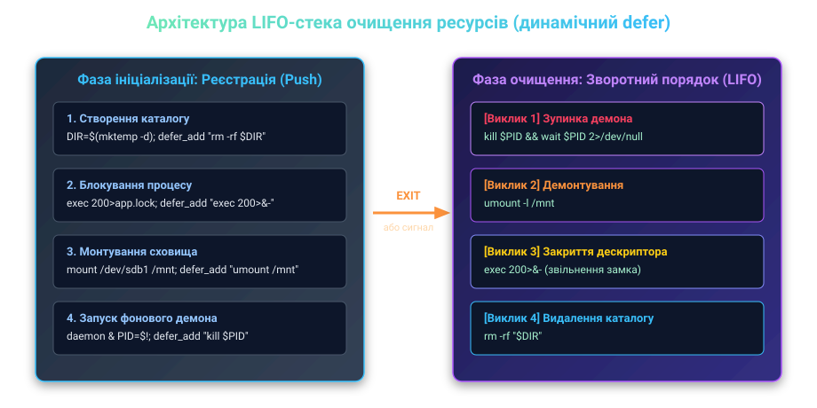

# ⚙️ Модуль динамічного очищення ресурсів defer для системних сценаріїв

У великих системних та автоматизаційних сценаріях ресурси операційної системи виділяються послідовно в міру просування етапів: створення тимчасових каталогів, захоплення файлових блокувань, монтування мережевих або блокових томів, запуск допоміжних фонових процесів та підготовка мережевих сокетів.

Традиційний підхід до очищення за допомогою статичної функції `cleanup()`, зареєстрованої через `trap cleanup EXIT`, швидко деградує у складних конвеєрах. Статична функція жорстко закодована на звільнення всіх можливих ресурсів, але вона не знає, на якому саме кроці обірвалося виконання сценарію. Якщо збій стався на другому кроці з десяти, статична функція спробує демонтувати неіснуючий диск, зняти незахоплений замок або видалити ще не створений каталог, генеруючи каскад помилок та маскуючи справжню причину аварії.

Цей модуль реалізує ідіому відкладеного виконання `defer` (за аналогією з ключовим словом `defer` у мовах Go та Zig), де кожен крок звільнення реєструється безпосередньо в місці ініціалізації ресурсу та гарантовано виконується у строго зворотному порядку (LIFO) під час виходу або перехоплення фатальних сигналів.

---

## Архітектура та інваріанти стека `defer`

Динамічний реєстр очищення базується на трьох ключових архітектурних інваріантах:

1. **Порядок LIFO (Last-In, First-Out):** Ресурси повинні звільнятися у строго зворотному порядку щодо їх створення. Наприклад, якщо процес спочатку змонтував файлову систему, а потім запустив фонового демона, що читає з цієї файлової системи, очищення зобов'язане спершу зупинити демона, і лише після цього розмонтувати диск. Порушення порядку призведе до системної помилки ядра `EBUSY (Target is busy)`.
2. **Ізоляція збоїв окремих хуків:** Якщо один із кроків очищення зазнає невдачі (наприклад, тимчасовий файл уже було видалено іншим процесом або дескриптор закрився), виконання стека не повинно перериватися. Усі наступні команди в реєстрі мають бути виконані гарантовано.
3. **Захист від рекурсії та повторного входу:** Якщо команда всередині хука очищення випадково викликає `exit` або спричиняє помилку в режимі `set -e`, механізм `defer` повинен заблокувати повторний запуск обробника, запобігаючи нескінченному зацикленню.


*Принцип реєстрації викликів очищення на стадії ініціалізації та їхнього розгортання у зворотному порядку під час виходу.*

---

## Реалізація бібліотеки `defer.sh`

Нижче наведено повний вихідний код виробничої бібліотеки `defer.sh`, оптимізованої для середовищ Bash 4.0+:

:::code proj-defer-cleanup-stack/sh/defer.sh

---

## Допоміжні утиліти безпечного виділення ресурсів

Для запобігання типовим системним помилкам модуль надає високорівневі функції-обгортки над системними викликами, які автоматично реєструють відповідні дії прибирання:

### 1. Безпечний тимчасовий каталог: `defer_mktemp_dir`

Функція атомарно створює каталог за допомогою `mktemp -d`, обмежує права доступу маскою `0700` та додає команду рекурсивного видалення до стека `defer`:

:::code proj-defer-cleanup-stack/sh/1-bezpechnyi-tymchasovyi.sh

### 2. Неблокуюче файлове блокування: `defer_flock`

Функція відкриває окремий файловий дескриптор, викликає `flock -n` для запобігання паралельному запуску однакових завдань та реєструє закриття дескриптора. При закритті дескриптора ядро Linux автоматично знімає блокування:

:::code proj-defer-cleanup-stack/sh/2-neblokuiuche-failove.sh

### 3. Гарантоване завершення фонових процесів: `defer_spawn`

Запуск дочірніх процесів у фоні (`cmd &`) створює ризик появи процесів-сиріт у разі раптового збою основного сценарію. Якщо дочірній процес породжує власні підпроцеси, звичайна відправка сигналу за конкретним PID не зупинить його нащадків.

Функція `defer_spawn` запускає команду, зберігає її PID та додає команду послідовної відправки `SIGTERM`, невеликої паузи для коректного закриття та примусового `SIGKILL` у разі зависання:

:::code proj-defer-cleanup-stack/sh/3-harantovane-zavershennia.sh

---

## Робота з підоболонками та локальна область видимості

Згідно зі специфікацією POSIX, форк підоболонки `( ... )` копіює стан масиву `__DEFER_STACK`, але ядро автоматично скидає встановлені батьком пастки `trap EXIT` та пастки сигналів. Це означає, що при виході з підоболонки батьківський стек `defer` не виконується всередині дочірнього процесу.

Якщо підоболонка виділяє власні тимчасові ресурси (наприклад, локальний кеш у пам'яті), вона повинна створити свій ізольований контекст:

:::code proj-defer-cleanup-stack/sh/robota-z-pidobolonkamy-ta.sh

Така дисципліна забезпечує повну капсуляцію ресурсів: внутрішні підзадачі прибирають за собою самостійно, не перевантажуючи глобальний стек батьківського сценарію.

---

## Особливості роботи під обліковим записом root

При написанні сценаріїв, що виконуються з привілеями суперкористувача (`root`), помилка в коді очищення несе катастрофічні ризики. Якщо змінна шляху випадково розгорнеться в порожній рядок, виклик `rm -rf "${WORK_DIR}"` перетвориться на руйнівну команду `rm -rf ""`, а `rm -rf "${WORK_DIR}/*"` — на знищення кореневої файлової системи `rm -rf /*`.

Для захисту від таких сценаріїв реєстрація команд видалення повинна супроводжуватися перевіркою непорожності шляху та валідацією каталогу:

```bash
# Безпечна реєстрація видалення тимчасового каталогу для root-скриптів:
defer '[[ -n "${WORK_DIR:-}" && "${WORK_DIR}" != "/" && -d "${WORK_DIR}" ]] && rm -rf "${WORK_DIR}"'
```

Така конструкція перевіряє, що змінна визначена, не вказує на корінь системи і дійсно є каталогом перед виконанням системного виклику `unlinkat(2)`.

---

## Повний практичний приклад: резервне копіювання з нульовим витоком

Розглянемо практичний сценарій, що імітує створення резервної копії бази даних, запуск локального тунелю та архівування. Сценарій демонструє стійкість до раптових збоїв:

:::code proj-defer-cleanup-stack/sh/povnyi-praktychnyi-pryklad.sh

### Що відбувається у разі аварії на кроці 4?

Якщо під час виконання команди `dd` оператор натисне `Ctrl+C` або система надішле `SIGTERM`:

1. Інтерпретатор перехоплює сигнал через `__defer_handle_signal`.
2. Викликається `__defer_execute`, який починає розгортати стек із вершини.
3. **Крок 1 LIFO:** Надсилається сигнал `SIGTERM` фоновому процесу `MONITOR_PID` (`sleep 600`), після чого `wait` очищає запис про процес із таблиці процесів ядра.
4. **Крок 2 LIFO:** Каталог `WORK_DIR` рекурсивно видаляється разом із незавершеним файлом `production_data.sql`, запобігаючи витоку дискового простору.
5. **Крок 3 LIFO:** Закривається файловий дескриптор `200`, звільняючи блокування `/var/lock/db_backup.lock`.
6. Сценарій завершується безпосередньо від отриманого сигналу з кодом `130` (для `SIGINT`) або `143` (для `SIGTERM`), інформуючи систему моніторингу про коректне аварійне завершення.
