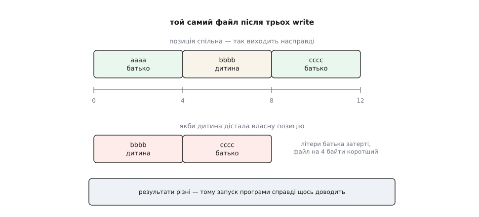

# ⚙️ Передати дескриптор своїми руками

Ось програма на C, яка віддає відкритий файл із батьківського процесу дочірньому через `socketpair` — і тут-таки доводить, що дитина дістала не копію доступу, а той самий об'єкт усередині ядра. Сотня рядків, дві функції та один запуск, після якого `SCM_RIGHTS` перестає бути описом і стає спостереженням.

## Дослід, який може провалитися

Демонстрація чогось варта лише тоді, коли має щонайменше два різні можливі закінчення. Тому програма влаштована так.

Батько відкриває порожній файл і пише в нього чотири байти `aaaa`; позиція запису стає 4. Далі він передає дескриптор дитині. Дитина пише `bbbb`, закриває свою копію й повідомляє батькові, що закінчила. Батько дописує `cccc`.

Тепер дві можливості. Якщо дитині дістався якийсь окремий доступ до того самого файлу — у неї власна позиція, вона починає з нуля, `bbbb` затирає `aaaa`, батько дописує `cccc` зі своєї четвірки, і у файлі лишається `bbbbcccc`. Якщо ж дитині дісталося посилання на [опис відкритого файлу](root:sys-unix/open-file-description) — позиція одна на двох: дитина пише з четвірки, батько бачить вісімку й дописує далі, і у файлі буде `aaaabbbbcccc`.



*Різниця видна неозброєним оком, тож результат запуску є свідченням, а не ілюстрацією до вже сказаного.*

## Уся морока — в упаковці

Сама передача робиться одним викликом `sendmsg`. Складність в іншому: керівну смугу доводиться складати руками, у пам'яті, яку ядро потім читатиме за жорсткими правилами. Тут три місця, де новачок помиляється майже напевно.

Перше — вирівнювання. Заголовок `struct cmsghdr` починається з поля типу `size_t`, тому буфер під керівну смугу мусить бути вирівняний так само, як цей заголовок. Звичайний `char buf[…]` такої обіцянки не дає. Класичний прийом — загорнути масив у `union` разом із `struct cmsghdr`: компілятор вирівняє все об'єднання за найсуворішим членом, а місця це не коштує.

Друге — два макроси розміру. У поле `cmsg_len` пишуть `CMSG_LEN`, а буфер виділяють за `CMSG_SPACE`, бо друга величина враховує ще й хвостове доповнення до наступного блоку. Переплутати їх — це віддати ядру буфер, коротший за той, який воно вважає своїм.

Третє — хоча б один байт звичайних даних. Керівна смуга не літає сама: на потоковому сокеті в Linux повідомлення без жодного байта в `msg_iov` просто не піде, і дескриптор нікуди не потрапить. Тому в прикладі поруч із дескриптором їде беззмістовна крапка.

:::code proj-pass-a-descriptor/c/usia-moroka-v-upakovtsi.c

## Бік прийому обережніший за бік передачі

Приймальна половина довша, і не випадково: усі неприємності живуть саме тут.

Прапорець `MSG_CMSG_CLOEXEC` (з Linux 2.6.23) ставить новому дескрипторові «закрити при `exec`» **у мить створення**. Зробити те саме через `fcntl` одразу після `recvmsg` — не те саме: між двома викликами інший потік може встигнути зробити `exec`, і дескриптор поїде в новий образ програми.

> 🔧 **Навіщо це.** Прийнятий дескриптор — це вже готове повноваження, здобуте кимось іншим. Якщо він непомітно переживе [заміну образу процесу](root:sys-unix/exec-semantics), його успадкує програма, якій його ніхто не давав і яка навіть не знає, що тримає. Такі витоки відтворюються раз на тисячу запусків і майже не ловляться в налагоджувачі, тому єдиний надійний захист — атомарність.

Далі — порядок дій. Спершу проходимо **всі** керівні блоки й забираємо з них усе, що прийшло, і лише потім дивимося на `MSG_CTRUNC`. Навпаки не можна: якщо вийти з помилкою одразу, дескриптори, які встигли влізти в буфер, лишаться в таблиці нікому не потрібними й нікому не відомими. Ядро закриває саме тільки той надлишок, який не вмістився.

І ще одне, менш очевидне: цикл написано так, щоб працювати навіть тоді, коли ми дескрипторів не чекали. Співрозмовник має право надіслати їх без попиту, і якщо їх не помітити, чужі дескриптори тихо накопичуватимуться у вашій таблиці.

:::code proj-pass-a-descriptor/c/bik-pryiomu-oberezhnishyi.c

## Дослід

Лишилося звести все докупи. Файл батько відкриває **після** `fork` — інакше дитина успадкувала б його й доводити було б нічого. Синхронізація теж дармова: `socketpair` двобічний, тож дитина відсилає назад один байт, коли допише.

:::code proj-pass-a-descriptor/c/doslid.c

Збирається без жодних прапорців — `cc -Wall -o scm-demo scm-demo.c` — і друкує таке:

```
батько: номер 4, позиція 4
дитина: номер 3, позиція 4
батько після дитини: позиція 8

$ cat /tmp/scm-demo.txt
aaaabbbbcccc
```

Три рядки — три висновки. Номери різні, бо ядро ставить дескриптор у найменше вільне місце **своєї** таблиці: у батька зайняті 0–3, у дитини звільнилося 3. Дитина побачила позицію 4, хоча сама у файл ще не писала й де він лежить не знає. А батько після дитини побачив 8: рухали позицію двоє, а рухалася вона одна. Той самий ефект дає звичайний `fork` — і це не збіг, а та сама причина: опис відкритого файлу один, а посилань на нього стало два.

Повірити на слово самій програмі не обов'язково — те саме видно ззовні. Досить вставити `sleep(30)` у дитині перед її `close(fd)` — батько в цю мить якраз чекає на відповідь, і позиція в обох дорівнює восьми, — а поки дитина спить, спитати [файлову систему `/proc`](root:sys-unix/proc-reading-process-and-kernel-state):

```
$ grep pos /proc/$БАТЬКО/fdinfo/4
pos:	8
$ grep pos /proc/$ДИТИНА/fdinfo/3
pos:	8
```

Дві різні таблиці, два різні номери — і однакове число, яке не збіглося випадково, а прочитане з однієї структури.

## Ціна й межі застосування

Передача коштує однаково для порожнього файлу й для терабайтного: ядро торкається однієї структури та однієї комірки в чужій таблиці. Очевидна альтернатива — переслати сам вміст байтами — коштує стільки, скільки того вмісту, і дає отримувачеві геть інше. Вміст є знімком: він застаріває тієї ж миті, і записати щось назад у файл із ним неможливо. Дескриптор не старіє, бо це не дані про об'єкт, а спосіб до нього дотягнутися.

Обидві функції нічого не знають про походження сокета — їм байдуже, чи це половинка `socketpair`, чи з'єднання, прийняте через `accept` на сокеті в `/run`. Рідні процеси відрізняються від чужих не кодом передачі, а тим, що з чужим спершу доводиться вирішити, чи варто йому щось давати.

## Що ламається насамперед

Найчастіша помилка — забутий байт даних: програма нічого не повідомляє, `sendmsg` повертає нуль, дескриптор не їде. Друга за частотою — буфер, виділений за `CMSG_LEN`; вона гірша, бо працює доти, доки не перестане.

Далі йдуть межі. За один виклик передають щонайбільше 253 дескриптори (до Linux 2.6.38 було 255), інакше `sendmsg` відмовить із `EINVAL`. Дескриптори, надіслані, але ще не прочитані, рахуються проти обмеження `RLIMIT_NOFILE` відправника — лічильник ядро веде спільний на всі процеси того самого користувача: коли їх забагато, приходить `ETOOMANYREFS`.

Окрема пастка чекає на того, хто захоче передавати дескриптори пачками по живому потоку. На `SOCK_STREAM` допоміжні дані працюють як бар'єр: `recvmsg` віддасть байти, що надійшли до них, і зупиниться рівно на тому байті, до якого дескриптор причеплено. Байти сусідніх викликів `sendmsg` при цьому вільно зливаються, тож зіставляти «який дескриптор до якого повідомлення» доводиться вручну. Саме тому протоколи, у яких дескриптори ходять регулярно, беруть `SOCK_SEQPACKET`: там межа повідомлення є сама собою, і дескриптор має до чого прикріпитися.
