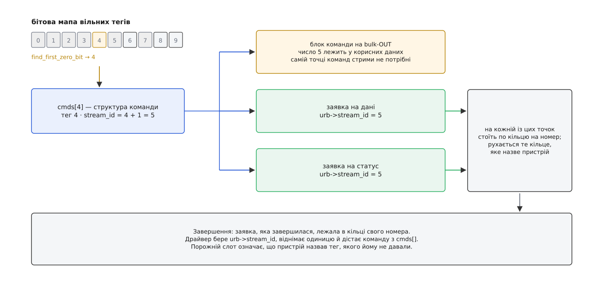

# ⚙️ Драйвер на стримах: тридцять команд у польоті на одній парі точок

Тут зібрано робочий кістяк драйвера USB, який справді користується стримами: від перевірки, чи вони на цій машині є, до скасування й повернення до життя після помилки. Мова — C, бо це код ядра Linux, іншої тут не буває.

Задача поставлена так. Є bulk-точка для даних у кожен бік і окрема точка, якою пристрій віддає статуси. Треба, щоб усередині пристрою чекала не одна команда, а кілька десятків. Уся конструкція тримається на одному числі: драйвер зве його тегом, дріт — номером стриму, таблиця в пам'яті — індексом. Далі — як зробити, щоб ці три імена завжди означали одне й те саме, і що ламається, коли вони розходяться.

## Скільки стримів дадуть насправді

Число, яке драйвер просить, — це побажання. Кожен із трьох учасників має право його вкоротити: контролер хоста обмежений розміром первинного масиву, який він уміє витягти; пристрій оголошує свою стелю в дескрипторі-компаньйоні SuperSpeed (молодші п'ять бітів `bmAttributes` — це двійковий логарифм, тож `(bmAttributes & 0x1f) == 5` означає 32 стрими); драйвер задає свою власну. `usb_alloc_streams()` повертає те, що вціліло після всіх трьох, і саме з цим числом драйверові жити.

:::code proj-streams-driver/c/skilky-strymiv-dadut.c

Три речі в цьому коді варті окремого слова.

Точку команд у наборі не видно, і це навмисне: команда несе своє число всередині корисних даних, тож на дротах її ні з чим сплутати. Стрими потрібні лише там, де йдуть сирі байти без обгортки, — на даних і статусах. Зате всі три точки, які їх дістають, названо **одним викликом**: номер повинен означати те саме на всіх точках протоколу, інакше дані сьомої команди й статус сьомої команди виявляться різними розмовами.

Виділяти стрими можна лише тоді, коли на цих точках немає жодної живої заявки — контролер перебудовує контекст точки, а зробити це під навантаженням не вийде. `usbcore` за цим не стежить; тримати правило мусить драйвер. Природне місце — `probe`, до того як [драйвер прив'яжеться](root:sys-unix/driver-probe-and-binding) й верхній шар дістане право щось подавати. Друге таке місце — `post_reset`: після скидання пристрою контексти точок збудовано наново, стримів там уже немає, і їх треба просити знову.

`GFP_NOIO` тут не осторога заради обережності. Драйвер обслуговує накопичувач; виділення з `GFP_KERNEL` дозволяє ядру піти витісняти сторінки, а витіснення означає запис — на цей самий диск, через цей самий драйвер, який зараз стоїть усередині виділення. Класичний глухий кут, і рятує від нього саме цей прапорець.

## Тег, який живе в трьох місцях

Тег беруть з бітової мапи, і разом із ним команда дістає своє місце в таблиці драйвера. Зверніть увагу на зсув на одиницю: номер стриму 0 зарезервовано, тож теги 0…n−1 відповідають номерам 1…n.

:::code proj-streams-driver/c/teh-iakyi-zhyve-v-trokh.c

Далі це число розходиться на три боки — у корисні дані команди, у заявку на дані й у заявку на статус:

```c
        usb_fill_bulk_urb(c->data_urb, d->udev, d->data_in_pipe,
                          buf, len, data_done, c);
        if (d->use_streams)
                c->data_urb->stream_id = c->stream_id;
        rc = usb_submit_urb(c->data_urb, GFP_ATOMIC);
```

`usb_fill_bulk_urb()` заповнює пристрій, канал, буфер, довжину, обробник і контекст — і не чіпає `stream_id`. Заявка, яку драйвер повторно вживає під іншу команду, приносить із собою старий номер; помилка вилазить лише під навантаженням, коли теги встигають перетасуватися. Тому номер ставлять щоразу перед поданням, а не колись при створенні заявки.



*Зсув на одиницю робиться в одному місці — там, де тег перетворюється на `stream_id`.*

## Обробник завершення: знайти свою команду

Напрошується питання: навіщо взагалі шукати команду за номером стриму, коли `urb->context` уже вказує на неї?

Для заявки на дані так і є — її подав драйвер під конкретну команду. А от точка статусів улаштована інакше. Щоб узагалі почути відповідь, заявка мусить **уже лежати** в кільці, а хто відповість першим, наперед не знає ніхто — у цьому й уся суть стримів. Тому драйвер тримає на цій точці пул заявок, по одній на номер, і їхній контекст — не команда, а сам пристрій. Що завершилася саме ця заявка, а не сусідня, і є відповіддю на питання «чия розмова зрушила».

:::code proj-streams-driver/c/obrobnyk-zavershennia.c

Перевірка `c == NULL` — не параноя. Мікропрограма, яка не забула тег скасованої команди, назве в `ERDY` номер, під яким уже нікого немає; порожній слот ловить це на боці драйвера ще до того, як воно перетвориться на звертання за сміттєвим вказівником.

Друга річ, помітна в цьому коді, — лічильник `parts` замість «прийшов статус, отже все». Дані й статус однієї команди їдуть різними точками, і порядок їхнього прибуття не обіцяний нічим: статус може випередити останній пакет даних. Команда завершена тоді, коли повернулися всі її частини, а не тоді, коли повернулася котрась одна.

І третя: обробник працює в контексті переривання, тож усе, що [може заснути](root:sys-unix/kernel-locking), звідси заборонене. `usb_clear_halt()`, `usb_kill_urb()`, `usb_free_streams()` — усі троє сплять. Звідси й `schedule_work()`: важку роботу [переносять у робочу чергу](root:sys-unix/interrupts-bottom-halves).

## Скасувати одну команду з тридцяти

Команда, що не вклалася в час, має піти, поки решта летить далі. Ядро дає два способи, і різниця між ними тут визначальна. `usb_unlink_urb()` лише позначає заявку до скасування й повертається негайно (успіх — це `-EINPROGRESS`); обробник відпрацює пізніше зі статусом `-ECONNRESET`. `usb_kill_urb()` чекає, доки обробник справді відпрацює, і тому спить.

```c
static void abort_cmd(struct dev_state *d, struct cmd *c)
{
        usb_unlink_urb(c->data_urb);   /* швидко, з будь-якого контексту */
        /* тег НЕ повертаємо: його поверне обробник, коли добіжить */
}
```

Ось де стрими карають за поспіх. Тег — це номер стриму, а номер стриму — це кільце, у якому просто зараз може лежати недороблена робота. Якщо повернути тег у бітову мапу відразу після `usb_unlink_urb()`, наступна команда візьме той самий номер — і запізніла відповідь на скасовану знайде за ним уже нову команду. Тому тег звільняє лише той, хто бачив останнє завершення: `tag_put()` викликають, коли `parts` дійшов нуля, байдуже з якої причини.

## Коли точка стала

`STALL` віддається заявці як `-EPIPE`. Ключове: зупинилася не одна розмова, а вся кінцева точка — доки пристрій не почує `CLEAR_FEATURE(ENDPOINT_HALT)`, жоден її стрим не зрушить. Тож відновлення — це вивести з польоту всіх, зняти зупинку й запустити наново.

:::code proj-streams-driver/c/koly-tochka-stala.c

`usb_clear_halt()` — синхронна керуюча передача, і в її документації прямо написано, що з контексту переривання її вживати не можна. Тому вона тут, у робочій черзі, а не в обробнику.

Другу половину роботи драйвер не робить зовсім, і це варто знати, щоб не шукати в собі неіснуючого коду. Хостову позицію — вказівник прочитаного того кільця, на якому сталася біда, — пересуває сам драйвер [контролера](root:sys-unix/usb-host-controller): він видає команду `Set TR Dequeue Pointer`, у якій серед іншого стоїть номер стриму. Саме тому решта кілець лишається на своїх місцях і після зняття зупинки їде далі зі свого стану.

## Від'єднання: порядок, який не можна переставити

:::code proj-streams-driver/c/vidiednannia-poriadok.c

Кроки один і три не переставляються місцями. Обробник завершення сам подає заявку назад у кільце; якщо не закрити вхід прапорцем, `usb_kill_urb()` уб'є заявку, обробник тут-таки покладе її знову — і цикл не матиме кінця. Крок чотири стоїть останнім із тієї самої причини, що й виділення стримів у `probe`: звільнення перебудовує контекст точки, а жива заявка цього не переживе.

## Ціна глибини

Кожен стрим — це запис у масиві контекстів і власне кільце в пам'яті під DMA. Порахуймо нижню межу для набору з трьох точок (кільце може мати й більше одного сегмента, тож це саме нижня межа):

```
запис контексту стриму    = 16 байтів
сегмент кільця xHCI       = 256 TRB · 16 байтів      = 4096 байтів
масив контекстів          = найближчий степінь двійки, з місцем під нульовий номер

32 стрими:  3 · (32 · 4096 + 64 · 16)   = 396288 байтів  ≈ 387 КіБ
256 стримів: 3 · (256 · 4096 + 512 · 16) = 3170304 байтів ≈ 3.0 МіБ
```

Пам'ять — не єдина плата. Перемикання між стримами можливе лише в проміжку між транзакціями й коштує розвороту каналу, тож просити 256, коли пристрій уміє перекривати вісім очікувань, — це купити мегабайти й затримку замість швидкості. Корисна глибина — та, яку пристрій справді витримує; більша дає лише довшу чергу перед тим самим вузьким місцем.

> 🔧 **Навіщо це.** Шлях без стримів у такому драйвері — не запасний вихід на випадок дива, а звичайний робочий режим: ним іде кожен пристрій у порту USB 2, кожен контролер із прапорцем `XHCI_BROKEN_STREAMS` і кожен міст із чорного списку. Код, який ніхто не виконує, тихо гниє, тому найдешевша страховка — параметр модуля, що змушує `setup_streams()` піти в `no_streams` без жодної причини, і прогін тестів через нього.

Лишається одна пастка, яку не видно в жодному з наведених фрагментів. Тег у бітовій мапі — це індекс від нуля, номер стриму — від одиниці, а тег усередині корисних даних команди мусить збігатися з номером стриму, а не з індексом. Зсув робиться рівно в одному місці, у `tag_get()`; щойно він з'явиться десь удруге, пристрій почне називати в `ERDY` номери, яких хост йому не заводив, контролер відповість `Invalid Stream ID Error` — і зупиниться вся точка. Симптом при цьому виглядатиме як несправне залізо, хоча зламано одну арифметичну дію.
