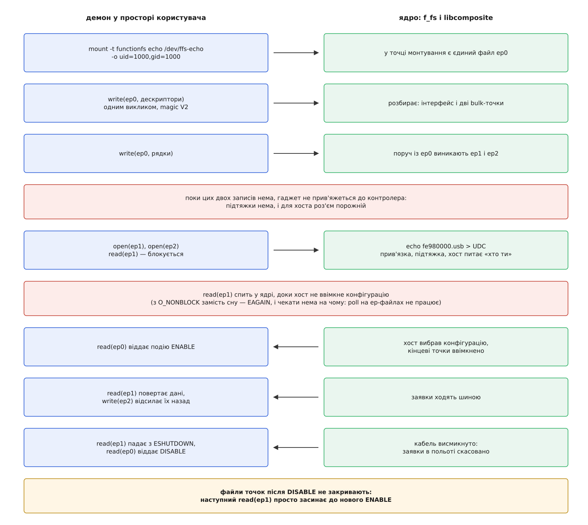

# ⚙️ Своя функція через FunctionFS: демон, який і є USB-пристроєм

Зберемо пристрій, якого в ядрі немає: власний клас, дві масові кінцеві точки, і вся поведінка — у звичайній програмі на C, яку можна перезапустити з-під налагоджувача. Ядру дістається транспорт, протокол лишається програмі; на тому самому стику стоїть adbd в Android, а поруч із ним — передача файлів по MTP, тільки протокол у них складніший.

## Примірник, монтування й права

Функція `f_fs` заводиться так само, як будь-яка інша, але після посилання в конфігурацію додається монтування:

```sh
mkdir functions/ffs.echo
ln -s functions/ffs.echo configs/c.1/

mkdir -p /dev/ffs-echo
mount -t functionfs echo /dev/ffs-echo -o uid=1000,gid=1000,rmode=0750,fmode=0660
```

Слово `echo` на місці «пристрою» в команді монтування — не довільна назва: ядро шукає примірник за дослівним збігом із тим, що стоїть після крапки в `ffs.echo`. Помилився літерою — монтування не вдасться, і причину доведеться шукати довго, бо повідомлення буде звичайне «немає такого пристрою».

Опції теж не косметика. Монтує root, а працювати демонові краще без прав root — саме для цього `f_fs` розбирає `uid`, `gid`, `mode`, `rmode`, `fmode` і `no_disconnect`: перші п'ять кажуть, кому належать файли всередині й з якими правами вони створяться, тож демон під власним обліковим записом дістає `ep0` і точки, не отримуючи разом із ними всієї машини.

У щойно змонтованій теці лежить рівно один файл — `ep0`. Більше нічого не з'явиться, поки програма не скаже, чим вона є.

## Дескриптори — двійковий блок, а не текст

Ядро не вигадає дескрипторів за програму: воно не знає ні скільки в неї точок, ні якого вони типу. Тому перше, що демон робить після відкриття `ep0`, — пише туди суцільний двійковий блок такої будови (усі числа — молодшим байтом уперед, незалежно від машини):

```
зсув  поле       тип    що кладемо
   0  magic      LE32   FUNCTIONFS_DESCRIPTORS_MAGIC_V2 = 3
   4  length     LE32   довжина всього блоку разом із заголовком
   8  flags      LE32   HAS_FS_DESC | HAS_HS_DESC
  12  fs_count   LE32   3 — скільки дескрипторів у повношвидкісному наборі
  16  hs_count   LE32   3 — стільки ж у високошвидкісному
  20  fs_descrs  …      інтерфейс, точка OUT, точка IN
   …  hs_descrs  …      те саме, інший wMaxPacketSize
```

Лічильники йдуть у жорсткому порядку — `eventfd`, `fs`, `hs`, `ss`, `os_desc` — і присутні лише ті, чий прапорець піднято. Саме тому `struct usb_functionfs_descs_head_v2` у заголовку ядра обривається на `flags`, а лічильники залишено дописати самому: далі вигляд блоку залежить від того, що саме ти оголосив.

:::code proj-ffs-function/c/ffs-echo.c

Три речі в цьому шматку варті окремої уваги.

**Тип дескриптора точки.** `struct usb_endpoint_descriptor` із `ch9.h` має дев'ять байтів: два останні, `bRefresh` і `bSynchAddress`, потрібні лише аудіо-класові. Блок — суцільний потік байтів, і ядро йде ним, відмірюючи кожен дескриптор його ж полем `bLength`. Візьмеш дев'ятибайтову структуру, а `bLength` залишиш сімкою — розбір поїде далі не з того місця, і запис обірветься помилкою; узгодиш із дев'яткою — блок пройде, зате хост дістане опис із двома зайвими байтами там, де їм не місце. Для всіх не-аудіо випадків є семибайтовий `usb_endpoint_descriptor_no_audio`, і саме його тут видно.

**Номери, які нічого не значать.** `bInterfaceNumber` дорівнює нулю, адреси точок — одиниця й двійка. Пишемо їх так, ніби наша функція в пристрої єдина; справжні номери проставить `libcomposite`, коли складе конфігурацію цілком. Так само `iInterface = 1` вказує не в загальний перелік рядків пристрою, а в наш власний блок, де нумерація починається з одиниці.

**Дві швидкості.** Набори `fs` і `hs` мусять описувати ті самі інтерфейси й ті самі точки — відрізняється тільки те, що від швидкості й залежить. Для масової точки на високій швидкості стандарт дозволяє єдиний розмір пакета — 512 байтів, тоді як на повній це 64 ([кінцеві точки USB](root:com-devices/usb-endpoints)).

## Порядок, у якому речі з'являються

Блоки пишуться двома викликами `write()` і саме в цьому порядку: спершу дескриптори, потім рядки. Кожен блок — один виклик: ядро розбирає рівно той буфер, що прийшов, і звіряє поле `length` із кількістю записаних байтів, тож розрізати блок на два записи не вийде, а переставити місцями — тим паче: магічне число не збіжиться зі станом, у якому ядро на цей момент перебуває, і `write` поверне `EINVAL`.

Файли кінцевих точок створюються не при монтуванні й не при прив'язці до контролера, а саме в обробнику **другого** запису — того, що приносить рядки. Тому послідовність у демоні природна: відкрити `ep0`, віддати два блоки, і аж потім відкривати `ep1` та `ep2`. Імена цих файлів послідовні, а їхній порядок повторює порядок точок у наборі дескрипторів: перша описана точка — `ep1`, друга — `ep2`. Яка апаратна точка стоїть за файлом, знати не треба й не можна: `ep1` може виявитися третьою точкою контролера, і від перезбирання гаджета це зміниться.

## Демон цілком

:::code proj-ffs-function/c/demon-tsilkom.c

Читання `ep0` віддає стільки подій, скільки їх устигло накопичитись, тому буфер беруть із запасом і обробляють усі, що прийшли, а не першу.

## Дві точки, де все зупиняється

Тепер видно, чому запис імені контролера в файл `UDC` не оживляє пристрій одразу. Ядро реєструє гаджет лише тоді, коли всі змонтовані примірники FunctionFS уже дістали свої дескриптори, — інакше воно просто не має чого відповісти хостові на перше ж питання. Порядок команд від цього стає вільним: запустиш демона першим — пристрій з'явиться на записі в `UDC`; запишеш `UDC` першим — він з'явиться, коли демон віддасть блоки. Оживає на пізнішому з двох моментів.

Друге очікування — усередині самого обміну. Читання й запис на файлі точки, поки та не ввімкнена, не помиляються, а сплять: ядро тримає викликача на черзі очікування, доки хост не вибере конфігурацію. Відкрив точку з `O_NONBLOCK` — замість сну дістанеш `EAGAIN`, і це не помилка, а «точки ще нема».



*Дві червоні смуги — не збій, а звичайний робочий стан: спершу ядро чекає на дескриптори, потім демон — на ввімкнення конфігурації.*

## Чого це коштує

Стеля шини рахується коротко:

```
масова точка на високій швидкості:
  13 транзакцій × 512 Б у мікрокадрі 125 мкс
  6656 Б / 125 мкс ≈ 53.2 МБ/с
```

Демон із однією заявкою в польоті цієї стелі не побачить. Наш цикл спершу дочитує пакет до кінця, потім повертається з ядра в програму, і лише тоді кладе відповідь; між цими митями кінцева точка порожня, і на кожен токен від хоста контролер відповідає «поки нічого нема». Хост від цього не простоює — він опитує інших, — але наша частка смуги падає в рази, і винен у цьому не розмір буфера й не мова, а те, що покласти більш ніж одну заявку наперед синхронні `read`/`write` не вміють. Звідси й береться асинхронний ввід-вивід у справжніх демонах: кілька заявок, поданих заздалегідь, роблять так, що наступному пакетові з шини вже є куди лягти, а на зустрічний токен завжди є що віддати.

## Пастки

**Події `DISCONNECT` не існує.** Їх усього сім: `BIND`, `UNBIND`, `ENABLE`, `DISABLE`, `SETUP`, `SUSPEND`, `RESUME`. Висмикнутий кабель приходить як `DISABLE`, а `echo "" > UDC` — як `DISABLE` і слідом `UNBIND`.

**Після `DISABLE` файли точок не закривають.** Спокуса «перевідкрити все начисто» веде до перегонів із ядром, а потреби в ній немає: заявки в польоті вже скасовано, читання повернулося з `ESHUTDOWN`, і наступний виклик просто засне до нового `ENABLE`. Демон, який на кожне від'єднання завершується, дає гірше: закриття `ep0` для ядра означає, що функції більше немає, і пристрій зникає в хоста; пережити перезапуск демона дозволяє опція монтування `no_disconnect=1`.

**`poll()` на файлах точок бреше.** У наборі файлових операцій `f_fs` для них немає обробника опитування — тільки читання, запис і `ioctl`. Отже, `select`, `poll` і `epoll` завжди звітують «готовий», і побудувати на них однопотоковий цикл не вийде. Лишаються два чесні шляхи: [окремий потік](root:sys-unix/threads-as-tasks) на кожен напрям, як зроблено вище, або асинхронний ввід-вивід через [io_submit](root:sys-unix/linux-aio-io-submit) із [eventfd](root:sys-unix/eventfd-and-futex) як сповіщувачем — саме так влаштований adbd, бо йому потрібні кілька заявок у польоті водночас. Дрібниця з `EAGAIN` виявляється тут наріжною: неблокуючий режим без опитування нічого не дає, тільки перетворює сон на порожнє прокручування ([блокуючий і неблокуючий режим](root:sys-unix/blocking-and-nonblocking)).

**`EINTR` — це не кінець.** Будь-який сигнал уриває і сон на точці, і читання подій. Цикл, який вважає першу невдачу фатальною, помре від першого ж `SIGWINCH` у налагоджувальному запуску.

**Стадія даних краде події.** Поки керуючий запит не завершено, наступне читання `ep0` віддасть не подію, а дані цього запиту. Тому обробник `SETUP` мусить закрити стадію тут-таки, а не відкладати «на потім»: інакше подієвий цикл читатиме зовсім не те, чого чекає. За звичайних умов до демона доходять лише запити класу й виробника, адресовані його інтерфейсу; решту забирає `libcomposite`, а прапорець `FUNCTIONFS_ALL_CTRL_RECIP` у блоці дескрипторів каже віддавати демонові все, що не зачіпає роботу самого пристрою.
