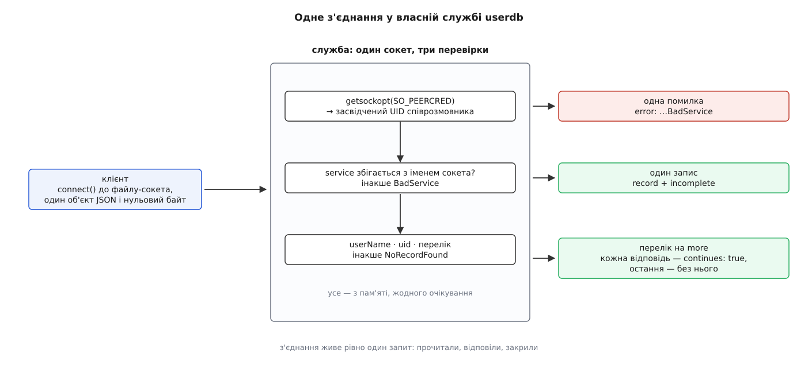

# ⚙️ Власна служба userdb: реєстр застосунку як користувачі системи

Нижче — робоча служба на C і на Python, яка віддає користувачів, що не лежать у жодному файлі: вони існують лише в реєстрі стороннього застосунку, а після її запуску `id`, `ls -l` і `systemd-run --uid=` бачать їх такими самими, як усіх інших.

## Реєстр, який не хоче ставати файлом

Хай є ферма збірок: десяток проєктів, і кожен збирається від власного користувача — щоб артефакти мали різних власників, щоб `ps` показував, чия саме робота з'їдає процесор, щоб зірваний скрипт одного проєкту нічого не дописав у теку іншого. Проєкти заводять і закривають щотижня, а список їх уже є — у базі самої ферми.

Очевидний хід — кликати `useradd` на кожен проєкт — робить `/etc/passwd` копією цієї бази. Копію доводиться тримати однаковою на всіх машинах ферми; після закриття проєкту в ній лишається рядок, якого ніхто не прибере; а редагують цей файл ще й руками. Кожна з трьох бід — наслідок одного: дані розмножили.

Потрібне протилежне: реєстр лишається там, де він є, а система питає його щоразу, коли треба перекласти ім'я в номер або номер в ім'я. Саме це й дає userdb — джерелом стає не файл, а працюючий процес.

## Два рішення до першого рядка коду

Механіка протоколу вміщується в абзац: зв'язати сокет `AF_UNIX`/`SOCK_STREAM` у теці `/run/systemd/userdb/` під іменем своєї служби, прочитати з нього об'єкт [JSON](root:sf-data/json-format), закінчений нульовим байтом, і надіслати назад такий самий. Складне не тут.

Складні два рішення, які потім міняти дорого.

**Перше: відповідність імені й номера мусить бути чистою функцією в обидва боки.** Питати будуть і так, і так: `ls -l` прийде з номером і захоче ім'я, `chown` — навпаки. Якщо ці два переклади робить окрема таблиця, вона рано чи пізно розійдеться сама з собою, і в системі з'явиться користувач, у якого `id -u` дає одне число, а власник його ж домівки — інше. Тому в прикладі ім'я — це `proj-` плюс назва проєкту, а номер — початок діапазону плюс місце в реєстрі: обидва переклади рахуються, а не шукаються.

**Друге: номери беруться з діапазону, який на цій машині не виданий нікому.** Служба нічого не «резервує» — вона просто заявляє номери. І розсудити її з тим, хто заявить ті самі числа, нікому: джерела опитують паралельно, черги, у якій одне перекрило б інше, немає, — на одне число просто знайдеться два різні імені, а котре з них покаже `ls -l`, залежатиме від того, чия відповідь надійшла першою. Тому діапазон вирізає адміністратор наперед; тут це 55000…55999.

## Уся служба

Код читається згори вниз: розбір повідомлення, засвідчений UID співрозмовника, три гілки за іменем методу. Перевірки в ньому стоять у певному порядку, і порядок цей не випадковий.

Спершу — засвідчений UID: він знадобиться ще до того, як стане ясно, про що питають, і взяти його можна лише з самого з'єднання. Далі — `service`: параметр обов'язковий, і його значення мусить збігтися з іменем сокета, до якого клієнт під'єднався. Перевірка здається порожньою формальністю рівно доти, доки запит не перешле посередник: тоді вона єдина відрізняє «питають мене» від «мене переплутали з кимось», і відповідь на другий випадок — `BadService`, а не чужий запис. І лише третьою йде сама вимога: ім'я, номер або перелік.

:::tabs
:::code proj-userdb-service/c/projectdb.c
:::code proj-userdb-service/py/projectdb.py
:::

Ціна відповіді тут стала: пошук за іменем чи номером — це порівняння з коротким масивом, без жодного звертання до диска чи мережі, а перелік коштує рівно стільки, скільки в реєстрі записів. Саме тому цикл в одному потоці, що обслуговує з'єднання одне за одним, — не спрощення заради прикладу, а законна конструкція.



*Три перевірки й три можливі закінчення, і жодне з них нічого не чекає ззовні.*

## Чому перелік — потік, а не масив

Запит без імені й без номера означає «перелічи всіх». Відповіддю міг би бути масив записів усередині одного об'єкта — так зробили б, якби писали це вперше. Varlink робить інакше: виклик із прапорцем `more` дозволяє відповісти багато разів, і кожна відповідь несе один запис та позначку `continues`, доки не прийде остання — уже без позначки.

Різниця виявляється на великих джерелах. Служба, що віддає мережевий каталог на десятки тисяч записів, за масивом мусила б скласти весь список у пам'яті, перш ніж написати перший байт; потоком вона віддає запис тоді, коли він у неї з'явився. А клієнтові, якому досить першого збігу, вистачить закрити з'єднання — за решту він не платить.

Звідси й дрібниця, помітна в коді: у відповіді немає жодного номера запиту. Varlink відповідає в тому самому порядку, у якому дістав виклики, і на з'єднанні, що несе рівно один виклик, зіставляти нема чого — тому служба пише відповідь просто в той самий дескриптор і закриває його.

## Число, яке не можна перебрехати

`getsockopt(SO_PEERCRED)` віддає структуру, яку ядро заповнило в мить `connect()` з облікових даних того, хто під'єднався. Це не параметр виклику й не поле в JSON: клієнт не бере в цьому участі, тож не може ні підмінити своє число, ні пропустити його. [Сокети домену Unix](root:sys-unix/unix-domain-sockets) — з'єднання через файл, де ядро саме засвідчує другому боку, хто на тому кінці, — уміють це самі, тому засвідчення тут коштує один рядок і не потребує жодного протоколу автентифікації.

Звідси випливає річ, яка спершу лякає: файл-сокет має режим `0666`, і відкрити його може будь-хто. Це не діра. Права на сокет відповідають на питання «кому дозволено питати», а засвідчений UID — на інше питання, «скільки йому сказати». Сам systemd робить так само: сокет `systemd-userdbd` теж має `SocketMode=0666`.

І ще одне, що в такому коді проґавлюють майже завжди: `incomplete` треба виставляти навіть тоді, коли здається, ніби нема кому. Розробник запускає службу від `root` і питає її від `root` — секцію `privileged` йому віддають щоразу, і забутий `incomplete` ніде не видно. Помилка виявиться на чужій машині й виглядатиме як «у проєкту зник ключ».

## Чотири способи зіпсувати робочу службу

**Відповідь не має права чекати.** Найприродніший наступний крок — піти по дані просто в базу ферми, бо реєстр же живе саме там. Він і робить службу вузьким місцем усієї машини: черга з'єднань перетворюється на чергу за кожним звертанням по імені, а звертання по імені трапляється в `ls`, у `ps` і в кожному вході в систему. Лікування не в тому, щоб зробити читання [неблокуючим](root:sys-unix/blocking-and-nonblocking): цим ви лише розмажете те саме чекання по всіх з'єднаннях одразу. Лікування — тримати в пам'яті знімок реєстру й оновлювати його окремим потоком, а відповідь щоразу складати з того, що вже є.

**Служба мусить бути на місці раніше за всіх, хто питає імена.** Питання «як звати цей номер» виникає задовго до того, як піднялася мережа: в initramfs, у найпершій фазі завантаження, у процесі, який саме складає з себе привілеї. Демон, запущений після всього, на ці запити просто не встигне. Правильний хід — не стартувати раніше, а віддати сокет менеджеру служб: за [активації за сокетом](root:sys-unix/socket-activation) файл існує з моменту, коли піднято юніт сокета, а з'єднання, що прийшли до старту демона, ядро тримає в черзі.

```ini
# /etc/systemd/system/projectdb.socket
[Unit]
Description=Реєстр проєктів як джерело userdb
DefaultDependencies=no
Before=sockets.target

[Socket]
ListenStream=/run/systemd/userdb/com.example.Projects
SocketMode=0666

[Install]
WantedBy=sockets.target
```

Програма тоді не зв'язує сокет сама, а бере готовий успадкований дескриптор — перший переданий має номер 3.

**Не питати назад класичний перемикач імен.** Спокуса всередині служби виглядає невинно: узяти `getpwnam()`, щоб перевірити, чи ім'я не зайняте, або `getgrnam()`, щоб дізнатися групу. Наслідок — кільце. Бібліотека C піде в модуль `nss-systemd`, той — у мультиплексор userdb, мультиплексор — назад у наш-таки сокет, а ми в цю мить сидимо в `serve()` й нікого не приймаємо: служба чекає сама на себе. Правило просте — усередині служби, що віддає записи, імена лишаються рядками, номери числами, і жодних питань до [класичної бази](root:sys-unix/user-database-nss) звідси не ставлять.

**Методів три, а не один.** Служба, що відповідає лише на `GetUserRecord`, виглядає працездатною рівно доти, доки хтось не набере `id proj-kernel`: після імені користувача йому потрібні групи. Перелічувати себе служба не зобов'язана — і якщо не вміє, каже це прямо, помилкою `EnumerationNotSupported`, бо порожній список виглядав би як повний. А от відповідати на всі три виклики зобов'язана, і «нічого не знайшов» мусить бути помилкою `NoRecordFound`. Різниця між «додаткових груп у цього користувача немає» і «служба не зрозуміла запиту» — це те, за чим клієнт відрізняє знання від мовчання.
