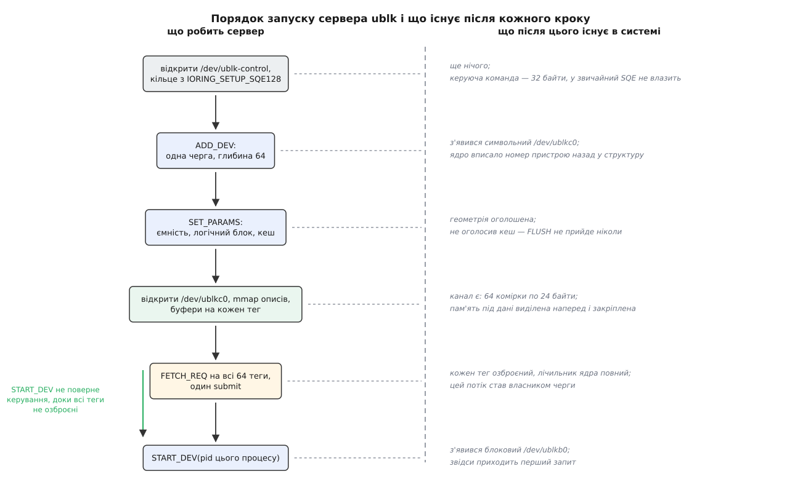

# ⚙️ Найпростіший сервер ublk власноруч

Двісті рядків C — і `/dev/ublkb0` стає вікном у звичайний файл: усе, що на цьому пристрої читають і пишуть, проходить через наш процес. Замінити `loop` тут не мета; мета — побачити каркас цілком, бо саме в нього потім вставляють справжню логіку: розшифрування, дедуплікацію, похід у мережеве сховище. Файл-підкладка — найдешевша заглушка, на якій видно, що каркас справді працює: `mkfs`, `mount` і все, що потім на цей пристрій навантажать, мають поводитися буденно.

## Задум: два кільця, одна черга, один потік

Кілець мусить бути два, і це не примха. Керуючі команди йдуть у `/dev/ublk-control`, і кожна несе `struct ublksrv_ctrl_cmd` — тридцять два байти. У звичайному 64-байтовому елементі подання io_uring під корисне навантаження команди відведено рівно шістнадцять байтів, тож керуюче кільце створюють із прапорцем `IORING_SETUP_SQE128`: елементи стають удвічі більші, і структура вміщається. Робоче кільце ходить у `/dev/ublkc0` і несе `struct ublksrv_io_cmd` на шістнадцять байтів — йому звичайного розміру досить.

Черга одна, потік один. Це не спрощення заради стислості: драйвер запам'ятовує, який саме потік озброїв теги черги, і команди від будь-якого іншого потоку відхиляє. Кілька черг означало б кілька потоків, кожен зі своїм кільцем — і жодного нового поняття, лише повторення того самого. [io_uring](root:sys-unix/io-uring-rings-model) тут не прискорювач, а сам канал: у нього, крім читань і записів, можна класти операцію `IORING_OP_URING_CMD` — довільне доручення драйверові, з яким сервер уже й розмовляє.

Порядок кроків при запуску жорсткий, і кожен крок додає в системі рівно одну річ.



*Символьний вузол з'являється після `ADD_DEV`, блоковий — аж після `START_DEV`; між ними мусять поміститися параметри, відображення описів і озброєння всіх тегів.*

Найважливіше тут — передостанній крок. `START_DEV` не повертає керування, доки кожен тег кожної черги не має озброєної команди: драйвер лічить готові теги й вважає чергу готовою лише тоді, коли їх рівно на глибину черги. Тому `FETCH_REQ` подають **до** `START_DEV`. Інакше блоковий вузол з'явився б раніше, ніж є кому відповідати.

Наш єдиний потік від цього не застрягає. `io_uring_submit` лише передає ядру озброєні команди й одразу повертається: команди лишаються в польоті — не завершені, а такі, що чекають на свій запит, — і лічильник готових тегів уже повний, коли черга доходить до керуючої команди. Разом зі `START_DEV` передають ідентифікатор процесу-демона: за ним ядро потім упізнає, чий саме відхід означає, що обслуговувати пристрій більше нема кому.

## Керуюча команда

:::code proj-ublk-server/c/ublk-file.c

Команди тут ходять у так званому ioctl-кодованому вигляді (`UBLK_U_CMD_*`, `UBLK_U_IO_*`): номер команди упакований разом із розміром і напрямком її структури, як у звичайному `ioctl`. Старіші ядра знали лише голі номери; чи вміє ядро нову форму, питають командою `UBLK_U_CMD_GET_FEATURES`.

## Створення пристрою й геометрія

:::code proj-ublk-server/c/stvorennia-prystroiu-i.c

`ADD_DEV` — команда «туди й назад»: ядро вписує виданий номер у ту саму структуру, і всі подальші імена будуються з нього.

Два рішення тут потім не переграти. Перше: `UBLK_ATTR_VOLATILE_CACHE` оголошує, що в пристрою є непостійний кеш запису, — і лише після цього до нас узагалі почнуть приходити `FLUSH`, а `UBLK_ATTR_FUA` набуде сенсу. Не оголосив кеш — блоковий шар вважає кожен твій успішний запис уже довговічним і жодного [`fsync`](root:sys-unix/page-cache-durability) до сервера не донесе. Друге: логічний блок у 4 КіБ узято не заради швидкості, а щоб усі запити приходили вирівняними так, як вимагає `O_DIRECT` на підкладці. Ємність при цьому однаково рахується в 512-байтових секторах — це наскрізна домовленість блокового шару, і `start_sector` з `nr_sectors` в описі запиту теж у них.

## Канал

:::code proj-ublk-server/c/kanal.c

Рядок зі `stride` вартий години налагодження, якщо його не помітити. Драйвер вираховує номер черги зі зсуву в `mmap` діленням саме на максимальний розмір ділянки описів — а не на той, що відповідає вашій глибині. Порахуєте від своєї шістдесят четвірки — і черга 1 відобразиться туди, де черги немає. Ділянку беремо лише на читання: описи заповнює ядро, серверові там нічого міняти.

> 🔧 **Навіщо це.** `mlock` і `posix_memalign` наперед виглядають як передчасна оптимізація, але вони тут із іншої причини. Сервер стоїть у шляху запису на пристрій, і серед цих записів бувають ті, що їх ядро робить, вивільняючи пам'ять. Якщо на шляху обробки запиту сервер попросить пам'яті, а вільної немає, ядро піде вивільняти її записом — на цей самий пристрій. Коло замикається, і машина стає. Тому все, що знадобиться, виділяють і закріплюють до `START_DEV`, а в гарячому шляху не звертаються по пам'ять взагалі.

Ціна цієї домовленості рахується в один рядок:

```
буфери  64 теги × 256 КіБ = 16 МіБ закріпленої пам'яті
описи   64 теги ×  24 Б   = 1536 Б — вміщаються в одну сторінку спільної ділянки
```

Подвоєння глибини черги подвоює й закріплену пам'ять, і платить її сервер увесь час, поки пристрій живий. Тому глибину беруть за справжнім паралелізмом сховища під сервером, а не «щоб було з запасом».

## Обслуговування

:::code proj-ublk-server/c/obsluhovuvannia.c

## Головний цикл

:::code proj-ublk-server/c/holovnyi-tsykl.c

Цикл читається як одне речення: прокинулися, взяли тег, глянули в комірку, зробили роботу, віддали вердикт і тим самим рухом стали в чергу знову. Ані `read`, ані `write` на каналі немає — усе перенесення робить пара «команда в кільці плюс спільна ділянка». Поле `c->addr` в `arm` при цьому стосується не того запиту, який щойно закінчили, а наступного: підтвердження й озброєння — одна операція, тож адресу буфера ми називаємо наперед.

## Один запит наскрізь

**Умова.** Файлова система над `/dev/ublkb0` скидає 32 КіБ за зсувом 1 МіБ; блоковий шар дав цьому запитові тег 7.

```
комірка desc[7] після пробудження:
  op_flags     = 1          UBLK_IO_OP_WRITE, жодного прапорця понад операцію
  start_sector = 2048       1 МіБ ÷ 512 Б
  nr_sectors   = 64         32 КіБ ÷ 512 Б
  addr         = buf[7]     адреса, яку ми самі назвали, озброюючи тег 7

арифметика в serve():
  off = 2048 · 512 = 1048576
  len =   64 · 512 =   32768
```

До того, як сервер прокинувся, ядро вже перенесло ці 32 КіБ зі сторінок запиту в `buf[7]` — дані лежать на місці, окремо діставати їх не треба. `pwrite(backing_fd, buf[7], 32768, 1048576)` повертає 32768; ознаки `FUA` немає, тож `fdatasync` не робимо; `arm(7, UBLK_U_IO_COMMIT_AND_FETCH_REQ, 32768)` віддає вердикт і знову ставить тег 7 у чергу очікування.

Порахуймо, чого це коштувало: один `pwrite` і один `io_uring_submit`. Опис запиту не пересилався жодного разу — його прочитали з пам'яті; повідомлення про запит теж не пересилалося — ним була завершена команда, що вже висіла в кільці. Саме тому подання можна робити рідше, ніж раз на запит: якщо в кільці завершень чекає одразу кілька тегів, `serve` викликають для кожного, а `io_uring_submit` — один раз на всю пачку.

## Перевірка

```sh
truncate -s 4G /srv/backing.img
sudo ./ublk-file /srv/backing.img &
cat /sys/block/ublkb0/queue/logical_block_size   # 4096 — те, що оголосили
sudo mkfs.ext4 /dev/ublkb0 && sudo mount /dev/ublkb0 /mnt
```

Пройшов `mkfs`, змонтувалося, файли пишуться — каркас цілий. Найпряміша перевірка на правильність не в швидкості, а в збіжності: записавши щось у `/mnt` і скинувши кеші, порівняйте пристрій із підкладкою в обхід себе — `sudo cmp /dev/ublkb0 /srv/backing.img` має промовчати. Розбіжність означає, що десь переплутано одиниці: сектори з байтами або логічний блок із фізичним.

## Пастки

**Вердикт — число зі знаком.** У полі `result` невід'ємне значення означає кількість оброблених байтів, від'ємне — `−errno`, який блоковий шар перекладе на свій код помилки. Тому в `serve` усюди `-errno`, а не `-1`: інакше пристрій відповість на всі збої однаково й нагорі побачать не «місця немає», а безлике «помилка вводу-виводу».

**Мовчання гірше за помилку.** Тег, на який сервер не відповів, лишається в польоті; блоковий шар має власний таймаут, але поки він не спрацював, файлова система над пристроєм стоїть, а разом із нею — усе, що в неї писало. Гілка `default: -EOPNOTSUPP` тут не формальність: невідома операція мусить дістати відповідь, а не тишу.

**Стеля запиту мусить збігатися з буфером.** `max_io_buf_bytes` в описі пристрою і `basic.max_sectors` у параметрах — це та сама межа, названа двічі: у байтах і в 512-байтових секторах. Тут обидві виведені з `IO_BUF_SZ`, і поки так, `serve` може довіряти `nr_sectors` без перевірки. Розійдуться — перший же великий запит перепише пам'ять за `buf[tag]`, і винним здаватиметься ядро.

**Скидання виконуйте чесно.** [`O_DIRECT`](root:sys-unix/buffered-and-direct-io) не робить запис довговічним: дані оминули кеш сторінок, але в носія під підкладкою є власний кеш, а у файла — метадані. Тому `FLUSH` і запис із ознакою `FUA` — це `fdatasync` **перед** відповіддю. Сервер, що відповідає раніше, перетворює чужий `fsync` на брехню, і журналювання файлової системи перестає захищати будь-що.

**Підкладка не може стояти на власному пристрої.** Ані прямо, ані через шар device mapper, ані через файлову систему, змонтовану з `/dev/ublkb0`. Кожен такий шлях — очікування на самого себе всередині обробки запиту.

**Discard не приходить без оголошення.** Ми виставили лише `UBLK_PARAM_TYPE_BASIC`, тож `UBLK_IO_OP_DISCARD` і `WRITE_ZEROES` до сервера не потраплять і `fstrim` нічого не звільнить. Для файлової підкладки їх природно виконує `fallocate` з `FALLOC_FL_PUNCH_HOLE`, але спершу треба додати `UBLK_PARAM_TYPE_DISCARD` із межами.

**Права потрібні лише на створення.** `/dev/ublk-control` відкриває тільки root, тож без нього пристрою не буде взагалі. Прапорець `UBLK_F_UNPRIVILEGED_DEV` у `info.flags` розводить ці ролі: пристрій заводить привілейований помічник, а обслуговує його звичайний користувач — той, кому [правила udev](root:sys-unix/udev-rules) віддали вузол `/dev/ublkc<N>`.

**Смерть демона.** Убийте цей процес — і пристрій зникне разом із ним, а змонтована зверху файлова система побачить, що носія більше немає. Щоб пережити перезапуск сервера, пристрій створюють із прапорцем `UBLK_F_USER_RECOVERY`: вузол лишається, запити, які ще не встигли піти в простір користувача, ставлять назад у чергу, а новий демон приєднується до того самого `/dev/ublkc0` і забирає їх далі.
