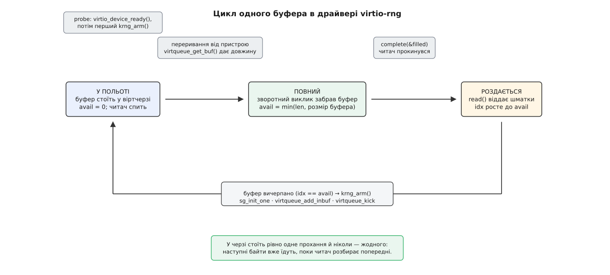

# ⚙️ Мінімальний драйвер virtio-rng

Зберемо [модуль ядра](root:sys-unix/kernel-modules), який перетворює пристрій virtio-rng на джерело для каркаса `hw_random`: дві сотні рядків разом із коментарями, одна віртчерга, один буфер. Пристрій не вміє нічого, крім «дай байтів», і саме через це на ньому видно голу механіку [віртчерг](root:sys-unix/virtio-transport) без жодного шуму від протоколу самого пристрою. А ще майже кожен неочевидний рядок тут — слід від справжньої помилки, яку колись ловили в основній гілці ядра.

## Задача

Драйвер стоїть між двома контрактами, і обидва короткі.

**Згори** — каркас `hw_random`. Від нас потрібна структура `struct hwrng` з функцією `read(rng, buf, size, wait)`: покласти в `buf` до `size` байтів і повернути, **скільки** поклали, або від'ємний код помилки. Віддати менше за прохане — не помилка, а звичайна відповідь. Прапорець `wait` каже, чи вільно чекати: потоку каркаса — вільно, а тому, хто читає `/dev/hwrng` неблокуючим дескриптором, — ні. Викликати `read()` одночасно з двох боків каркас не буде: він сам тримає їх у чергу.

**Знизу** — шина virtio. Пристрій має рівно одну віртчергу. Драйвер ставить у неї буфер, позначений як придатний **лише для запису пристроєм**, і торкає регістр сповіщення; назад в ужитому кільці приїжджає той самий буфер і одне число — скільки байтів у нього справді записали.

І є третя вимога, якої немає в жодному з контрактів, але заради якої все й робиться: байти потрібні **швидко** і з першої секунди. Драйвер, який чесно робить обмін на кожне прохання, працює правильно, але кожне читання коштує повного кола «поставив — сповістив — переривання — забрав».

## Ідея: прохання завжди в польоті

Розв'язок виходить із двох спостережень.

Перше: господар має право записати менше, ніж просили, тому `read()` однаково мусить уміти повертати короткий результат. Друге: обмін іде по одному буферу, а каркас забирає дані шматками — отже, між ними варто поставити власний невеликий буфер драйвера.

З цих двох випливає вся будова. `read()` роздає байти зі свого буфера й лічильником `idx` пам'ятає, докуди роздав. Щойно буфер вичерпано — драйвер **негайно** ставить у чергу нове прохання й тільки потім повертається до того, хто читав. Тобто наступна порція вже їде, поки читач розбирає попередню, і в черзі ніколи не буває порожньо. Через це типове читання взагалі не чекає: дані вже вдома.

Чекати доводиться лише тоді, коли прохання ще в дорозі. Для цього є `struct completion`: зворотний виклик із переривання позначає буфер повним і будить сплячого, а `read()` засинає на `wait_for_completion_killable()`.

Найперше читання після завантаження машини теж потрапляє на готове або майже готове: прохання ставить іще `probe`, і поки ядро перебирає решту шини, господар устигає на нього відповісти.

Замків у драйвері немає, і це не недогляд. Каркас не пускає два `read()` одночасно, тож із боку задачі виконавець завжди один. А з боку [переривання](root:sys-unix/interrupts-bottom-halves) працює простий поділ володіння: буфер у кожну мить або стоїть у черзі — і тоді до `avail` дотягується лише зворотний виклик, — або лежить удома, і тоді до нього дотягується лише `read()`. Межу проводить `virtqueue_get_buf()`, і саме через це `krng_arm()` обнуляє лічильники **перед** `virtqueue_add_inbuf()`: після цього виклику поля вже не наші. Лишається одна-єдина комірка, яку бачать обидва боки, — та сама `avail`, і за неї платять парою «release — acquire», а не замком.



*Стан драйвера — це два числа: скільки байтів приїхало і скільки з них уже віддано. Усе інше в цій схемі — переходи між ними.*

> 🔧 **Навіщо це.** Той самий прийом працює скрізь, де пристрій відповідає повільніше, ніж його питають: тримати одне прохання в польоті постійно дешевше, ніж починати обмін тоді, коли даних уже потребують. Тут це видно в чистому вигляді, бо прохання не має параметрів — наступне нічим не відрізняється від попереднього, і його можна поставити наперед.

## Код

:::code proj-minimal-rng-driver/c/main.c

Таблиця відповідності — один рядок: `VIRTIO_ID_RNG` (номер 4 у специфікації) і `VIRTIO_DEV_ANY_ID` замість ідентифікатора виробника. Ніяких можливостей драйвер не узгоджує, тож поля `feature_table` в нього немає взагалі.

## Збирання й перевірка

```makefile
obj-m += krng.o

KDIR ?= /lib/modules/$(shell uname -r)/build

all:
	$(MAKE) -C $(KDIR) M=$(PWD) modules
clean:
	$(MAKE) -C $(KDIR) M=$(PWD) clean
```

Пристрій у машині заводять двома частинами — бекенд і сама плата на шині:

```sh
$ qemu-system-x86_64 -m 2G -hda guest.qcow2 \
      -object rng-random,filename=/dev/urandom,id=rng0 \
      -device virtio-rng-pci,rng=rng0
```

Усередині гостя штатний драйвер треба спершу прибрати — інакше пристрій уже зайнятий ним:

```sh
$ sudo rmmod virtio_rng
$ sudo insmod krng.ko
$ cat /sys/class/misc/hw_random/rng_current
krng.0
$ cat /sys/class/misc/hw_random/rng_quality
1024
$ sudo dd if=/dev/hwrng bs=32 count=1 status=none | xxd
00000000: 3f7a 91c4 08de 2b55 e1a0 7c39 4b6d f2aa  ?z....+U..|9Km..
00000010: 5c13 8807 96be d420 71fa 3e6c 0d51 a982  \...... q.>l.Q..
```

Рядок `rng_current` — це і є доказ, що каркас узяв наше джерело; про решту того, що видно збоку, — [модель пристроїв у sysfs](root:sys-unix/sysfs-device-model).

## Пастки

**Готовність — до першого прохання, не після.** Порядок `virtio_find_single_vq()` → `virtio_device_ready()` → перше прохання виглядає формальністю, а насправді це три різні стани в регістрі стану пристрою. Доки біт `DRIVER_OK` не виставлено, господар має повне право не обслуговувати чергу — і не обслуговує. Драйвер, який ставить буфер раніше, або мовчки чекає невідомо чого, або працює лише на тому гіпервізорі, що виявився поблажливим. Це не гіпотеза: 2022 року Джейсон Ван вніс у драйвер правку з назвою рівно про це — «зробити пристрій готовим, перш ніж робити прохання».

**Реєстрація в каркасі — не з `probe`.** `hwrng_register()` може миттєво привести потік каркаса в наш `read()`. Якщо покликати її посеред `probe`, читання прийде в драйвер, який ще не добудований, — і жодного замка, який це стримав би, немає. Тому реєстрацію винесено у зворотний виклик `.scan`, який ядро virtio кличе **після** повернення з `probe`. Порядок гарантований будовою шини, а не вдалим збігом.

**Довжина з ужитого кільця — вхідні дані.** Число, яке господар кладе в ужите кільце, ніщо не перевіряє: воно приходить із-за межі гостя. Скажімо, що записано 4096 байтів у буфер на 64 — і `memcpy()` побіжить далеко за межу виділеної пам'яті. Один `min_t()` у зворотному виклику закриває це назавжди; ціна питання — рядок, ціна забудькуватості — читання чужої пам'яті ядра, кероване гіпервізором.

**Буфер, у який пише пристрій, живе окремо.** Він не має права бути на стеку — стек не годиться для [DMA](root:sys-unix/dma-and-buffers) — і не має ділити рядок кешу з полями, які драйвер міняє сам: на машинах без когерентного кешу господар і драйвер писали б в одну лінію й затирали одне одного. Тому окремий `kmalloc()` (він вирівнює під DMA) і розмір не менший за `SMP_CACHE_BYTES`.

**Зняти реєстрацію — перед скиданням пристрою.** `virtio_reset_device()` зупиняє чергу; після цього поставлений буфер уже ніколи не повернеться. Якщо джерело в цей момент ще зареєстроване, потік каркаса цілком може спати в нашому `wait_for_completion_killable()` — і спатиме до кінця світу, бо будити його вже нікому. Звідси порядок у `krng_remove()`: прапорець «пристрою немає», `complete()` для сплячого, `hwrng_unregister()` і аж потім скидання. Правку з такою самою назвою — «знімати реєстрацію перед скиданням пристрою» — вносили в драйвер окремим патчем: до неї від'єднання зайнятого пристрою вішало того, хто читав.

**Публікувати довжину, а не байти.** Зворотний виклик пише `avail` через `smp_store_release()`, читач бере його через `smp_load_acquire()` — і не тому, що так гарніше. Байти в буфер поклав пристрій, і без цієї пари процесор читача має право побачити нове значення `avail` раніше за самі дані; віддали б тоді не випадковість, а сміття з попереднього обміну. Гонку саме такого роду в драйвері закрили 2023 року — правка Герберта Сюя називалася «гонка між `data_avail` і власне даними».

**Сон по пам'ять — лише з контексту задачі.** Постановка буфера просить пам'ять під дескриптори віртчерги, і просить її сном — `GFP_KERNEL`. Це правильно рівно доти, доки `krng_arm()` кличуть тільки з контексту задачі: з `probe` і зсередини `read()`. Спокуса поставити наступне прохання просто у зворотному виклику виглядає природно — буфер щойно приїхав, черга вільна, — але зворотний виклик іде в контексті переривання, де спати не можна, і драйвер завалить машину на першому ж голодному виділенні пам'яті. Це загальна межа, а не особливість virtio: [де саме в ядрі спати заборонено](root:sys-unix/kernel-locking).

**Знімок і пробудження.** Наш драйвер свідомо не має `.freeze` і `.restore`. Справжній їх має, і причина проста: приспана машина скидає пристрій, тож поставлений буфер після пробудження не повернеться ніколи, а зареєстроване джерело лишиться. Тому реальний virtio-rng на `.freeze` розбирає все так само, як на відв'язуванні, а на `.restore` збирає наново — з новою чергою й новим першим проханням.

**Мовчазний штиль.** Прохання в черзі мусить бути завжди — і це не оптимізація, а умова живучості. Якщо `krng_arm()` не покликати після спорожнення буфера, наступний читач засне на `completion`, якого вже ніхто не завершить: переривання не прийде, бо ніхто нічого не просив. Тому постановка нового прохання стоїть усередині `krng_drain()`, поряд із самим спорожненням, а не в кінці `read()`, звідки її легко винести разом із раннім `return`.
