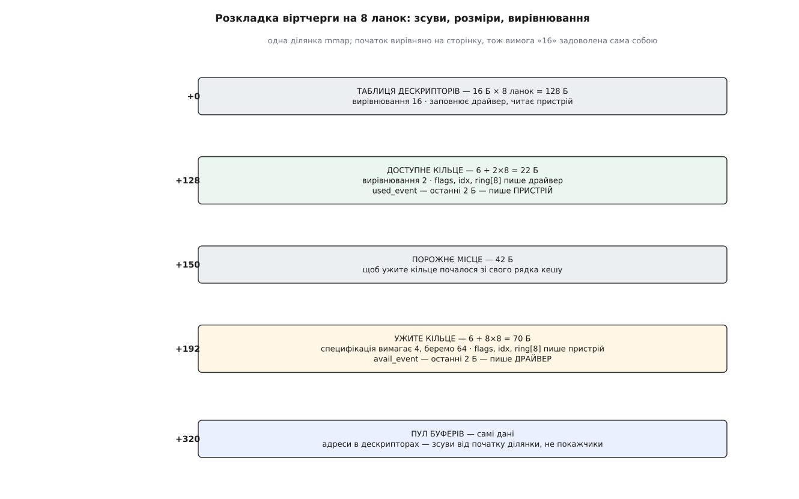
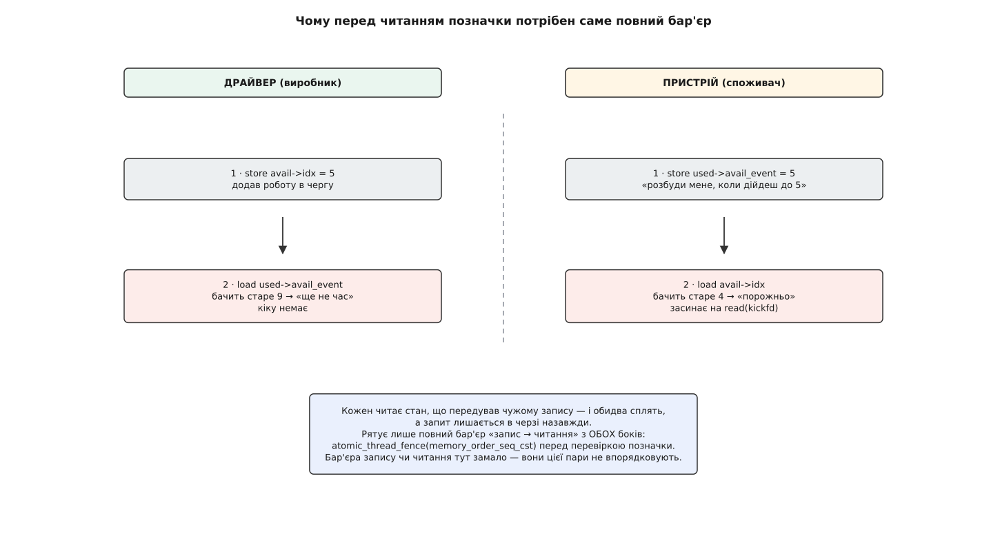

# ⚙️ Пройти віртчергу руками

Складімо обидва боки розділеної віртчерги — того, хто дає роботу, і того, хто її виконує — в одній програмі на C над спільною ділянкою пам'яті, без жодного ядерного інтерфейсу: це найдешевший спосіб побачити на власні очі, що весь контракт virtio справді зводиться до розкладки байтів плюс одного сигналу «глянь туди».

## Задача

Один потік грає драйвера, другий — пристрій. Спільного в них — ділянка пам'яті й два дескриптори [eventfd](root:sys-unix/eventfd-and-futex) (лічильник у ядрі, який один бік збільшує записом, а другий чекає на ньому читанням): перший заміняє кік у регістр, другий — переривання. Драйвер складає прохання з трьох ланок — заголовок, який пристрій лише читає, тіло, у яке пристрій пише, і байт статусу, — публікує його, забирає відповідь і повертає ланки в обіг. Пристрій прокидається, обходить ланцюг, виконує роботу просто в чужих буферах і звітує.

Ніякої піддавки тут немає: правила ті самі, за якими розмовляють гостьове ядро й `vhost` у ядрі господаря — [контрактові байдуже, хто саме обслуговує чергу](root:sys-unix/vhost-and-vdpa) (обробку можна винести в ядро господаря, в окремий процес або взагалі в кремній мережевої карти). Мірило успіху жорстке: зібрана з `-O2` програма крутиться на двох ядрах і не губить жодного запиту.

## Ідея

Два потоки одного процесу бачать спільну пам'ять точнісінько так само, як гість і господар, — через ту саму когерентність кешів, з тими самими правами на перестановку записів. Тож ділянку можна взяти найпростішу, `mmap` з `MAP_SHARED | MAP_ANONYMOUS`; щоб розвести боки по різних процесах, вистачить `fork` або [спільної пам'яті POSIX](root:sys-unix/posix-shared-memory).

Одну річ, однак, підробляти не можна. Пристрій не сидить у чужому просторі адрес: у дескрипторах лежать адреси в **його** системі координат, і кожну він мусить перекласти й перевірити. Тому в нашому коді `addr` — це зсув від початку ділянки, а не покажчик, і всі звертання йдуть через `xlate()` з перевіркою меж. Бекенд, який довіряє чужій адресі, віддає власний простір пам'яті тому, кого обслуговує.

## Три області, зсуви й вирівнювання

Розміри й вирівнювання беремо не зі `sizeof`, а з таблиці специфікації virtio 1.2 (§2.7): таблиця дескрипторів — 16 байтів на ланку з вирівнюванням 16, доступне кільце — 6 + 2·N з вирівнюванням 2, ужите — 6 + 8·N з вирівнюванням 4. Шістка в обох формулах — це `flags`, `idx` і поле-позначка наприкінці кільця, тож `used_event` і `avail_event` уже враховані.

*Специфікація вимагає для ужитого кільця вирівнювання 4; ми беремо 64 — і далі видно, чому.*

:::code proj-ring-walk/c/vqwalk.c

Зверніть увагу на `USED_OFF`: специфікації вистачило б чотирьох байтів вирівнювання, і тоді ужите кільце почалося б одразу після доступного, у тому самому рядку кешу. Але доступне кільце пише драйвер, а ужите — пристрій, і рядок почав би ходити між ядрами на кожному запиті — [хибне спільне використання](root:hw-arch/false-sharing) в чистому вигляді. Тому округлюємо до 64. І ще одна дрібниця з тієї ж родини: `sizeof(struct vring_used)` дорівнює 72, а не 70, бо компілятор доповнює структуру до свого вирівнювання, — розмір області треба брати з формули, інакше на щільнішій розкладці все з'їде.

## Бік драйвера: ланцюг, публікація, кік

Вільні ланки не потребують окремого масиву: вони лежать у самій таблиці, зшиті полем `next`. Ланцюг прохання будується просто проходом по цьому списку — і саме тому `next` у ланцюгу ніде не переписується, він уже вказує куди треба.

:::code proj-ring-walk/c/bik-draivera-lantsiuh.c

Порядок у `vq_add` не переставляється навіть подумки. Спершу заповнені ланки, потім номер голови в кільце, потім бар'єр — і аж тоді новий `idx`. Індекс тут відіграє роль публікації: доти, доки він старий, усе написане вище для пристрою просто не існує, а щойно він виріс — мусить існувати цілком.

## Бік драйвера: забрати відповідь і повернути ланки

:::code proj-ring-walk/c/bik-draivera-zabraty.c

## Бік пристрою

:::code proj-ring-walk/c/bik-prystroiu.c

Обидва боки виявилися дзеркальними — і це не збіг, а наслідок правила «одне поле — один письменник»: виробник публікує індексом, споживач читає індекс і лише потім дані, кожен замовляє собі пробудження у своєму кільці.

## Збірка й прогін

:::code proj-ring-walk/c/zbirka-i-prohin.c

## Пастки

**Бар'єр, який зникає під `-O2`.** Якби поля кілець були звичайними `uint16_t`, компілятор мав би повне право винести читання `idx` із циклу очікування — і потік крутився б навколо значення, узятого один раз. Порятунок `asm volatile("" ::: "memory")` лікує лише компілятор, а не процесор, і на x86-64 помилка сховається: там записи й так не переставляються між собою. Проявиться вона на ARM, у продакшні, під навантаженням. `_Atomic` з `memory_order_relaxed` — це рівно те, чим у ядрі є `READ_ONCE`/`WRITE_ONCE`: доступ, який не можна ні викинути, ні розділити; впорядкування додає окремий [бар'єр](root:sf-tasks/memory-ordering-barriers).

**Загублене пробудження.** Найпідступніша з гонитв ховається не в даних, а в парі «замовив сповіщення — перевірив, чи є робота». Обидва боки роблять запис і зразу читання чужого запису, і саме цю пару — «запис, потім читання» — жоден бар'єр запису чи читання не впорядковує.

*Класична пастка «запис → читання»: без повного бар'єра з обох боків програма зупиняється намертво, і виглядає це як зависання пристрою.*

Другий шар захисту — повторна перевірка після запису позначки: обидва боки, замовивши сповіщення, ще раз дивляться на чужий індекс і засинають, тільки якщо він і досі старий.

**Гонитва «прочитав `idx` — прочитав ланку».** Дзеркало публікації. Побачити новий індекс і піти за номером голови без бар'єра читання — значить мати шанс дістати ланку зі сміттям минулого прохання: адреса стара, довжина нова. Пристрій слухняно пише 256 байтів кудись, куди права вже не давали.

**Переповнення кільця.** У доступному кільці рівно `QSZ` місць, і позиція береться як `idx & QMASK`. Опублікувати `QSZ + 1` прохання, не дочекавшись відповідей, — значить затерти запис, який пристрій ще не прочитав. Стримує це не перевірка кільця, а список вільних ланок: на кожне прохання йде щонайменше одна ланка, ланок усього `QSZ`, тому умова `num_free >= n` сама тримає кількість неопрацьованих прохань у межах. Ось чому в `vq_add` немає окремої перевірки на «кільце повне» — вона була б другим замком на ті самі двері.

**`id` — це номер голови, а не позиція в кільці.** Спокуса написати в `used->ring[…].id` значення `ui` (або `last_avail`) величезна: у простих прогонах вони часто збігаються. Розбіжаться вони рівно тоді, коли пристрій відповість не в тому порядку, у якому отримав, — і тоді драйвер поверне в список вільних чужий ланцюг. Той самий дескриптор опиниться у списку двічі, наступне прохання побудує ланцюг сам на себе, і `serve_chain` упреться в лічильник `hops`. Без цього лічильника пристрій просто зациклився б — тому обмеження довжини ланцюга розміром таблиці для бекенда обов'язкове, а не бажане.

**Переписаний `next`.** Будуючи ланцюг, страшенно кортить дописати в кожну ланку `dsc->next = наступна` — так наче поле саме про це й просить. Але `next` уже несе службу: він тримає список вільних ланок, і ланцюг просто йде по ньому. Варто його переписати — і хвіст ланцюга почне вказувати всередину самого ланцюга; `free_chain` після відповіді зациклиться або поверне у вільні лише частину ланок. Тече це повільно, по одній ланці на прохання, і виглядає як «черга з часом стає повільнішою». Ядро Linux будує ланцюг точно так само — проходом по вільному списку без запису `next`.

**Ширина `id`.** У `struct vring_used_elem` поле `id` — 32-бітне, хоча номер ланки не перевищує розміру черги й усередині драйвера ходить як `uint16_t`. Отже, той бік має де покласти будь-яке значення, і не завжди зі злого наміру: бекенд, що заповнив лише молодшу половину слова, віддасть у старшій те, що там лежало. Тому в `vq_get` стоїть перевірка `id >= QSZ` перед тим, як число стане номером ланки. Драйвер не зобов'язаний вірити тому, хто його обслуговує, — надто коли на тому кінці чужий процес або окрема плата.

**Порядок байтів.** У нашій вправі обидва боки — та сама машина, тож питання не постає. У справжньому virtio 1.x усі поля кілець — молодшим байтом уперед незалежно від того, на чому працює гість; спадкові пристрої до 1.0 вживали порядок байтів гостя, і саме на цьому ловляться бекенди, написані «за пам'яттю» на s390x.

## Скільки це коштує

На одне прохання припадає `n` записів по 16 байтів, один запис у доступне кільце й один в ужите — тобто час лінійний за довжиною ланцюга, без жодного виділення пам'яті та жодного замка. Синхронізації рівно чотири бар'єри на ходку. Перетинів межі — нуль, коли обидва боки зайняті: `vring_need_event` мовчить, поки споживач крутиться в циклі, і саме тому [кільце](root:sf-algorithms/ring-buffer) виграє в емуляції регістрів не на один порядок.

Половину помилок x86-64 сховає: сильна модель пам'яті цієї машини сама впорядковує записи між собою й читання між собою, тож вирізані бар'єри публікації та читання на ній не проявляться ніколи. Справжній прогін для них — на aarch64, де переставляння видно неозброєним оком, плюс збірка з `-fsanitize=thread`, яка ловить недописані бар'єри як гонитву. А от повний бар'єр перед перевіркою позначки не безкоштовний і на x86: саме пару «запис, потім читання» ця машина переставляє через буфер запису, тож без нього прогін зависає на обох архітектурах. Найкорисніша вправа — прибирати бар'єри по одному й дивитися, за скільки кругів усе розсиплеться: `release` і `acquire` на x86 не розсиплються ніколи, на ARM — за секунди, а `seq_cst` розсиплеться скрізь.
